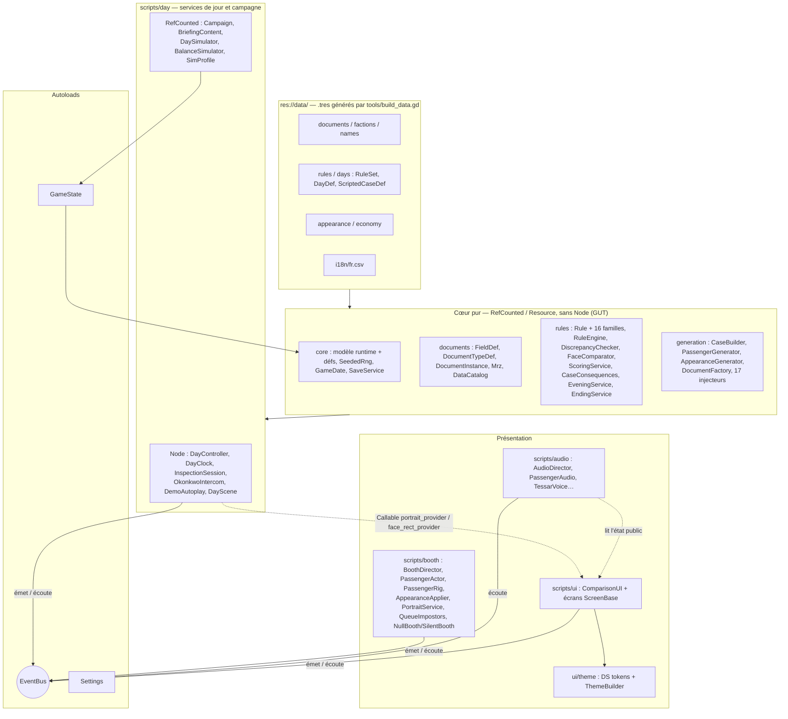
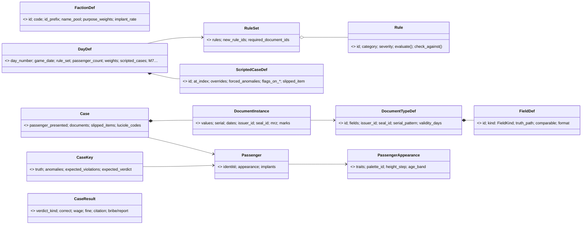
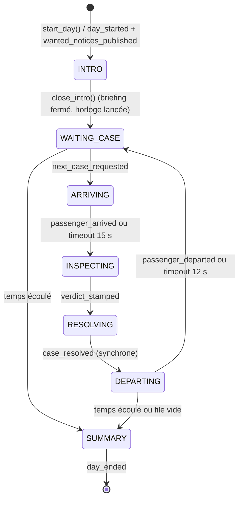

# ARCHITECTURE — CLEARANCE

> Propriétaire : **Godot Architect** · Statut : 🟢 validé par le client · Cible : **Godot 4.7.2**, GDScript typé, renderer Forward+
>
> Documents liés : [`AGENTS.md`](../AGENTS.md) · [`DECISIONS.md`](../DECISIONS.md) · [`DESIGN_SYSTEM.md`](../DESIGN_SYSTEM.md) · [`docs/UI_FLOW.md`](UI_FLOW.md) · [`docs/BOOTH_SCENE.md`](BOOTH_SCENE.md) (visuel du guichet, 3D Designer) · [`docs/ASSETS.md`](ASSETS.md) (rigs, clips, atlas, licences) · [`docs/AUDIO.md`](AUDIO.md) (Audio Designer) · [`docs/NARRATIVE.md`](NARRATIVE.md) (Scénariste)
>
> **Révision 3.1** (2026-10-28, corrections de la passe QA — `docs/QA.md`) : R18, R23, R25 résolus ; §4 (réglages de session), §5 (noms réservés, dates « année seule », symboles), §6.3 (signalement du code 1), §10 (sauvegarde atomique, borne du jour, version), §15 (`qa_boot.gd`), §16.4 (filtres d'export).
>
> **Révision 3** (2026-10-27, passe documentaire après M7 — jeu complet J1–J10, 414 tests GUT) : le document décrit désormais **le code réel**. Les notes « Implémenté en Mx » des révisions précédentes ont été fondues dans les sections concernées. Sections réécrites : §2–§14 ; **nouvelles** : §15 « Outils et pipelines », §16 « Export et distribution ». La numérotation §1–§14 est conservée (renvois des autres documents).
>
> **Légende** : sans mention = **état réel** (vérifié dans le code). 🎯 **Intention** = prévu mais non implémenté (ou implémenté autrement, l'écart est alors décrit). ⚠️ = incohérence connue, à corriger dans le code (liste en §13).

---

## 1. Principes directeurs

| # | Principe | Conséquence concrète |
|---|---|---|
| P1 | **Données plutôt que code** | Documents, champs, origines, règles, jours, économie, apparences, cas scénarisés, briefings, soirées = Resources `.tres` dans `res://data/`, **produites par `tools/build_data.gd`** (D-029). Ajouter une règle d'une famille existante ou un jour ne demande aucun code de jeu. |
| P2 | **Le cœur ne connaît pas l'UI** | `scripts/core|documents|rules|generation` n'étendent jamais `Node`/`Control`, ne chargent aucune scène, n'accèdent à aucun autoload (vérifié : aucune référence hors commentaires). Ils tournent en headless → testables par GUT. |
| P3 | **Vérité terrain** | Chaque cas est généré valide puis corrompu de façon contrôlée ; la réponse attendue est **recalculée par le `RuleEngine`** sur le cas final (§6). |
| P4 | **Déterminisme** | Toute aléa logique passe par un `SeededRng` (SplitMix64 maison). Même graine ⇒ même cas, bit à bit (`CaseSerializer`). Les seuls `RandomNumberGenerator` libres sont cosmétiques (audio, clignements), eux aussi seedés. |
| P5 | **Communication par signaux** | Logique ↔ UI ↔ 3D via l'autoload `EventBus` (§7). Exceptions documentées : deux `Callable` injectés dans l'UI (D-038) et la lecture directe de `ComparisonUI` par l'`AudioDirector` (§8 bis.8). |
| P6 | **Autoloads minimaux** | 3 autoloads (`EventBus`, `Settings`, `GameState`). Services de jour, booth, audio, portraits = nœuds de `day.tscn`, remplaçables et testables. |
| P7 | **Un script = une responsabilité** | Pas de « GameManager ». ⚠️ Deux scripts dépassent largement le seuil d'alerte : `BoothDirector` (≈ 700 lignes) et `ComparisonUI` (≈ 1 400 lignes) — §13 R19. |
| P8 | **La logique ne dépend pas de l'animation** | Le jour avance même si une animation ne rend jamais la main : watchdogs du booth + timeouts du `DayController` ; `NullBooth`/`SilentBooth` en test (§8 bis.6). |

---

## 2. Vue d'ensemble des couches



**Règle de dépendance** : `CORE` ne référence ni `scripts/day`, ni les autoloads, ni la présentation. `Campaign` (RefCounted, `scripts/day/`) est la seule couche statique qui manipule `GameState` et `SaveService` ensemble. L'UI et le booth ne reçoivent que des objets « présentés » (`Case`, `DocumentInstance`, `CaseResult` après verdict), **jamais `CaseKey`** (gardée par `DayController`).

**Règle du booth** : `PassengerActor` ne connaît **ni l'EventBus ni `Case`** — API impérative (`assign`, `apply_appearance`, `apply_markings`, `walk_to_desk`, `present_documents`, `play_reaction`, `remove_visor`, `leave_along`, `set_look_target`, `set_expression`, `release`) et signaux **locaux**. `BoothDirector` est le **seul** nœud 3D branché sur l'EventBus. `AudioDirector` ajoute un `PassengerAudio` à chaque acteur sans modifier le booth.

---

## 3. Arborescence `res://` (état réel)

```
res://
├── project.godot               # autoloads, actions d'entrée, avertissements de typage (Godot Architect)
├── icon.svg                    # seule icône (pas encore de .ico/.icns, §16)
├── default_bus_layout.tres     # bus audio, GÉNÉRÉ par tools/build_audio.gd (D-049)
├── .gutconfig.json             # tests/unit + tests/integration, préfixe test_
├── addons/gut/                 # GUT 9.7.1 — VERSIONNÉ (D-008)
├── art_src/                    # sources d'art, .gdignore (invisible pour Godot, jamais exporté)
│   ├── kenney_skins/           # 8 skins Kenney CC0 versionnées (entrée de build_passenger_skins)
│   └── downloads/              # packs bruts (fetch_assets.sh) + _audio_build/ — IGNORÉ par git
├── assets/                     # ressources importées et versionnées (licences : docs/ASSETS.md §10)
│   ├── audio/                  # ambience/, music/ (OGG), sfx/{passenger,booth,station}/, ui/, voice/pa/ (WAV) — générés (§15)
│   ├── fonts/                  # Chakra Petch, Inter, JetBrains Mono (+ OFL-*.txt)
│   ├── models/passenger/       # chr_kenney_medium.fbx, anim_ual1_standard.glb, bonemap_*.tres,
│   │                           # passenger_anims.res, imp_silhouette.res (générés), License_*.txt
│   ├── shaders/                # booth_glass, rain_sheet, impostor_silhouette, chr_toon, passenger_body, face_dither, ui_backdrop_blur
│   ├── textures/passenger/     # tex_chr_zones_<skin>.png (générés)
│   └── icons/, materials/      # vides (icônes UI dessinées en code : UiIcon)
├── data/                       # CONTENU (.tres générés, sauf i18n)
│   ├── documents/              # doc_id_card, doc_entry_permit, doc_bioscan, doc_mil_waiver
│   ├── factions/               # faction_{tyc,hal,ter,cer,thr,drv}.tres
│   ├── names/                  # namepool_<faction>.tres
│   ├── rules/                  # 22 rule_*.tres (§6)
│   ├── days/                   # day_01..10.tres (DayDef) + ruleset_day_01..10.tres
│   ├── appearance/             # appearance_catalog.tres (10 slots en sous-ressources, pas de slot_*.tres)
│   ├── economy/                # economy.tres (EconomyDef)
│   └── i18n/                   # fr.csv (+ .import ; fr.fr.translation généré, ignoré par git, D-040)
├── scenes/
│   ├── main/                   # main.tscn + main.gd (titre), day.tscn (DayScene)
│   ├── booth/                  # booth.tscn — GÉNÉRÉ par tools/build_booth_greybox.gd
│   ├── passenger/              # passenger_actor.tscn ; passenger_demo.tscn (bac à sable / captures)
│   ├── ui/                     # comparison_ui.tscn ; comparison_ui_demo.tscn (bac à sable)
│   └── documents/              # vide : DocumentView générique construite en code
├── scripts/
│   ├── autoload/               # event_bus.gd, settings.gd, game_state.gd
│   ├── core/                   # modèle runtime, Resources de définition, SeededRng, GameDate, SaveService, Household…
│   ├── documents/              # FieldDef, DocumentTypeDef, DocumentInstance, FieldRef, FieldValue, Mrz, DataCatalog
│   ├── rules/                  # Rule, families/ (16), RuleSet, RuleEngine, RuleContext, DiscrepancyChecker,
│   │                           # FaceComparator, ScoringService, CaseConsequences, EveningService, EndingService…
│   ├── generation/             # CaseBuilder, PassengerGenerator, AppearanceGenerator/Roster, DocumentFactory,
│   │                           # CaseSerializer, NamePool, ScriptedCaseDef, injectors/ (17 + registre + état)
│   ├── day/                    # DayController, DayClock, InspectionSession, DayScene, Campaign, BriefingContent,
│   │                           # OkonkwoIntercom, DemoAutoplay, DaySimulator, BalanceSimulator, SimProfile
│   ├── booth/                  # BoothDirector, PassengerActor/Rig/Locomotion/Anims, AppearanceApplier, ExpressionController,
│   │                           # FaceAtlas, HeadScaleModifier, ImplantDecor, GreyboxStyle, PortraitService, QueueImpostors,
│   │                           # NullBooth, SilentBooth, PassengerDemo
│   ├── audio/                  # AudioDirector, AudioBuses, AudioCueBank, AudioDsp, PassengerAudio, TessarVoice, VoicePool
│   └── ui/                     # ComparisonUI, Workbench, DocumentView, RulebookPanel, écrans (ScreenBase)…, UiText, UiIcon
├── ui/theme/                   # tokens.gd (class_name DS), theme_builder.gd (D-025) — rien d'autre
├── tests/
│   ├── unit/                   # 35 suites (347 tests)
│   ├── integration/            # 9 suites (67 tests)
│   ├── helpers/                # case_factory.gd, day_harness.gd, generation_fixtures.gd (preload, pas de class_name)
│   └── manual/                 # vide (🎯 booth_sandbox jamais créé : remplacé par les scènes *_demo)
├── tools/                      # générateurs et outils headless (§15)
└── docs/                       # documentation + mockups/ (PNG importés : à exclure de l'export, §16)
```

- **`scripts/day/`** mélange des `Node` (services de la scène de jour) et des `RefCounted` statiques (campagne, simulateurs) : ils partagent le même domaine (le jour / la campagne) et dépendent tous de `GameState` ou de services de jour, donc ni de `core` ni de `ui`.
- **`scripts/booth/`** : scripts 3D (ni `Control`, ni cœur headless). `NullBooth`/`SilentBooth` y vivent car ils servent aussi au mode `--no-booth`.
- **`res://ui/`** ne contient que `theme/` (R10 résolu).
- Fichiers générés versionnés : `*.import`, `*.uid` (D-027), `.tres` de `data/`, `booth.tscn`, assets audio et passager. Ignorés : `.godot/`, `*.translation`, `art_src/downloads/`, `export_presets.cfg` (⚠️ §16).

---

## 4. Autoloads

Déclarés dans `project.godot`, dans cet ordre (pas de `class_name` sur un autoload) :

```ini
[autoload]
EventBus="*res://scripts/autoload/event_bus.gd"
Settings="*res://scripts/autoload/settings.gd"
GameState="*res://scripts/autoload/game_state.gd"
```

| Autoload | Rôle (état réel) | Ne fait PAS |
|---|---|---|
| `EventBus` | 31 signaux typés (catalogue §7). Aucun état, aucune méthode. | Logique, stockage |
| `Settings` | Préférences dans `user://settings.cfg` (`ConfigFile`) : `volume_{master,music,ambience,sfx,voice,ui}` (appliqués aux bus `Master/Music/Ambience/SFX/Voice/UI`), `fx_intensity` (1 / 0,5 / 0), `reduce_motion`, `text_scale` (0,9–1,5, D-026), `subtitles`, `clock_slow_accessibility` (horloge ×0,5), `audio_mono`. `set_value()` valide (`_sanitize`), applique et émet `settings_changed` (choix du joueur, persisté ; `persist = false` diffère seulement l'écriture). **Valeurs de session** (QA-006) : `set_session_value()` / `clear_session_value()` (argument `--reduce-motion`, outils, tests) appliquent sans jamais écrire — `save_settings()` écrit pour ces clés la dernière valeur persistée. `use_storage(path)` change de fichier : la suite GUT utilise `user://test_settings/settings.cfg` (crochet `tests/helpers/gut_pre_run.gd`, `.gutconfig.json`). 🎯 Langue, daltonisme, sensibilité manette : non implémentés. | État de partie |
| `GameState` | État de **campagne** : `campaign_seed`, `current_day`, `credits`, `score_total`, `citations`, `narrative_flags: Dictionary[StringName, Variant]` (drapeaux et jauges `loyalty` / `lucioles_trust` / `suspicion`), `day_history: Array[Dictionary]`, `household: Household`, `case_memory` (§9.4). `to_save_dict()` / `apply_save_dict()` / `save_to_slot()` / `load_from_slot()` (§10), `get_day_seed()`, `add_to_flag()`, `get_true_flags()`, `remember_case()`. Émet `credits_changed`, `narrative_flag_changed`, `game_saved`, `game_loaded`. | État du jour en cours (porté par `DayController`) |

`EventBus` est chargé en premier : les autres s'y connectent dans `_ready`.

---

## 5. Modèle de données

### 5.1 Vue d'ensemble



### 5.2 Définitions (Resources, `res://data/`)

| Classe | Script | Champs principaux (état réel) | Notes |
|---|---|---|---|
| `FieldDef` | `documents/field_def.gd` | `id`, `label_key`, `kind: FieldKind` (`TEXT, DATE, ID_CODE, ENUM, PORTRAIT, NUMBER, BOOL, LIST`), `truth_path`, `comparable`, `display_order`, `format` | `truth_path` = propriété de `Passenger` (`Passenger.TRUTH_PATHS`) ou `document.<prop>` (`serial`, `issue_date`, `expiry_date`, `issuer_id`, `seal_id`, `mrz`) résolue par `DocumentInstance.get_value()`. `LIST` = `PackedStringArray` (implants). |
| `DocumentTypeDef` | `documents/document_type_def.gd` | `id`, `title_key`, `fields`, `issuer_faction_ids`, `validity_days: Vector2i`, `holo_tint_token` (token `DS`), `issuer_id`, `seal_id`, `serial_pattern` | 4 types : `id_card` (dont `implants`, `seal`, `mrz`), `entry_permit`, `bioscan`, `mil_waiver`. ⚠️ `view_scene` n'est ni rempli ni lu (vue générique `DocumentView`). |
| `FactionDef` | `core/faction_def.gd` | `id`, `name_key`, `code`, `id_prefix`, `origin_sectors`, `name_pool`, `citizen_class_weights`, `purpose_weights`, `employers`, `implant_rate`, `implant_weights`, `year_only_birth_rate` (DRV 0,5 : naissances `00.00.AAAA`, §9.2) | 6 origines : TYC, HAL, TER, CER, THR, DRV. ⚠️ `seal_texture` non rempli, non lu. |
| `NamePool` | `generation/name_pool.gd` | `given_names_f/m/x`, `family_names`, `reserved_names` (jamais tirés : Okonkwo, noms de famille distinctifs des personnages, prénoms du foyer), `reserved_full_names` (« Prénom Nom » des personnages scénarisés et des avis : prénom remplacé sans tirage, `avoid_reserved_full_name`) | Une par origine. Listes réservées **calculées** par `build_data.gd` depuis les `DayDef` (QA-002). |
| `Rule` (abstraite) | `rules/rule.gd` | `id`, `title_key`, `rulebook_text_key`, `category` (`DOCUMENTS, IDENTITY, FACTION, PURPOSE, SPECIAL`), `severity` 1–3 | §6. |
| `RuleSet` | `rules/rule_set.gd` | `id`, `rules`, `new_rule_ids` (badge « NOUVEAU »), `required_document_ids` | Liste **explicite et cumulative** par jour (pas d'héritage). Règles partagées entre RuleSets, **jamais mutées**. |
| `DayDef` | `core/day_def.gd` | `day_number`, `game_date`, `rule_set`, `duration_sec`, `passenger_count`, `anomaly_count_weights`, `anomaly_weights: Dictionary[AnomalyType.Kind, float]`, `scripted_cases`, `intro_text_key`, `credit_per_correct`, `penalty_per_error` ; GDD : `faction_weights`, `visor_down_rate`, `legit_noise_rate`, `bribe_rate`, `luciole_rate`, `free_citations_per_day`, `penalty_escalated` ; M7 : `detain_enabled`, `has_evening`, `bribe_amounts`, `wanted_notices`, `briefing_messages`, `evening_events`, `hall_announcements: Dictionary[int, String]`, `rulebook_tabs` | J1–J10 : 8→16 passagers, 540→720 s ; DÉTENTION dès J7 ; pas de soirée au J10. |
| `ScriptedCaseDef` | `generation/scripted_case_def.gd` | `id`, `at_index`, `passenger_overrides`, `appearance_overrides`, `forced_anomalies` (liste exacte), `injection_params`, `dialogue_id`, `sets_flag`, `requires_flag`, `flags_on_approve/deny` ; M7 : `flags_on_detain`, `flags_if_unprocessed`, `extra_effects: Array[CaseEffectDef]`, `forbids_flags`, `appearance_from_case`, `identity_from_case`, `truth_overrides`, `extra_documents`, `slipped_item: SlippedItemDef`, `luciole_codes`, `extra_tags` | SC-01 → SC-22 + tutoriels J1, saisis dans les `DayDef`. |
| `AppearanceCatalog` | `core/appearance_catalog.gd` | `slots`, `min_distance` (5), `window_size` (15), `max_attempts` (12), `age_band_weights`, `height_step_range` | Slots : `silhouette, face, eyes, nose_mouth, skin, hair, headwear, outfit, accessory, palette`. Coiffes `visor_down/visor_up` de poids 0. |
| `AppearanceSlotDef` / `AppearanceOptionDef` | `core/appearance_*.gd` | slot : `id`, `identity`, `visible_in_portrait`, `options` ; option : `id`, `weight`, `faction_weights`, `tags` | Le rendu est déduit des **identifiants** (`AppearanceApplier` + `GreyboxStyle`). ⚠️ Les champs visuels `mesh`, `atlas_cell`, `material`, `portrait_layer` ne sont ni remplis ni lus. |
| `EconomyDef` | `core/economy_def.gd` | loyer / taxe d'air (et hausses datées), nourriture, chauffage, oxygène, soins, règles de santé du foyer, expulsion, `detain_bonus`, `report_bonus`, seuils d'audit, seuils F4/F6 | `data/economy/economy.tres` (D-044, D-047, D-059). |
| `SlippedItemDef` | `core/slipped_item_def.gd` | `kind`, `amount`, `label_key`, `text_key`, `extra_text_keys`, `allowed`, `default_decision`, `report_bonus`, `effects` | Objets glissés des cas scénarisés (D-054). |
| `WantedNoticeDef` | `core/wanted_notice_def.gd` | `id`, `scripted_case_id` ou `at_index`, noms, `reason_key` | Avis liés à des passagers du jour (D-056). |
| `BriefingMessageDef` | `core/briefing_message_def.gd` | `speaker_key`, `text_key`, `voice`, `condition`, `group`, `family_slot`, `priority` | Table conditionnelle (≤ 4 messages / jour). |
| `EveningEventDef` / `EveningOptionDef` | `core/evening_*_def.gd` | événement : `id`, `kind`, `order`, `condition`, textes, `options`, `flags`, `line_costs` ; option : `id`, `label_key`, `result_key`, `cost`, `gain`, `requires_funds`, `flags`, `line_costs`, `household`, `condition`, `default_rank` | Soirées J4–J9 (D-058, D-061). |
| `FlagCondition`, `ConditionalKey`, `CaseEffectDef` | `core/` | `all_of`, `any_of`, `none_of`, `gauges_min/max` ; clé conditionnelle ; effet `verdict × condition → flags` | Conditions narratives réutilisées partout. |

### 5.3 Objets runtime (RefCounted)

| Classe | Rôle | Champs principaux |
|---|---|---|
| `Passenger` | Identité (vraie ou présentée) | `id`, `given_name`, `family_name`, `birth_date`, `sex`, `faction_id`, `origin_sector`, `citizen_id`, `citizen_class`, `appearance_seed`, `appearance`, `purpose`, `stay_days`, `employer`, `health_status`, `implants` (visibles sur le corps) ; `TRUTH_PATHS`, `copy()`, `apply_overrides()` |
| `PassengerAppearance` | Apparence modulaire, **pure** (identifiants seulement) | `traits`, `palette_id`, `height_step` (−2..+2), `age_band` ; `distance()`, `derive()`, `copy()`, `serialize()`, `is_face_covered()`, `without_visor()` |
| `PortraitValue` | Valeur d'un champ `PORTRAIT` | `appearance` (la personne sur la photo), `photo_seed`, `years_before_issue` |
| `DocumentInstance` | Document tendu | `type_def`, `serial`, `issue_date`, `expiry_date`, `issuer_id`, `seal_id`, `mrz` (bande `Mrz`), `marks` (`&"luciole"`), `values` ; `get_value()` / `set_value()` / `copy()` |
| `FieldRef` | Pointeur vers un champ affiché | `document_id`, `field_id` ; pseudo-références : `passenger_face()`, `today()`, `rulebook_rule(id)`, `wanted(id)`, `symbol(id)` (bulletin « Symboles subversifs », `__symbols__`), `mark(document_id, mark_id)` (marque au coin d'un document, `mark:luciole`) |
| `Case` | **Ce que voit le joueur** | `case_id`, `index`, `case_seed`, `passenger_presented`, `documents`, `dialogue_tags`, `slipped_items`, `luciole_codes`, `presentation` (`&"knock_three"`) ; `remove_visor()`, `get_value(ref)`, `find_refs_by_*` |
| `CaseKey` | **Clé de réponse** (jamais transmise) | `truth`, `anomalies`, `expected_violations`, `expected_verdict` |
| `Anomaly` / `AnomalyType.Kind` | Corruption injectée | 17 valeurs **figées** (D-033) : `EXPIRED_DOCUMENT`… `WANTED_PERSON = 16` ; `cosmetic` |
| `Violation`, `Discrepancy`, `Verdict`, `VerdictKind` | Sorties règle / comparaison / décision | `Discrepancy.result` (`CONCORDANT, DISCORDANT, INCOMPARABLE`), `differing_traits`, `reason_key` ; `Verdict.kind` (`APPROVE, DENY, DETAIN`), `flagged`, `elapsed_sec` |
| `CaseResult` | Sortie du scoring (§8) | `verdict_kind`, `expected_verdict`, `correct`, `verdict_correct`, `documented`, `expected_violations` / `missed_violations` (révélées après verdict), `wage`, `fine`, `credits_delta`, `citation_*`, `procedure_missed`, `scripted_id`, `narrative_changes`, `item_decisions`, `bribe_credits`, `report_credits`, `password_answered`, `luciole_report` (§6.3) |
| `DaySummary` | Bilan du jour | résultats, non traités, `time_expired`, `unprocessed_changes` ; `get_wage_total()`, `get_fine_total()`, `get_net()`, `get_bribe_total()`, `get_report_total()`, `get_total_income()` |
| `RuleContext` | Contexte d'évaluation | `today`, `day_def`, `rule_set`, `faction_db`, `document_db`, `identity_slots`, `wanted` |
| `RulebookEntry` | Ligne du Rulebook | `rule_id`, `title_key`, `text_key`, `category`, `severity`, `is_new`, `ref` |
| `SlippedItem`, `WantedNotice`, `CaseMemory`, `Household`, `EveningEvent`, `EveningReport`, `ExpenseLine` | M5/M7 | objet glissé et sa décision ; avis (`get_ref()`) ; mémoire des cas scénarisés ; foyer (Ilan, Noa, Dora : santé, faim, froid, `detained`) ; soirée |
| `DataCatalog` | Chargement indexé de `res://data/` | `factions`, `documents`, `rules`, `rule_sets`, `days`, `errors` ; `load_from()`, `get_day()`, `get_economy()`, `make_context()` ; liste les fichiers par `DirAccess` et suit les `.remap` d'export (§16) |

- **Dates** : `GameDate` = entier « jours depuis 01.01.2100 » ; jamais `Time`/OS dans la logique. Date « année seule » (Dérivants, NARRATIVE §4.10) : `GameDate.year_only(AAAA)` = `YEAR_ONLY_BASE − AAAA` (hors de toute vraie date), lue `(AAAA, 0, 0)` par `to_ymd` ⇒ affichage `00.00.AAAA`, égalité par année (R07), `add_years` conservé ; `possible_ages()` = {âge − 1, âge} ; `latest_day()` = 31.12.AAAA ; `Passenger.is_birth_year_only()`. (NARRATIVE proposait 01.01.AAAA + booléen : l'encodage dans l'entier évite de propager un drapeau sur chaque champ de document.)
- **`Case` / `CaseKey` séparés** physiquement : l'UI ne peut pas tricher par erreur.
- **Invariant d'apparence** : l'acteur 3D affiche `case.passenger_presented.appearance`, toujours égale à l'apparence physique réelle ; aucun injecteur ne la modifie (seulement les `PortraitValue`). Exception assumée : la visière (état physique, posée sur la vérité *et* le présenté).

---

## 6. Moteur de règles

```gdscript
class_name Rule extends Resource   # @abstract
func evaluate(case: Case, ctx: RuleContext) -> Array[Violation]
func get_detectable_anomalies() -> Array[AnomalyType.Kind]
func check_against(case: Case, ref: FieldRef, ctx: RuleContext) -> Discrepancy.Result  # mode Inspection : règle ↔ champ
func get_required_document_ids() -> Array[StringName]
func get_referenced_truth_paths() -> Dictionary[StringName, Array]                       # validation des données
func get_rulebook_entry() -> RulebookEntry
```

- **Comportement par famille (script), paramètres par `.tres`.** Règles pures : pas d'état, pas d'aléa, pas d'arbre de scène ; contexte passé explicitement (`RuleContext`).
- **`RuleEngine`** : `validate(case, rule_set, ctx)`, `expected_verdict(violations)` — **DÉTENTION** si une violation a une sévérité ≥ 3, sinon **REFUS** s'il y en a au moins une, sinon **APPROBATION** (D-030) —, `build_case_key()`.
- **Vérité terrain** (R1 résolu) : la réponse attendue est recalculée sur le cas final ; invariants vérifiés par `CaseBuilder.check_invariants()` et par les tests : cas propre ⇒ 0 violation (8 re-tirages max), chaque anomalie prouvée par une règle active (sauf `cosmetic`), seuls les types détectables du jour sont tirés.
- **Procédures** (R06, R08) : `ProcedureRule` ne produit jamais de violation ; vérifiées par le `ScoringService` (D-031).

### 6.1 Familles (16, `scripts/rules/families/`)

| Famille | Paramètres `@export` | Règles |
|---|---|---|
| `RequireDocumentRule` | `document_id`, `exempt_faction_ids` | R01, R04, R11 |
| `DocumentNotExpiredRule` | `document_id`, `max_age_days` | R02, R05, R12 |
| `PortraitMatchRule` | `check_passenger_face`, `check_between_documents`, `max_differing_traits`, `detected_anomalies` | R03, R17 |
| `ProcedureRule` | `procedure_id`, `applies_to_faction_ids` | R06, R08 |
| `FieldsMatchRule` | `truth_paths`, `document_ids`, `detected_anomalies` | R07 |
| `PurposeConsistentRule` | `permit_id`, `card_id`, `work_purpose`, `no_employer_values`, `short_stay_*` | R09 |
| `OriginIdBlockRule` | — | R10 |
| `IssuerAllowedRule` | `document_id`, `allowed_issuer_ids` | R13 |
| `FieldValueAllowedRule` | `document_id`, `truth_path`, `allowed_values`, `detected_anomalies` | R14 |
| `ImplantsDeclaredRule` | `document_id`, `escalated_prefixes`, `escalated_from_day`, `escalated_severity` | R15 |
| `BannedImplantsRule` | `document_id`, `always_banned`, `waiver_prefixes`, `waiver_document_id` | R16 |
| `ApparentAgeRule` | `document_id` | R18 |
| `FactionBannedRule` | `banned_faction_ids`, `exempt_purposes`, `card_id`, `permit_id` | R19 |
| `SealValidRule` | — | R20 |
| `MrzConsistentRule` | `document_id` | R21 |
| `WantedRule` | `document_id` (lit `RuleContext.wanted`) | R22 |

### 6.2 Les 22 règles (`data/rules/`, introduites cumulativement)

| Jour | Règles (id, sévérité) |
|---|---|
| J1 | R01 `r_id_card_required` (2), R02 `r_id_card_valid` (2) |
| J2 | R03 `r_portrait_match` (2) |
| J3 | R04 `r_permit_required`, R05 `r_permit_valid`, R07 `r_identity_fields_match` (2) ; R06 `r_face_uncovered` (procédure, 1) |
| J4 | R08 `r_tycho_interview` (procédure, 1), R09 `r_purpose_consistent`, R10 `r_origin_block` (2) |
| J5 | R11 `r_bioscan_required`, R12 `r_bioscan_valid`, R13 `r_bioscan_issuer`, R14 `r_bioscan_fit` (2) |
| J6 | R15 `r_implants_declared` (2 ; 3 pour un `MIL-` non déclaré dès J7), R16 `r_banned_implants` (2) |
| J7 | R17 `r_identity_fraud_detain` (sosie 1–2 traits, **3**) |
| J8 | R18 `r_apparent_age` (**3**), R19 `r_tharsis_banned` (2) |
| J9 | R20 `r_seals_valid`, R21 `r_mrz_valid` (2) |
| J10 | R22 `r_wanted_detain` (**3**) |

### 6.3 Comparaison (mode Inspection)

- **`DiscrepancyChecker.check(case, a, b, ctx) -> Discrepancy`** compare ce qui est **affiché** (jamais `CaseKey`). Paires : même `truth_path` entre documents ; photo ↔ visage (`FieldRef.passenger_face()`) et photo ↔ photo ; date ↔ `FieldRef.today()` ; règle ↔ champ (`Rule.check_against`, R09, R15, R16, R19, R20, R21) ; visage ↔ `implants` (`disc_implant_mismatch`) ; visage ↔ naissance (`disc_age_mismatch`) ; MRZ ↔ N° ID / origine / nom / prénoms de la même carte (`disc_mrz_mismatch`) ; avis ↔ visage ou nom (`disc_wanted_match` / `disc_wanted_no_match`) ; marque d'un document ↔ symbole du bulletin, si l'onglet `symbols` est ouvert ce jour (J7+) ⇒ `disc_symbol_match`. Visage masqué ⇒ `INCOMPARABLE` (`disc_face_masked`). Naissance « année seule » ↔ visage : concordante si l'un des deux âges possibles est dans la tranche (`ApparentAgeRule.birth_matches_band`, zéro faux positif).
- **Signalement d'un porteur du code 1** (NARRATIVE §4.9) : DÉTENTION + `disc_symbol_match` épinglée sur un cas `luciole_codes ∋ 1` ⇒ `ScoringService.is_luciole_report` : cas correct, aucune citation ni procédure, salaire + prime de détention (`CaseResult.luciole_report`) ; `CaseConsequences.compute(…, luciole_report)` : `luciole_reported_at_booth`, `lucioles_trust −2`, `loyalty +1` une seule fois (pas de cumul avec la dénonciation générique) ; un cas scénarisé avec `flags_on_detain` (SC-13) garde ses drapeaux à la place des jauges. **L'UI doit rendre sélectionnables** la marque (`FieldRef.mark(doc, &"luciole")`) et l'entrée du bulletin (`FieldRef.symbol(&"luciole")`).
- **`FaceComparator.compare(a, b, identity_slots)`** renvoie les slots d'identité visibles en portrait qui diffèrent ; tenue, coiffe, accessoire et `age_band` ±1 ignorés. `identity_slots_of(catalog)` alimente `RuleContext.identity_slots`.

---

## 7. Catalogue des signaux `EventBus`

Source : `scripts/autoload/event_bus.gd` (31 signaux, tous typés). Convention : passé pour un fait, `*_requested` pour une intention de l'UI. Émetteurs / écouteurs **de production** relevés dans le code (les scènes de démo `comparison_ui_demo`, `passenger_demo`, `demo_booth_backdrop` émettent aussi la plupart des signaux pour simuler la logique).

| Signal | Paramètres | Émetteurs → Écouteurs (état réel) |
|---|---|---|
| **Jour** | | |
| `day_started` | `day: DayDef, rulebook: Array[RulebookEntry]` | DayController → ComparisonUI, BoothDirector (graine de la file), AudioDirector, OkonkwoIntercom |
| `day_clock_ticked` | `remaining_sec: float` | DayClock → ComparisonUI, AudioDirector (musique « tension ») |
| `day_time_expired` | — | DayClock → DayController |
| `day_ended` | `summary: DaySummary` | DayController → DayScene (sirène puis bilan), AudioDirector |
| `day_phase_changed` | `phase: DayPhase.Kind, case_id: StringName` | DayController → ComparisonUI (tampon, « Suivant »), AudioDirector, OkonkwoIntercom |
| `wanted_notices_published` | `notices: Array[WantedNotice]` | DayController (juste après `day_started`) → ComparisonUI (onglet Avis du Rulebook) |
| `hall_announced` | `text_key: String` | DayController (après le n-ième cas) → ComparisonUI (sous-titre haut-parleur), AudioDirector (carillon) |
| **Passager** | | |
| `next_case_requested` | — | ComparisonUI (« Suivant »), DemoAutoplay, DayScene (debug) → DayController (ignoré hors `WAITING_CASE`) |
| `case_presented` | `case: Case` | DayController → BoothDirector, ComparisonUI, AudioDirector, OkonkwoIntercom, NullBooth/SilentBooth |
| `passenger_arrived` | `case_id` | BoothDirector / NullBooth → DayController, AudioDirector |
| `documents_presented` | `case_id` | BoothDirector / NullBooth, **ou DayController sur timeout** → ComparisonUI, InspectionSession, DayController (objets glissés), AudioDirector, OkonkwoIntercom, DemoAutoplay, DayScene (captures) |
| `document_focused` | `doc: DocumentInstance` | ComparisonUI → ⚠️ **aucun écouteur** (prévu : télémétrie / tutoriel) |
| `passenger_reaction_triggered` | `reaction: PassengerReaction.Kind` | InspectionSession → BoothDirector, ComparisonUI, AudioDirector |
| `passenger_departed` | `case_id` | BoothDirector (guichet libéré, `ClearMark`) / NullBooth → DayController, AudioDirector |
| `inspection_target_picked` | `ref: FieldRef` | BoothDirector (clic visage) → ComparisonUI, BoothDirector (travelling visage) |
| `item_slipped` | `item: SlippedItem` | DayController (au premier `documents_presented`) → ComparisonUI, AudioDirector |
| `item_decision_requested` | `item_id, decision: SlippedItem.Decision` | ComparisonUI → DayController (ignoré hors `INSPECTING` ou si non autorisé) |
| `item_decided` | `item, decision` | DayController (décision, ou **défaut au tampon**) → ComparisonUI, AudioDirector |
| **Inspection** | | |
| `inspection_mode_changed` | `enabled: bool` | ComparisonUI, DayScene (debug) → InspectionSession, BoothDirector, AudioDirector |
| `discrepancy_check_requested` | `a: FieldRef, b: FieldRef` | ComparisonUI, DemoAutoplay → InspectionSession, AudioDirector |
| `discrepancy_checked` | `result: Discrepancy` | InspectionSession → ComparisonUI, AudioDirector, OkonkwoIntercom, DemoAutoplay |
| `interrogation_requested` | `topic: StringName` | ComparisonUI, DemoAutoplay, DayScene (debug) → InspectionSession |
| `interrogation_answered` | `topic, line_key: String` | InspectionSession → ComparisonUI (sous-titres), BoothDirector (parole, visière), AudioDirector (voix Tessar) |
| **Verdict / score** | | |
| `verdict_stamped` | `verdict: Verdict` | ComparisonUI (tampon maintenu), DemoAutoplay, DayScene (debug) → DayController, AudioDirector |
| `case_resolved` | `case_id, result: CaseResult` | DayController → ComparisonUI, BoothDirector (sortie selon `verdict_kind`), NullBooth, AudioDirector, OkonkwoIntercom |
| `citation_issued` | `reason_key: String` | DayController (après `case_resolved`) → ComparisonUI (ticket), AudioDirector, OkonkwoIntercom |
| `credits_changed` | `credits: int, delta: int` | GameState → ComparisonUI |
| **Méta** | | |
| `narrative_flag_changed` | `flag, value: Variant` | GameState → ⚠️ **aucun écouteur** (les drapeaux sont relus à la demande) |
| `settings_changed` | `key, value: Variant` | Settings → ComparisonUI, ScreenBase, PauseMenu, AudioDirector, main.gd |
| `game_saved` / `game_loaded` | `slot: int` | GameState → ⚠️ **aucun écouteur** |

**Robustesse** : tous les signaux du booth portent `case_id` ; `DayController` ignore un signal d'un autre cas ou hors de l'état attendu ; `BoothDirector._emit_once()` n'émet chaque fait qu'une fois par cas, dans l'ordre `passenger_arrived → documents_presented → passenger_departed`. Seule exception à « un émetteur par fait » : le timeout `documents_presented` du `DayController`. `document_handed` a été supprimé au profit de `documents_presented(case_id)` (D-014).

**Signaux locaux hors EventBus** (contrats de composants) : `PassengerActor` (`arrived`, `departed`, `cleared`, `anim_event`, `reaction_finished`, `face_clicked`) ; `BoothDirector` (`glass_knocked`, `escort_started`, `escort_finished`) ; `ComparisonUI` (`hovered`, `toast_shown`, `departure_line_shown`, `passenger_line_shown`) ; `PortraitService.portrait_ready` ; `AudioDirector.cue_played` ; écrans (`closed`, `finished`, `confirmed`…).

### 7.1 Contrat UI M7 — comportement réel avec et sans UI

Depuis la partie B de M7 (D-061), les comportements « par défaut » du contrat initial ne s'appliquent plus que **sans UI** : tests headless (`DayHarness`, `NullBooth`/`SilentBooth`), simulateurs (`DaySimulator`, `BalanceSimulator`, `SimProfile`) et `--no-ui`. La logique (DayController, Campaign) est identique dans les deux cas : seule la source des décisions change.

| Sujet | API logique | UI présente (`day.tscn` normal) | Sans UI (headless, simulateurs, `--no-ui`) |
|---|---|---|---|
| **Objets glissés** (enveloppe, mot, carte de quai) | `Case.slipped_items`, `SlippedItem` (`allowed`, `default_decision`, `credits_for()`), `item_slipped` / `item_decision_requested` / `item_decided` | `SlippedItemView` sur le plan de travail : GARDER / RENDRE / REMETTRE À LA GARDE, modifiable jusqu'au tampon ; réplique de pot-de-vin sous-titrée, sujet `about_envelope`. Un objet non tranché reçoit **quand même** la décision par défaut au tampon. | Décision par défaut au tampon (refus automatique : enveloppe et mot rendus, carte de quai gardée, D-054) ; `SimProfile.decision_for()` dans les simulateurs. Effets : `CaseResult.bribe_credits` (crédités immédiatement, hors salaire), `report_credits`. |
| **Tampon DÉTENTION** | `DayDef.detain_enabled` (J7+), `VerdictKind.DETAIN`, `CaseResult.verdict_kind` | 3ᵉ tampon visible à partir du J7 ; sortie escortée par la Garde (§8 bis.1). | Les bots/simulateurs peuvent détenir dès J7 ; une DÉTENTION avant J7 est lue comme REFUS par le DayController. Avec `NullBooth`, pas d'escorte (départ immédiat). |
| **Avis de recherche** (J10) | `wanted_notices_published`, `WantedNotice.get_ref()` = `FieldRef.wanted(id)`, `DiscrepancyChecker` avis ↔ visage/nom | Onglet « Avis » du Rulebook (`WantedCardView`), sélectionnable en mode Inspection. | R22 évaluée normalement ; aucune preuve sélectionnée par défaut. |
| **Onglets du Rulebook** | `DayDef.rulebook_tabs` (cumulatif : `origins` J4, `implants` J6, `symbols` J7, `seals` J9, `wanted` J10) | Seconde rangée « BULLETINS » (`RulebookReference`). | — |
| **Champs M7** | `implants` (LIST), `seal`, `mrz`, `DocumentInstance.marks`, `Passenger.implants`, document `mil_waiver` | `DocumentView` (MRZ en bande, marque luciole dessinée au coin) ; implants visibles sur l'acteur (`ImplantDecor`) et fil magenta (code 6). | Valeurs présentes dans `Case` ; rien n'est rendu. |
| **Codes Lucioles** | `Case.luciole_codes`, `Case.presentation`, étiquettes `luciole`, `luciole_password`, `magenta_thread`, `lumika` | Code 5 : trois tapes sur la vitre (booth + étiquette sous-titrée) ; code 7 : *lumika* affiché « [mot inconnu] » jusqu'à `lumika_learned`. | Effets narratifs calculés (`CaseConsequences`), aucune mise en scène. |
| **Phrase de passe** | `InspectionSession.luciole_reply_allowed` (étiquette + `lucioles_trust ≥ 2`), sujet `luciole_reply`, `CaseResult.password_answered` | Sujet proposé dans le menu de questions quand autorisé. | Jamais répondue (sauf profil simulé qui le prévoit). |
| **Répliques scénarisées** | `<dialogue>_arrival/_present/_password/_bribe/_exit_*…` (`fr.csv`), `InspectionSession.scripted_line()`, `exit_line_key()` | Sous-titrées (arrivée, présentation, pot-de-vin, départ), voix Tessar synthétisée. | Seules les clés `interrogation_answered` sont produites. |
| **Annonces du Hall** | `hall_announced(text_key)` | Sous-titre « haut-parleur » (≥ 6 s) + carillon. | Signal émis, sans effet. |
| **Briefings J4–J10** | `BriefingContent.build()` (≤ 4 messages conditionnels), voix `LUCIOLES` (magenta), `INSPECTION` (ambre, D-061) | `BriefingScreen`. | Non construits (simulateurs). |
| **Soirées à choix** (J4–J9) | `Campaign.prepare_events/prepare_evening/preview_evening/close_evening`, `EveningService.can_choose()` (option gratuite toujours possible), `default_choices()` | `EveningScreen` **attend tous les choix** ; `confirm()` complète par les défauts (D-061). Mot des Lucioles du J3 : SIGNALER (prime `report_bonus` affichée) / BRÛLER. | Choix par défaut `EveningOptionDef.default_rank` (refus / neutre, soins payés si finançables, jamais de dénonciation, D-058) ou choix du `SimProfile`. |
| **Foyer** | `Household.Member.detained` | `HouseholdView` (état « MIS·E EN ATTENTE »). | — |
| **Fin de campagne** | `Campaign.close_final_day()`, `EndingService` (F1–F7, audit J9), `Campaign.epilogue()` | `EndScreen` : épilogue révélé ligne à ligne (*skippable*), traces des choix, récapitulatif ; sauvegarde effacée (D-041). | `BalanceSimulator` : fin évaluée par `EndingService.evaluate_final`. |
| **Bilan** | `DaySummary.get_bribe_total()`, `get_report_total()`, `get_total_income()` | Tuile « DIVERS NON DÉCLARÉ », puces par cas. | Lu par la soirée / les simulateurs. |

🎯 Restent à trancher côté UI/UX : rendu italique des fragments Tessar (NARRATIVE §7.1, recopiés sans astérisques dans `fr.csv`).

---

## 8. Flux d'un passager

```mermaid
sequenceDiagram
    autonumber
    actor J as Joueur
    participant UI as ComparisonUI
    participant EB as EventBus
    participant DC as DayController
    participant CB as CaseBuilder
    participant IS as InspectionSession
    participant BD as BoothDirector
    participant PA as PassengerActor

    J->>UI: « Suivant »
    UI->>EB: next_case_requested
    EB->>DC: (WAITING_CASE seulement)
    DC->>CB: build(next_index)
    CB-->>DC: GeneratedCase (Case + CaseKey)
    DC->>IS: begin(case, ctx) + luciole_reply_allowed
    DC->>EB: case_presented(case) + day_phase_changed(ARRIVING)
    EB->>BD: acteur libre : assign, apply_appearance, apply_markings, walk_to_desk
    PA-->>BD: arrived
    BD->>EB: passenger_arrived(id)
    EB->>DC: ARRIVING → INSPECTING
    Note over BD,PA: (code 5 : trois tapes) puis present_documents
    PA-->>BD: anim_event(documents_slot)
    BD->>EB: documents_presented(id)
    EB->>UI: documents glissent par la fente
    EB->>DC: item_slipped(item)… pour chaque objet glissé
    loop Inspection
        UI->>EB: discrepancy_check_requested / interrogation_requested / item_decision_requested
        IS->>EB: discrepancy_checked / interrogation_answered / passenger_reaction_triggered
    end
    J->>UI: maintient un tampon (actif en INSPECTING)
    UI->>EB: verdict_stamped(verdict)
    EB->>DC: RESOLVING : ScoringService.score, citation, objets (défauts), conséquences, GameState
    DC->>EB: case_resolved(id, result) [+ citation_issued] [+ hall_announced] + DEPARTING
    EB->>BD: sortie (approuvé : porte de la station ; refusé : demi-tour ; détenu : escorte)
    PA-->>BD: cleared (ClearMark)
    BD->>EB: passenger_departed(id)
    EB->>DC: WAITING_CASE ou SUMMARY (day_ended)
```

### Machine à états du `DayController`



| État | Tampon | « Suivant » | Horloge | Timeout de sécurité (`@export`) |
|---|---|---|---|---|
| `INTRO` | ✗ | ✗ | arrêtée | — |
| `WAITING_CASE` | ✗ | ✓ | tourne | — |
| `ARRIVING` | ✗ | ✗ | tourne (D-019) | `arrive_timeout_sec = 15` → `INSPECTING` + `push_warning` |
| `INSPECTING` | ✓ | ✗ | tourne | `present_timeout_sec = 6` : `documents_presented` émis par le DayController |
| `RESOLVING` | ✗ | ✗ | tourne | synchrone |
| `DEPARTING` | ✗ | ✗ | tourne | `depart_timeout_sec = 12` → état suivant |
| `SUMMARY` | ✗ | ✗ | arrêtée | — |

- Les timeouts sont pilotés par `advance(delta)` (appelé par `_process`, ou à la main en test) — pas de `Timer`.
- Le tampon est refusé hors `INSPECTING` **côté logique** (pas seulement côté UI). Une DÉTENTION avant `detain_enabled` devient un REFUS.
- Fin du temps : le cas en cours se termine normalement, puis `SUMMARY`. Les cas scénarisés restés dans la file appliquent `flags_if_unprocessed`.
- Enchaînement de la scène (`DayScene`) : briefing → shift (tutoriel `OkonkwoIntercom` au J1) → sirène (1,2 s) → `ShiftSummaryScreen` → `EveningScreen` (J1–J9) ou `show_final` (J10) → rechargement de la scène / `EndScreen` ; `PauseMenu` au-dessus.

---

## 8 bis. Booth & PassengerActor

> Visuel : [`BOOTH_SCENE.md`](BOOTH_SCENE.md), [`ASSETS.md`](ASSETS.md) ; sons : [`AUDIO.md`](AUDIO.md). Cette section fixe la structure technique et les contrats.

### 8 bis.1 Scène `scenes/booth/booth.tscn` (générée, §15)

```
Booth (Node3D, BoothDirector)
├── WorldEnvironment, CameraRig/BoothCamera (FOV 14°), Lights/ (KeyLight, rims, SlotGlow, GateLight…)
├── Hall/, Pillar/, Background/, Rain/          # décor greybox stylisé (M4)
├── Queue/ + QueueImpostors (MultiMeshInstance3D) # file d'attente en imposteurs (imp_silhouette.res)
├── StationDoor/, BoothFront/ (Glass booth_glass.gdshader, DocumentSlot, Counter, Hygiaphone…)
├── ArrivalPath (Path3D) → DeskMark (Marker3D)
├── ExitApprovedPath (Path3D) / ClearMark       # vers la porte de la station (approuvé ET détenu)
├── ExitRefusedPath (Path3D) / ClearMark        # demi-tour vers le hall
├── LookTargetPlane (Marker3D)
└── PassengerSlots (Node3D)                     # PassengerA, PassengerB (pool), GuardEscort — créés au _ready
                                                # + GuardInPath, GuardOutPath, GuardMark créés en code
```

Les noms `ArrivalPath`, `DeskMark`, `Exit*Path`, `ClearMark`, `LookTargetPlane`, `PassengerSlots`, `QueueImpostors`, `BoothCamera` sont **contractuels**. 🎯 Écart à l'intention initiale : pas de `HoloEmitter` ni de `WatchdogTimer` dans la scène — l'audio est porté par l'`AudioDirector` (§8 bis.8) et les watchdogs sont un dictionnaire d'échéances traité dans `_process`. 🎯 Le décor reste le **greybox M4** ; le kit modulaire final (BOOTH_SCENE) n'est pas livré.

`BoothDirector` :
1. Écoute `day_started`, `case_presented`, `passenger_reaction_triggered`, `interrogation_answered`, `case_resolved`, `inspection_mode_changed`, `inspection_target_picked`. Il lit `Settings.reduce_motion` à chaque `case_presented` (pas d'écoute de `settings_changed`).
2. **Pool de 2 acteurs** (D-017) : `_by_case: case_id → acteur` ; l'acteur libre est ré-habillé même si l'autre finit sa sortie ; si aucun n'est libre, le plus ancien est libéré de force. `passenger_departed` part au `ClearMark` (guichet libéré), pas à la disparition.
3. **Garde d'escorte (M7, D-061)** : 3ᵉ `PassengerActor` hors pool (`GuardEscort`, uniforme gris + brassard jaune, sans collision). Sur `case_resolved` avec `DETAIN` : la Garde entre par `GuardInPath`, encadre le détenu, puis repart avec lui (`GuardOutPath`) ; signaux locaux `escort_started` / `escort_finished`.
4. M7 : implants visibles et fil magenta (`apply_markings`), trois tapes sur la vitre (code 5) avant `present_documents`.
5. Regard (projection souris), clic visage (test rayon ↔ sphère de tête dans `_unhandled_input`, pas de picking physique), travelling visage (FOV 14° → 6,5°), cadreur automatique désactivé (`framer_enabled`).
6. Ne lit que `Case.case_id`, `passenger_presented.appearance/.implants`, `presentation`, `dialogue_tags` et `CaseResult.verdict_kind`.
7. API pour l'intégration : `get_face_viewport_rect()` (cadre « VISAGE »), `get_desk_actor()`, `get_actor(case_id)`, `actors` (lu par l'AudioDirector).

### 8 bis.2 Scène `scenes/passenger/passenger_actor.tscn`

```
PassengerActor (CharacterBody3D, passenger_actor.gd)
├── CollisionShape3D
├── Locomotion (Node, PassengerLocomotion)      # échantillonnage de Path3D + move_and_slide (D-015)
├── Visual (Node3D, PassengerRig)               # échelle = taille (±3 %/pas)
│   └── Armature → Skeleton3D (Kenney characterMedium retargeté, pistes « Visual/Armature/Skeleton3D:<Os> »)
│       ├── Body (MeshInstance3D, chr_toon.gdshader + carte de zones de la tenue)
│       ├── HeadAttachment → Head (repère en mètres) : Face (plaque ditherée), Nose, EarL/R, Hair,
│       │                                              Headwear, HeadAccessory, HeadArea, implants
│       ├── NeckAttachment → NeckWear · UpperChestAttachment → Outfit · RightHandAttachment → HandSpace/Papers
│       ├── HeadScale (HeadScaleModifier : tête ×0,45, cou ×0,55, forme du visage — D-051)
│       └── NeckLook / HeadLook (LookAtModifier3D, cou 30 %, tête 100 %)
├── AnimationPlayer (bibliothèque « passenger ») + AnimationTree (construit par PassengerAnims)
├── LookTarget (Marker3D, top_level)
└── ExpressionController (Node)
```

Les pièces variables sont des `MeshInstance3D` **attachées aux os** (pas de meshes skinnés par slot). `AppearanceApplier` est un `RefCounted` (pas un nœud). `PassengerAudio` est ajouté à l'exécution par l'`AudioDirector`. Signaux locaux : `arrived`, `departed`, `cleared`, `anim_event(name)`, `reaction_finished(kind)`, `face_clicked`.

### 8 bis.3 Animation et déplacement

- **Bibliothèque `passenger`** (`assets/models/passenger/passenger_anims.res`, générée, §15) — **9 clips** : `walk`, `idle`, `present_documents`, `leave`, `react_angry`, `react_nervous`, `shrug`, `talk`, `remove_visor`. Source : Quaternius UAL (CC0) retargeté sur `SkeletonProfileHumanoid`, gestes manquants en couches procédurales (D-050). Pas de Mixamo. Repères (« Call Method » → `_on_anim_marker`) : `footstep_l/r`, `documents_slot` (0,75 s), `papers_show/hide`, `glass_hit`, `visor_off`. Métadonnée `walk_v_ref` (0,724 m/s à l'échelle 1).
- **`PassengerAnims`** : contrat des clips, construction de l'`AnimationTree` (StateMachine `walk ⇄ idle`, `present_documents`, `leave` ; `TalkBlend` haut du corps ; `Reaction` OneShot) et **bibliothèque de secours** sans pistes si le `.res` manque.
- `speed_scale = v / walk_v_ref / échelle des jambes`. Réactions reçues pendant la marche mises en file (1 max). `RELIEVED` = expression + hochement procédural, sans clip (D-014).
- Pourquoi pas `PathFollow3D` ni `NavigationAgent3D` : D-015 (trajets auteurés, un seul parent stable).

### 8 bis.4 Regard (`LookAtModifier3D`)

`BoothDirector` projette la souris sur le plan de `LookTargetPlane`, bornée (x ±0,6 m, y 0,85–1,8 m : le passager peut baisser les yeux vers le comptoir) ; hors vitre ou sans souris : la caméra. L'acteur borne encore la cible (lacet ±40°, tangage −25°/+15°), la lisse, fond l'influence sur 0,2 s pendant marche / présentation / réactions (jamais `active = false`) et la **réactive après `present_documents`** ; les pupilles finissent le mouvement (décalage UV de l'atlas). Purement cosmétique.

### 8 bis.5 Apparence, visage, portraits

- **`AppearanceApplier.apply()`** — même code pour l'acteur et le studio portrait (D-012/D-018) : tenue = carte de zones d'une des 8 skins Kenney recolorée par `chr_toon.gdshader`, silhouette = échelle du squelette, forme du visage = échelle de l'os `Head`, pièces low-poly par identifiant. Couleurs : **matériaux dupliqués par acteur** (pas d'`instance uniform`) ; palettes en hex dans `GreyboxStyle`.
- **Visage** : plaque `face_dither.gdshader` (transition Bayer 4×4 entre cellules), atlas dessiné en code par `FaceAtlas` ; `ExpressionController` gère clignements (RNG seedé par cas), alternance `talk_a/b`, micro-expressions.
- **`PortraitService`** (nœud de `day.tscn`) : `get_portrait(appearance) -> Texture2D`, studio `SubViewport` 256×320 `UPDATE_ONCE` construit en code (pas de `portrait_studio.tscn`), même rig posé sur `idle` ; renvoie tout de suite une esquisse CPU puis met la texture à jour sur place (`portrait_ready`) ; cache par signature, vidé chaque jour. En headless : esquisse seule.
- **Intégration UI** (D-038) : `DayScene` injecte `portrait_provider` et `face_rect_provider` dans `ComparisonUI`.

### 8 bis.6 Synchronisation et timeouts

- `documents_slot` verrouillé une fois par cas (`documents_slot_fired()`, `force_documents_slot()` pour les watchdogs).
- **Watchdogs à deux niveaux** : (1) `BoothDirector` arme une échéance par étape (durée attendue + 1,5 s) et cale l'acteur sur l'état final à l'échéance ; (2) timeouts du `DayController` (§8).
- **`NullBooth`** : `passenger_arrived` puis `documents_presented` sur `case_presented`, `passenger_departed` sur `case_resolved`, chacun en `call_deferred` ; journal `emitted`. **`SilentBooth`** : n'émet rien (teste les timeouts). Utilisés par `DayHarness` et `--no-booth`.

### 8 bis.7 Horloge, accessibilité

- Horloge continue pendant la marche (D-019) ; `Settings.clock_slow_accessibility` la ralentit ×0,5.
- `Settings.reduce_motion` : marche ×2,5, départ à 70 % de `ArrivalPath`, sortie coupée après 1 s, réactions = expression seule, Garde accélérée.

### 8 bis.8 Audio (structure — détail dans `AUDIO.md`)

- Bus générés (`default_bus_layout.tres`, D-049) : `Master` → `Music`, `Ambience`, `SFX`, `SFX_World`, `Voice`, `UI` ; ducking par effets de bus ; `Settings.audio_mono`.
- **`AudioDirector`** (nœud de `day.tscn`, pas un autoload) : seul écouteur audio de l'EventBus ; pools 2D (`VoicePool`), ambiance, musique par état, `AudioListener3D` côté agent ; ajoute un `PassengerAudio` (pas, souffle, voix 3D) à chaque acteur ; voix Tessar synthétisées à l'exécution (`TessarVoice`, thread de travail, cache — D-048). Il lit l'état public de `ComparisonUI` (signaux `hovered`, `toast_shown`, `departure_line_shown`, `passenger_line_shown`, `selection`, `tool_bar.stamps`) : couplage accepté, documenté ici.

### 8 bis.9 Performance

- Au plus 3 acteurs animés (2 du pool pendant le chevauchement + la Garde lors d'une détention) ; pool et Garde créés au chargement du jour.
- File en imposteurs `MultiMesh` (silhouette ≤ 400 tris, teinte par `INSTANCE_COLOR`).
- Budgets cibles : acteur ≤ 15 k tris (réel : ≈ 1,6 k corps + ≤ 2 k pièces) ; décor ≤ 40 draws (⚠️ greybox mesuré à 56). **FPS GPU non mesurés** sur PC d'entrée de gamme ni Steam Deck (BOOTH_SCENE §14 : mesures en rendu logiciel seulement) → §13 R27.

---

## 9. Génération procédurale

### 9.1 Graines

```
campaign_seed (GameState, « Nouvelle partie » ou --seed)
  └─ day_seed  = SeededRng.day_seed(campaign_seed, day_number)   # mix SplitMix64
       ├─ case_seed = SeededRng.case_seed(day_seed, index)        # cas indépendants
       │    └─ sous-flux fork(SALT_PASSENGER | DOCUMENTS | INJECTION | PRESENTATION | IMPLANTS | BRIBE | LUCIOLE)
       └─ roster d'apparences du jour, avis de recherche           # dépendent de day_seed seul
evening_seed = mix_string(day_seed…, "evening") (Campaign)          # aléa du foyer
```

Interdits : `randi()`, `randf()`, `Array.shuffle()`, `Array.pick_random()` globaux (vérifié : aucun usage).

### 9.2 Pipeline `CaseBuilder`

`CaseBuilder.new(data, day, day_seed, flags, memory)` est **une instance par jour** : roster, avis du jour, continuité. `build(index)` / `build_clean(index)` / `build_with(index, anomalies, params)` / `build_day()` renvoient un `GeneratedCase` (`case`, `key`, `scripted_id`, diagnostics : `clean_attempts`, `photo_noise`, `visor_down`, `invariant_errors`).

1. **Cas scénarisé** à cet index (si `requires_flag` satisfait et aucun `forbids_flags`) : overrides, identité/visage repris d'un cas antérieur (`identity_from_case`, `appearance_from_case`, via `CaseMemory`).
2. **Passager vrai** (`PassengerGenerator`) : origine (lue dans le roster), nom (`NamePool`, jamais un nom réservé ni le nom complet d'un personnage — QA-002), naissance (`00.00.AAAA` pour une part `year_only_birth_rate` des DRV, décidée par l'empreinte du N° ID, sans tirage), secteur, N° ID `HG-#NNN-XXXX` (sans checksum), classe, motif, durée, employeur, implants civils les jours où R15 est active.
3. **Documents valides** (`DocumentFactory`) : documents exigés par les `RequireDocumentRule` actives pour l'origine (+ `extra_documents`) ; MRZ, sceau et implants déclarés présents dès J1 (jamais discordants avant leurs règles) ; photo officielle sans coiffe ni accessoire ; bruit légitime (`legit_noise_rate` : autre coupe, photo ancienne).
4. **Contrôle** : `RuleEngine.validate() == []`, sinon re-tirage (8 max).
5. **Visière** : `visor_down_rate` (×1,5 si anomalie de visage, plafond 0,40), sur la vérité et le présenté (D-035).
6. **Injection** : nombre (`anomaly_count_weights`) puis types (`anomaly_weights` filtrés sur les types détectables du jour) ; un injecteur ne modifie rien s'il échoue. **17 injecteurs** (`InjectorRegistry`, état partagé `InjectionState`) : un par `AnomalyType` ; `WANTED_PERSON` n'est produit que via les avis (D-056). MRZ recalculée après injection.
7. **Extras M7** : codes Lucioles (`luciole_rate`, `luciole_codes` scénarisés), enveloppes (`bribe_rate`, sur un cas en infraction), objets glissés scénarisés.
8. **Clé** : `RuleEngine.build_case_key()` + `check_invariants()`.

Sérialisation stable : `CaseSerializer` (tests de déterminisme). 🎯 Golden files : non réalisés.

### 9.3 Apparences

- **`AppearanceGenerator.new(catalog)`** (cache des poids par origine, catalogue jamais muté) : `generate()`, `reroll_slot()`, `derive_identity()`, `build_day_roster(day_seed, count, scripted, faction_weights, today) -> AppearanceRoster` (entrées `faction_id`, `appearance_seed`, `fallback`).
- Anti-répétition : rejet si `distance < min_distance` (5/10) avec l'un des 15 précédents, 12 essais puis meilleur candidat (D-037) ; signatures entières. L'origine de l'index `i` est tirée **dans le roster** (`roster_faction`).
- Anomalies de visage : `PORTRAIT_MISMATCH` (≥ 3 traits ⇒ R03), `IMPOSTOR_LOOKALIKE` (1–2 traits ⇒ R03 + R17 dès J7, D-055 ; `truth` = usurpateur, D-036), `RELATIVE_DOCUMENTS` (papiers d'un parent ; âge apparent ⇒ R18).
- Invariant : un injecteur de visage ne touche jamais `passenger_presented.appearance`.

### 9.4 Continuité, avis, objets (M7)

- **`CaseMemory`** : identité présentée, visage et verdict des passagers scénarisés, stockés dans `GameState.case_memory` (sauvegarde v3) ; **recalcul déterministe** si absente (`CaseMemory.resolve`, `Campaign.memory_for_day`) — D-057.
- **Avis de recherche** : calculés au début du jour (avant le premier passager) depuis les `WantedNoticeDef` ; les autres visages du jour sont rendus différents de l'avis et les homonymes évités ; ignorés par le contrôle « cas propre ».
- **Conséquences narratives** : `CaseConsequences.compute()` (verdict × objets × phrase de passe × codes) → `CaseResult.narrative_changes`, appliquées au `GameState` par le DayController.

---

## 10. Sauvegarde

- **Quand** : automatiquement à la validation de la soirée (`Campaign.close_evening`), jamais en plein shift (D-041). Toute fin efface la sauvegarde (`SaveService.delete()`, idempotent).
- **Où / format** : `user://saves/slot_0.json` (un seul emplacement utilisé), JSON texte ; préférences séparées dans `user://settings.cfg`. Jamais de `.tres` dans `user://` (D-008).
- **Format v3** (`SaveService.VERSION = 3` ; `game_version` = `SaveService.game_version()`, lu dans `application/config/version` de `project.godot`, `0.8.0`) : `version`, `game_version`, `saved_at`, `campaign_seed`, `current_day`, `credits`, `score_total`, `citations`, `narrative_flags`, `day_history` (détail par jour : traités, corrects, citations, salaire, amendes, dépenses, solde), `household`, `case_memory`.
- **Migrations** (`SaveService.migrate`, en chaîne) : v1 → v2 (foyer par défaut, historique complété) ; v2 → v3 (`case_memory` vide, `suspicion +1` rétroactif si SC-02 approuvée, D-052/D-057). Version inconnue ou future ⇒ refus.
- **Lecture** : JSON → migrations → validation de schéma (`SCHEMA`, `1 ≤ jour ≤ SaveService.last_day()`, dernier `day_NN.tres` de `data/days` — QA-003) ; nombres JSON lus par `as_int()`. **Écriture atomique** (QA-018) : `.tmp` écrit et vidé, puis renommé **par-dessus** la sauvegarde (jamais de suppression préalable) ; si la plateforme refuse d'écraser, l'ancienne passe d'abord en `.bak`. Lecture de secours : sauvegarde principale absente ou refusée ⇒ `.tmp`, puis `.bak` ; `has_save` / `delete` couvrent les trois fichiers.
- Responsables : `SaveService` (pur, dossier paramétrable pour les tests) ; `GameState.save_to_slot()` / `load_from_slot()` ; écran titre « Continuer ».
- ✅ Version unique : `application/config/version` (`project.godot`) ; l'écran titre l'affiche (QA-013, UI).

---

## 11. Conventions de code

| Sujet | Règle |
|---|---|
| Fichiers / dossiers | `snake_case` |
| Classes | `class_name PascalCase` pour toute classe réutilisée (sauf autoloads, helpers de test et outils : `preload`) |
| Données `.tres` | préfixes `doc_`, `rule_`, `ruleset_`, `day_`, `faction_`, `namepool_`, `appearance_` ; `day_01.tres` |
| Identifiants | `StringName` littéraux ; constantes dans la classe concernée |
| Membres | `snake_case`, privés `_`, constantes `UPPER_SNAKE`, enums `PascalCase` / `UPPER_SNAKE` ; valeurs d'enum sérialisées **figées** (D-033) |
| Signaux | passé ou `*_requested`, toujours typés |
| **Typage statique** | Obligatoire. `project.godot` : `untyped_declaration` = erreur ; `unsafe_property_access`, `unsafe_method_access`, `unsafe_cast`, `unsafe_call_argument` = avertissement |
| Responsabilité | 1 script = 1 responsabilité ; > ~300 lignes = alerte (⚠️ `BoothDirector`, `ComparisonUI`, `EveningScreen`, `CaseBuilder`, `AudioDirector`) |
| Couches | `core/documents/rules/generation` : `RefCounted`/`Resource`, jamais `Node`, pas de `get_tree()`, pas de scène, pas d'autoload |
| Nœuds | `%UniqueName`, références injectées par `@export` / `node_paths` |
| UI | aucune valeur visuelle en dur → `DS.*` ou thème (`ThemeBuilder`) ; textes via `UiText.t(key, fallback)` |
| Erreurs | `assert()` pour invariants de dev, `push_error()` + repli pour données invalides, `push_warning()` pour les timeouts |
| Docs | `##` sur classes et méthodes publiques ; en-tête de script = rôle + renvoi au § de ce document |

---

## 12. Stratégie de test

- **Outil** : GUT 9.7.1, versionné dans `addons/gut/`. **445 tests** (après la passe QA) : 38 suites unitaires (358) + 13 suites d'intégration (87), dont les suites `test_qa_*` (non-régression des bugs QA : `pending("QA-xxx")` tant qu'un bug est ouvert). Crochet `pre_run_script` (`tests/helpers/gut_pre_run.gd`) : préférences isolées dans `user://test_settings/` (jamais le `settings.cfg` du joueur).
- **Commande** (README) : `godot --headless --import` puis `godot --headless -s addons/gut/gut_cmdln.gd -gconfig=.gutconfig.json -gexit` (`.gutconfig.json` : `tests/unit/` + `tests/integration/`, préfixe `test_`).
- **Helpers** (`tests/helpers/`, par `preload`) : `case_factory.gd` (cas construits à la main sur les vraies données), `generation_fixtures.gd` (catalogue réel, jour « toutes règles », collecte sur N graines), `day_harness.gd` (DayController + DayClock + InspectionSession + booth au choix, `set_process(false)`, temps piloté par `advance()`, journal des signaux).

| Domaine | Suites |
|---|---|
| Fondations | `test_seeded_rng`, `test_game_date`, `test_event_bus`, `test_settings`, `test_game_state`, `test_theme_builder` |
| Données | `test_data_integrity` (chargement, comptes attendus, origines, documents, règles, RuleSets, jours, progression GDD), `test_document_model` |
| Règles | `test_rule_<famille>` (8 familles M2), `test_rule_m7_families`, `test_rule_engine`, `test_discrepancy_checker`, `test_scoring_service` |
| Générateur | `test_generator_properties` (**1 000 graines** : déterminisme, cas propre, verdict, N° ID, noms, Okonkwo, visages, visière), `test_generator_injectors`, `test_generator_units`, `test_generator_scripted`, `test_appearance_generator`, `test_m7_generation` |
| Jour / campagne | `test_day_controller_states`, `test_inspection_session`, `test_evening_service`, `test_save_service`, `test_m7_narrative` (dont sauvegarde v3 et migration v2 → v3) ; intégration : `test_day_flow` (NullBooth + SilentBooth, ordre des signaux, timeouts), `test_campaign`, `test_m7_campaign` (J1–J10 de bout en bout, fins F1–F7 atteignables, déterminisme), `test_balance` (non-régression d'équilibrage) |
| Présentation | `test_booth_actor` (clips, repères `documents_slot`, pistes résolues sur le squelette, options du catalogue, atlas, portraits headless, palettes, cartes de zones), `test_booth_director`, `test_audio_core`, `test_audio_director`, `test_comparison_ui`, `test_m5_screens`, `test_m7_ui`, `test_day_scene`, `test_m7_day_scene` |

- **Outils de mesure hors GUT** (§15) : `tools/gen_stats.gd` (distribution des anomalies, verdicts, visière, replis du roster) et `tools/balance_sim.gd` (fins par profil). Leurs conclusions sont consignées dans `DECISIONS.md` (D-037, D-047, D-059, D-060).
- **Conventions** : un test par branche de règle ; propriétés sur graines plutôt qu'exemples ; temps simulé (jamais d'attente réelle) ; aucune dépendance au GPU (portraits en esquisse CPU) ; nouvelles données ⇒ `test_data_integrity` mis à jour ; tout outil qui change une valeur d'équilibrage met à jour `test_balance`.
- **Bacs à sable** (hors CI) : `scenes/passenger/passenger_demo.tscn`, `scenes/ui/comparison_ui_demo.tscn` ; captures via les arguments de `DayScene` (`--screen=…`, `--autoplay`…).
- **Hors GUT** : rendu, animation, feel, perf → playtests QA.
- 🎯 Non couverts : golden files du générateur ; test de **non-mutation** des Resources partagées (R7) ; smoke test d'un build exporté (§16).

---

## 13. Risques et questions ouvertes

| # | Sujet | Statut | Note |
|---|---|---|---|
| R1 | Vérité terrain vs règles | ✅ Résolu | Verdict recalculé par le RuleEngine + invariants (§6) |
| R2 | UI projetée sur la 3D | ✅ Résolu | UI `Control` 2D au-dessus d'un `SubViewport` 3D (bande B transparente) |
| R3 | Portraits procéduraux | ✅ Résolu | Rendu du même rig (`PortraitService`, D-018) |
| R4 | Localisation | ✅ Résolu (FR) | Clés partout, `fr.csv`, `UiText` (D-040). 🎯 Autres langues : non prévues |
| R5 | Équilibrage opaque | ✅ Résolu | `gen_stats`, `balance_sim`, `test_balance` |
| R6 | Version moteur | 🟡 Partiel | 4.7.2 figé (D-003, `install_godot.sh`) ; pas de CI (§16) |
| R7 | Resources partagées mutées | 🟡 Ouvert | Règle respectée par convention ; aucun test de non-mutation |
| R8 | Format des dialogues | ✅ Résolu autrement | Pas de `DialogueDef` : clés `<dialogue_id>_<suffixe>` dans `fr.csv` |
| R9 | Temps réel vs horloge | ✅ Résolu | `duration_sec` réel + ralenti d'accessibilité |
| R10 | `res://ui/` | ✅ Résolu | Thème seulement |
| R11 | Retarget UAL → Kenney | ✅ Résolu | D-050 + `test_booth_actor` |
| R12 | Désync anim ↔ logique | ✅ Résolu | Signaux idempotents, watchdogs, timeouts, NullBooth/SilentBooth |
| R13 | Horloge pendant la marche | ✅ Résolu | D-019 |
| R14 | `PassengerReaction` | ✅ Résolu | `.Kind` ; RELIEVED sans clip |
| R15 | Choix de la sortie | ✅ Résolu | `CaseResult.verdict_kind` |
| R16 | Anti-répétition vs indépendance | ✅ Résolu | Roster du jour = f(`day_seed`) |
| R17 | Clic visage accessible | ✅ Résolu | Action `inspect_face` (F / manette) + vignette UI |
| R18 | Arguments de debug actifs en build final | ✅ Résolu | `DebugArgs.for_scene()` (`scripts/day/debug_args.gd`) : vide hors `OS.is_debug_build()` sauf fonctionnalité d'export `debug_args` ; les arguments qui modifient la partie (`ONE_SHOT` : `--seed`, `--day`, `--screen`, `--flags`…) ne valent que pour la première scène du processus (QA-017) |
| R19 | Scripts trop gros | ⚠️ Ouvert | `BoothDirector` (escorte, codes, regard, zoom à extraire), `ComparisonUI` |
| R20 | `build_booth_greybox` non déterministe | 🟡 Connu | Godot 4.7 tire des `unique_id` au hasard : régénérer = diff complet de `booth.tscn` |
| R21 | Champs de Resource morts | ⚠️ Ouvert | `DocumentTypeDef.view_scene`, `FactionDef.seal_texture`, `AppearanceOptionDef.mesh/atlas_cell/material/portrait_layer` |
| R22 | Signaux sans écouteur | 🟡 Ouvert | `document_focused`, `narrative_flag_changed`, `game_saved`, `game_loaded` (garder si un usage est prévu, sinon retirer) |
| R23 | Version du jeu dispersée | ✅ Résolu | `application/config/version = "0.8.0"` ; `SaveService.game_version()` le lit (plus de constante) ; libellé du titre : QA-013 (UI) |
| R24 | Données et traductions dans un build exporté | 🟡 À vérifier | `DataCatalog` liste `res://data` par `DirAccess` (+ `.remap`) ; `UiText` charge `fr.fr.translation` à la demande — à valider sur un export réel |
| R25 | Mockups exportés | ✅ Résolu | `docs/.gdignore` (comme `art_src/.gdignore`) : docs, maquettes et captures QA ne sont plus importées |
| R26 | Décor du guichet | 🟡 Ouvert | Toujours greybox M4 ; 56 draws > budget 40 |
| R27 | Performance cible | 🟡 Ouvert | Aucune mesure GPU (PC d'entrée de gamme, Steam Deck 1280×800) |

---

## 14. Jalons

| Jalon | Livré (état réel) | Commit |
|---|---|---|
| **M1 — Fondations** | Autoloads, `SeededRng`, `GameDate` (epoch 01.01.2100), `ThemeBuilder` (D-025), écran titre, GUT versionné | 53 tests |
| **M2 — Documents & règles** | Modèle §5, `Rule` + 8 familles, `RuleEngine`, `DiscrepancyChecker`, `DataCatalog`, `build_data.gd` (J1–J3, 13 règles) | 145 |
| **M3 — Générateur + apparences** | `CaseBuilder`, 9 injecteurs, apparences uniques, visière, `gen_stats.gd` | 190 |
| **M4 — Comparaison + booth greybox** | `ComparisonUI`, `booth.tscn` généré, `BoothDirector` (pool de 2), `PassengerActor` capsule, `PortraitService`, services de jour, `day.tscn` | 265 |
| **M5 — Boucle de jour** | Scoring complet et citations, bilan, soirée et foyer, `Campaign`, sauvegarde v2, briefing, pause/options, 3 jours jouables, `balance_sim.gd` | 311 → 316 |
| **M6 — Passager final + audio** | Rig Kenney + UAL retargeté, `LookAtModifier3D`, tenues recolorables, portraits et file finaux ; `AudioDirector`, bus, ~40 cues, voix Tessar | 342 → 356 |
| **M7 — Jours 4–10** | A : 22 règles, 17 injecteurs, DÉTENTION, objets glissés, avis, continuité, jauges, soirées, 7 fins, sauvegarde v3. B : interfaces (§7.1), escorte de la Garde, épilogue | 395 → 414 |

**Reste à faire** (proposition de découpage) :
- **M8 — Export et distribution** (§16) : presets, icônes, filtres, version, garde des arguments de debug, smoke test exporté, CI.
- **Finitions techniques** : corrections ⚠️ de §13 (R18, R19, R21–R25), test de non-mutation (R7), golden files.
- **Contenu visuel** : kit modulaire du guichet (R26), mesures de performance sur config cible et Steam Deck (R27).
- **QA** : playtest J1–J10 complet, plan de test (`docs/QA.md`, propriété QA).

Chaque jalon passe par la revue Orchestrateur + une entrée `DECISIONS.md` si un contrat change.

---

## 15. Outils et pipelines

Tous les outils sont des scripts `extends SceneTree` lancés en headless depuis la racine (`godot --headless --script res://tools/<outil>.gd [-- args]`), sauf les `.sh`. Aucun n'est utilisé à l'exécution du jeu ; tous sont **à exclure de l'export** (§16).

| Outil | Génère / fait | Quand le relancer | Déterminisme | Prérequis |
|---|---|---|---|---|
| `install_godot.sh` | Installe Godot 4.7.2 (Linux x86_64) dans `/opt/godot` + lien `/usr/local/bin/godot` (GUT 9.7.1 est versionné dans `addons/gut` : rien à cloner) | Nouvelle machine / CI | Version figée | `curl`, `unzip`, droits root |
| `fetch_assets.sh` | Télécharge les packs CC0 (Kenney Animated Characters ×3, Sci-fi / Interface / Impact Sounds ; Quaternius UAL Standard via itch.io) dans `art_src/downloads/` (ignoré par git) | Avant `build_audio.sh` ou une mise à jour des sources personnage | Dépend des sites (liens résolus à la volée) | `curl`, `unzip`, `python3`, réseau |
| `build_data.gd` | **Tous les `.tres` de `data/`** : documents, origines, réserves de noms, catalogue d'apparences, économie, 22 règles, RuleSets et `DayDef` J1–J10 (cas scénarisés, briefings, soirées, avis) | À chaque changement de contenu (Game Designer, Scénariste, Lore) — jamais d'édition manuelle durable (D-029) | **Oui** : UID conservés, identifiants de sous-ressources stables (`_tag_subresources`) | `godot --headless --import` fait au préalable ; puis `test_data_integrity` |
| `build_booth_greybox.gd` | `scenes/booth/booth.tscn` (décor greybox, nœuds contractuels §8 bis.1) | Seulement pour modifier le décor | **Non** pour les `unique_id` des nœuds (diff complet à chaque régénération) ; géométrie identique | Autoloads chargés (attend une frame) |
| `build_passenger_bonemaps.gd` | `assets/models/passenger/bonemap_kenney.tres`, `bonemap_ual.tres` (étape 1) | Changement de rig source | Oui | Puis `godot --headless --import` (les `.import` les référencent) |
| `build_passenger_anims.gd` | `passenger_anims.res` : 9 clips UAL retargetés + couches procédurales, repères, `walk_v_ref` (étape 2) | Changement de clips, de repères ou de rig | Oui (rééchantillonnage fixe 30 i/s) | Étape 1 + import ; `chr_kenney_medium.fbx` et `anim_ual1_standard.glb` versionnés |
| `build_passenger_skins.gd` | `assets/textures/passenger/tex_chr_zones_<skin>.png` (8 cartes de zones) depuis `art_src/kenney_skins/` (étape 3) | Nouvelle tenue / réglage des zones | Oui (sans perte) | Skins Kenney versionnées |
| `build_passenger_impostor.gd` | `imp_silhouette.res` (≤ 400 tris, étape 4) | Après un changement de proportions du rig | Oui (simplification meshoptimizer) | `passenger_actor.tscn` fonctionnel |
| `build_audio.sh` (+ `build_audio.gd`) | Décode les packs Kenney en WAV, synthétise et traite les sons (`build_audio.gd`), écrit `assets/audio/**` (WAV 48 kHz) et `default_bus_layout.tres`, encode ambiances/musiques en OGG Vorbis, réimporte et pose les boucles dans les `.import` | Changement de cue sheet / de mix (`--only=ui,booth,…` pour une partie) | Graines fixes ; l'OGG dépend de la version de `ffmpeg`/libvorbis | `fetch_assets.sh` fait, **`ffmpeg` avec `libvorbis`**, `sed`, Godot 4.7 (`GODOT=` pour un autre binaire) |
| `gen_stats.gd` | Rapport console par jour : nombre/types d'anomalies (observé vs poids), verdicts, visière, bruit, re-tirages, invariants, anti-répétition | Après un changement de poids du générateur ou du catalogue (`-- --campaigns=200 --seed=1`) | Oui (même graine ⇒ même rapport) ; code retour ≠ 0 si invariant violé | Données à jour |
| `qa_boot.gd` | Lanceur des nœuds QA qui ont besoin des autoloads (un `--script` est compilé avant leur enregistrement) : attend une image puis ajoute `--qa-node=<script>` à la racine | — | — | `godot --headless --script res://tools/qa_boot.gd -- --qa-node=res://tools/qa_campaign.gd …` |
| `qa_campaign.gd` (QA) | Campagne J1–J10 dans la **vraie** `day.tscn` (booth 3D compris) jouée par `--autoplay`, accélérée (`Engine.time_scale`) ; contrôle à chaque soir sauvegarde relue = `GameState`, solde affiché ; lignes `QA_DAY` / `QA_END` | Avant une livraison, après un changement de flux de jour | Oui à graine fixe (`--qa-seed`) | **Lancé par `qa_boot.gd`** (jamais directement), `--headless` possible avec le booth ; `--no-booth` sans erreur (QA-012) ; détail dans `docs/QA.md` §11 |
| `qa_perf.gd` (QA) | Temps moyen / p95 par image au guichet | Après un changement du booth | — | Par `qa_boot.gd`, rendu réel (xvfb, `--rendering-driver opengl3`) |
| `balance_sim.gd` | Rapport console : par profil (précision) et par soir, revenu, solde, foyer, fins F1–F7 ; `--set=champ=valeur` surcharge l'`EconomyDef` en mémoire | Après un changement d'économie, de paie ou de soirées (`-- --seeds=200 --profiles=0.6,0.8,0.95 --presets=…`) | Oui | Données à jour ; reporter les valeurs retenues dans `build_data.gd` puis `test_balance` |

**Ordre type d'une régénération complète** : `install_godot.sh` → `fetch_assets.sh` → `godot --headless --import` → `build_passenger_bonemaps` → import → `build_passenger_anims` → `build_passenger_skins` → `build_passenger_impostor` → `build_audio.sh` → `build_data` → (`build_booth_greybox` si besoin) → import → suite GUT.

---

## 16. Export et distribution (préparatoire — jalon M8)

> Plan seulement : rien n'est implémenté. Cibles validées : PC d'entrée de gamme et **Steam Deck** (D-023).

### 16.1 Prérequis

- **Modèles d'export 4.7.2-stable** (`Godot_v4.7.2-stable_export_templates.tpz`) installés dans `<données Godot>/export_templates/4.7.2.stable/` (Linux : `~/.local/share/godot/…`, Windows : `%APPDATA%\Godot\…`, macOS : `~/Library/Application Support/Godot/…`). À ajouter à `install_godot.sh` (CI).
- **Version du jeu** : ✅ `application/config/version = "0.8.0"` dans `project.godot`, lue par `SaveService.game_version()` et l'écran titre (R23).
- `godot --headless --import` avant tout export (génère notamment `fr.fr.translation`).

### 16.2 Presets

| Preset | Plateforme | Notes |
|---|---|---|
| `Windows Desktop` | x86_64 | `.exe` + `.pck` (ou PCK embarqué) ; icône `.ico` ; signature Authenticode optionnelle (SmartScreen) |
| `Linux` | x86_64 | **Couvre le Steam Deck** (SteamOS natif, Vulkan / Forward+) ; tester en 1280×800, manette (actions déjà mappées dans `project.godot`) |
| `macOS` | universel (x86_64 + arm64) | `.app` / `.dmg` ; icône `.icns` ; signature + notarisation (16.5) |

### 16.3 `export_presets.cfg` : stratégie

État actuel : le fichier est ignoré par `.gitignore`, dont le commentaire annonce un `export_presets.example.cfg` **qui n'existe pas**. Proposition :
1. **Versionner `export_presets.cfg`** (retirer la ligne de `.gitignore`) : depuis Godot 4.3, les données sensibles (mots de passe, clé de chiffrement) sont écrites à part dans `.godot/export_credentials.cfg`, déjà ignoré avec `.godot/`. Vérifier avant le premier commit qu'aucun chemin local ni identifiant ne s'y trouve.
2. **Secrets par variables d'environnement** (CI) — noms à vérifier dans la doc 4.7 : `GODOT_SCRIPT_ENCRYPTION_KEY` (si chiffrement), `GODOT_MACOS_CODESIGN_CERTIFICATE_FILE` / `_PASSWORD`, `GODOT_MACOS_NOTARIZATION_API_UUID` / `_API_KEY` / `_API_KEY_ID`, `GODOT_WINDOWS_CODESIGN_IDENTITY` / `_PASSWORD`. Secrets GitHub côté CI, jamais dans le dépôt.
3. Chemins de sortie relatifs (`build/<plateforme>/`, déjà ignoré).
4. Consigner la décision dans `DECISIONS.md` et corriger le commentaire de `.gitignore`.

### 16.4 Contenu exporté

- Mode `export_filter="all_resources"` avec `exclude_filter` (à poser dans chaque preset) :
  `tests/*, tools/*, addons/gut/*, .gutconfig.json, scenes/passenger/passenger_demo.tscn, scenes/ui/comparison_ui_demo.tscn, scripts/booth/passenger_demo.gd, scripts/ui/comparison_ui_demo.gd, scripts/ui/demo_booth_backdrop.gd`.
- `art_src/` et `docs/` sont invisibles pour Godot (`.gdignore`, R25) : ni importés ni exportés.
- `include_filter` pour les fichiers non-ressources à distribuer : licences `assets/fonts/OFL-*.txt` (obligatoire OFL) et `assets/models/passenger/License_*.txt` (+ un fichier `CREDITS` généré depuis `docs/ASSETS.md`).
- `DemoAutoplay` et `NullBooth` restent (référencés par `DayScene`) ; les arguments de debug sont neutralisés en build *release* par `DebugArgs` (R18). Un preset de test peut les réactiver avec la fonctionnalité personnalisée `debug_args` (`custom_features`).
- Le plugin éditeur GUT est déclaré dans `project.godot` ; il n'est pas chargé à l'exécution, l'exclure de l'export est sans effet de bord (à confirmer par le smoke test).
- Vérifier sur un build réel : chargement de `res://data` par `DataCatalog` (`.tres` convertis en binaire + `.remap`), traduction `fr.fr.translation`, `passenger_anims.res`, sauvegarde dans `user://` (R24). **Smoke test** proposé : lancer le binaire exporté en headless avec `--day=10 --no-booth --autoplay` (en build debug) et vérifier l'absence d'erreur.

### 16.5 Signature macOS

| Option | Coût | Effet | Usage |
|---|---|---|---|
| **Ad hoc** (`codesign -s -`, ou `rcodesign` depuis Linux) | Gratuit | Exigée sur Apple Silicon ; Gatekeeper bloque au premier lancement (clic droit → Ouvrir, ou `xattr -dr com.apple.quarantine`) | Tests internes, playtests |
| **Developer ID + notarisation** (`notarytool`, ou `rcodesign notary-submit`) | Compte Apple Developer (99 $/an) | Lancement sans avertissement ; *hardened runtime* + *entitlements* minimaux (pas de JIT, pas de micro) | Distribution publique (Steam, itch.io) |

Recommandation : ad hoc dès M8 pour itérer, Developer ID avant toute diffusion publique (décision client : coût du compte).

### 16.6 Icônes

`icon.svg` (seule source) → `icon.ico` multi-résolution (16, 32, 48, 64, 128, 256) pour Windows et `icon.icns` (jusqu'à 1024) pour macOS, via un futur `tools/build_icons.sh` (`rsvg-convert` + ImageMagick / `png2icns`), sorties versionnées dans `assets/icons/` et référencées par les presets (`application/icon`). Windows : vérifier si l'exportateur 4.7.2 modifie les ressources PE sans outil externe, sinon configurer `rcedit`. Linux / Steam Deck : icône fournie par Steam (bibliothèque), pas de `.desktop` requis.

### 16.7 CI GitHub Actions (proposition)

1. **`test`** (à chaque push / PR) : conteneur Ubuntu, `install_godot.sh`, cache `.godot/`, `godot --headless --import`, suite GUT (code retour), en option `gen_stats --campaigns=20` (invariants).
2. **`export`** (tag `v*` ou manuel) : matrice Windows / Linux / macOS depuis Linux (modèles d'export en cache) ; exclusions §16.4 ; artefacts `build/<plateforme>/`.
3. **`sign-macos`** (tag, runner `macos-latest` ou `rcodesign` sur Linux) : signature Developer ID + notarisation avec les secrets §16.3.
4. **`release`** : archives + empreintes ; plus tard `steamcmd` (dépôts Windows / Linux / macOS, branche bêta).
Les outils de génération (§15) ne tournent **pas** en CI (sorties versionnées) ; un job manuel peut vérifier que `build_data.gd` ne produit aucun diff.
