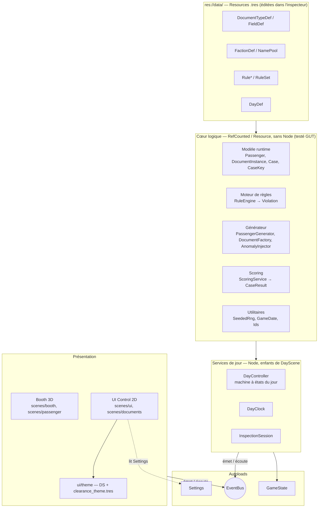
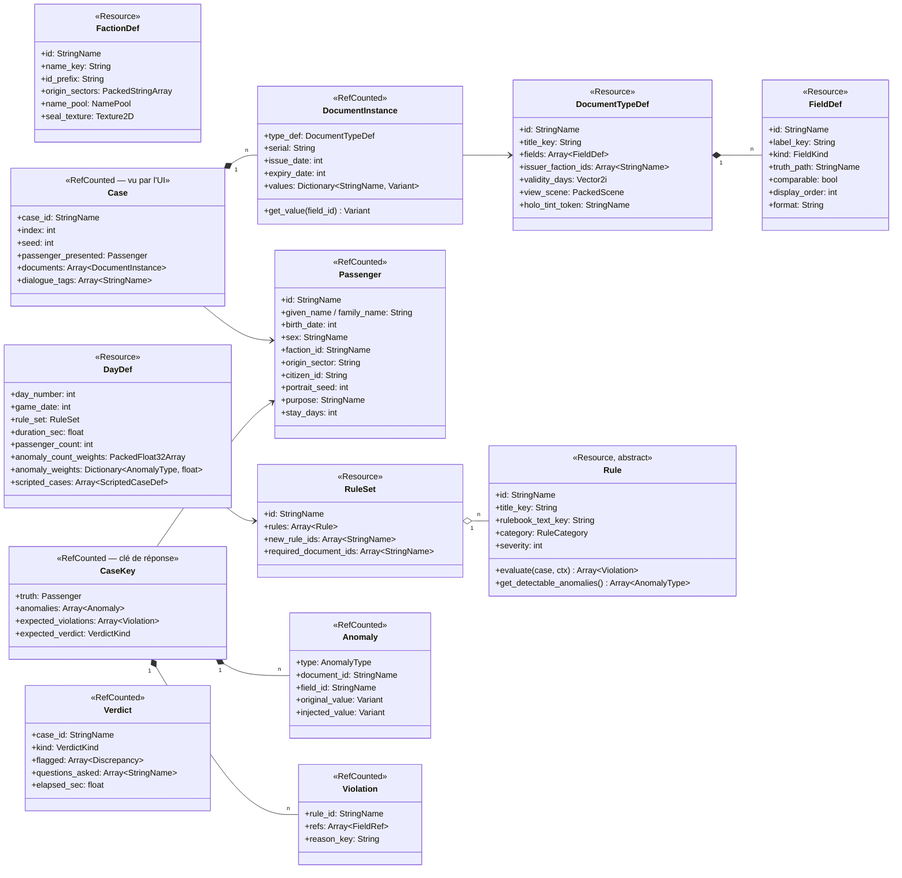
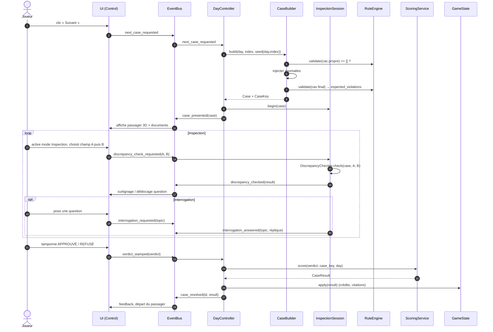

# ARCHITECTURE — CLEARANCE

> Propriétaire : **Godot Architect** · Statut : 🟡 proposé (à valider par le client) · Cible : **Godot 4.4+**, GDScript typé, renderer Forward+
>
> Documents liés : [`AGENTS.md`](../AGENTS.md) · [`DECISIONS.md`](../DECISIONS.md) · [`DESIGN_SYSTEM.md`](../DESIGN_SYSTEM.md) · [`docs/UI_FLOW.md`](UI_FLOW.md)

---

## 1. Principes directeurs

| # | Principe | Conséquence concrète |
|---|---|---|
| P1 | **Données plutôt que code** | Types de documents, champs, factions, règles, jours = Resources `.tres` dans `res://data/`. Ajouter une règle « classique » ou un jour ne demande aucun code. |
| P2 | **Le cœur ne connaît pas l'UI** | `scripts/core|documents|rules|generation` n'étendent jamais `Node`/`Control` et ne chargent jamais de scène. Ils tournent en headless → testables par GUT. |
| P3 | **Vérité terrain** | Chaque cas est généré valide puis corrompu de façon contrôlée. Le jeu connaît la réponse attendue *et* les discordances attendues. |
| P4 | **Déterminisme** | Toute aléa passe par un `SeededRng` injecté (jamais `randi()` global). Même seed ⇒ même cas, bit à bit. |
| P5 | **Communication par signaux** | Logique ↔ UI via l'autoload `EventBus`. Aucune référence directe d'une scène UI vers un service. |
| P6 | **Autoloads minimaux** | 3 autoloads (EventBus, GameState, Settings). Tout le reste est instancié par la scène de jour, donc remplaçable et testable. |
| P7 | **Un script = une responsabilité** | Pas de « GameManager » fourre-tout. |

---

## 2. Vue d'ensemble des couches



**Règle de dépendance** : les flèches ne remontent jamais. `CORE` ne référence ni `SERVICES`, ni `AUTO`, ni `PRES`. Les services sont la seule couche qui touche à la fois au cœur et à l'EventBus. L'UI ne voit que des objets « présentés » (`Case`, `DocumentInstance`), jamais la clé de réponse (`CaseKey`).

---

## 3. Arborescence `res://`

```
res://
├── project.godot               # Config moteur (Godot Architect)
├── icon.svg
├── addons/
│   └── gut/                    # GUT 9.x — VERSIONNÉ (CI reproductible, pas de téléchargement)
├── assets/                     # Assets bruts importés (Asset Lead) — licences dans docs/ASSETS.md
│   ├── models/                 # .glb (guichet, station, passagers)
│   ├── textures/               # albedo, normal, ORM, décals, portraits (couches)
│   ├── materials/              # .tres StandardMaterial3D / ShaderMaterial
│   ├── shaders/                # .gdshader (hologramme, scanlines, glitch, CRT)
│   ├── fonts/                  # Chakra Petch, Inter, JetBrains Mono (OFL)
│   ├── audio/                  # sfx/, ambience/, music/
│   └── icons/                  # icônes UI (SVG)
├── data/                       # CONTENU data-driven (.tres) — aucune logique
│   ├── documents/              # doc_passport.tres, doc_entry_permit.tres… (DocumentTypeDef + FieldDef sous-ressources)
│   ├── rules/                  # rule_passport_not_expired.tres, rule_ban_faction_x.tres… (instances de sous-classes de Rule)
│   ├── days/                   # day_01.tres… (DayDef) + ruleset_day_01.tres (RuleSet)
│   ├── factions/               # faction_consortium.tres… (FactionDef) — propriété Lore Master
│   └── names/                  # namepool_<culture>.tres (NamePool)
├── scenes/                     # .tscn uniquement (+ scripts de vue attachés si triviaux)
│   ├── main/                   # main.tscn (bootstrap, menu), day.tscn (DayScene : services + booth + UI)
│   ├── booth/                  # guichet 3D, caméra, éclairage, points d'ancrage UI
│   ├── passenger/              # passager 3D (rig, variations d'apparence)
│   ├── documents/              # une scène de vue par gabarit de document (passport_view.tscn…)
│   └── ui/                     # HUD, Rulebook, tampon, panneau de comparaison, résumé de jour
├── scripts/
│   ├── autoload/               # event_bus.gd, game_state.gd, settings.gd
│   ├── core/                   # modèle runtime transverse + utilitaires (SeededRng, GameDate, Case, Verdict…)
│   ├── documents/              # FieldDef, DocumentTypeDef, DocumentInstance, FieldRef, formatage des valeurs
│   ├── rules/                  # Rule (base) + sous-classes, RuleSet, RuleEngine, Violation, RuleContext
│   ├── generation/             # PassengerGenerator, DocumentFactory, AnomalyInjector(s), CaseBuilder, NamePool
│   └── ui/                     # contrôleurs de vue (Control), sans règle métier
├── ui/
│   └── theme/                  # tokens.gd (class_name DS) + clearance_theme.tres — propriété Design System
├── tests/
│   ├── unit/                   # test_rule_*.gd, test_generator_*.gd, test_seeded_rng.gd…
│   └── integration/            # boucle de jour simulée sans UI (DayController + faux joueur)
└── docs/                       # ARCHITECTURE.md, UI_FLOW.md, QA.md, ASSETS.md…
```

> ⚠️ **Point d'attention** : `ui/theme/` (Design System) vit à la racine alors que les vues sont dans `scenes/ui/` et `scripts/ui/`. C'est acceptable (le thème est une ressource partagée, pas une vue), mais à valider pour éviter qu'on y range des scènes par erreur. Règle : **`res://ui/` ne contient que `theme/`.**

Dossiers techniques ignorés : `.godot/` (cache). Les `*.import` sont **versionnés** (paramètres d'import).

---

## 4. Autoloads

Non déclarés dans `project.godot` tant que les scripts n'existent pas (Godot refuse de démarrer proprement avec un autoload manquant). À ajouter en M1 :

```ini
; project.godot — à décommenter en M1, dans cet ordre
; [autoload]
; EventBus="*res://scripts/autoload/event_bus.gd"
; Settings="*res://scripts/autoload/settings.gd"
; GameState="*res://scripts/autoload/game_state.gd"
```

| Autoload | Rôle | Ne fait PAS |
|---|---|---|
| `EventBus` | Déclare uniquement des `signal` typés (catalogue §7). Aucun état, aucune méthode métier. | Logique, stockage |
| `Settings` | Préférences joueur (volume, langue, taille de texte, daltonisme, sensibilité, « réduire les effets »). Persistées dans `user://settings.cfg` (`ConfigFile`). Émet `EventBus.settings_changed`. | État de partie |
| `GameState` | État de **campagne** : `campaign_seed`, `current_day`, `credits`, `score_total`, `citations`, `narrative_flags: Dictionary[StringName, Variant]`, historique résumé des jours. Sauvegarde/chargement (§9). | État du jour en cours (porté par `DayController`) |

**Pièges Godot** :
- Un script autoload **ne doit pas** avoir de `class_name` identique au nom d'autoload (conflit de symbole global). Convention : pas de `class_name` sur les autoloads.
- Ordre : `EventBus` en premier (les autres s'y connectent dans `_ready`).

---

## 5. Modèle de données

### 5.1 Vue d'ensemble



### 5.2 Définitions (Resources, `res://data/`)

| Classe (`class_name`) | Script | Champs principaux | Notes |
|---|---|---|---|
| `FieldDef` | `scripts/documents/field_def.gd` | `id: StringName`, `label_key: String`, `kind: FieldKind` (`TEXT, DATE, ID_CODE, ENUM, PORTRAIT, NUMBER, BOOL`), `truth_path: StringName` (ex. `&"family_name"` → attribut de `Passenger` dont la valeur est recopiée), `comparable: bool` (activable en mode Inspection), `display_order: int`, `format: String` (ex. `"YYYY.MM.DD"`) | Sous-ressource embarquée dans le `.tres` du document. `truth_path` est **le** lien qui permet au générateur de remplir les champs et aux règles de comparer « même donnée sur deux documents ». |
| `DocumentTypeDef` | `scripts/documents/document_type_def.gd` | `id`, `title_key`, `fields: Array[FieldDef]`, `issuer_faction_ids: Array[StringName]` (vide = toutes), `validity_days: Vector2i` (durée min/max), `view_scene: PackedScene`, `holo_tint_token: StringName` (nom d'un token `DS`, jamais une couleur) | Un fichier par type : passeport, permis d'entrée, carte de travail, certificat médical, autorisation diplomatique… |
| `FactionDef` | `scripts/core/faction_def.gd` | `id`, `name_key`, `id_prefix` (préfixe du numéro de citoyen), `origin_sectors: PackedStringArray`, `name_pool: NamePool`, `seal_texture: Texture2D` | Contenu fourni par le Lore Master. |
| `NamePool` | `scripts/generation/name_pool.gd` | `given_names_f/m/x: PackedStringArray`, `family_names: PackedStringArray` | Une par culture. |
| `Rule` (abstraite) | `scripts/rules/rule.gd` | `id`, `title_key`, `rulebook_text_key`, `category: RuleCategory` (`DOCUMENTS, IDENTITY, FACTION, PURPOSE, SPECIAL`), `severity: int` | Voir §6. Méthodes virtuelles `evaluate()`, `get_detectable_anomalies()`, `get_rulebook_entry()`. |
| `RuleSet` | `scripts/rules/rule_set.gd` | `id`, `rules: Array[Rule]`, `new_rule_ids: Array[StringName]` (badge « NOUVEAU » au Rulebook), `required_document_ids: Array[StringName]` (dérivé/vérifié) | Liste **explicite** par jour (pas d'héritage entre jours en MVP : plus lisible, diffable). Les `Rule` sont des `.tres` partagés référencés par plusieurs RuleSets. |
| `DayDef` | `scripts/core/day_def.gd` | `day_number`, `game_date: int` (jour absolu, cf. `GameDate`), `rule_set`, `duration_sec`, `passenger_count`, `anomaly_count_weights: PackedFloat32Array` (proba de 0,1,2,3 anomalies), `anomaly_weights: Dictionary[AnomalyType, float]`, `scripted_cases: Array[ScriptedCaseDef]`, `intro_text_key`, `credit_per_correct`, `penalty_per_error` | Le Game Designer règle la difficulté uniquement ici. |
| `ScriptedCaseDef` | `scripts/generation/scripted_case_def.gd` | `at_index: int`, `passenger_overrides: Dictionary`, `forced_anomalies: Array[AnomalyType]`, `dialogue_id: StringName`, `sets_flag / requires_flag: StringName` | Passagers narratifs (Scénariste) injectés à un index donné, générés par la même chaîne. |

### 5.3 Objets runtime (RefCounted, produits par le générateur)

| Classe | Rôle | Champs principaux |
|---|---|---|
| `Passenger` | Identité (vraie ou présentée) | voir diagramme ; `appearance_seed: int` pour le modèle 3D, `portrait_seed: int` pour la photo |
| `DocumentInstance` | Un document tendu par le passager | `type_def`, `serial`, `issue_date`, `expiry_date`, `values: Dictionary[StringName, Variant]` (clé = `FieldDef.id`) |
| `FieldRef` | Pointeur vers un champ affiché | `document_id: StringName`, `field_id: StringName` |
| `Case` | **Ce que voit le joueur** | `case_id`, `index`, `seed`, `passenger_presented`, `documents`, `dialogue_tags` |
| `CaseKey` | **Clé de réponse**, jamais transmise à l'UI | `truth`, `anomalies`, `expected_violations`, `expected_verdict` |
| `Anomaly` | Corruption injectée | `type: AnomalyType` (`EXPIRED_DOCUMENT, PORTRAIT_MISMATCH, ID_MISMATCH, NAME_MISMATCH, MISSING_DOCUMENT, BANNED_FACTION, WRONG_ISSUER, INVALID_SEAL, PURPOSE_MISMATCH…`), cible, valeur avant/après |
| `Violation` | Sortie d'une règle | `rule_id`, `refs: Array[FieldRef]` (champs qui prouvent la violation), `reason_key` |
| `Discrepancy` | Discordance signalée par le joueur | `a: FieldRef`, `b: FieldRef`, `confirmed: bool` |
| `Verdict` | Décision du joueur | `case_id`, `kind: VerdictKind` (`APPROVE, DENY`; extensible `DETAIN` post-MVP), `flagged`, `questions_asked`, `elapsed_sec` |
| `CaseResult` | Sortie du scoring | `correct: bool`, `missed_violations`, `false_flags`, `credits_delta`, `citation: bool` |
| `RuleContext` | Contexte d'évaluation | `today: int`, `day_def`, `faction_db`, `document_db` |

**Dates** : jamais `Time`/OS. `GameDate` = entier « jours depuis l'epoch de la station » + helpers de formatage. Évite fuseaux horaires et rend les règles d'expiration triviales (`expiry_date < ctx.today`).

**Séparation `Case` / `CaseKey`** (ajout par rapport à l'orientation) : le cas « connaît sa réponse », mais si cette réponse voyage avec le cas dans l'EventBus, n'importe quelle vue peut tricher par erreur (afficher un indice, colorer un champ). On sépare donc physiquement ce que l'UI reçoit de ce que seuls `DayController`/`ScoringService` détiennent.

---

## 6. Moteur de règles

```gdscript
# Contrat (illustratif — implémentation en M2)
class_name Rule extends Resource
func evaluate(case: Case, ctx: RuleContext) -> Array[Violation]: return []
func get_detectable_anomalies() -> Array[int]: return []   # AnomalyType couvertes
func get_rulebook_entry() -> RulebookEntry: ...
```

- **Paramétrage par `.tres`, comportement par sous-classe.** Chaque *famille* de règle = une sous-classe (`RequireDocumentRule(document_id)`, `DocumentNotExpiredRule(document_id)`, `FieldsMatchRule(field_id, document_ids)`, `PortraitMatchRule`, `FactionBannedRule(faction_ids)`, `IssuerAllowedRule`, `PurposeRequiresDocumentRule(purpose, document_id)`). Chaque *règle concrète* = un `.tres` qui instancie la sous-classe avec ses `@export`. Les designers créent de nouvelles règles sans code ; une nouvelle famille demande un script (acceptable, revue par Godot Architect).
- **`evaluate` ajoute `ctx: RuleContext`** (par rapport à `evaluate(case)`) : les règles ont besoin de la date du jour et des bases de données factions/documents ; on les passe explicitement plutôt que de lire un autoload → règles pures, testables.
- **Règles pures** : pas d'état, pas d'aléa, pas d'accès à l'arbre de scène. Une `Resource` partagée entre RuleSets ne doit **jamais** être mutée au runtime.
- **`RuleEngine.validate(case, rule_set, ctx) -> Array[Violation]`** : simple boucle, agrège. Verdict attendu = `DENY` si au moins une violation, sinon `APPROVE`.
- **Rulebook** : l'UI construit le Rulebook à partir de `rule_set.rules[i].get_rulebook_entry()` → une seule source de vérité pour le texte affiché et la logique.
- **Vérification de discordance** (mode Inspection) : `DiscrepancyChecker.check(case, a: FieldRef, b: FieldRef) -> bool` compare les valeurs normalisées des deux champs **affichés** (même `truth_path`, ou couple déclaré comparable : photo ↔ passager 3D, date d'expiration ↔ date du jour). Il ne consulte pas `CaseKey` : il répond comme le ferait un agent humain, à partir de ce qui est visible.

### ⚠️ Ajustement recommandé à l'orientation « vérité terrain »

L'orientation dit : « le cas connaît sa réponse grâce aux anomalies injectées ». Deux problèmes concrets :
1. **Anomalie hors règle** : une faction « interdite » n'est interdite que certains jours ; une photo différente n'est une violation que si `PortraitMatchRule` est active. L'anomalie seule ne dit pas la réponse.
2. **Violation accidentelle** : un tirage aléatoire « valide » peut tomber sur une date d'expiration < aujourd'hui, un doublon, etc.

**Proposition** : la **réponse attendue est calculée par le `RuleEngine`** sur le cas final (`expected_violations = RuleEngine.validate(...)`), et les anomalies servent à *provoquer* ces violations. Invariants vérifiés par le générateur (assert en debug) et par les tests :
- cas avant injection ⇒ `validate()` renvoie `[]` (sinon on retire au sort, max N essais, puis erreur explicite) ;
- chaque anomalie injectée est détectée par ≥ 1 règle active (`get_detectable_anomalies()`), **sauf** si elle est marquée `cosmetic` (leurre volontaire, ex. faute de frappe tolérée) ;
- le générateur ne tire que des `AnomalyType` couvertes par le RuleSet du jour (filtrage de `anomaly_weights`).

On garde tous les bénéfices (scoring juste, tests déterministes, discordances attendues connues) sans risque de divergence entre « ce que le générateur croit » et « ce que les règles disent ».

---

## 7. Catalogue des signaux `EventBus`

Convention : nom au **passé** pour un fait (`*_started`, `*_stamped`), `*_requested` pour une intention de l'UI vers la logique. Tous les paramètres typés.

| Signal | Paramètres | Émetteur → Écouteurs |
|---|---|---|
| **Jour** | | |
| `day_started` | `day: DayDef, rulebook: Array[RulebookEntry]` | DayController → HUD, Rulebook, Booth |
| `day_clock_ticked` | `remaining_sec: float` | DayClock → HUD |
| `day_time_expired` | — | DayClock → DayController |
| `day_ended` | `summary: DaySummary` | DayController → UI résumé, GameState |
| **Passager** | | |
| `next_case_requested` | — | UI (bouton « Suivant ») → DayController |
| `case_presented` | `case: Case` | DayController → Booth 3D, UI documents |
| `document_handed` | `doc: DocumentInstance` | Booth (animation finie) → UI documents |
| `document_focused` | `doc: DocumentInstance` | UI → InspectionSession (télémétrie, tuto) |
| **Inspection / comparaison** | | |
| `inspection_mode_changed` | `enabled: bool` | UI → InspectionSession, Booth (FX) |
| `discrepancy_check_requested` | `a: FieldRef, b: FieldRef` | UI → InspectionSession |
| `discrepancy_checked` | `result: Discrepancy` | InspectionSession → UI (surlignage magenta / « aucune discordance ») |
| `interrogation_requested` | `topic: StringName` | UI → InspectionSession |
| `interrogation_answered` | `topic: StringName, line_key: String` | InspectionSession → UI dialogue, Booth (anim) |
| **Verdict / score** | | |
| `verdict_stamped` | `verdict: Verdict` | UI tampon → DayController |
| `case_resolved` | `case_id: StringName, result: CaseResult` | DayController (via ScoringService) → HUD, Booth (départ) |
| `citation_issued` | `reason_key: String` | DayController → HUD (impression du ticket) |
| `credits_changed` | `credits: int, delta: int` | GameState → HUD |
| **Méta** | | |
| `narrative_flag_changed` | `flag: StringName, value: Variant` | GameState → systèmes narratifs |
| `settings_changed` | `key: StringName, value: Variant` | Settings → UI, audio, FX |
| `game_saved` / `game_loaded` | `slot: int` | GameState → UI |

`case_presented` transporte `Case` (jamais `CaseKey`). `case_resolved` peut révéler les violations manquées pour le feedback (`CaseResult.missed_violations`) **après** le verdict.

---

## 8. Flux d'un passager



`DayController` est une petite machine à états : `INTRO → WAITING_CASE → INSPECTING → RESOLVING → (WAITING_CASE | SUMMARY)`. Le temps écoulé force `SUMMARY` après résolution du cas en cours.

---

## 9. Génération procédurale

### 9.1 Graines

```
campaign_seed  (tiré au « Nouvelle partie », stocké dans GameState)
  └─ day_seed  = mix(campaign_seed, day_number)
       └─ case_seed = mix(day_seed, case_index)
```
- `mix` = fonction de hachage entière **maison** (type SplitMix64) implémentée dans `SeededRng`, plutôt que `hash()` de Godot dont la stabilité entre versions n'est pas garantie.
- Chaque cas a son propre `RandomNumberGenerator` seedé → générer le cas 7 ne dépend pas d'avoir généré les cas 0..6. Permet : rejouer un cas, reproduire un bug depuis son `case_seed`, reprendre un jour en cours.
- **Interdits** : `randi()`, `randf()`, `Array.shuffle()`, `Array.pick_random()` (RNG global). Utiliser `SeededRng.pick()`, `SeededRng.shuffle()`.

### 9.2 Pipeline `CaseBuilder.build(day, index, seed)`

1. **Cas scénarisé ?** Si `day.scripted_cases` a une entrée à `index` (et ses `requires_flag` sont satisfaits), on part de ses overrides.
2. **Passager vrai** (`PassengerGenerator`) : faction (pondérée), nom (`NamePool` de la faction), date de naissance, secteur d'origine, `citizen_id` (préfixe faction + checksum), motif de visite, durée, `portrait_seed`, `appearance_seed`.
3. **Documents valides** (`DocumentFactory`) : pour chaque document requis par le RuleSet (+ documents optionnels « bruit » selon le motif), remplir chaque champ via `FieldDef.truth_path`, dates d'émission/expiration cohérentes avec `today` et `validity_days`, émetteur autorisé, sceau correct.
4. **Contrôle** : `RuleEngine.validate()` doit renvoyer `[]`. Sinon re-tirage (max 8), puis `push_error` avec la seed.
5. **Injection** : tirer le nombre d'anomalies (`anomaly_count_weights`), puis leurs types (`anomaly_weights` filtrés sur les types détectables par le RuleSet). Chaque type a un `AnomalyInjector` (strategy, RefCounted) : `ExpiredDocumentInjector`, `PortraitMismatchInjector` (change `portrait_seed` d'un document), `IdMismatchInjector` (altère 1–2 caractères), `MissingDocumentInjector`, `BannedFactionInjector` (change la faction *vraie*, cohérente sur tous les documents — la fraude n'est pas une discordance mais une règle), etc.
6. **Clé** : `expected_violations = RuleEngine.validate(final)`, `expected_verdict`, vérification des invariants (§6).
7. **Présentation** : `passenger_presented` = vérité + éventuel mensonge (anomalies qui touchent ce que dit le passager), `dialogue_tags` pour l'interrogation.

**Bruit légitime** : pour éviter que « différence visible = refus », le générateur ajoute des variations *valides* (photo plus ancienne mais même `portrait_seed`, nom translittéré autorisé par une règle, etc.) — à doser par le Game Designer.

**Portraits** : `portrait_seed` → composition de couches 2D (visage, cheveux, accessoires, implants) pour la photo des documents ; `appearance_seed` → variations du modèle 3D. Une anomalie `PORTRAIT_MISMATCH` modifie 1–2 couches seulement (détectable mais pas grossier). Méthode de rendu à confirmer avec l'Asset Lead (cf. §13).

---

## 10. Sauvegarde

- **Quand** : entre deux jours uniquement (comme *Papers, Please*). Le jour en cours n'est pas sauvegardé en MVP (mais il serait reconstructible grâce aux seeds).
- **Où / format** : `user://saves/slot_<n>.json` — JSON texte, champ `"version": int` pour migrations. Préférences séparées dans `user://settings.cfg` (`ConfigFile`).
- **Contenu** : `campaign_seed`, `current_day`, `credits`, `score_total`, `citations`, `narrative_flags`, `day_history: [{day, correct, errors, credits}]`, horodatage réel, version du jeu.
- **Pas de `ResourceSaver`/`.tres` dans `user://`** : charger une Resource arbitraire peut exécuter un script embarqué (risque si un joueur partage une sauvegarde). JSON + validation de schéma à la lecture.
- **Écriture atomique** : écrire `slot_n.json.tmp` puis renommer.
- Responsable : `GameState` (méthodes `save_to_slot`, `load_from_slot`), sérialisation dans `scripts/core/save_codec.gd`.

---

## 11. Conventions de code

| Sujet | Règle |
|---|---|
| Fichiers / dossiers | `snake_case` : `rule_engine.gd`, `passport_view.tscn` |
| Classes | `class_name PascalCase` pour toute classe réutilisée (sauf autoloads) |
| Données `.tres` | préfixe de type : `doc_`, `rule_`, `ruleset_`, `day_`, `faction_`, `namepool_` ; `day_01.tres` (2 chiffres) |
| Identifiants | `StringName` littéraux `&"passport"` ; jamais de chaîne magique dupliquée — constantes dans la classe concernée |
| Membres | `snake_case` ; privés préfixés `_` ; constantes `UPPER_SNAKE` ; enums `PascalCase` / valeurs `UPPER_SNAKE` |
| Signaux | passé (`case_resolved`) ou `*_requested` ; toujours typés |
| **Typage statique** | **Obligatoire** : `var x: int`, `func f(a: Case) -> bool`, `Array[Rule]`, `Dictionary[StringName, Variant]` (Godot 4.4). `project.godot` met `untyped_declaration` en **erreur** et les accès non sûrs (`unsafe_*`) en avertissement. `:=` autorisé quand le type est évident. |
| Responsabilité | 1 script = 1 responsabilité ; > ~300 lignes = signal d'alerte |
| Couches | `core/documents/rules/generation` : `extends RefCounted` ou `Resource`, **jamais** `Node`, pas de `get_tree()`, pas de `preload` de `.tscn`, pas d'accès aux autoloads |
| Nœuds | `%UniqueName` pour les enfants ; pas de `get_node("../../..")` ; références injectées par `@export` |
| UI | Aucune valeur visuelle en dur → `DS.*` ou thème ; textes via `tr()` sur des clés |
| Erreurs | `assert()` pour invariants de dev, `push_error()` + valeur de repli pour les données invalides |
| Docs | `##` (doc-comments Godot) sur classes et méthodes publiques |

---

## 12. Stratégie de test

- **Outil** : GUT 9.x (compatible Godot 4.4 — version exacte figée à l'installation), versionné dans `addons/gut/`.
- **Exécution CI / locale** : `godot --headless -s addons/gut/gut_cmdln.gd -gdir=res://tests -gexit` (config dans `.gutconfig.json`, ajoutée en M1).
- **Unitaires (`tests/unit/`)** :
  - `test_seeded_rng.gd` : même seed ⇒ même suite ; indépendance des cas.
  - `test_game_date.gd` : formatage, comparaisons, années bissextiles éventuelles du calendrier de jeu.
  - `test_rule_<famille>.gd` : pour chaque famille, un cas conforme (0 violation) et un cas fautif par branche (fixtures construites à la main via un `CaseFixtureBuilder`).
  - `test_generator_*.gd` — **tests de propriétés** sur 1 000 seeds :
    1. un cas sans anomalie ⇒ `validate() == []` et `APPROVE` ;
    2. chaque anomalie injectée ⇒ au moins une violation de la règle attendue ;
    3. déterminisme : `serialize(build(seed)) == serialize(build(seed))` ;
    4. distribution : sur N jours, fréquence des anomalies ≈ poids du `DayDef` (tolérance).
  - `test_discrepancy_checker.gd`, `test_scoring.gd`.
- **Intégration (`tests/integration/`)** : `DayController` + `DayClock` simulé + « bot parfait » (lit `CaseKey`) ⇒ score max, 0 citation ; « bot qui approuve tout » ⇒ score attendu.
- **Validation des données** : un test parcourt `res://data/**.tres` et vérifie la cohérence (ids uniques, `truth_path` existants, règles référençant des documents existants, chaque `DayDef` a ≥ 1 règle).
- **Golden files** (optionnel M3+) : snapshot JSON de 20 cas de référence pour détecter les changements involontaires du générateur.
- Hors périmètre GUT : rendu 3D, feel UI → playtests (QA, `docs/QA.md`).

---

## 13. Risques et questions ouvertes

| # | Sujet | Risque / question | Proposition |
|---|---|---|---|
| R1 | Vérité terrain vs règles | Divergence anomalie ↔ verdict (§6) | Verdict attendu calculé par le RuleEngine + invariants — **à valider** |
| R2 | UI « projetée » sur la 3D | Documents rendus dans des `SubViewport` sur des meshes = texte flou, input complexe, coût GPU | **Documents et Rulebook en `CanvasLayer` 2D** au-dessus de la scène 3D (lisibilité, thème DS, accessibilité) ; `SubViewport` réservé aux écrans décoratifs du guichet — **à valider avec UI/UX et client** |
| R3 | Portraits procéduraux | Coût art élevé, lisibilité des différences | Couches 2D en MVP ; render-to-texture du modèle 3D post-MVP |
| R4 | Localisation | Ajouter `tr()` après coup coûte cher | Clés dès M1 (`*_key`), table CSV FR uniquement en MVP — **à valider** |
| R5 | Équilibrage | Difficulté uniquement par poids : peut être opaque | Outil de debug : générer 100 cas d'un jour et afficher les stats (scène d'outil, M3) |
| R6 | Godot 4.4 minimum | `Dictionary` typés requis | Figer 4.4.x dans le README et la CI |
| R7 | Resources partagées | Muter une `Rule`/`DocumentTypeDef` au runtime contamine tous les jours | Règle « définitions en lecture seule » + test de non-mutation |
| R8 | Interrogation | Format des dialogues non défini | Dépend du Scénariste : proposer `DialogueDef` (.tres) en M4 |
| R9 | Temps | Temps réel vs horloge in-game accélérée | Horloge in-game affichée (DayClock), `duration_sec` réel en données — à confirmer par le Game Designer |
| R10 | `res://ui/theme/` hors `scenes/ui` | Confusion de rangement | `res://ui/` réservé au thème (§3) |

---

## 14. Plan d'implémentation

| Jalon | Contenu | Propriétaires | Définition de « terminé » |
|---|---|---|---|
| **M1 — Fondations** | Autoloads (`EventBus` avec tout le catalogue, `GameState`, `Settings`), déclaration dans `project.godot`, GUT + `.gutconfig.json`, `SeededRng`, `GameDate`, `main.tscn` (bootstrap), branchement du thème DS | Godot Architect, QA | Projet s'ouvre sans erreur ; `gut` headless vert ; tests RNG/date |
| **M2 — Documents & règles** | `FieldDef`, `DocumentTypeDef`, `FactionDef`, `DocumentInstance`, `Case`, `CaseKey`, `Rule` + 5 familles, `RuleSet`, `RuleEngine`, `DiscrepancyChecker`, `RulebookEntry` ; 3 types de documents, 2 factions, 8 règles en `.tres` | Gameplay Systems, Lore Master | Tests unitaires par famille de règles ; test de validation des données |
| **M3 — Générateur** | `PassengerGenerator`, `DocumentFactory`, `NamePool`, injecteurs (≥ 6 types), `CaseBuilder`, invariants, outil de stats | Gameplay Systems, QA | Tests de propriétés sur 1 000 seeds verts ; déterminisme prouvé |
| **M4 — Interface de comparaison** | Vues de documents (gabarits DS), drag/zoom, mode Inspection A↔B, surlignage, interrogation minimale, tampon, Rulebook ; booth 3D greybox + passager placeholder | UI/UX, Design System, Asset Lead | Un cas jouable de bout en bout à la souris et au clavier ; revue DS |
| **M5 — Boucle de jour** | `DayController`, `DayClock`, `InspectionSession`, `ScoringService`, résumé de jour, 3 `DayDef`, sauvegarde entre jours, 1 passager scénarisé | Gameplay Systems, Game Designer, Scénariste | *Vertical slice* : 3 jours jouables, sauvegarde/chargement, test d'intégration « bot parfait » |

Chaque jalon passe par la revue Orchestrateur + une entrée `DECISIONS.md` si un contrat change.
