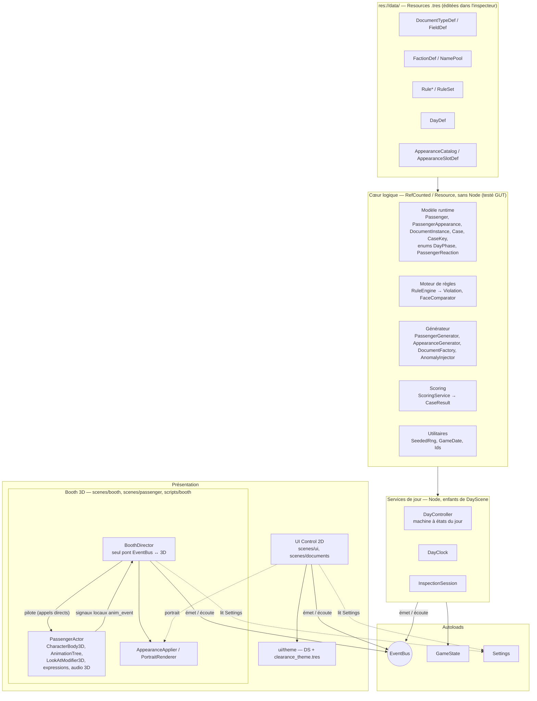
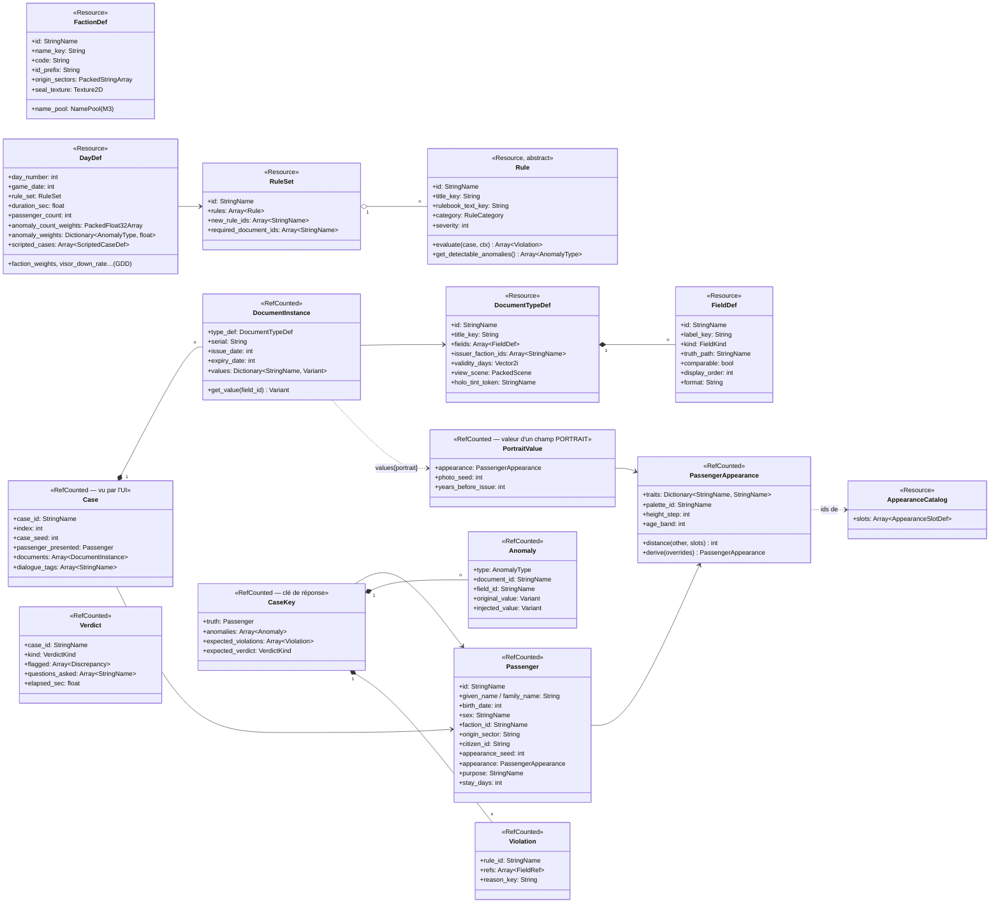
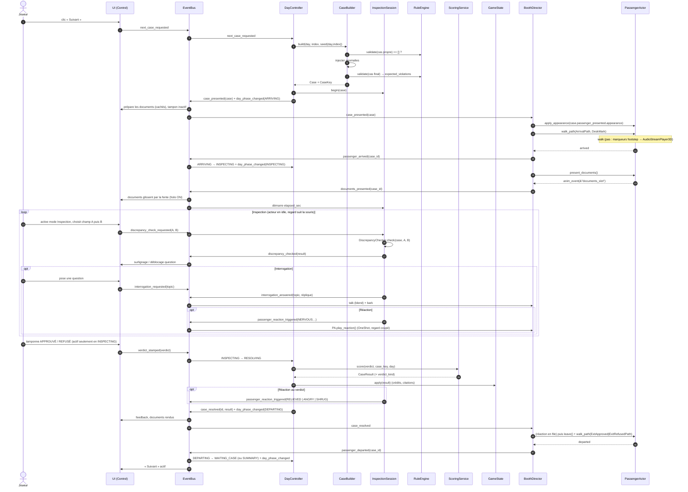
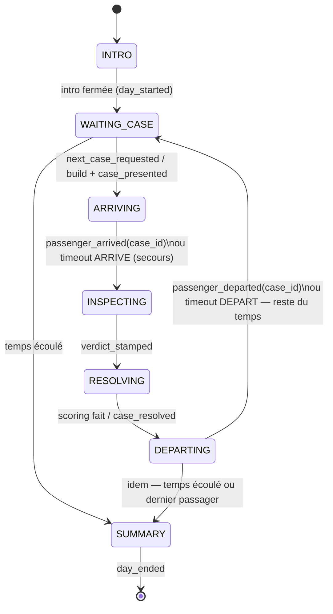

# ARCHITECTURE — CLEARANCE

> Propriétaire : **Godot Architect** · Statut : 🟢 validé par le client · Cible : **Godot 4.7.2**, GDScript typé, renderer Forward+
>
> Documents liés : [`AGENTS.md`](../AGENTS.md) · [`DECISIONS.md`](../DECISIONS.md) · [`DESIGN_SYSTEM.md`](../DESIGN_SYSTEM.md) · [`docs/UI_FLOW.md`](UI_FLOW.md) · [`docs/BOOTH_SCENE.md`](BOOTH_SCENE.md) (visuel du guichet, 3D Designer) · [`docs/ASSETS.md`](ASSETS.md) (rigs, clips, atlas, licences) · [`docs/AUDIO.md`](AUDIO.md) (Audio Designer)
>
> **Révision 2** (2026-10-27) : passager 3D animé qui arrive au guichet (D-009, D-010, D-013) et apparences uniques/modulaires comparables (D-012). Sections touchées : §2, §3, §5, §7, §8, **§8 bis (nouvelle)**, §9.3 (nouvelle), §12, §13, §14. La numérotation existante est conservée pour ne pas casser les renvois des autres documents.

---

## 1. Principes directeurs

| # | Principe | Conséquence concrète |
|---|---|---|
| P1 | **Données plutôt que code** | Types de documents, champs, factions, règles, jours = Resources `.tres` dans `res://data/`. Ajouter une règle « classique » ou un jour ne demande aucun code. |
| P2 | **Le cœur ne connaît pas l'UI** | `scripts/core|documents|rules|generation` n'étendent jamais `Node`/`Control` et ne chargent jamais de scène. Ils tournent en headless → testables par GUT. |
| P3 | **Vérité terrain** | Chaque cas est généré valide puis corrompu de façon contrôlée. Le jeu connaît la réponse attendue *et* les discordances attendues. |
| P4 | **Déterminisme** | Toute aléa passe par un `SeededRng` injecté (jamais `randi()` global). Même seed ⇒ même cas, bit à bit. |
| P5 | **Communication par signaux** | Logique ↔ UI via l'autoload `EventBus`. Aucune référence directe d'une scène UI vers un service. |
| P6 | **Autoloads minimaux** | 3 autoloads (EventBus, GameState, Settings). Tout le reste est instancié par la scène de jour, donc remplaçable et testable. |
| P7 | **Un script = une responsabilité** | Pas de « GameManager » fourre-tout. |
| P8 | **La logique ne dépend pas de l'animation** | Le jeu doit avancer même si une animation ne rend jamais la main (timeouts de sécurité, `NullBooth` en test). La 3D *met en scène* des faits, elle ne les décide pas. |

---

## 2. Vue d'ensemble des couches



**Règle de dépendance** : les flèches ne remontent jamais. `CORE` ne référence ni `SERVICES`, ni `AUTO`, ni `PRES`. Les services sont la seule couche qui touche à la fois au cœur et à l'EventBus. L'UI ne voit que des objets « présentés » (`Case`, `DocumentInstance`), jamais la clé de réponse (`CaseKey`).

**Règle du booth** : `PassengerActor` ne connaît **ni l'EventBus ni `Case`**. Il expose une API impérative (`walk_path()`, `present_documents()`, `play_reaction()`, `set_look_target()`, `set_expression()`, `apply_appearance()`) et émet des signaux **locaux** (`arrived`, `anim_event(name)`, `departed`). `BoothDirector` (script racine de `booth.tscn`) est le **seul** nœud 3D qui écoute et émet sur l'EventBus. Conséquence : l'acteur est testable isolément dans une scène de démo, et remplaçable par un placeholder capsule sans toucher à la logique.

---

## 3. Arborescence `res://`

```
res://
├── project.godot               # Config moteur (Godot Architect)
├── icon.svg
├── addons/
│   └── gut/                    # GUT 9.x — VERSIONNÉ (CI reproductible, pas de téléchargement)
├── assets/                     # Assets bruts importés (Asset Lead) — licences dans docs/ASSETS.md
│   ├── models/                 # .glb (guichet, station, passagers) ; models/passenger/ = rigs + passenger_anims.res (AnimationLibrary « passenger »)
│   ├── textures/               # albedo, normal, ORM, décals, atlas de visages (face_atlas_*.png)
│   ├── materials/              # .tres StandardMaterial3D / ShaderMaterial
│   ├── shaders/                # .gdshader (hologramme, scanlines, glitch, CRT, face_dither, impostor)
│   ├── fonts/                  # Chakra Petch, Inter, JetBrains Mono (OFL)
│   ├── audio/                  # sfx/, voice/, ambience/, music/ — détail dans docs/AUDIO.md
│   └── icons/                  # icônes UI (SVG)
├── data/                       # CONTENU data-driven (.tres) — aucune logique
│   ├── documents/              # doc_passport.tres, doc_entry_permit.tres… (DocumentTypeDef + FieldDef sous-ressources)
│   ├── rules/                  # rule_passport_not_expired.tres, rule_ban_faction_x.tres… (instances de sous-classes de Rule)
│   ├── days/                   # day_01.tres… (DayDef) + ruleset_day_01.tres (RuleSet)
│   ├── factions/               # faction_consortium.tres… (FactionDef) — propriété Lore Master
│   ├── names/                  # namepool_<culture>.tres (NamePool)
│   └── appearance/             # appearance_catalog.tres + slot_<slot>.tres (AppearanceSlotDef/AppearanceOptionDef) — 3D Designer + Lore Master
├── scenes/                     # .tscn uniquement (+ scripts de vue attachés si triviaux)
│   ├── main/                   # main.tscn (bootstrap, menu), day.tscn (DayScene : services + booth + UI)
│   ├── booth/                  # booth.tscn : guichet, vitre, caméra, éclairage, ArrivalPath, DeskMark, Exit*Path, LookTargetPlane, file d'attente (imposteurs)
│   ├── passenger/              # passenger_actor.tscn (PassengerActor), passenger_placeholder.tscn (capsule M4), portrait_studio.tscn (rendu des portraits)
│   ├── documents/              # une scène de vue par gabarit de document (passport_view.tscn…)
│   └── ui/                     # HUD, Rulebook, tampon, panneau de comparaison, résumé de jour
├── scripts/
│   ├── autoload/               # event_bus.gd, game_state.gd, settings.gd
│   ├── core/                   # modèle runtime transverse + utilitaires (SeededRng, GameDate, Case, Verdict…)
│   ├── documents/              # FieldDef, DocumentTypeDef, DocumentInstance, FieldRef, formatage des valeurs
│   ├── rules/                  # Rule (base) + sous-classes, RuleSet, RuleEngine, Violation, RuleContext
│   ├── generation/             # PassengerGenerator, AppearanceGenerator, DocumentFactory, AnomalyInjector(s), CaseBuilder, NamePool
│   ├── booth/                  # BoothDirector, PassengerActor, PassengerLocomotion, ExpressionController, AppearanceApplier, PortraitRenderer, QueueImpostors, NullBooth
│   └── ui/                     # contrôleurs de vue (Control), sans règle métier
├── ui/
│   └── theme/                  # tokens.gd (class_name DS) + clearance_theme.tres — propriété Design System
├── tests/
│   ├── unit/                   # test_rule_*.gd, test_generator_*.gd, test_seeded_rng.gd…
│   ├── integration/            # boucle de jour simulée sans UI (DayController + faux joueur + NullBooth/SilentBooth)
│   └── manual/                 # bacs à sable hors CI (booth_sandbox.tscn) — créé en M4
└── docs/                       # ARCHITECTURE.md, UI_FLOW.md, QA.md, ASSETS.md…
```

> ⚠️ **Point d'attention** : `ui/theme/` (Design System) vit à la racine alors que les vues sont dans `scenes/ui/` et `scripts/ui/`. C'est acceptable (le thème est une ressource partagée, pas une vue), mais à valider pour éviter qu'on y range des scènes par erreur. Règle : **`res://ui/` ne contient que `theme/`.**

**Pourquoi `scripts/booth/`** (nouveau, `.gitkeep` créé) : les scripts du guichet 3D ne sont pas « triviaux » (machine d'animation, suivi de chemin, regard, watchdogs, application d'apparence) et ne sont ni des `Control` (`scripts/ui/` est réservé aux vues 2D) ni du cœur headless (ils étendent `Node3D`/`CharacterBody3D`). Un dossier dédié garde la règle « `scripts/ui` = Control, `scripts/core…generation` = sans Node ». `NullBooth` y vit aussi (pas dans `tests/`) car il sert également au mode debug `--no-booth` du jeu.

**Pourquoi `data/appearance/`** (nouveau, `.gitkeep` créé) : les catalogues de traits sont du contenu éditable (P1) au même titre que les factions ; le générateur ne lit que leurs `id`/poids/tags, la présentation lit leurs références visuelles.

Dossiers techniques ignorés : `.godot/` (cache). Les `*.import` sont **versionnés** (paramètres d'import).

---

## 4. Autoloads

Non déclarés dans `project.godot` tant que les scripts n'existent pas (Godot refuse de démarrer proprement avec un autoload manquant). À ajouter en M1 :

```ini
; project.godot — à décommenter en M1, dans cet ordre
; [autoload]
; EventBus="*res://scripts/autoload/event_bus.gd"
; Settings="*res://scripts/autoload/settings.gd"
; GameState="*res://scripts/autoload/game_state.gd"
```

| Autoload | Rôle | Ne fait PAS |
|---|---|---|
| `EventBus` | Déclare uniquement des `signal` typés (catalogue §7). Aucun état, aucune méthode métier. | Logique, stockage |
| `Settings` | Préférences joueur (volumes par bus, langue, taille de texte, daltonisme, sensibilité, « réduire les effets », **« réduire les animations »** `reduce_motion: bool`, cf. §8 bis.7). Persistées dans `user://settings.cfg` (`ConfigFile`). Émet `EventBus.settings_changed`. | État de partie |
| `GameState` | État de **campagne** : `campaign_seed`, `current_day`, `credits`, `score_total`, `citations`, `narrative_flags: Dictionary[StringName, Variant]`, historique résumé des jours. Sauvegarde/chargement (§9). | État du jour en cours (porté par `DayController`) |

**Pièges Godot** :
- Un script autoload **ne doit pas** avoir de `class_name` identique au nom d'autoload (conflit de symbole global). Convention : pas de `class_name` sur les autoloads.
- Ordre : `EventBus` en premier (les autres s'y connectent dans `_ready`).

---

## 5. Modèle de données

### 5.1 Vue d'ensemble



### 5.2 Définitions (Resources, `res://data/`)

| Classe (`class_name`) | Script | Champs principaux | Notes |
|---|---|---|---|
| `FieldDef` | `scripts/documents/field_def.gd` | `id: StringName`, `label_key: String`, `kind: FieldDef.FieldKind` (`TEXT, DATE, ID_CODE, ENUM, PORTRAIT, NUMBER, BOOL`), `truth_path: StringName`, `comparable: bool` (activable en mode Inspection), `display_order: int`, `format: String` (ex. `"DD.MM.YYYY"`) | Sous-ressource embarquée dans le `.tres` du document. `truth_path` est **le** lien qui permet au générateur de remplir les champs et aux règles de comparer « même donnée sur deux documents ». **M2** : deux espaces de noms — une propriété de `Passenger` (`&"family_name"`, `&"appearance"`… cf. `Passenger.TRUTH_PATHS`) ou `document.<propriété>` pour une donnée propre au document (`document.serial`, `document.issue_date`, `document.expiry_date`, `document.issuer_id`, `document.seal_id`), résolue par `DocumentInstance.get_value()`. |
| `DocumentTypeDef` | `scripts/documents/document_type_def.gd` | `id`, `title_key`, `fields: Array[FieldDef]`, `issuer_faction_ids: Array[StringName]` (vide = toutes), `validity_days: Vector2i` (durée min/max), `view_scene: PackedScene`, `holo_tint_token: StringName` (nom d'un token `DS`, jamais une couleur) ; **ajouts M2** : `issuer_id` (émetteur légitime), `seal_id` (sceau légitime), `serial_pattern` (`PE-YYYY-NNNNN`…) | Un fichier par type. MVP : `doc_id_card` (Carte d'identité), `doc_entry_permit` (Permis d'entrée), `doc_bioscan` (Certificat bio-scan). MRZ et « Implants déclarés » ne sont pas encore des champs (J6/J9). |
| `FactionDef` | `scripts/core/faction_def.gd` | `id` (`&"tyc"`), `name_key`, **`code`** (`"TYC"`, ajout M2), `id_prefix` (`"HG-4"` : préfixe du N° ID, le chiffre encode l'origine), `origin_sectors: PackedStringArray`, `seal_texture: Texture2D` ; `name_pool: NamePool` **ajouté en M3** avec `NamePool` ; **ajouts M3 (générateur)** : `citizen_class_weights`, `purpose_weights` (`Dictionary[StringName, float]`), `employers: PackedStringArray` | Contenu fourni par le Lore Master. MVP : `tyc`, `hal`, `ter`. `matches_citizen_id()` sert à R10. |
| `NamePool` | `scripts/generation/name_pool.gd` | `id`, `given_names_f/m/x: PackedStringArray` (**M3** : `x` = prénoms épicènes, tirables pour tous les sexes), `family_names: PackedStringArray`, **`reserved_names`** (jamais tirés : Okonkwo, LORE §5.3) | Une par culture : `data/names/namepool_<faction>.tres`, référencée par `FactionDef.name_pool`. |
| `Rule` (abstraite, `@abstract`) | `scripts/rules/rule.gd` | `id`, `title_key`, `rulebook_text_key`, `category: Rule.RuleCategory` (`DOCUMENTS, IDENTITY, FACTION, PURPOSE, SPECIAL`), `severity: int` (1 procédure, 2 refus, ≥ 3 détention) | Voir §6. Méthodes virtuelles `evaluate()`, `get_detectable_anomalies() -> Array[AnomalyType.Kind]`, `get_rulebook_entry()`, **ajouts M2** : `check_against(case, ref, ctx) -> Discrepancy.Result` (comparaison champ ↔ règle du mode Inspection), `get_required_document_ids()`, `get_referenced_truth_paths()` (validation des données). **Familles M2** (`scripts/rules/families/`) : `RequireDocumentRule`, `DocumentNotExpiredRule` (option `max_age_days`), `FieldsMatchRule`, `PortraitMatchRule`, `ProcedureRule` (R06/R08 : jamais de violation, vérifiée par le `ScoringService`), `IssuerAllowedRule`, `FieldValueAllowedRule`, `OriginIdBlockRule` (R10). |
| `RuleSet` | `scripts/rules/rule_set.gd` | `id`, `rules: Array[Rule]`, `new_rule_ids: Array[StringName]` (badge « NOUVEAU » au Rulebook), `required_document_ids: Array[StringName]` (dérivé de `compute_required_document_ids()`, vérifié par test) | Liste **explicite** par jour (pas d'héritage entre jours en MVP : plus lisible, diffable). Les `Rule` sont des `.tres` partagés référencés par plusieurs RuleSets. Helpers : `build_rulebook()`, `get_detectable_anomalies()`, `can_detect()`. |
| `DayDef` | `scripts/core/day_def.gd` | `day_number`, `game_date: int` (jour absolu, cf. `GameDate`), `rule_set`, `duration_sec`, `passenger_count`, `anomaly_count_weights: PackedFloat32Array` (proba de 0,1,2,3 anomalies), `anomaly_weights: Dictionary[AnomalyType.Kind, float]`, `scripted_cases: Array[ScriptedCaseDef]`, `intro_text_key`, `credit_per_correct`, `penalty_per_error` ; **ajouts GDD §8.3 (M2)** : `faction_weights: Dictionary[StringName, float]`, `visor_down_rate`, `legit_noise_rate`, `bribe_rate`, `luciole_rate`, `free_citations_per_day`, `penalty_escalated` | Le Game Designer règle la difficulté uniquement ici. `day_01..03.tres` + `ruleset_day_01..03.tres` dans `data/days/`. |
| `ScriptedCaseDef` | `scripts/generation/scripted_case_def.gd` | **`id: StringName`** (ajout M2 : `&"sc_04"`…), `at_index: int`, `passenger_overrides: Dictionary` (clés = `Passenger.TRUTH_PATHS`), `appearance_overrides: Dictionary[StringName, StringName]` (traits imposés, ex. personnage récurrent), `forced_anomalies: Array[AnomalyType.Kind]` (liste **exacte** ; vide = cas propre), **`injection_params: Dictionary`** (M3 : `document_id`, `expired_days`, `trait_count`, `char_count`, `field_path`, `photo_noise` — ex. SC-02 « expirée de 3 jours »), `dialogue_id: StringName`, `sets_flag / requires_flag: StringName` | Passagers narratifs (Scénariste) injectés à un index donné, générés par la même chaîne (M3). SC-01…SC-05 et les 2 cas tutoriels du J1 sont saisis dans les `DayDef`. |
| `AppearanceCatalog` | `scripts/core/appearance_catalog.gd` | `slots: Array[AppearanceSlotDef]`, `min_distance: int` (anti-répétition, défaut 5), `window_size: int` (défaut 15) ; **ajouts M3** : `max_attempts` (12), `age_band_weights`, `height_step_range` ; `get_identity_slots()` | `data/appearance/appearance_catalog.tres`. Une seule instance. **M3 : placeholder** (identifiants seulement, 10 slots de BOOTH_SCENE §12.2 ; coiffes `visor_down`/`visor_up` de poids 0, jamais tirées). |
| `AppearanceSlotDef` | `scripts/core/appearance_slot_def.gd` | `id: StringName` (`silhouette, face, eyes, nose_mouth, hair, headwear, skin, outfit, accessory, palette`), `identity: bool` (trait de la personne vs trait changeable : tenue, coiffe, accessoire), `visible_in_portrait: bool`, `options: Array[AppearanceOptionDef]` | Les slots `identity && visible_in_portrait` sont ceux que compare `FaceComparator`. |
| `AppearanceOptionDef` | `scripts/core/appearance_option_def.gd` | `id: StringName`, `weight: float`, `faction_weights: Dictionary[StringName, float]`, `tags: PackedStringArray` (ex. `&"family:round_face"`), **références visuelles** : `mesh: Mesh`, `atlas_cell: int`, `material: Material`, `portrait_layer: Texture2D` | Le générateur ne lit **que** `id`, poids et tags ; `AppearanceApplier`/`PortraitRenderer` lisent les références visuelles. En headless (tests), les meshes se chargent sur le renderer factice : acceptable ; si les tests ralentissent, scinder en `AppearanceVisualDef` séparé. |

### 5.3 Objets runtime (RefCounted, produits par le générateur)

| Classe | Rôle | Champs principaux |
|---|---|---|
| `Passenger` | Identité (vraie ou présentée) | voir diagramme ; `appearance_seed: int` (traçabilité), `appearance: PassengerAppearance` (résolue par `AppearanceGenerator`, §9.3). **`portrait_seed` est supprimé** (D-012) : la photo n'est plus une graine indépendante. **Ajouts M2** : `citizen_class: StringName` (`&"C-3"`), `employer: String`, `health_status: StringName` (`fit/quarantine/review`, bio-scan) ; `TRUTH_PATHS` (liste des `truth_path` valides), `copy()`, `apply_overrides()`. Codes ENUM en constantes (`PURPOSE_WORK`, `HEALTH_FIT`…). |
| `PassengerAppearance` | Apparence modulaire d'une personne (`scripts/core/passenger_appearance.gd`) | `traits: Dictionary[StringName, StringName]` (slot → option id), `palette_id`, `height_step: int` (−2..+2, quantifié), `age_band: int` ; `distance(other, slots) -> int` = nombre de slots différents ; `derive(overrides) -> PassengerAppearance` (copie modifiée, pour sosies/parents/vieillissement) ; `serialize()`. **Pur** : que des identifiants, aucune ressource visuelle. Jamais de lien vers `CaseKey`. **M2** : structure, `distance`, `derive`, `copy`, `serialize`, `is_face_covered()` (coiffe `visor_down`) ; le générateur et le catalogue restent M3. |
| `PortraitValue` | Valeur d'un champ `PORTRAIT` | `appearance: PassengerAppearance` (la personne *sur la photo*), `photo_seed` (cadrage, éclairage, grain), `years_before_issue` (photo plus ancienne = bruit légitime). Rendu par `PortraitRenderer` (§8 bis.5). |
| `PassengerReaction` | Enum des réactions (`scripts/core/passenger_reaction.gd`) | `class_name PassengerReaction` + `enum Kind { NERVOUS, ANGRY, SHRUG, RELIEVED }` (GDScript n'a pas d'enum global : le type exposé est `PassengerReaction.Kind`) |
| `DayPhase` | Enum des états du jour (`scripts/core/day_phase.gd`) | `class_name DayPhase` + `enum Kind { INTRO, WAITING_CASE, ARRIVING, INSPECTING, RESOLVING, DEPARTING, SUMMARY }` — dans `core/` pour que l'EventBus ne dépende pas de `DayController` |
| `DocumentInstance` | Un document tendu par le passager | `type_def`, `serial`, `issue_date`, `expiry_date`, **`issuer_id`, `seal_id`** (ajouts M2, recopiés du type), `values: Dictionary[StringName, Variant]` (clé = `FieldDef.id`, données issues du passager ; un champ `PORTRAIT` contient un `PortraitValue`) ; `get_value(field_id)` / `set_value()` résolvent uniformément `values` et les propriétés `document.*` ; `copy()` profond |
| `FieldRef` | Pointeur vers un champ affiché | `document_id: StringName`, `field_id: StringName`. GDScript n'admettant pas de constante objet, `FieldRef.PASSENGER_FACE` devient la fabrique **`FieldRef.passenger_face()`** = `(&"__passenger__", &"face")` : le visage de l'acteur 3D, résolu par `DiscrepancyChecker` vers `case.passenger_presented.appearance`. Pseudo-références M2 du Rulebook : **`FieldRef.today()`** = `(&"__rulebook__", &"__today__")` (date du jour) et **`FieldRef.rulebook_rule(rule_id)`** = `(&"__rulebook__", rule_id)`. |
| `Case` | **Ce que voit le joueur** | `case_id`, `index`, **`case_seed`** (renommé : `seed` masque la fonction globale), `passenger_presented`, `documents`, `dialogue_tags` ; helpers `get_document`, `get_field_def(ref)`, `get_value(ref)`, `find_refs_by_truth_path`, `find_refs_by_kind`. Hypothèse M2 : un document au plus par type. |
| `CaseKey` | **Clé de réponse**, jamais transmise à l'UI | `truth`, `anomalies`, `expected_violations`, `expected_verdict: VerdictKind.Kind` — construite par `RuleEngine.build_case_key()` sur le cas final |
| `Anomaly` | Corruption injectée | `type: AnomalyType` (`EXPIRED_DOCUMENT, PORTRAIT_MISMATCH, IMPOSTOR_LOOKALIKE, RELATIVE_DOCUMENTS, ID_MISMATCH, NAME_MISMATCH, MISSING_DOCUMENT, BANNED_FACTION, WRONG_ISSUER, INVALID_SEAL, PURPOSE_MISMATCH…`), cible, valeur avant/après. Visages : `PORTRAIT_MISMATCH` = photo d'une autre personne (≥ 3 traits d'identité différents, jours faciles) ; `IMPOSTOR_LOOKALIKE` = photo dérivée du passager avec **1–2** traits d'identité visibles modifiés ; `RELATIVE_DOCUMENTS` = papiers d'un parent (§9.3). **M2** : enum `AnomalyType.Kind` (`scripts/core/anomaly_type.gd`) à valeurs **explicites et figées** (sérialisées en entier dans les `.tres` ; on ajoute à la fin), incluant les types 🟡 du GDD (`ORIGIN_ID_MISMATCH`, `BIOSCAN_UNFIT`, `UNDECLARED_IMPLANT`, `BANNED_IMPLANT`, `MRZ_MISMATCH`, `WANTED_PERSON`) ; `Anomaly.cosmetic: bool`. |
| `Violation` | Sortie d'une règle | `rule_id`, `refs: Array[FieldRef]` (champs qui prouvent la violation ; une règle « document requis » a pour preuve sa propre référence Rulebook), `reason_key`, **`severity`** (copiée de la règle) ; `is_documented_by(discrepancy)` = discordance confirmée ∩ `refs` ≠ ∅ (D-024) |
| `Discrepancy` | Résultat d'une comparaison A ↔ B | `a: FieldRef`, `b: FieldRef`, **`result: Discrepancy.Result`** (`CONCORDANT, DISCORDANT, INCOMPARABLE`), `confirmed: bool` (= `DISCORDANT`), `differing_traits: Array[StringName]` (comparaison de visages : surlignage/feedback), **`reason_key`** (ex. `disc_face_masked`). Produit par `DiscrepancyChecker.check(case, a, b, ctx) -> Discrepancy` (M2 : renvoie l'objet au lieu d'un `bool`, et prend le `RuleContext` pour la date du jour et les règles actives). |
| `Verdict` | Décision du joueur | `case_id`, `kind: VerdictKind.Kind` (`APPROVE, DENY, DETAIN` — `scripts/core/verdict_kind.gd` ; `DETAIN` utilisé à partir du J7), `flagged: Array[Discrepancy]`, `questions_asked`, `elapsed_sec` (mesuré depuis `documents_presented`) |
| `CaseResult` | Sortie du scoring | `correct: bool`, **`verdict_kind: VerdictKind`** (ajout : le booth choisit la sortie sans écouter `verdict_stamped`), `missed_violations`, `false_flags`, `credits_delta`, `citation: bool` |
| `RuleContext` | Contexte d'évaluation | `today: int`, `day_def`, `faction_db: Dictionary[StringName, FactionDef]`, `document_db: Dictionary[StringName, DocumentTypeDef]` ; **ajouts M2** : `rule_set` (règles actives, pour le mode Inspection), `identity_slots` (slots comparés par `FaceComparator`, liste par défaut jusqu'au catalogue M3) ; `RuleContext.for_day(day, factions, documents)` |
| `RulebookEntry` (M2) | Ligne du Rulebook (`scripts/rules/rulebook_entry.gd`) | `rule_id`, `title_key`, `text_key`, `category`, `severity`, `is_new`, `ref: FieldRef` (sélectionnable en mode Inspection) — construite par `Rule.get_rulebook_entry()` / `RuleSet.build_rulebook()` |
| `DataCatalog` (M2) | Chargement indexé de `res://data/` (`scripts/documents/data_catalog.gd`) | `factions`, `documents`, `rules`, `rule_sets`, `days`, `errors` (doublons, ressources illisibles) ; `make_context(day_number)`. Pur (DirAccess + `load`), gère les `.remap` d'export. Utilisé par les tests de données et, en M5, par la scène de jour. |

**Dates** : jamais `Time`/OS. `GameDate` = entier « jours depuis l'epoch de la station » + helpers de formatage. Évite fuseaux horaires et rend les règles d'expiration triviales (`expiry_date < ctx.today`).

**Séparation `Case` / `CaseKey`** (ajout par rapport à l'orientation) : le cas « connaît sa réponse », mais si cette réponse voyage avec le cas dans l'EventBus, n'importe quelle vue peut tricher par erreur (afficher un indice, colorer un champ). On sépare donc physiquement ce que l'UI reçoit de ce que seuls `DayController`/`ScoringService` détiennent.

**Apparence et vérité terrain** : l'acteur 3D affiche `case.passenger_presented.appearance`, qui est **toujours** l'apparence physique réelle (`CaseKey.truth.appearance`) — invariant : aucun injecteur ne modifie l'apparence du passager, seulement celle des `PortraitValue` des documents. Le booth n'a donc jamais besoin de `CaseKey`.

---

## 6. Moteur de règles

```gdscript
# Contrat (illustratif — implémentation en M2)
class_name Rule extends Resource
func evaluate(case: Case, ctx: RuleContext) -> Array[Violation]: return []
func get_detectable_anomalies() -> Array[int]: return []   # AnomalyType couvertes
func get_rulebook_entry() -> RulebookEntry: ...
```

- **Paramétrage par `.tres`, comportement par sous-classe.** Chaque *famille* de règle = une sous-classe (`RequireDocumentRule(document_id)`, `DocumentNotExpiredRule(document_id)`, `FieldsMatchRule(field_id, document_ids)`, `PortraitMatchRule`, `FactionBannedRule(faction_ids)`, `IssuerAllowedRule`, `PurposeRequiresDocumentRule(purpose, document_id)`). Chaque *règle concrète* = un `.tres` qui instancie la sous-classe avec ses `@export`. Les designers créent de nouvelles règles sans code ; une nouvelle famille demande un script (acceptable, revue par Godot Architect).
- **`evaluate` ajoute `ctx: RuleContext`** (par rapport à `evaluate(case)`) : les règles ont besoin de la date du jour et des bases de données factions/documents ; on les passe explicitement plutôt que de lire un autoload → règles pures, testables.
- **Règles pures** : pas d'état, pas d'aléa, pas d'accès à l'arbre de scène. Une `Resource` partagée entre RuleSets ne doit **jamais** être mutée au runtime.
- **`RuleEngine.validate(case, rule_set, ctx) -> Array[Violation]`** : simple boucle, agrège. Verdict attendu = `DENY` si au moins une violation, sinon `APPROVE`.
- **Rulebook** : l'UI construit le Rulebook à partir de `rule_set.rules[i].get_rulebook_entry()` → une seule source de vérité pour le texte affiché et la logique.
- **Vérification de discordance** (mode Inspection) : `DiscrepancyChecker.check(case, a: FieldRef, b: FieldRef) -> bool` compare les valeurs normalisées des deux champs **affichés** (même `truth_path`, ou couple déclaré comparable : photo ↔ passager 3D, date d'expiration ↔ date du jour). Il ne consulte pas `CaseKey` : il répond comme le ferait un agent humain, à partir de ce qui est visible.
- **Comparateur de visages** : `FaceComparator.compare(a: PassengerAppearance, b: PassengerAppearance, catalog) -> Array[StringName]` (`scripts/rules/face_comparator.gd`, pur) renvoie les slots **d'identité visibles en portrait** qui diffèrent. Les slots changeables (coiffe, tenue, accessoires) et `age_band` ±1 sont ignorés (bruit légitime). Il est utilisé par `PortraitMatchRule` (photo ↔ `passenger_presented.appearance`, et photo ↔ photo entre deux documents) et par `DiscrepancyChecker` dès qu'un des `FieldRef` est `PASSENGER_FACE` ou un champ `PORTRAIT`. Discordance ⇔ au moins 1 slot différent.

### ⚠️ Ajustement recommandé à l'orientation « vérité terrain »

L'orientation dit : « le cas connaît sa réponse grâce aux anomalies injectées ». Deux problèmes concrets :
1. **Anomalie hors règle** : une faction « interdite » n'est interdite que certains jours ; une photo différente n'est une violation que si `PortraitMatchRule` est active. L'anomalie seule ne dit pas la réponse.
2. **Violation accidentelle** : un tirage aléatoire « valide » peut tomber sur une date d'expiration < aujourd'hui, un doublon, etc.

**Proposition** : la **réponse attendue est calculée par le `RuleEngine`** sur le cas final (`expected_violations = RuleEngine.validate(...)`), et les anomalies servent à *provoquer* ces violations. Invariants vérifiés par le générateur (assert en debug) et par les tests :
- cas avant injection ⇒ `validate()` renvoie `[]` (sinon on retire au sort, max N essais, puis erreur explicite) ;
- chaque anomalie injectée est détectée par ≥ 1 règle active (`get_detectable_anomalies()`), **sauf** si elle est marquée `cosmetic` (leurre volontaire, ex. faute de frappe tolérée) ;
- le générateur ne tire que des `AnomalyType` couvertes par le RuleSet du jour (filtrage de `anomaly_weights`).

On garde tous les bénéfices (scoring juste, tests déterministes, discordances attendues connues) sans risque de divergence entre « ce que le générateur croit » et « ce que les règles disent ».

---

## 7. Catalogue des signaux `EventBus`

Convention : nom au **passé** pour un fait (`*_started`, `*_stamped`), `*_requested` pour une intention de l'UI vers la logique. Tous les paramètres typés.

| Signal | Paramètres | Émetteur → Écouteurs |
|---|---|---|
| **Jour** | | |
| `day_started` | `day: DayDef, rulebook: Array[RulebookEntry]` | DayController → HUD, Rulebook, Booth |
| `day_clock_ticked` | `remaining_sec: float` | DayClock → HUD |
| `day_time_expired` | — | DayClock → DayController |
| `day_ended` | `summary: DaySummary` | DayController → UI résumé, GameState |
| `day_phase_changed` 🆕 | `phase: DayPhase.Kind, case_id: StringName` | DayController → UI (active/désactive tampon et « Suivant »), BoothDirector (debug) |
| **Passager** | | |
| `next_case_requested` | — | UI (bouton « Suivant ») → DayController (ignoré hors `WAITING_CASE`) |
| `case_presented` | `case: Case` | DayController → BoothDirector (applique l'apparence, lance la marche), UI (prépare les documents **sans les afficher**) |
| `passenger_arrived` 🆕 | `case_id: StringName` | BoothDirector (acteur sur `DeskMark`) → DayController (`ARRIVING → INSPECTING`) |
| `documents_presented` 🆕 | `case_id: StringName` | BoothDirector (marqueur `documents_slot` du clip `present_documents`) → UI documents (les documents glissent par la fente), InspectionSession (démarre `elapsed_sec`), audio (hologramme qui s'allume) |
| ~~`document_handed`~~ | — | **Supprimé** — remplacé par `documents_presented` (voir ci-dessous) |
| `document_focused` | `doc: DocumentInstance` | UI → InspectionSession (télémétrie, tuto) |
| `passenger_reaction_triggered` 🆕 | `reaction: PassengerReaction.Kind` | InspectionSession (réponses d'interrogation, réaction au verdict selon `dialogue_tags`) / dialogue → BoothDirector (OneShot + expression + bark) |
| `passenger_departed` 🆕 | `case_id: StringName` | BoothDirector (le sortant a **libéré le guichet** — il finit sa sortie en parallèle, pool de 2, §8 bis.1) → DayController (`DEPARTING → WAITING_CASE \| SUMMARY`, autorise « Suivant ») |
| `inspection_target_picked` 🆕 | `ref: FieldRef` | BoothDirector (clic sur le visage de l'acteur en mode Inspection → `FieldRef.PASSENGER_FACE`) → UI comparaison (même chemin qu'un clic sur un champ de document) |
| **Inspection / comparaison** | | |
| `inspection_mode_changed` | `enabled: bool` | UI → InspectionSession, Booth (FX) |
| `discrepancy_check_requested` | `a: FieldRef, b: FieldRef` | UI → InspectionSession |
| `discrepancy_checked` | `result: Discrepancy` | InspectionSession → UI (surlignage magenta / « aucune discordance ») |
| `interrogation_requested` | `topic: StringName` | UI → InspectionSession |
| `interrogation_answered` | `topic: StringName, line_key: String` | InspectionSession → UI dialogue, Booth (anim) |
| **Verdict / score** | | |
| `verdict_stamped` | `verdict: Verdict` | UI tampon → DayController |
| `case_resolved` | `case_id: StringName, result: CaseResult` | DayController (via ScoringService) → HUD, BoothDirector (départ : `ExitApprovedPath` si `result.verdict_kind == APPROVE`, sinon `ExitRefusedPath`) |
| `citation_issued` | `reason_key: String` | DayController → HUD (impression du ticket) |
| `credits_changed` | `credits: int, delta: int` | GameState → HUD |
| **Méta** | | |
| `narrative_flag_changed` | `flag: StringName, value: Variant` | GameState → systèmes narratifs |
| `settings_changed` | `key: StringName, value: Variant` | Settings → UI, audio, FX |
| `game_saved` / `game_loaded` | `slot: int` | GameState → UI |

`case_presented` transporte `Case` (jamais `CaseKey`). `case_resolved` peut révéler les violations manquées pour le feedback (`CaseResult.missed_violations`) **après** le verdict ; le booth n'en lit que `verdict_kind`.

**Décision `documents_presented` vs `document_handed`** : on garde **uniquement `documents_presented(case_id)`**. Raisons : (1) il n'y a qu'un clip `present_documents` et donc un seul instant de remise — un signal par document inventerait une synchronisation qui n'existe pas dans l'animation ; (2) l'UI a déjà les `DocumentInstance` via `case_presented` : l'ordre et l'échelonnement de l'arrivée des documents sont une animation 2D (DS), pas un fait logique ; (3) `case_id` permet d'ignorer un événement tardif d'un cas précédent, ce que `doc` seul ne permettait pas. Le catalogue n'étant pas encore implémenté (M1), la suppression ne coûte rien. Si un jour le passager tend les documents un par un (post-MVP), on rajoutera `document_handed(case_id, doc)`.

**Règles de robustesse des signaux du booth** : tous portent `case_id` ; `DayController` ignore tout signal dont le `case_id` n'est pas le cas courant **ou** qui arrive dans un état inattendu (idempotence). L'UI ignore un second `documents_presented` pour le même cas. Seule exception à « un émetteur par signal » : en cas de **timeout de sécurité**, `DayController` émet lui-même `documents_presented` (§8 bis.6) pour que l'UI n'attende jamais indéfiniment.

---

## 8. Flux d'un passager



### Machine à états du `DayController`



| État | Tampon | « Suivant » | Horloge de shift | Timeout de sécurité (défaut, `@export`) |
|---|---|---|---|---|
| `INTRO` | ✗ | ✗ | arrêtée | — |
| `WAITING_CASE` | ✗ | ✓ | **tourne** | — |
| `ARRIVING` | ✗ | ✗ | **tourne** (🟡 à valider client) | `arrive_timeout_sec = 15` → passe en `INSPECTING` + `push_warning` |
| `INSPECTING` | ✓ | ✗ | tourne | `present_timeout_sec = 6` après l'entrée : si `documents_presented` absent, DayController l'émet lui-même |
| `RESOLVING` | ✗ | ✗ | tourne | instantané (synchrone) |
| `DEPARTING` | ✗ | ✗ | tourne | `depart_timeout_sec = 12` → passe à l'état suivant |
| `SUMMARY` | ✗ | ✗ | arrêtée | — |

- **Fin du temps** (`day_time_expired`) : le cas en cours se termine normalement (le joueur peut encore tamponner) ; après `DEPARTING`, on va en `SUMMARY` au lieu de `WAITING_CASE`. En `ARRIVING`, le passager finit d'arriver (cas jouable) — à valider avec le Game Designer.
- Le tampon est refusé avant `passenger_arrived` **côté logique** (DayController ignore `verdict_stamped` hors `INSPECTING`) **et** côté UI (désactivé via `day_phase_changed`) : l'UI n'est pas la seule garde.
- Les timeouts sont des `Timer` enfants de DayController, désactivables en test (`process_callback` + `DayClock` simulé). Ils ne remplacent pas les watchdogs locaux du booth (§8 bis.6) : ce sont le dernier filet.

---

## 8 bis. Booth & PassengerActor

> Visuel (modélisation, éclairage, vitre, cadrage, liste des assets et licences) : [`docs/BOOTH_SCENE.md`](BOOTH_SCENE.md) et [`docs/ASSETS.md`](ASSETS.md) (3D Designer). Sons : [`docs/AUDIO.md`](AUDIO.md) (Audio Designer). Cette section ne fixe que la **structure technique** et les contrats.

### 8 bis.1 Scène `res://scenes/booth/booth.tscn`

```
Booth (Node3D)                         scripts/booth/booth_director.gd  (class_name BoothDirector)
├── Camera3D (%BoothCamera)            # vue de l'agent, fixe (léger sway optionnel)
├── Desk / Glass / Slot …              # décor : cf. BOOTH_SCENE.md — la vitre est un mesh transparent SANS collision sur le calque « look »
├── ArrivalPath (Path3D)               # de la file d'attente jusqu'à DeskMark (dernier point = DeskMark)
├── DeskMark (Marker3D)                # position + orientation finale du passager face à la vitre
├── ExitApprovedPath (Path3D)          # vers le portail du secteur
├── ExitRefusedPath (Path3D)           # demi-tour vers le hall
├── LookTargetPlane (Marker3D)         # plan de la vitre : origine = centre, -Z = normale vers l'agent
├── PassengerSlots (Node3D)            # parent du pool de 2 PassengerActor (A/B), créés au chargement du jour
├── QueueImpostors (Node3D)            # scripts/booth/queue_impostors.gd — file d'attente en imposteurs
├── HoloEmitter (AudioStreamPlayer3D)  # « hologramme qui s'allume » sur documents_presented (bus SFX)
└── WatchdogTimer (Timer)
```

Responsabilités de `BoothDirector` (≈ 200 lignes max, sinon extraire) :
1. Écouter `case_presented`, `passenger_reaction_triggered`, `interrogation_answered`, `case_resolved`, `inspection_mode_changed`, `settings_changed`.
2. Piloter l'acteur (API impérative) et convertir ses signaux locaux en signaux EventBus (`passenger_arrived`, `documents_presented`, `passenger_departed`, `inspection_target_picked`).
3. Calculer la cible du regard (projection souris, §8 bis.4) chaque frame.
4. Watchdogs locaux par étape (§8 bis.6).
5. **Pool de 2 acteurs** (arbitrage Orchestrateur, BOOTH_SCENE §15.1) : `Dictionary[StringName, PassengerActor]` case_id → acteur. Sur `case_presented`, il prend l'acteur libre, le ré-habille et lance la marche, même si l'autre acteur est encore sur un `Exit*Path`. `passenger_departed(case_id)` est émis quand le sortant **libère le guichet** (marqueur `ClearMark` / ≈ 1 s après la fin de `leave`), pas quand il disparaît : le sortant finit son trajet hors-champ en parallèle, puis repasse « libre » (masqué). La machine à états du DayController ne change pas ; l'idempotence par `case_id` (§7) évite toute confusion entre les deux acteurs. Si aucun acteur n'est libre (sortant bloqué), le plus ancien est caché de force.
6. Il ne connaît ni `CaseKey`, ni les règles, ni le score : il ne lit que `Case.case_id`, `Case.passenger_presented.appearance`, `Case.dialogue_tags` (voix) et `CaseResult.verdict_kind`.

### 8 bis.2 Scène `res://scenes/passenger/passenger_actor.tscn`

```
PassengerActor (CharacterBody3D)       scripts/booth/passenger_actor.gd  (class_name PassengerActor)
├── CollisionShape3D                   # CapsuleShape3D h≈1.75 m, calque « passenger » (clic visage en mode Inspection via HeadArea)
├── Locomotion (Node)                  scripts/booth/passenger_locomotion.gd — suivi de Path3D (§8 bis.3)
├── Visual (Node3D)                    # rig instancié depuis le .glb (ou capsule placeholder en M4)
│   └── Armature
│       └── Skeleton3D                 # profil SkeletonProfileHumanoid (retarget Quaternius UAL / Mixamo, D-011)
│           ├── Body / Outfit / Hair / Headwear / Accessory (MeshInstance3D)   # swappés par AppearanceApplier
│           ├── HeadAttachment (BoneAttachment3D → "Head")
│           │   ├── Face (MeshInstance3D)          # quad/visière, ShaderMaterial face_dither.gdshader
│           │   ├── HeadArea (Area3D + CollisionShape3D)   # cible du clic « Visage »
│           │   └── VoicePlayer (AudioStreamPlayer3D)      # bus Voice — barks
│           ├── ChestAttachment (BoneAttachment3D → "Chest")
│           │   └── BreathPlayer (AudioStreamPlayer3D)     # bus SFX — souffle (boucle, volume selon état)
│           ├── NeckLook (LookAtModifier3D)    # os "Neck", influence 0.35 (optionnel, naturel)
│           └── HeadLook (LookAtModifier3D)    # os "Head", cible = LookTarget
├── FootstepPlayer (AudioStreamPlayer3D)       # bus SFX, au niveau du sol
├── AnimationPlayer                    # libraries = { "passenger": passenger_anims.res }
├── AnimationTree                      # §8 bis.3 ; anim_player = ../AnimationPlayer
├── LookTarget (Marker3D, top_level = true)    # déplacée par BoothDirector via set_look_target()
├── ExpressionController (Node)        scripts/booth/expression_controller.gd
├── AppearanceApplier (Node)           scripts/booth/appearance_applier.gd
└── StepWatchdog (Timer)
```

Signaux **locaux** de `PassengerActor` : `arrived`, `departed`, `anim_event(name: StringName)`, `reaction_finished(reaction: PassengerReaction.Kind)`, `face_clicked`.

### 8 bis.3 Animation et déplacement

**AnimationLibrary `passenger`** (`assets/models/passenger/passenger_anims.res`) : `walk` (boucle, *in place*), `idle` (boucle), `present_documents`, `leave` (demi-tour + premier pas), `react_angry`, `react_nervous`, `shrug`, `talk` (boucle, haut du corps). Source : **Quaternius Universal Animation Library (CC0) en priorité**, Mixamo en complément pour les clips manquants. Les clips sont importés « in place » (pas de root motion) et retargetés sur `SkeletonProfileHumanoid` ; la bibliothèque est **sauvegardée en fichier** à l'import avec *Keep Custom Tracks* pour que les pistes de méthodes ajoutées à la main (marqueurs) survivent à un ré-import.

**AnimationTree** (racine `AnimationNodeBlendTree`) :

```
[Main: StateMachine] ──► [TalkBlend: Blend2, filtre = colonne+bras+tête] ──► [Reaction: OneShot] ──► Output
                                   ▲ blend                                        ▲ shot
                             [talk: Animation]                       [ReactionSelect: Transition]
                                                                       ├─ angry   → react_angry
                                                                       ├─ nervous → react_nervous
                                                                       └─ shrug   → shrug

Main (StateMachine) :
  Start → walk ⇄ idle (xfade 0.25 s)
  idle → present_documents (travel) → idle (switch AT_END, auto-advance)
  idle → leave (travel) → walk (AT_END, auto-advance)
```

- Paramètres pilotés par l'acteur uniquement : `parameters/Main/playback.travel(...)`, `parameters/TalkBlend/blend_amount` (0 → 1 en 0.15 s pendant un bark), `parameters/ReactionSelect/transition_request`, `parameters/Reaction/request = ONE_SHOT_REQUEST_FIRE`.
- Les réactions ne sont jouées qu'en `idle` (ou juste avant `leave`) ; reçues pendant la marche, elles sont **mises en file** (1 max, la dernière gagne). `RELIEVED` n'a pas de clip (D-014) : expression `relieved` + voix (bark) seulement au MVP.
- **Déplacement** : `PassengerLocomotion` échantillonne la `Curve3D` du `Path3D` (`sample_baked(distance, true)`), avance `distance += speed * delta`, vise un point « carotte » 0,3 m devant, fixe `velocity` vers ce point et appelle `move_and_slide()`. Arrivé à `curve.get_baked_length()` et à < 5 cm de `DeskMark`, il **cale** position et orientation sur `DeskMark` (interpolation 0,2 s) puis émet `arrived`. `AnimationTree` : `walk` avec `speed_scale = speed / WALK_NOMINAL_SPEED` (anti-glissement des pieds).
- **Pourquoi pas `PathFollow3D`** : il impose le `transform` directement (téléportation, pas de `move_and_slide`, pas de sol ni de collision) et oblige à re-parenter l'acteur sous chaque `Path3D`. L'échantillonnage garde un vrai `CharacterBody3D` (gravité, `floor_snap`, collisions avec la file/porte) avec un seul parent stable (`PassengerSlot`).
- **Pourquoi pas `NavigationAgent3D` au MVP** : les trajets sont **auteurés** (mise en scène, cadrage caméra), courts et sans obstacle dynamique ; un navmesh ajouterait un bake, du non-déterminisme visuel et du debug pour zéro gain. À reconsidérer si le hall devient dynamique (post-MVP).

### 8 bis.4 Regard (`LookAtModifier3D`)

- **Cible** : chaque frame, `BoothDirector` projette la souris : `ray = camera.project_ray_origin/normal(mouse_pos)` ∩ `Plane(LookTargetPlane.global_basis.z, LookTargetPlane.global_position)` → point monde, **clampé** dans un rectangle de la vitre (±0,6 m × ±0,4 m) puis passé à `actor.set_look_target(point)`. Hors vitre ou sans souris (manette/clavier) : cible = caméra (le passager regarde l'agent).
- **Modificateur** : `HeadLook` (`bone_name = "Head"`, `target_node = LookTarget`, `use_angle_limitation = true`, `primary_limit_angle ≈ 50°`, `secondary_limit_angle ≈ 30°`, `duration = 0.25`, transition `TRANS_SINE`) ; `NeckLook` mêmes réglages avec `influence = 0.35`. Lissage double : interpolation interne du modificateur + `LookTarget` lerpée (≈ 8 /s) pour éviter les saccades de souris.
- **Désactivation** : pendant `walk`, `present_documents`, `leave` et les OneShot de réaction, l'acteur tween `influence` → 0 (0,2 s) puis → 1 à la fin (`reaction_finished`). Jamais `active = false` brutal (pop visuel).
- Le regard est purement cosmétique : aucun état logique n'en dépend.

### 8 bis.5 Apparence, visage et micro-expressions

- **Application** : `AppearanceApplier.apply(appearance: PassengerAppearance, catalog: AppearanceCatalog)` remplace meshes/matériaux par slot, règle `height_step` (échelle du `Visual`, ±3 % par pas) et la palette via **`instance uniform`** (pas de duplication de matériaux par passager). Appelé à chaque `case_presented` sur l'acteur libre du pool.
- **Visage** : atlas de textures (grille, une cellule par expression × variante de visage ; format fixé dans ASSETS.md). Shader `face_dither.gdshader` : `instance uniform int expression_from`, `expression_to`, `float blend` → transition par **dithering ordonné (Bayer 4×4)** entre deux cellules, cohérente avec la DA holo/rétro ; `face_variant` choisit la ligne de l'atlas selon les traits `face`/`eyes`/`nose_mouth`.
- **`ExpressionController`** : expose `set_expression(id: StringName, hold_sec := 0.0)` ; gère le clignement (intervalle tiré d'un RNG seedé par `case_id` — cosmétique, mais reproductible pour les captures), l'alternance bouche `talk_a/talk_b` pendant un bark, et les micro-expressions (flash 120–250 ms de `suspicious`/`nervous`/`contempt`) déclenchées par : réaction, question d'interrogation sensible (tag de dialogue), ou regard insistant de la souris sur le visage > 2 s en mode Inspection. Expressions de base : `neutral, blink, talk_a, talk_b, nervous, angry, relieved, suspicious, contempt, sad`.
- **Portraits des documents** : `PortraitRenderer` (scène `portrait_studio.tscn`, `SubViewport` 256×320, `UPDATE_ONCE`) rend un `PortraitValue` avec **le même `AppearanceApplier`** que l'acteur (même source de vérité, D-012), puis applique filtre photo (`photo_seed`) ; cache `Dictionary[hash(appearance+photo_seed), ImageTexture]` vidé à chaque jour. Fallback headless/tests : pas de rendu, la comparaison est faite sur les traits.
- **Clic sur le visage** : en mode Inspection, un clic sur `HeadArea` émet `face_clicked` → `BoothDirector` → `inspection_target_picked(FieldRef.PASSENGER_FACE)`. Accessibilité : la même cible existe dans l'UI comme vignette « Visage » sélectionnable au clavier/manette (UI_FLOW).

### 8 bis.6 Synchronisation anim ↔ logique et timeouts

- **Marqueurs** : pistes de méthode dans les clips appelant `PassengerActor._on_anim_marker(name: StringName)` : `footstep_l`/`footstep_r` (walk, leave), `documents_slot` (present_documents, à l'instant où les papiers passent la fente), `breath_in` (idle, optionnel). L'acteur ré-émet `anim_event(name)`.
- **Dédoublonnage** : une piste de méthode peut ne pas se déclencher (fondu, frame sautée à bas FPS) ou se déclencher deux fois (blend). `documents_slot` est donc **verrouillé une fois par cas** côté acteur ; les pas, eux, sont tolérés.
- **Watchdogs à deux niveaux** :
  1. **Local (BoothDirector)** : à chaque étape, `StepWatchdog` = durée attendue + 1,5 s (marche : `longueur / vitesse`, présentation : longueur du clip). À l'échéance, l'acteur est **calé** sur l'état final (téléport sur `DeskMark`, ou masqué en fin de sortie) et le signal EventBus est émis normalement + `push_warning`.
  2. **Global (DayController)** : timeouts du tableau §8 — couvre l'absence totale de booth ou un booth bloqué. Seul cas où un autre émetteur que BoothDirector émet `documents_presented`.
- **Ordre garanti** pour un cas : `case_presented` → `passenger_arrived` → `documents_presented` → (`case_resolved`) → `passenger_departed`. Un signal du booth hors séquence ou d'un autre `case_id` est ignoré.
- **NullBooth** (`scripts/booth/null_booth.gd`, `extends Node`) : écoute les mêmes signaux que `BoothDirector` et émet `passenger_arrived` + `documents_presented` sur `case_presented`, `passenger_departed` sur `case_resolved`, chacun via `call_deferred` (préserve l'asynchronisme réel, évite la réentrance dans DayController). Variante `SilentBooth` (n'émet rien) pour tester les timeouts. Utilisé par les tests d'intégration et par l'argument debug `--no-booth`.

### 8 bis.7 Horloge, accessibilité

- L'horloge de shift **continue pendant la marche** (🟡 proposition à valider client) : la file d'attente fait partie de la pression temporelle. Marche d’arrivée cible : ≤ 3–4 s (≈ 2,75 s dans BOOTH_SCENE).
- **« Réduire les animations »** (`Settings.reduce_motion`) : vitesse de marche ×2,5, départ de `ArrivalPath` à 70 % de la courbe (arrivée ≤ 1,5 s), sortie coupée après 1 s (fondu), OneShots de réaction raccourcis (expression seule), sway caméra coupé. Les timings logiques (timeouts) se calculent à partir des durées effectives. Indépendant de « réduire les effets » (FX holo, D-001/UI_FLOW).

### 8 bis.8 Audio (structure seulement — détail dans `docs/AUDIO.md`)

- Bus (`default_bus_layout.tres`) : `Master` → `SFX`, `Voice`, `UI`, `Ambience`, `Music`. Volumes par bus dans `Settings`.
- Sur l'acteur : `FootstepPlayer` (déclenché par marqueurs `footstep_*`, `AudioStreamRandomizer`, surface du sol en option), `BreathPlayer` (boucle, intensité selon expression/réaction), `VoicePlayer` (barks courts sur `interrogation_answered` et réactions, **toujours sous-titrés** côté UI). Sur le booth : `HoloEmitter` sur `documents_presented`.
- `AudioListener3D` = caméra de l'agent. L'atténuation « derrière la vitre » (filtre passe-bas sur `Voice`) est un choix de l'Audio Designer.

### 8 bis.9 Performance

- **Au plus 2 acteurs animés** simultanément (squelette + AnimationTree), et seulement pendant le chevauchement départ/arrivée (≈ 1–1,5 s par cas) ; le reste du temps un seul. **Pool de 2** créé au chargement du jour, ré-habillé à chaque cas → pas d'instanciation ni de compilation de shader en plein jeu. Le sortant a ses `LookAtModifier3D` à `influence = 0` et son `ExpressionController` en pause (seul l'acteur au guichet regarde/s'exprime). Budgets à tenir **pour 2 acteurs** : 2 × ≤ 15 k tris, 2 AnimationTree, audio de pas sur les deux (voix/souffle seulement pour l'acteur au guichet).
- **File d'attente en imposteurs** : `QueueImpostors` = `MultiMeshInstance3D` de silhouettes low-poly non riggées (ou billboards), 4–8 instances, teinte/silhouette par `instance custom data` tirées d'un RNG cosmétique seedé par le jour (MVP : génériques, le booth ne connaît pas les cas futurs ; l'imposteur de tête est masqué quand l'acteur entre en scène). Avance d'un cran à chaque `passenger_departed` (tween, pas d'animation squelettale).
- Budgets indicatifs : acteur ≤ 15 k tris, 1 matériau principal + visage ; atlas visage ≤ 1024² ; préchauffage des shaders (acteur, visage, holo) pendant l'écran d'intro du jour.
- `AnimationTree.callback_mode_process = IDLE` ; `LookAtModifier3D` coût négligeable pour 2 os.

---

## 9. Génération procédurale

### 9.1 Graines

```
campaign_seed  (tiré au « Nouvelle partie », stocké dans GameState)
  └─ day_seed  = mix(campaign_seed, day_number)
       └─ case_seed = mix(day_seed, case_index)
```
- `mix` = fonction de hachage entière **maison** (type SplitMix64) implémentée dans `SeededRng`, plutôt que `hash()` de Godot dont la stabilité entre versions n'est pas garantie.
- Chaque cas a son propre `RandomNumberGenerator` seedé → générer le cas 7 ne dépend pas d'avoir généré les cas 0..6. Seule exception contrôlée : l'**anti-répétition des apparences** (§9.3), qui dépend d'une liste du jour calculée uniquement depuis `day_seed`. Permet : rejouer un cas, reproduire un bug depuis son `case_seed`, reprendre un jour en cours.
- **Interdits** : `randi()`, `randf()`, `Array.shuffle()`, `Array.pick_random()` (RNG global). Utiliser `SeededRng.pick()`, `SeededRng.shuffle()`.

### 9.2 Pipeline `CaseBuilder.build(day, index, seed)`

1. **Cas scénarisé ?** Si `day.scripted_cases` a une entrée à `index` (et ses `requires_flag` sont satisfaits), on part de ses overrides.
2. **Passager vrai** (`PassengerGenerator`) : faction (pondérée), nom (`NamePool` de la faction), date de naissance, secteur d'origine, `citizen_id` (préfixe faction + checksum), motif de visite, durée ; `appearance` = `roster[index]` de l'`AppearanceRoster` du jour (§9.3), `appearance_seed` recopié pour traçabilité.
3. **Documents valides** (`DocumentFactory`) : pour chaque document requis par le RuleSet (+ documents optionnels « bruit » selon le motif), remplir chaque champ via `FieldDef.truth_path`, dates d'émission/expiration cohérentes avec `today` et `validity_days`, émetteur autorisé, sceau correct.
4. **Contrôle** : `RuleEngine.validate()` doit renvoyer `[]`. Sinon re-tirage (max 8), puis `push_error` avec la seed.
5. **Injection** : tirer le nombre d'anomalies (`anomaly_count_weights`), puis leurs types (`anomaly_weights` filtrés sur les types détectables par le RuleSet). Chaque type a un `AnomalyInjector` (strategy, RefCounted) : `ExpiredDocumentInjector`, `PortraitMismatchInjector` (photo d'une autre apparence, ≥ 3 traits d'identité), `ImpostorLookalikeInjector` et `RelativeDocumentsInjector` (§9.3), `IdMismatchInjector` (altère 1–2 caractères), `MissingDocumentInjector`, `BannedFactionInjector` (change la faction *vraie*, cohérente sur tous les documents — la fraude n'est pas une discordance mais une règle), etc.
6. **Clé** : `expected_violations = RuleEngine.validate(final)`, `expected_verdict`, vérification des invariants (§6).
7. **Présentation** : `passenger_presented` = vérité + éventuel mensonge (anomalies qui touchent ce que dit le passager), `dialogue_tags` pour l'interrogation.

**Bruit légitime** : pour éviter que « différence visible = refus », le générateur ajoute des variations *valides* (photo plus ancienne de la même apparence, coiffe ou accessoires différents, nom translittéré autorisé par une règle, etc.) — à doser par le Game Designer.

**Portraits** (révisé, D-012) : il n'y a plus de `portrait_seed`. Le champ `PORTRAIT` d'un document contient un `PortraitValue` qui **référence une `PassengerAppearance`** ; photo et modèle 3D sont rendus depuis la même structure (§8 bis.5). Par défaut `PortraitValue.appearance` = l'apparence du titulaire (éventuellement vieillie : `age_band` −1, coiffe/accessoires différents = bruit légitime).

> **Implémentation M3** (écarts au pipeline ci-dessus) : `CaseBuilder` est une **instance par jour** — `CaseBuilder.new(data: DataCatalog, day, day_seed, flags)` calcule le roster, puis `build(index)` / `build_day()` / `build_with(index, anomalies, params)` (liste exacte, tests et outils) renvoient un `GeneratedCase` (`case`, `key`, diagnostics : `clean_attempts`, `clean_violation_count`, `photo_noise`, `visor_down`, `invariant_errors`). Sous-flux RNG indépendants par étape (`fork`). Documents produits = documents exigés par les `RequireDocumentRule` actives pour l'origine (pas de document « bruit »). N° ID `HG-#NNN-XXXX` **sans checksum** (absent du LORE) ; le numéro de la carte d'identité est le N° ID. Photo officielle = apparence du titulaire sans coiffe ni accessoire ; bruit légitime (`legit_noise_rate`) = autre coupe et/ou photo ancienne (`age_band` −1). **Visière** : posée par le `CaseBuilder` (`visor_down_rate`, ×1,5 si anomalie de visage, plafond 0,40) sur la vérité *et* le passager présenté (état physique) ou par `appearance_overrides` (SC-04) ; `Case.remove_visor()` / `PassengerAppearance.without_visor()` (coiffe `visor_up`) rendent le visage comparable. Injecteurs (`scripts/generation/injectors/`, état partagé `InjectionState`, table `InjectorRegistry`) : `EXPIRED_DOCUMENT`, `MISSING_DOCUMENT`, `PORTRAIT_MISMATCH`, `IMPOSTOR_LOOKALIKE`, `ID_MISMATCH`, `NAME_MISMATCH`, `ORIGIN_ID_MISMATCH`, `WRONG_ISSUER`, `BIOSCAN_UNFIT` ; un injecteur ne cible que ce qu'une règle **active** détecte et ne modifie rien s'il échoue. `CaseSerializer` : sérialisation stable (déterminisme, futurs golden files). Outil `tools/gen_stats.gd`.

### 9.3 Apparences : unicité, ressemblances, anomalies de visage

**`AppearanceGenerator`** (`scripts/generation/appearance_generator.gd`, pur) :
- `generate(rng: SeededRng, catalog, faction_id) -> PassengerAppearance` : un tirage pondéré par slot (`weight` × `faction_weights`), palette, `height_step`, `age_band`.
- `build_day_roster(day_seed, passenger_count, catalog, scripted) -> AppearanceRoster` : liste des apparences du jour, **calculée une fois au `day_started`** et dépendant **uniquement de `day_seed`** (+ catalogue et cas scénarisés du `DayDef`). Pour chaque index `i` : sous-graine `mix(day_seed, i, attempt)`, tirage, rejet si `distance(candidat, roster[j]) < catalog.min_distance` (distance = nombre de slots différents, tous slots confondus) pour un des `window_size` (15) précédents ; max 12 essais, puis on garde le candidat le plus éloigné (jamais d'échec). Les `appearance_overrides` des cas scénarisés sont posés d'abord.
- **Déterminisme** : `roster[i]` = f(`day_seed`, `i`, données) ; rejouer le cas 7 reconstruit le roster (≈ quelques ms pour 60 passagers, pur) puis prend `roster[7]`. Le roster n'est pas sauvegardé (reconstructible).
- **Faction** : le roster ne connaît pas la faction de chaque cas (elle est tirée dans le pipeline du cas). Pour garder l'indépendance, la faction de l'index `i` est tirée **dans le roster** depuis `mix(day_seed, i, &"faction")` et relue par `PassengerGenerator` (une seule source).
- **Ressemblances occasionnelles tolérées** : `min_distance` (5 sur 10 slots) laisse partager jusqu’à la moitié des traits ; en dehors de la fenêtre, deux passagers peuvent se ressembler fortement. Ce n'est jamais une violation : seule la comparaison photo ↔ porteur compte.

**Anomalies de visage** (injecteurs, `scripts/generation/injectors/`) :

| Anomalie | Ce que fait l'injecteur | Vérité terrain (`CaseKey`) | Règle qui détecte |
|---|---|---|---|
| `PORTRAIT_MISMATCH` | `PortraitValue.appearance` = apparence tirée à distance ≥ 3 du passager | `anomalies[]` avec slots différents | `PortraitMatchRule` |
| `IMPOSTOR_LOOKALIKE` | `PortraitValue.appearance = passenger.appearance.derive(1–2 slots d'identité visibles modifiés)` ; le passager présenté usurpe l'identité du document | `truth` = vraie identité de l'usurpateur ; `Anomaly.original_value/injected_value` = traits modifiés | `PortraitMatchRule` (≥ 1 slot différent) |
| `RELATIVE_DOCUMENTS` (🟡 optionnel MVP) | Documents d'un parent : même `family_name`, prénom/naissance/`citizen_id` du parent, cohérents entre eux ; photo = `derive()` « familiale » (garde silhouette/peau/1 trait de visage, change ≥ 2 traits d'identité, `age_band` ±2) | `truth` = passager réel ; parent généré par le même pipeline | `PortraitMatchRule` + éventuellement âge vs date de naissance |

> **Implémentation M3** : `AppearanceGenerator` est une **instance** liée au catalogue (`AppearanceGenerator.new(catalog)` : cache des poids cumulés par origine ; le catalogue partagé n'est jamais modifié) ; `build_day_roster(day_seed, count, scripted, faction_weights, today)` renvoie un `AppearanceRoster` (`scripts/generation/appearance_roster.gd`, entrées `faction_id`, `appearance_seed`, `fallback`) ; distance anti-répétition calculée sur des signatures entières (`signature_of()`), identique à `PassengerAppearance.distance()` ; les cas scénarisés sont aussi soumis au rejet vis-à-vis des entrées déjà posées ; la tranche d'âge d'un cas scénarisé suit sa `birth_date` imposée. `FaceComparator.identity_slots_of(catalog)` / `compare_in()` ; `DataCatalog.make_context()` et `CaseBuilder` posent `RuleContext.identity_slots` depuis le catalogue.

Invariants (debug + tests) : un injecteur de visage ne touche **jamais** `passenger_presented.appearance` ; `FaceComparator.compare(photo, porteur)` renvoie `[]` sans anomalie de visage et ≥ 1 slot avec.

---

## 10. Sauvegarde

- **Quand** : entre deux jours uniquement (comme *Papers, Please*). Le jour en cours n'est pas sauvegardé en MVP (mais il serait reconstructible grâce aux seeds).
- **Où / format** : `user://saves/slot_<n>.json` — JSON texte, champ `"version": int` pour migrations. Préférences séparées dans `user://settings.cfg` (`ConfigFile`).
- **Contenu** : `campaign_seed`, `current_day`, `credits`, `score_total`, `citations`, `narrative_flags`, `day_history: [{day, correct, errors, credits}]`, horodatage réel, version du jeu.
- **Pas de `ResourceSaver`/`.tres` dans `user://`** : charger une Resource arbitraire peut exécuter un script embarqué (risque si un joueur partage une sauvegarde). JSON + validation de schéma à la lecture.
- **Écriture atomique** : écrire `slot_n.json.tmp` puis renommer.
- Responsable : `GameState` (méthodes `save_to_slot`, `load_from_slot`), sérialisation dans `scripts/core/save_codec.gd`.

---

## 11. Conventions de code

| Sujet | Règle |
|---|---|
| Fichiers / dossiers | `snake_case` : `rule_engine.gd`, `passport_view.tscn` |
| Classes | `class_name PascalCase` pour toute classe réutilisée (sauf autoloads) |
| Données `.tres` | préfixe de type : `doc_`, `rule_`, `ruleset_`, `day_`, `faction_`, `namepool_`, `appearance_`, `slot_` ; `day_01.tres` (2 chiffres) |
| Identifiants | `StringName` littéraux `&"passport"` ; jamais de chaîne magique dupliquée — constantes dans la classe concernée |
| Membres | `snake_case` ; privés préfixés `_` ; constantes `UPPER_SNAKE` ; enums `PascalCase` / valeurs `UPPER_SNAKE` |
| Signaux | passé (`case_resolved`) ou `*_requested` ; toujours typés |
| **Typage statique** | **Obligatoire** : `var x: int`, `func f(a: Case) -> bool`, `Array[Rule]`, `Dictionary[StringName, Variant]` (Godot 4.4+). `project.godot` met `untyped_declaration` en **erreur** et les accès non sûrs (`unsafe_*`) en avertissement. `:=` autorisé quand le type est évident. |
| Responsabilité | 1 script = 1 responsabilité ; > ~300 lignes = signal d'alerte |
| Couches | `core/documents/rules/generation` : `extends RefCounted` ou `Resource`, **jamais** `Node`, pas de `get_tree()`, pas de `preload` de `.tscn`, pas d'accès aux autoloads |
| Nœuds | `%UniqueName` pour les enfants ; pas de `get_node("../../..")` ; références injectées par `@export` |
| UI | Aucune valeur visuelle en dur → `DS.*` ou thème ; textes via `tr()` sur des clés |
| Erreurs | `assert()` pour invariants de dev, `push_error()` + valeur de repli pour les données invalides |
| Docs | `##` (doc-comments Godot) sur classes et méthodes publiques |

---

## 12. Stratégie de test

- **Outil** : GUT 9.7.1 (branche godot_4_7), versionné dans `addons/gut/`.
- **Exécution CI / locale** : `godot --headless -s addons/gut/gut_cmdln.gd -gdir=res://tests -gexit` (config dans `.gutconfig.json`, ajoutée en M1).
- **Unitaires (`tests/unit/`)** :
  - `test_seeded_rng.gd` : même seed ⇒ même suite ; indépendance des cas.
  - `test_game_date.gd` : formatage, comparaisons, années bissextiles éventuelles du calendrier de jeu.
  - `test_rule_<famille>.gd` : pour chaque famille, un cas conforme (0 violation) et un cas fautif par branche (fixtures construites à la main via un `CaseFixtureBuilder`).
  - `test_generator_*.gd` — **tests de propriétés** sur 1 000 seeds :
    1. un cas sans anomalie ⇒ `validate() == []` et `APPROVE` ;
    2. chaque anomalie injectée ⇒ au moins une violation de la règle attendue ;
    3. déterminisme : `serialize(build(seed)) == serialize(build(seed))` ;
    4. distribution : sur N jours, fréquence des anomalies ≈ poids du `DayDef` (tolérance).
  - `test_appearance_*.gd` — **propriétés des apparences** (1 000 `day_seed`) :
    1. **unicité sur fenêtre** : pour tout `i`, `distance(roster[i], roster[j]) ≥ min_distance` pour les `window_size` précédents (sauf repli « meilleur candidat », compté et < 1 %) ;
    2. **déterminisme** : `build_day_roster(seed)` sérialisé identique sur deux appels ; `roster[i]` identique qu'on génère le cas `i` seul ou après les cas `0..i-1` ;
    3. **`IMPOSTOR_LOOKALIKE`** : `FaceComparator.compare(photo, porteur)` renvoie **1 à 2** slots, tous `identity && visible_in_portrait` ; **`PORTRAIT_MISMATCH`** ≥ 3 ; aucun cas sans anomalie de visage n'a de différence de visage ;
    4. aucun injecteur ne modifie `passenger_presented.appearance` (égal à `CaseKey.truth.appearance`).
  - `test_face_comparator.gd` (slots changeables ignorés, `age_band` ±1 toléré), `test_discrepancy_checker.gd` (dont `FieldRef.PASSENGER_FACE`), `test_scoring.gd`.
  - `test_day_controller_states.gd` : transitions valides/invalides de la machine à états (§8), `verdict_stamped` ignoré hors `INSPECTING`, signaux d'un autre `case_id` ignorés.
- **Intégration (`tests/integration/`)** — sans booth, avec **`NullBooth`** (§8 bis.6) : `DayController` + `DayClock` simulé + « bot parfait » (lit `CaseKey`) ⇒ score max, 0 citation ; « bot qui approuve tout » ⇒ score attendu ; séquence de signaux par cas vérifiée (`case_presented → passenger_arrived → documents_presented → case_resolved → passenger_departed`). Avec **`SilentBooth`** : les timeouts font avancer le jour jusqu'au `SUMMARY` (horloge des timeouts simulée, pas d'attente réelle).
- **Scène de démo du booth** (`tests/manual/booth_sandbox.tscn`, hors CI) : boutons pour déclencher chaque étape/réaction, slider d'apparence — sert aux playtests anim/regard/expressions.
- **Validation des données** : un test parcourt `res://data/**.tres` et vérifie la cohérence (ids uniques, `truth_path` existants, règles référençant des documents existants, chaque `DayDef` a ≥ 1 règle).
- **Golden files** (optionnel M3+) : snapshot JSON de 20 cas de référence pour détecter les changements involontaires du générateur.
- Hors périmètre GUT : rendu 3D, animations, regard, feel UI → playtests (QA, `docs/QA.md`). Un test GUT léger instancie néanmoins `passenger_actor.tscn` en headless pour vérifier que l'`AnimationLibrary` contient les 8 clips attendus et que `present_documents` porte le marqueur `documents_slot` (garde-fou contre un ré-import qui perd les pistes).

---

## 13. Risques et questions ouvertes

| # | Sujet | Risque / question | Proposition |
|---|---|---|---|
| R1 | Vérité terrain vs règles | Divergence anomalie ↔ verdict (§6) | Verdict attendu calculé par le RuleEngine + invariants — **à valider** |
| R2 | UI « projetée » sur la 3D | Documents rendus dans des `SubViewport` sur des meshes = texte flou, input complexe, coût GPU | **Documents et Rulebook en `CanvasLayer` 2D** au-dessus de la scène 3D (lisibilité, thème DS, accessibilité) ; `SubViewport` réservé aux écrans décoratifs du guichet — **à valider avec UI/UX et client** |
| R3 | Portraits procéduraux | Coût art élevé, lisibilité des différences ; photo et modèle 3D doivent correspondre (D-012) | **Arbitré** : portrait = **rendu `SubViewport` du même modèle** (`PortraitRenderer`, `UPDATE_ONCE` + cache), plus de couches 2D indépendantes ; **dès M4 en greybox** (capsule + couleurs/formes par trait), modèle final en M6 ; coût : 1 rendu par photo distincte à la présentation du cas (cache par jour) ; chaque option de slot d'identité doit être **lisible en 256×320** (contrainte pour le 3D Designer, ASSETS.md) sinon `IMPOSTOR_LOOKALIKE` est injouable |
| R4 | Localisation | Ajouter `tr()` après coup coûte cher | Clés dès M1 (`*_key`), table CSV FR uniquement en MVP — **à valider** |
| R5 | Équilibrage | Difficulté uniquement par poids : peut être opaque | Outil de debug : générer 100 cas d'un jour et afficher les stats (scène d'outil, M3) |
| R6 | Version moteur | `Dictionary` typés requis (≥ 4.4) | Figer 4.7.2 dans le README et la CI |
| R7 | Resources partagées | Muter une `Rule`/`DocumentTypeDef` au runtime contamine tous les jours | Règle « définitions en lecture seule » + test de non-mutation |
| R8 | Interrogation | Format des dialogues non défini | Dépend du Scénariste : proposer `DialogueDef` (.tres) en M4 |
| R9 | Temps | Temps réel vs horloge in-game accélérée | Horloge in-game affichée (DayClock), `duration_sec` réel en données — à confirmer par le Game Designer |
| R10 | `res://ui/theme/` hors `scenes/ui` | Confusion de rangement | `res://ui/` réservé au thème (§3) |
| R11 | Retarget Quaternius UAL / Mixamo → Kenney | Proportions différentes (pieds qui glissent, mains qui traversent le bureau), noms d'os, échelle, clips « in place » oubliés, pistes de méthode perdues au ré-import | `SkeletonProfileHumanoid` + `BoneMap` versionné ; clips téléchargés *in place* ; bibliothèque sauvegardée en fichier avec *Keep Custom Tracks* ; test GUT des clips/marqueurs (§12) ; capsule placeholder tant que le retarget n'est pas validé |
| R12 | Désync animation ↔ logique | Marqueur `documents_slot` sauté/doublé, anim bloquée, booth absent → jour figé | Logique pilotée par signaux idempotents avec `case_id` ; watchdog local + timeouts DayController ; `NullBooth`/`SilentBooth` en CI (§8 bis.6, P8) |
| R13 | Horloge pendant la marche | Temps « perdu » à regarder marcher = frustration | 🟡 Horloge continue (proposition), marche ≤ 3–4 s, option « réduire les animations » — **à valider client / Game Designer** |
| R14 | Contrat `PassengerReaction` | (a) GDScript n'a pas d'enum global : le type est `PassengerReaction.Kind` ; (b) `RELIEVED` n'a **pas de clip** dans la liste | (a) adopté ; (b) **arbitré (D-014)** : MVP = expression + voix, pas de clip ; `react_relieved` éventuel post-MVP |
| R15 | Choix de la sortie | `case_resolved` ne portait pas le verdict | Ajout de `CaseResult.verdict_kind` (signature du signal inchangée) — **à valider Orchestrateur** |
| R16 | Anti-répétition vs indépendance des cas | Une fenêtre glissante rend le cas `i` dépendant des précédents | Roster du jour dépendant uniquement de `day_seed` (§9.3) ; testé (§12) |
| R17 | Clic sur le visage | Cible 3D petite, inaccessible clavier/manette | Vignette « Visage » équivalente dans l'UI ; `HeadArea` généreuse — à caler avec UI/UX (UI_FLOW) |

---

## 14. Plan d'implémentation

| Jalon | Contenu | Propriétaires | Définition de « terminé » |
|---|---|---|---|
| **M1 — Fondations** | Autoloads (`EventBus` avec tout le catalogue, `GameState`, `Settings`), déclaration dans `project.godot`, GUT + `.gutconfig.json`, `SeededRng`, `GameDate`, `main.tscn` (bootstrap), branchement du thème DS | Godot Architect, QA | Projet s'ouvre sans erreur ; `gut` headless vert ; tests RNG/date |
| **M2 — Documents & règles** | `FieldDef`, `DocumentTypeDef`, `FactionDef`, `DocumentInstance`, `Case`, `CaseKey`, `Rule` + 5 familles, `RuleSet`, `RuleEngine`, `DiscrepancyChecker`, `RulebookEntry` ; 3 types de documents, 2 factions, 8 règles en `.tres` | Gameplay Systems, Lore Master | Tests unitaires par famille de règles ; test de validation des données |
| **M3 — Générateur** | `PassengerGenerator`, `DocumentFactory`, `NamePool`, injecteurs (≥ 6 types), `CaseBuilder`, invariants, outil de stats | Gameplay Systems, QA | Tests de propriétés sur 1 000 seeds verts ; déterminisme prouvé |
| **M3 (ext.) — Apparences** | `PassengerAppearance`, `AppearanceCatalog`/slots (catalogue placeholder : ids seulement), `AppearanceGenerator` + roster, `FaceComparator`, injecteurs `PORTRAIT_MISMATCH` / `IMPOSTOR_LOOKALIKE` | Gameplay Systems, QA | Tests de propriétés apparences (§12) verts |
| **M4 — Interface de comparaison + booth greybox** | Vues de documents (gabarits DS), drag/zoom, mode Inspection A↔B (dont `PASSENGER_FACE`), surlignage, interrogation minimale, tampon, Rulebook ; **`booth.tscn` greybox** (vitre, `ArrivalPath`, `DeskMark`, `Exit*Path`, `LookTargetPlane`), **`BoothDirector`** (pool de 2), **`PassengerActor` capsule placeholder** animée, **`PortraitRenderer` greybox** (capsule + couleurs) (AnimationTree complet avec clips placeholder : bob de marche, inclinaison pour `present_documents`, secousse pour les réactions), regard sur un os/nœud tête factice, face quad avec shader de dithering et atlas provisoire, signaux booth + `NullBooth` | UI/UX, Design System, Godot Architect, 3D Designer | Un cas jouable de bout en bout : arrivée → documents → verdict → départ, à la souris et au clavier ; revue DS |
| **M5 — Boucle de jour** | `DayController` (machine à états §8 + timeouts), `DayClock`, `InspectionSession` (réactions), `ScoringService`, résumé de jour, 3 `DayDef`, sauvegarde entre jours, 1 passager scénarisé, option « réduire les animations » | Gameplay Systems, Game Designer, Scénariste | *Vertical slice* : 3 jours jouables, sauvegarde/chargement, tests d'intégration `NullBooth` + `SilentBooth` |
| **M6 — Passager final** | Rig Kenney + clips Quaternius UAL / Mixamo retargetés (8 clips, marqueurs), pool de 2 acteurs réglé (chevauchement départ/arrivée), catalogue d'apparence réel (meshes, atlas visages, palettes), `PortraitRenderer` final, micro-expressions, `LookAtModifier3D` réglé, file en imposteurs, audio (pas, souffle, holo, barks, bus) selon AUDIO.md, budgets perf vérifiés | 3D Designer, Audio Designer, Godot Architect | Playtest QA : aucune désync sur 3 jours, 60 FPS sur la config cible, IMPOSTOR_LOOKALIKE détectable à l'œil (taux de réussite testeurs ≥ seuil Game Designer) |

> **Implémenté en M3 + M3 (ext.)** (2026-10-27, Gameplay Systems) : `NamePool` (3 réserves LORE, Okonkwo réservé), `PassengerGenerator`, `DocumentFactory`, 9 injecteurs (§9.2), `CaseBuilder` + `GeneratedCase` + `CaseSerializer`, application des `ScriptedCaseDef` (SC-01…SC-05, tutoriels, `requires_flag`), `AppearanceCatalog`/`AppearanceSlotDef`/`AppearanceOptionDef` + catalogue placeholder, `AppearanceGenerator` + `AppearanceRoster`, `FaceComparator` branché sur le catalogue, visière (INCOMPARABLE puis comparable), `tools/gen_stats.gd`. Tests de propriétés sur 1 000 graines (cas, injecteurs, rosters). Écarts notés « M3 » en §5.2, §9.2, §9.3. Non implémentés (pas de règle/document) : `PURPOSE_MISMATCH`, `RELATIVE_DOCUMENTS`, implants, `BANNED_FACTION`, `INVALID_SEAL`, `MRZ_MISMATCH`, `WANTED_PERSON`.

> **Implémenté en M2** (2026-10-27, Gameplay Systems) : modèle §5 (`FieldDef`, `DocumentTypeDef`, `FactionDef`, `DocumentInstance`, `Case`, `CaseKey`, `FieldRef`, `Discrepancy`, `Verdict`/`VerdictKind`, `Anomaly`/`AnomalyType`, `RulebookEntry`, `DayDef`, `ScriptedCaseDef`, `PassengerReaction`, `DayPhase`, `Passenger`, `PassengerAppearance`, `PortraitValue`), moteur §6 (`Rule` + 8 familles, `RuleSet`, `RuleContext`, `RuleEngine`, `DiscrepancyChecker`, `FaceComparator` minimal), `DataCatalog` ; données générées par `tools/build_data.gd` : 3 documents, 3 origines MVP (TYC/HAL/TER), 13 règles (R01–R08, R10–R14), RuleSets et `DayDef` J1–J3 avec SC-01…SC-05 ; `EventBus` typé (restent `DaySummary`/`CaseResult`, M5). Écarts au contrat ci-dessus marqués « M2 » dans les tables §5.2/§5.3.

> **Implémenté en M1** (2026-10-27, Godot 4.7.2 / GUT 9.7.1) : `EventBus` (catalogue §7 complet, types du modèle provisoires `# TODO(M2)`), `Settings`, `GameState` (sans sauvegarde : M5), `SeededRng`, `GameDate` (epoch 01.01.2100 = jour 0), `ThemeBuilder` (thème construit en code depuis `DS`, à la place du `.tres` manuel — D-025 proposée), `main.tscn` (écran titre), GUT versionné + `.gutconfig.json`, 53 tests unitaires verts.

Chaque jalon passe par la revue Orchestrateur + une entrée `DECISIONS.md` si un contrat change.
