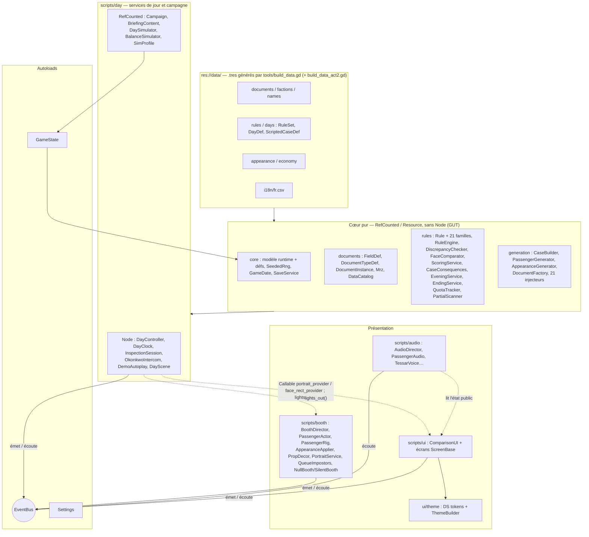
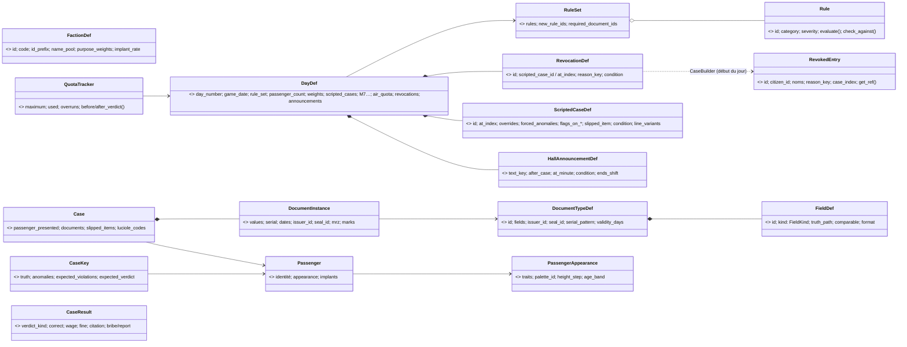
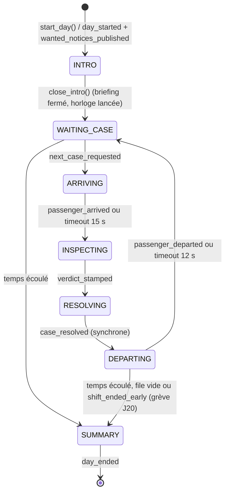

# ARCHITECTURE — CLEARANCE

> Propriétaire : **Godot Architect** · Statut : 🟢 validé par le client · Cible : **Godot 4.7.2**, GDScript typé, renderer Forward+
>
> Documents liés : [`AGENTS.md`](../AGENTS.md) · [`DECISIONS.md`](../DECISIONS.md) · [`DESIGN_SYSTEM.md`](../DESIGN_SYSTEM.md) · [`docs/UI_FLOW.md`](UI_FLOW.md) · [`docs/BOOTH_SCENE.md`](BOOTH_SCENE.md) (visuel du guichet, 3D Designer) · [`docs/ASSETS.md`](ASSETS.md) (rigs, clips, atlas, licences) · [`docs/AUDIO.md`](AUDIO.md) (Audio Designer) · [`docs/NARRATIVE.md`](NARRATIVE.md) (Scénariste)
>
> **Révision 3.5** (2026-10-28, corrections techniques de la passe QA de l'Acte II — `docs/QA.md` §12) : **QA-030** cause racine et correctif (§13 R31, autoload `AudioMixBarrier` §4, barks sans nœud dans le thread de travail §8 bis.8) ; R28 et R30 résolus ; §5 (`DayDef.asylum_class_rate` / `focus_documents`, `EveningEventDef.economy_gauges_min`, noms réservés des personnages des deux actes).
>
> **Révision 3.4** (2026-10-28, passe documentaire après l'Acte II — M8 parties A et B, jeu J1–J20, **515 tests GUT**) : §3 (arborescence), §5 (classes et champs Acte II), §6 (21 familles, R23–R31), §7 (34 signaux, émetteurs / écouteurs réels), §7.2 (contrat UI M8 → **état réel**), §8 (enchaînement J10 pivot / J20), §10 (sauvegarde v4), §12 (515 tests), §13 (R19, R22, R28–R30), §14 (M8 livré), §15 (`build_data_act2.gd`, arguments de debug Acte II), §16.8 (smoke J15 / J20). Décisions : D-076 → D-082.
>
> **Révision 3.2** (2026-10-28, M8 export) : §16 passé de « plan » à « état réel » (presets versionnés, icônes, `export_all.sh`, `smoke_export.sh`, CI, bug d'export des `PackedStringArray`) ; §15 (outils d'export).
>
> **Révision 3.1** (2026-10-28, corrections de la passe QA — `docs/QA.md`) : R18, R23, R25 résolus ; §4 (réglages de session), §5 (noms réservés, dates « année seule », symboles), §6.3 (signalement du code 1), §10 (sauvegarde atomique, borne du jour, version), §15 (`qa_boot.gd`), §16.4 (filtres d'export).
>
> **Révision 3** (2026-10-27, passe documentaire après M7 — jeu complet J1–J10, 414 tests GUT) : le document décrit désormais **le code réel**. Les notes « Implémenté en Mx » des révisions précédentes ont été fondues dans les sections concernées. Sections réécrites : §2–§14 ; **nouvelles** : §15 « Outils et pipelines », §16 « Export et distribution ». La numérotation §1–§14 est conservée (renvois des autres documents).
>
> **Légende** : sans mention = **état réel** (vérifié dans le code). 🎯 **Intention** = prévu mais non implémenté (ou implémenté autrement, l'écart est alors décrit). ⚠️ = incohérence connue, à corriger dans le code (liste en §13).

---

## 1. Principes directeurs

| # | Principe | Conséquence concrète |
|---|---|---|
| P1 | **Données plutôt que code** | Documents, champs, origines, règles, jours, économie, apparences, cas scénarisés, briefings, soirées = Resources `.tres` dans `res://data/`, **produites par `tools/build_data.gd`** (D-029). Ajouter une règle d'une famille existante ou un jour ne demande aucun code de jeu. |
| P2 | **Le cœur ne connaît pas l'UI** | `scripts/core|documents|rules|generation` n'étendent jamais `Node`/`Control`, ne chargent aucune scène, n'accèdent à aucun autoload (vérifié : aucune référence hors commentaires). Ils tournent en headless → testables par GUT. |
| P3 | **Vérité terrain** | Chaque cas est généré valide puis corrompu de façon contrôlée ; la réponse attendue est **recalculée par le `RuleEngine`** sur le cas final (§6). |
| P4 | **Déterminisme** | Toute aléa logique passe par un `SeededRng` (SplitMix64 maison). Même graine ⇒ même cas, bit à bit (`CaseSerializer`). Les seuls `RandomNumberGenerator` libres sont cosmétiques (audio, clignements), eux aussi seedés. |
| P5 | **Communication par signaux** | Logique ↔ UI ↔ 3D via l'autoload `EventBus` (§7). Exceptions documentées : deux `Callable` injectés dans l'UI (D-038), la lecture directe de `ComparisonUI` par l'`AudioDirector` (§8 bis.8) et, depuis M8, l'extinction des lumières du J20 : `DayScene` (intégrateur) écoute `hall_announced` puis appelle directement `BoothDirector.lights_out()` et `ComparisonUI.set_lights_out()` (§7.2). |
| P6 | **Autoloads minimaux** | 3 autoloads de jeu (`EventBus`, `Settings`, `GameState`) + `AudioMixBarrier` (contournement moteur sans état, QA-030). Services de jour, booth, audio, portraits = nœuds de `day.tscn`, remplaçables et testables. |
| P7 | **Un script = une responsabilité** | Pas de « GameManager ». ⚠️ Plusieurs scripts dépassent largement le seuil d'alerte : `ComparisonUI` (≈ 1 700 lignes), `EveningScreen` (≈ 1 030), `CaseBuilder` (≈ 900), `AudioDirector` (≈ 820), `BoothDirector` (≈ 730) — §13 R19. |
| P8 | **La logique ne dépend pas de l'animation** | Le jour avance même si une animation ne rend jamais la main : watchdogs du booth + timeouts du `DayController` ; `NullBooth`/`SilentBooth` en test (§8 bis.6). |

---

## 2. Vue d'ensemble des couches



**Règle de dépendance** : `CORE` ne référence ni `scripts/day`, ni les autoloads, ni la présentation. `Campaign` (RefCounted, `scripts/day/`) est la seule couche statique qui manipule `GameState` et `SaveService` ensemble. L'UI et le booth ne reçoivent que des objets « présentés » (`Case`, `DocumentInstance`, `CaseResult` après verdict), **jamais `CaseKey`** (gardée par `DayController`).

**Règle du booth** : `PassengerActor` ne connaît **ni l'EventBus ni `Case`** — API impérative (`assign`, `apply_appearance`, `apply_markings`, `walk_to_desk`, `present_documents`, `play_reaction`, `remove_visor`, `leave_along`, `set_look_target`, `set_expression`, `release`) et signaux **locaux**. `BoothDirector` est le **seul** nœud 3D branché sur l'EventBus. `AudioDirector` ajoute un `PassengerAudio` à chaque acteur sans modifier le booth.

---

## 3. Arborescence `res://` (état réel)

```
res://
├── project.godot               # autoloads, actions d'entrée, avertissements de typage (Godot Architect)
├── icon.svg                    # source des icônes (.ico/.icns générés dans assets/icons/, §16.6)
├── default_bus_layout.tres     # bus audio, GÉNÉRÉ par tools/build_audio.gd (D-049)
├── .gutconfig.json             # tests/unit + tests/integration, préfixe test_
├── addons/gut/                 # GUT 9.7.1 — VERSIONNÉ (D-008)
├── art_src/                    # sources d'art, .gdignore (invisible pour Godot, jamais exporté)
│   ├── kenney_skins/           # 8 skins Kenney CC0 versionnées (entrée de build_passenger_skins)
│   └── downloads/              # packs bruts (fetch_assets.sh) + _audio_build/ — IGNORÉ par git
├── assets/                     # ressources importées et versionnées (licences : docs/ASSETS.md §10)
│   ├── audio/                  # ambience/, music/ (OGG), sfx/{passenger,booth,station}/, ui/, voice/pa/ (WAV) — générés (§15)
│   ├── fonts/                  # Chakra Petch, Inter, JetBrains Mono (+ OFL-*.txt)
│   ├── models/passenger/       # chr_kenney_medium.fbx, anim_ual1_standard.glb, bonemap_*.tres,
│   │                           # passenger_anims.res, imp_silhouette.res (générés), License_*.txt
│   ├── shaders/                # booth_glass, rain_sheet, impostor_silhouette, chr_toon, passenger_body, face_dither, ui_backdrop_blur
│   ├── textures/passenger/     # tex_chr_zones_<skin>.png (générés)
│   └── icons/, materials/      # vides (icônes UI dessinées en code : UiIcon)
├── data/                       # CONTENU (.tres générés, sauf i18n)
│   ├── documents/              # doc_id_card, doc_entry_permit, doc_bioscan, doc_mil_waiver ;
│   │                           # Acte II : doc_work_contract, doc_drift_pass, doc_asylum, doc_queue_ticket (8 types)
│   ├── factions/               # faction_{tyc,hal,ter,cer,thr,drv}.tres
│   ├── names/                  # namepool_<faction>.tres
│   ├── rules/                  # 31 rule_*.tres (§6 ; R23–R31 : rule_air_quota … rule_ter_closed)
│   ├── days/                   # day_01..20.tres (DayDef) + ruleset_day_01..20.tres (40 fichiers)
│   ├── appearance/             # appearance_catalog.tres (10 slots en sous-ressources, pas de slot_*.tres)
│   ├── economy/                # economy.tres (EconomyDef)
│   └── i18n/                   # fr.csv (+ .import ; fr.fr.translation généré, ignoré par git, D-040)
├── scenes/
│   ├── main/                   # main.tscn + main.gd (titre), day.tscn (DayScene)
│   ├── booth/                  # booth.tscn — GÉNÉRÉ (déterministe) par tools/build_booth.gd (M9)
│   ├── passenger/              # passenger_actor.tscn ; passenger_demo.tscn (bac à sable / captures)
│   ├── ui/                     # comparison_ui.tscn ; comparison_ui_demo.tscn (bac à sable)
│   └── documents/              # vide : DocumentView générique construite en code
├── scripts/
│   ├── autoload/               # event_bus.gd, settings.gd, game_state.gd, audio_mix_barrier.gd
│   ├── core/                   # modèle runtime, Resources de définition, SeededRng, GameDate, SaveService, Household… ;
│   │                           # Acte II : hall_announcement_def, revocation_def, revoked_entry
│   ├── documents/              # FieldDef, DocumentTypeDef, DocumentInstance, FieldRef, FieldValue, Mrz, DataCatalog
│   ├── rules/                  # Rule, families/ (21), RuleSet, RuleEngine, RuleContext, DiscrepancyChecker,
│   │                           # FaceComparator, ScoringService, CaseConsequences, EveningService, EndingService… ;
│   │                           # Acte II : quota_tracker (QuotaTracker), partial_scanner (PartialScanner) ;
│   │                           # families/ : air_quota, contract_consistent, curfew, drift_pass, revoked_id
│   ├── generation/             # CaseBuilder, PassengerGenerator, AppearanceGenerator/Roster, DocumentFactory,
│   │                           # CaseSerializer, NamePool, ScriptedCaseDef, injectors/ (21 + base + registre + état ;
│   │                           # Acte II : contract_mismatch, unregistered_vessel, outdated_firmware, revoked_id)
│   ├── day/                    # DayController, DayClock, InspectionSession, DayScene, Campaign, BriefingContent,
│   │                           # OkonkwoIntercom, DemoAutoplay, DaySimulator, BalanceSimulator, SimProfile, DebugArgs
│   ├── booth/                  # BoothDirector, PassengerActor/Rig/Locomotion/Anims, AppearanceApplier, ExpressionController,
│   │                           # FaceAtlas, HeadScaleModifier, ImplantDecor, PropDecor (Acte II), GreyboxStyle, BoothQuality,
│   │                           # PortraitService, QueueImpostors, NullBooth, SilentBooth, PassengerDemo
│   ├── audio/                  # AudioDirector, AudioBuses, AudioCueBank, AudioDsp, PassengerAudio, TessarVoice, VoicePool
│   └── ui/                     # ComparisonUI, Workbench, DocumentView, RulebookPanel, RulebookReference, LinkLayer,
│                               # écrans (ScreenBase)…, UiText, UiIcon ; Acte II : quota_counter_view (QuotaCounterView),
│                               # revoked_card_view (RevokedCardView), chapter_screen (ChapterScreen)
├── ui/theme/                   # tokens.gd (class_name DS), theme_builder.gd (D-025) — rien d'autre
├── tests/
│   ├── unit/                   # 40 suites (392 tests)
│   ├── integration/            # 17 suites (123 tests)
│   ├── helpers/                # case_factory.gd, day_harness.gd, generation_fixtures.gd, gut_pre_run.gd (preload, pas de class_name)
│   └── manual/                 # vide (🎯 booth_sandbox jamais créé : remplacé par les scènes *_demo)
├── tools/                      # générateurs et outils headless (§15) ; build_data.gd + build_data_act2.gd (contenu J10–J20)
└── docs/                       # documentation + mockups/ (dont m11_* : captures Acte II) — .gdignore, jamais exportés (§16.4)
```

- **`scripts/day/`** mélange des `Node` (services de la scène de jour) et des `RefCounted` statiques (campagne, simulateurs) : ils partagent le même domaine (le jour / la campagne) et dépendent tous de `GameState` ou de services de jour, donc ni de `core` ni de `ui`.
- **`scripts/booth/`** : scripts 3D (ni `Control`, ni cœur headless). `NullBooth`/`SilentBooth` y vivent car ils servent aussi au mode `--no-booth`.
- **`res://ui/`** ne contient que `theme/` (R10 résolu).
- Fichiers générés versionnés : `*.import`, `*.uid` (D-027), `.tres` de `data/`, `booth.tscn`, assets audio et passager. Ignorés : `.godot/`, `*.translation`, `art_src/downloads/`, `build/` (exports). `export_presets.cfg` est versionné sans secret (§16.2).

---

## 4. Autoloads

Déclarés dans `project.godot`, dans cet ordre (pas de `class_name` sur un autoload) :

```ini
[autoload]
EventBus="*res://scripts/autoload/event_bus.gd"
Settings="*res://scripts/autoload/settings.gd"
GameState="*res://scripts/autoload/game_state.gd"
AudioMixBarrier="*res://scripts/autoload/audio_mix_barrier.gd"
```

| Autoload | Rôle (état réel) | Ne fait PAS |
|---|---|---|
| `EventBus` | 34 signaux typés (catalogue §7). Aucun état, aucune méthode. | Logique, stockage |
| `Settings` | Préférences dans `user://settings.cfg` (`ConfigFile`) : `volume_{master,music,ambience,sfx,voice,ui}` (appliqués aux bus `Master/Music/Ambience/SFX/Voice/UI`), `fx_intensity` (1 / 0,5 / 0), `reduce_motion`, `text_scale` (0,9–1,5, D-026), `subtitles`, `clock_slow_accessibility` (horloge ×0,5), `audio_mono`, `graphics_quality` (M9 : −1 Auto / 0 Bas / 1 Moyen / 2 Élevé ; `graphics_quality_level()` résout Auto = Moyen sur Steam Deck — variable `SteamDeck=1` —, Élevé ailleurs ; appliqué par `BoothQuality`). `set_value()` valide (`_sanitize`), applique et émet `settings_changed` (choix du joueur, persisté ; `persist = false` diffère seulement l'écriture). **Valeurs de session** (QA-006) : `set_session_value()` / `clear_session_value()` (argument `--reduce-motion`, outils, tests) appliquent sans jamais écrire — `save_settings()` écrit pour ces clés la dernière valeur persistée. `use_storage(path)` change de fichier : la suite GUT utilise `user://test_settings/settings.cfg` (crochet `tests/helpers/gut_pre_run.gd`, `.gutconfig.json`). 🎯 Langue, daltonisme, sensibilité manette : non implémentés. | État de partie |
| `GameState` | État de **campagne** : `campaign_seed`, `current_day`, `credits`, `score_total`, `citations`, `narrative_flags: Dictionary[StringName, Variant]` (drapeaux et jauges `loyalty` / `lucioles_trust` / `suspicion`), `day_history: Array[Dictionary]`, `household: Household`, `case_memory` (§9.4). `to_save_dict()` / `apply_save_dict()` / `save_to_slot()` / `load_from_slot()` (§10), `get_day_seed()`, `add_to_flag()`, `get_true_flags()`, `remember_case()`. Émet `credits_changed`, `narrative_flag_changed`, `game_saved`, `game_loaded`. | État du jour en cours (porté par `DayController`) |

| `AudioMixBarrier` (rév. 3.5, QA-030) | Barrière de mixage : `AudioServer.lock()` / `unlock()` une fois par image (`_process`, `PROCESS_MODE_ALWAYS`, avant `AudioServer.update()`) — contournement de la course de Godot 4.7.2 sur les `bus_details` (§13, R31). | Aucun état, aucun signal, aucun son |

`EventBus` est chargé en premier : les autres s'y connectent dans `_ready`.

---

## 5. Modèle de données

### 5.1 Vue d'ensemble



### 5.2 Définitions (Resources, `res://data/`)

| Classe | Script | Champs principaux (état réel) | Notes |
|---|---|---|---|
| `FieldDef` | `documents/field_def.gd` | `id`, `label_key`, `kind: FieldKind` (`TEXT, DATE, ID_CODE, ENUM, PORTRAIT, NUMBER, BOOL, LIST, TIME`), `truth_path`, `comparable`, `display_order`, `format` | `truth_path` = propriété de `Passenger` (`Passenger.TRUTH_PATHS`) ou `document.<prop>` (`serial`, `issue_date`, `expiry_date`, `issuer_id`, `seal_id`, `mrz`, `presented_at`) résolue par `DocumentInstance.get_value()`. `LIST` = `PackedStringArray` (implants). `TIME` (Acte II, valeur 8) = minutes depuis minuit, affichée `HH:MM` (`FieldValue.format_time`). |
| `DocumentTypeDef` | `documents/document_type_def.gd` | `id`, `title_key`, `fields`, `issuer_faction_ids`, `validity_days: Vector2i`, `holo_tint_token` (token `DS`), `issuer_id`, `seal_id`, `serial_pattern` | 8 types : `id_card` (dont `implants`, `firmware` (date du shunt `NX-`, Acte II), `seal`, `mrz`), `entry_permit`, `bioscan`, `mil_waiver` ; Acte II : `work_contract` (`contract_code` ↔ `employer_code`, `post`), `drift_pass` (`vessel`), `asylum` (`zone`), `queue_ticket` (`presented_at` en `TIME`, **sans sceau** : `seal_id` vide). ⚠️ `view_scene` n'est ni rempli ni lu (vue générique `DocumentView`). |
| `FactionDef` | `core/faction_def.gd` | `id`, `name_key`, `code`, `id_prefix`, `origin_sectors`, `name_pool`, `citizen_class_weights`, `purpose_weights`, `employers`, `implant_rate`, `implant_weights`, `year_only_birth_rate` (DRV 0,5 : naissances `00.00.AAAA`, §9.2) | 6 origines : TYC, HAL, TER, CER, THR, DRV. ⚠️ `seal_texture` non rempli, non lu. |
| `NamePool` | `generation/name_pool.gd` | `given_names_f/m/x`, `family_names`, `reserved_names` (jamais tirés : Okonkwo, noms de famille distinctifs, **nom de famille de chaque personnage scénarisé des deux actes et des avis nommés** — QA-022 —, prénoms du foyer), `reserved_full_names` (« Prénom Nom » des personnages scénarisés et des avis : prénom remplacé sans tirage, `avoid_reserved_full_name`) | Une par origine. Listes réservées **calculées** par `build_data.gd` depuis les `DayDef` (QA-002). |
| `Rule` (abstraite) | `rules/rule.gd` | `id`, `title_key`, `rulebook_text_key`, `category` (`DOCUMENTS, IDENTITY, FACTION, PURPOSE, SPECIAL`), `severity` 1–3 | §6. |
| `RuleSet` | `rules/rule_set.gd` | `id`, `rules`, `new_rule_ids` (badge « NOUVEAU »), `required_document_ids` | Liste **explicite et cumulative** par jour (pas d'héritage). Règles partagées entre RuleSets, **jamais mutées**. |
| `DayDef` | `core/day_def.gd` | `day_number`, `game_date`, `rule_set`, `duration_sec`, `passenger_count`, `anomaly_count_weights`, `anomaly_weights: Dictionary[AnomalyType.Kind, float]`, `scripted_cases`, `intro_text_key`, `credit_per_correct`, `penalty_per_error` ; GDD : `faction_weights`, `visor_down_rate`, `legit_noise_rate`, `bribe_rate`, `luciole_rate`, `free_citations_per_day`, `penalty_escalated` ; M7 : `detain_enabled`, `has_evening`, `bribe_amounts`, `wanted_notices`, `briefing_messages`, `evening_events`, `hall_announcements: Dictionary[int, String]`, `rulebook_tabs` ; **Acte II** : `air_quota` (0 = pas de quota), `luciole_trust_on_breach` (faux à l'Acte II), `revocations: Array[RevocationDef]`, `revoked_decoys`, `announcements: Array[HallAnnouncementDef]`, `asylum_class_rate` (part des TER C-4 tirés en C-5 avec attestation, R28 ; J15 : 1,0), `focus_documents` (documents de la règle du jour visés en priorité par `MISSING_DOCUMENT` / `EXPIRED_DOCUMENT`, QA-026) ; constantes `SHIFT_START_MIN` (10:00), `SHIFT_LENGTH_MIN` (8 h), `minute_at()` | J1–J10 : 8→16 passagers, 540→720 s ; DÉTENTION dès J7. J11–J20 : 16→18 passagers, 720→780 s, quota 5 (J11–J14) → 4 (J15–J18) → 3 (J19–J20) ; soirée **tous les jours sauf le J20** (J10 = soirée pivot, D-076). Onglets cumulés : `employers` (J12), `vessels` (J13), `revoked` (J17). |
| `ScriptedCaseDef` | `generation/scripted_case_def.gd` | `id`, `at_index`, `passenger_overrides`, `appearance_overrides`, `forced_anomalies` (liste exacte), `injection_params`, `dialogue_id`, `sets_flag`, `requires_flag`, `flags_on_approve/deny` ; M7 : `flags_on_detain`, `flags_if_unprocessed`, `extra_effects: Array[CaseEffectDef]`, `forbids_flags`, `appearance_from_case`, `identity_from_case`, `truth_overrides`, `extra_documents`, `slipped_item: SlippedItemDef`, `luciole_codes`, `extra_tags` ; **Acte II** : `condition` (la **première** définition active d'un index l'emporte : SC-35 a/b/c, SC-49, SC-50 a/b), `fixed_appearance_seed`, `line_variants: Array[ConditionalKey]`, `third_party_documents`, `password_grants_trust`, `flags_on_password`, `document_dates` | SC-01 → SC-50 + tutoriels J1, saisis dans les `DayDef` (`build_data.gd` / `build_data_act2.gd`). |
| `HallAnnouncementDef` (Acte II) | `core/hall_announcement_def.gd` | `text_key`, `after_case` (−1), `at_minute` (−1 ; 960 = 16:00), `condition: FlagCondition`, `ends_shift` | Complète `hall_announcements` (inconditionnelles). `ends_shift` : grève du J20, shift clos après le passager en cours (`DayController.shift_ended_early`). |
| `RevocationDef` (Acte II) | `core/revocation_def.gd` | `id`, `scripted_case_id` ou `at_index`, `reason_key` (facultatif), `condition` | Résolue en `RevokedEntry` par le `CaseBuilder` au début du jour (comme les avis, D-056) ; leurres `DayDef.revoked_decoys`. |
| `AppearanceCatalog` | `core/appearance_catalog.gd` | `slots`, `min_distance` (5), `window_size` (15), `max_attempts` (12), `age_band_weights`, `height_step_range` | Slots : `silhouette, face, eyes, nose_mouth, skin, hair, headwear, outfit, accessory, palette`. Coiffes `visor_down/visor_up` de poids 0. |
| `AppearanceSlotDef` / `AppearanceOptionDef` | `core/appearance_*.gd` | slot : `id`, `identity`, `visible_in_portrait`, `options` ; option : `id`, `weight`, `faction_weights`, `tags` | Le rendu est déduit des **identifiants** (`AppearanceApplier` + `GreyboxStyle`). ⚠️ Les champs visuels `mesh`, `atlas_cell`, `material`, `portrait_layer` ne sont ni remplis ni lus. |
| `EconomyDef` | `core/economy_def.gd` | loyer / taxe d'air (et hausses datées), nourriture, chauffage, oxygène, soins, règles de santé du foyer, expulsion, `detain_bonus`, `report_bonus`, seuils d'audit, seuils F4/F6 ; **Acte II** : `pivot_day` (10), `pivot_suspicion_divisor`, rations (`ration_start_day` 11, `ration_self/ilan/noa/dora`), compteur (`meter_surcharge`, `meter_fee`), prélèvements D-079 (`levy_rate` 0,30, `levy_floor` 40, `levy_days` [11, 17]), hausses datées (nourriture J15, oxygène et soins J16), `lease_cost` (ACV-2), `ilan_job_income` / `ilan_job_first_day`, `bail`, `dora_ticket`, `drift2_cost`, Revue J17 (`review_arrest_score` 5, `review_demote_score` 3 — D-080, `review_retention`), seuils des fins du J20 (`double_game2_threshold`, `air2_trust_threshold`, `glory2_loyalty_threshold`, `strike_solidarity_threshold`, `registre_threshold`, `drift2_min_present`) ; `rations_for()`, `ration_of()`, `levy_for()`, `food_for()`/`oxygen_for()`/`medicine_for()` | `data/economy/economy.tres` (D-044, D-047, D-059, D-077 → D-080). |
| `SlippedItemDef` | `core/slipped_item_def.gd` | `kind` (`SlippedItem.Kind` : `ENVELOPE, NOTE, DOCK_CARD` ; Acte II : `FORM, OBJECT, FILE`, ajoutés en fin), `amount`, `label_key`, `text_key`, `extra_text_keys`, `allowed`, `default_decision`, `report_bonus`, `effects` | Objets glissés des cas scénarisés (D-054). |
| `WantedNoticeDef` | `core/wanted_notice_def.gd` | `id`, `scripted_case_id` ou `at_index`, noms, `reason_key` ; Acte II : `condition`, `faces_only` (avis « visages seuls » du J20, sans nom), `memory_case_id` (personne absente de la file, visage repris de `CaseMemory`) | Avis liés à des passagers du jour (D-056). |
| `BriefingMessageDef` | `core/briefing_message_def.gd` | `speaker_key`, `text_key`, `voice`, `condition`, `group`, `family_slot`, `priority` | Table conditionnelle (≤ 4 messages / jour). |
| `EveningEventDef` / `EveningOptionDef` | `core/evening_*_def.gd` | événement : `id`, `kind`, `order`, `condition`, textes, `options`, `flags`, `line_costs` ; Acte II : `audit_id` (vide = audit du J9, `review` = Revue du J17), `household`, `text_gauges` (valeurs des `%d`), `economy_gauges_min` (jauge → seuil lu dans l'`EconomyDef`, R28) ; option : `id`, `label_key`, `result_key`, `cost`, `gain`, `requires_funds`, `flags`, `line_costs`, `household` (Acte II : `ilan_released`, `ilan_soute`, `ilan_back`, `dora_tycho`), `condition`, `default_rank` ; Acte II : `ends_campaign` (« Embarquer » → `f6_drift`), `set_gauges` (valeurs absolues après les deltas) | Soirées J4–J19 (D-058, D-061, D-076). |
| `FlagCondition`, `ConditionalKey`, `CaseEffectDef` | `core/` | `all_of`, `any_of`, `none_of`, `gauges_min/max` ; clé conditionnelle (Acte II : `replaces` = suffixe de réplique remplacé) ; effet `verdict × condition → flags` (Acte II : `context` ∈ `quota_reached`, `after_curfew`, `overrun`, calculé par `CaseConsequences.contexts_for`) | Conditions narratives réutilisées partout. |

### 5.3 Objets runtime (RefCounted)

| Classe | Rôle | Champs principaux |
|---|---|---|
| `Passenger` | Identité (vraie ou présentée) | `id`, `given_name`, `family_name`, `birth_date`, `sex`, `faction_id`, `origin_sector`, `citizen_id`, `citizen_class`, `appearance_seed`, `appearance`, `purpose`, `stay_days`, `employer`, `health_status`, `implants` (visibles sur le corps) ; Acte II : `employer_code` (`CT-XX`, R25), `post` (R31), `vessel` (R26), `firmware_date` (`GameDate`, 0 = aucun shunt `NX-`, R27) ; `TRUTH_PATHS`, `copy()`, `apply_overrides()` |
| `PassengerAppearance` | Apparence modulaire, **pure** (identifiants seulement) | `traits`, `palette_id`, `height_step` (−2..+2), `age_band` ; `distance()`, `derive()`, `copy()`, `serialize()`, `is_face_covered()`, `without_visor()` |
| `PortraitValue` | Valeur d'un champ `PORTRAIT` | `appearance` (la personne sur la photo), `photo_seed`, `years_before_issue` |
| `DocumentInstance` | Document tendu | `type_def`, `serial`, `issue_date`, `expiry_date`, `issuer_id`, `seal_id`, `mrz` (bande `Mrz`), `marks` (`&"luciole"`), `values` ; Acte II : `presented_at` (minutes, ticket de file, −1 sinon), `third_party` (document d'un tiers, SC-27 : jamais comparé, ignoré par les règles du porteur) ; `get_value()` / `set_value()` / `copy()` |
| `FieldRef` | Pointeur vers un champ affiché | `document_id`, `field_id` ; pseudo-références : `passenger_face()`, `today()`, `rulebook_rule(id)`, `wanted(id)`, `symbol(id)` (bulletin « Symboles subversifs », `__symbols__`), `mark(document_id, mark_id)` (marque au coin d'un document, `mark:luciole`) ; Acte II : `revoked(entry_id)` (`__revoked__`, onglet Révocations), `quota_counter()` (`__counter__/quota`, compteur de la barre d'état) ; `is_revoked()`, `is_quota_counter()` |
| `Case` | **Ce que voit le joueur** | `case_id`, `index`, `case_seed`, `passenger_presented`, `documents`, `dialogue_tags`, `slipped_items`, `luciole_codes`, `presentation` (`&"knock_three"`) ; Acte II : `line_overrides` (suffixe → clé, résolu sur les drapeaux du matin) ; `remove_visor()`, `get_value(ref)`, `find_refs_by_*` (`find_refs_by_truth_path(path, include_third_party = false)`), `get_own_document()` / `has_own_document()` (hors tiers), `scripted_key(suffix, fallback, exists)` |
| `CaseKey` | **Clé de réponse** (jamais transmise) | `truth`, `anomalies`, `expected_violations`, `expected_verdict` |
| `Anomaly` / `AnomalyType.Kind` | Corruption injectée | 21 valeurs **figées** (D-033) : `EXPIRED_DOCUMENT`… `WANTED_PERSON = 16` ; Acte II (ajoutées en fin) : `CONTRACT_MISMATCH = 17`, `UNREGISTERED_VESSEL = 18`, `OUTDATED_FIRMWARE = 19`, `REVOKED_ID = 20` ; `cosmetic` |
| `Violation`, `Discrepancy`, `Verdict`, `VerdictKind` | Sorties règle / comparaison / décision | `Discrepancy.result` (`CONCORDANT, DISCORDANT, INCOMPARABLE`), `differing_traits`, `reason_key` ; `Verdict.kind` (`APPROVE, DENY, DETAIN`), `flagged`, `elapsed_sec` |
| `CaseResult` | Sortie du scoring (§8) | `verdict_kind`, `expected_verdict`, `correct`, `verdict_correct`, `documented`, `expected_violations` / `missed_violations` (révélées après verdict), `wage`, `fine`, `credits_delta`, `citation_*`, `procedure_missed`, `scripted_id`, `narrative_changes`, `item_decisions`, `bribe_credits`, `report_credits`, `password_answered`, `luciole_report` (§6.3) ; Acte II : `quota_counted`, `quota_full`, `quota_refusal` (REFUS motivé par le seul quota : correct, documenté d'office), `quota_overrun` (APPROUVÉ au-delà du quota : 0 ₵) |
| `DaySummary` | Bilan du jour | résultats, non traités, `time_expired`, `unprocessed_changes` ; `get_wage_total()`, `get_fine_total()`, `get_net()`, `get_bribe_total()`, `get_report_total()`, `get_total_income()` ; Acte II : `get_overrun_count()`, `get_quota_refusal_count()` |
| `RuleContext` | Contexte d'évaluation | `today`, `day_def`, `rule_set`, `faction_db`, `document_db`, `identity_slots`, `wanted` ; Acte II : `revoked: Array[RevokedEntry]`, `quota_used`, `quota_max` ; `find_revoked()`, `is_revoked(citizen_id)`, `is_quota_full()` |
| `RevokedEntry` (Acte II) | Entrée résolue de l'onglet Révocations | `id`, `citizen_id`, `given_name`, `family_name`, `reason_key`, `case_index` (−1 = leurre) ; `full_name()`, `get_ref()` = `FieldRef.revoked(id)` |
| `QuotaTracker` (Acte II, `rules/`) | Compteur du quota respiratoire d'un shift (pur ; partagé par `DayController` et `DaySimulator`) | `rule: AirQuotaRule`, `maximum`, `used`, `overruns` ; `for_day(day)` (inactif sans R23 ou sans `air_quota`), `is_active()`, `is_full()`, `counts(case)`, `before_verdict(case)` (quota atteint pour ce passager), `after_verdict(case, verdict)` (vrai si entrée imputée), `sync(ctx)` |
| `PartialScanner` (Acte II, `rules/`) | Scanner partiel du guichet, statique | `SOURCE_ACV` / `SOURCE_LUCIOLE` (drapeaux `scanner_consortium`, `scanner_luciole`, `scanner_luciole_removed` ; l'ACV-2 l'emporte) ; `source_for(flags)`, `suggestions(case, ctx)` = discordances **date ↔ jour** déjà calculées par le `DiscrepancyChecker` (zéro faux positif) |
| `RulebookEntry` | Ligne du Rulebook | `rule_id`, `title_key`, `text_key`, `category`, `severity`, `is_new`, `ref` |
| `SlippedItem`, `WantedNotice`, `CaseMemory`, `Household`, `EveningEvent`, `EveningReport`, `ExpenseLine` | M5/M7/M8 | objet glissé et sa décision ; avis (`get_ref()`) ; mémoire des cas scénarisés (Acte II : aussi les visages des avis `memory_case_id`) ; foyer (Ilan, Noa, Dora : santé, faim, froid, `detained` ; Acte II : `breathless`, `breathless_streak`, `away` ∈ {`soute`, `tycho`}, `is_present()`, `present_members()`, `present_count()`, `state_key()` ; « mis·e en attente » ≠ `LOST`) ; soirée (Acte II : `EveningEvent.text_args`, `EveningReport.income_lines`, `ExpenseLine.ration_of`) |
| `DataCatalog` | Chargement indexé de `res://data/` | `factions`, `documents`, `rules`, `rule_sets`, `days`, `errors` ; `load_from()`, `get_day()`, `get_economy()`, `make_context()` ; liste les fichiers par `DirAccess` et suit les `.remap` d'export (§16) |

- **Dates** : `GameDate` = entier « jours depuis 01.01.2100 » ; jamais `Time`/OS dans la logique. Date « année seule » (Dérivants, NARRATIVE §4.10) : `GameDate.year_only(AAAA)` = `YEAR_ONLY_BASE − AAAA` (hors de toute vraie date), lue `(AAAA, 0, 0)` par `to_ymd` ⇒ affichage `00.00.AAAA`, égalité par année (R07), `add_years` conservé ; `possible_ages()` = {âge − 1, âge} ; `latest_day()` = 31.12.AAAA ; `Passenger.is_birth_year_only()`. (NARRATIVE proposait 01.01.AAAA + booléen : l'encodage dans l'entier évite de propager un drapeau sur chaque champ de document.)
- **`Case` / `CaseKey` séparés** physiquement : l'UI ne peut pas tricher par erreur.
- **Invariant d'apparence** : l'acteur 3D affiche `case.passenger_presented.appearance`, toujours égale à l'apparence physique réelle ; aucun injecteur ne la modifie (seulement les `PortraitValue`). Exception assumée : la visière (état physique, posée sur la vérité *et* le présenté).

---

## 6. Moteur de règles

```gdscript
class_name Rule extends Resource   # @abstract
func evaluate(case: Case, ctx: RuleContext) -> Array[Violation]
func get_detectable_anomalies() -> Array[AnomalyType.Kind]
func check_against(case: Case, ref: FieldRef, ctx: RuleContext) -> Discrepancy.Result  # mode Inspection : règle ↔ champ
func get_required_document_ids() -> Array[StringName]
func get_referenced_truth_paths() -> Dictionary[StringName, Array]                       # validation des données
func get_rulebook_entry() -> RulebookEntry
```

- **Comportement par famille (script), paramètres par `.tres`.** Règles pures : pas d'état, pas d'aléa, pas d'arbre de scène ; contexte passé explicitement (`RuleContext`).
- **`RuleEngine`** : `validate(case, rule_set, ctx)`, `expected_verdict(violations)` — **DÉTENTION** si une violation a une sévérité ≥ 3, sinon **REFUS** s'il y en a au moins une, sinon **APPROBATION** (D-030) —, `build_case_key()`.
- **Vérité terrain** (R1 résolu) : la réponse attendue est recalculée sur le cas final ; invariants vérifiés par `CaseBuilder.check_invariants()` et par les tests : cas propre ⇒ 0 violation (8 re-tirages max), chaque anomalie prouvée par une règle active (sauf `cosmetic`), seuls les types détectables du jour sont tirés.
- **Procédures** (R06, R08) : `ProcedureRule` ne produit jamais de violation ; vérifiées par le `ScoringService` (D-031).

### 6.1 Familles (26, `scripts/rules/families/`)

| Famille | Paramètres `@export` | Règles |
|---|---|---|
| `RequireDocumentRule` | `document_id`, `exempt_faction_ids` ; Acte II : `applies_to_faction_ids`, `applies_to_purposes`, `applies_to_classes`, `require_valid` (document présent **et** non expiré), `permit_id`, `card_id` | R01, R04, R11, R24, R28 |
| `DocumentNotExpiredRule` | `document_id`, `max_age_days`, `detected_anomalies` ; Acte II : `field_path` (date lue dans un champ, ex. `firmware_date`) | R02, R05, R12, R27 |
| `PortraitMatchRule` | `check_passenger_face`, `check_between_documents`, `max_differing_traits`, `detected_anomalies` | R03, R17 |
| `ProcedureRule` | `procedure_id`, `applies_to_faction_ids` | R06, R08 |
| `FieldsMatchRule` | `truth_paths`, `document_ids`, `detected_anomalies` | R07 |
| `PurposeConsistentRule` | `permit_id`, `card_id`, `work_purpose`, `no_employer_values`, `short_stay_*` | R09 |
| `OriginIdBlockRule` | — | R10 |
| `IssuerAllowedRule` | `document_id`, `allowed_issuer_ids` | R13 |
| `FieldValueAllowedRule` | `document_id`, `truth_path`, `allowed_values`, `detected_anomalies` | R14 |
| `ImplantsDeclaredRule` | `document_id`, `escalated_prefixes`, `escalated_from_day`, `escalated_severity` | R15 |
| `BannedImplantsRule` | `document_id`, `always_banned`, `waiver_prefixes`, `waiver_document_id` | R16 |
| `ApparentAgeRule` | `document_id` | R18 |
| `FactionBannedRule` | `banned_faction_ids`, `exempt_purposes`, `card_id`, `permit_id` ; Acte II : `exempt_posts`, `contract_id` ; M9 : `exempt_if_sponsored` | R19, R31, R37 |
| `SealValidRule` | — | R20 |
| `MrzConsistentRule` | `document_id` | R21 |
| `WantedRule` | `document_id` (lit `RuleContext.wanted`) | R22 |
| `AirQuotaRule` (M8) | `exempt_faction_ids` (HAL), `exempt_purposes` (diplomatique), `permit_id` ; `find_in(rule_set)`, `counts(case)` | R23 — **règle de contexte souple** : jamais de violation ; `check_against` sur `FieldRef.quota_counter()` DISCORDANT si le quota est atteint pour ce passager ; le `ScoringService` en tire `quota_refusal` / `quota_overrun` |
| `ContractConsistentRule` (M8) | `contract_id`, `permit_id`, `employer_codes: Dictionary[String, String]` (employeur → code `XX`), `posts` | R25 |
| `DriftPassRule` (M8, hérite de `RequireDocumentRule`) | `registered_vessels` (+ paramètres hérités) | R26 : laissez-passer requis, vaisseau inscrit = nom de famille du porteur |
| `CurfewRule` (M8) | `ticket_id`, `permit_id`, `curfew_minute` (960 = 16:00), `banned_purposes`, `exempt_faction_ids` (HAL) | R29 |
| `RevokedIdRule` (M8) | `document_id` (lit `RuleContext.revoked`) ; M9 : ignore une entrée réintégrée si R33 est active | R30 |
| `ProrogationRule` (M9) | `window_start`, `window_end`, `extended_until` ; `covers()`, `in_window()` | R32 — **règle de lecture** : jamais de violation ; les règles d'expiration lisent `RuleContext.is_document_expired()` |
| `ReinstatementRule` (M9) | — | R33 (lecture de `RevokedEntry.reinstated_on`) |
| `SponsorRule` (M9) | `exempt_faction_ids` (HAL), `purposes` (visite familiale), `permit_id` ; `has_valid_sponsor()` | R34 — **contexte du shift** (Main courante) |
| `ContractSuspendedRule` (M9) | `faction_ids` (TYC), `suspended_codes` (`KA`), `contract_id`, `card_id` | R35 |
| `SummonsRule` (M9) | `permit_id`, `card_id` ; `is_valid_summons()`, `is_forged()` | R36 ; exemptions déclaratives par `Rule.summons_exempt` |

### 6.2 Les 37 règles (`data/rules/` ; cumulatives jusqu'au J20, liste explicite ensuite)

| Jour | Règles (id, sévérité) |
|---|---|
| J1 | R01 `r_id_card_required` (2), R02 `r_id_card_valid` (2) |
| J2 | R03 `r_portrait_match` (2) |
| J3 | R04 `r_permit_required`, R05 `r_permit_valid`, R07 `r_identity_fields_match` (2) ; R06 `r_face_uncovered` (procédure, 1) |
| J4 | R08 `r_tycho_interview` (procédure, 1), R09 `r_purpose_consistent`, R10 `r_origin_block` (2) |
| J5 | R11 `r_bioscan_required`, R12 `r_bioscan_valid`, R13 `r_bioscan_issuer`, R14 `r_bioscan_fit` (2) |
| J6 | R15 `r_implants_declared` (2 ; 3 pour un `MIL-` non déclaré dès J7), R16 `r_banned_implants` (2) |
| J7 | R17 `r_identity_fraud_detain` (sosie 1–2 traits, **3**) |
| J8 | R18 `r_apparent_age` (**3**), R19 `r_tharsis_banned` (2) |
| J9 | R20 `r_seals_valid`, R21 `r_mrz_valid` (2) |
| J10 | R22 `r_wanted_detain` (**3**) |
| J11 | R23 `r_air_quota` (`AirQuotaRule`, quota souple : **jamais de violation**, D-077), R24 `r_contract_required` (2) |
| J12 | R25 `r_contract_consistent` (`ContractConsistentRule`, code employeur ↔ registre, 2) |
| J13 | R26 `r_drift_pass` (`DriftPassRule` : laissez-passer requis, vaisseau inscrit = nom de famille, 2) |
| J14 | R27 `r_nx_firmware` (`DocumentNotExpiredRule` sur `firmware`, > 90 j, 2) |
| J15 | R28 `r_asylum_required` (TER C-5, 2) |
| J16 | R29 `r_curfew` (`CurfewRule` : ticket de file ≥ 16:00, VISITE/TOURISME refusés, HAL exemptés, 2) |
| J17 | R30 `r_revoked_ids` (`RevokedIdRule`, lit `RuleContext.revoked`, 2) |
| J18–J20 | R31 `r_ter_closed` (`FactionBannedRule` + `exempt_posts` : RECYCLEUR / SOINS / HYDROPONIE, 2) |
| J21 | R32 `r_prorogation` (lecture) ; R29 **retirée** (ticket de file retiré) |
| J22 | R33 `r_reinstated` (lecture) |
| J23 | R11–R14 **retirées** (bio-scan repris par les quais) |
| J24 | R34 `r_sponsor` (2) |
| J25 | R35 `r_tycho_lockout` (2) |
| J26 | R36 `r_summons` (2) |
| J28–J30 | R37 `r_tycho_closed` (`FactionBannedRule` TYC + `exempt_if_sponsored`, 2) |

Acte III (`tools/build_data_act3.gd`) : RuleSets J21–J30 **non cumulatifs** (M1), règles retirées rappelées au Rulebook (`RuleSet.retired_rules`) ; R19, R23, R30, R31 `summons_exempt` ; R31 `exempt_if_sponsored` (SC-61, D-091 proposé) ; R26 `retired_vessels` (`BASSE-MARÉE` au 02.04) ; code employeur `AR` (Arbitrage de Continuité).

Données des règles Acte II (`tools/build_data.gd` + `build_data_act2.gd`) : R24 = `RequireDocumentRule` (`work_contract`, motif `work`, `require_valid`) ; R26 = `DriftPassRule` (`drift_pass`, DRV, `require_valid`) ; R27 = `DocumentNotExpiredRule` (`id_card`, `field_path = firmware_date`, 90 j) ; R28 = `RequireDocumentRule` (`asylum`, TER, classe `C-5`, `require_valid`) ; R31 = `FactionBannedRule` (TER, `exempt_purposes` vide, `exempt_posts` = `post_recycleur` / `post_soins` / `post_hydroponie`). Codes employeurs : `Act2.EMPLOYER_CODES` (LORE + PI/DL/EQ/CR, D-081). Documents d'un **tiers** (`DocumentInstance.third_party`, SC-27) : jamais comparés (`INCOMPARABLE`), ignorés par R07/R10 et par les règles du porteur (`Case.get_own_document`). J19 et J20 : aucune règle nouvelle (31 règles actives).

### 6.3 Comparaison (mode Inspection)

- **`DiscrepancyChecker.check(case, a, b, ctx) -> Discrepancy`** compare ce qui est **affiché** (jamais `CaseKey`). Paires : même `truth_path` entre documents ; photo ↔ visage (`FieldRef.passenger_face()`) et photo ↔ photo ; date ↔ `FieldRef.today()` ; règle ↔ champ (`Rule.check_against`, R09, R15, R16, R19, R20, R21) ; visage ↔ `implants` (`disc_implant_mismatch`) ; visage ↔ naissance (`disc_age_mismatch`) ; MRZ ↔ N° ID / origine / nom / prénoms de la même carte (`disc_mrz_mismatch`) ; avis ↔ visage ou nom (`disc_wanted_match` / `disc_wanted_no_match`) ; marque d'un document ↔ symbole du bulletin, si l'onglet `symbols` est ouvert ce jour (J7+) ⇒ `disc_symbol_match`. Visage masqué ⇒ `INCOMPARABLE` (`disc_face_masked`). Naissance « année seule » ↔ visage : concordante si l'un des deux âges possibles est dans la tranche (`ApparentAgeRule.birth_matches_band`, zéro faux positif).
- **Signalement d'un porteur du code 1** (NARRATIVE §4.9) : DÉTENTION + `disc_symbol_match` épinglée sur un cas `luciole_codes ∋ 1` ⇒ `ScoringService.is_luciole_report` : cas correct, aucune citation ni procédure, salaire + prime de détention (`CaseResult.luciole_report`) ; `CaseConsequences.compute(…, luciole_report)` : `luciole_reported_at_booth`, `lucioles_trust −2`, `loyalty +1` une seule fois (pas de cumul avec la dénonciation générique) ; un cas scénarisé avec `flags_on_detain` (SC-13) garde ses drapeaux à la place des jauges. **L'UI doit rendre sélectionnables** la marque (`FieldRef.mark(doc, &"luciole")`) et l'entrée du bulletin (`FieldRef.symbol(&"luciole")`).
- **Paires Acte II** : entrée de l'onglet Révocations (`FieldRef.revoked(id)`) ↔ N° ID d'un document ⇒ `disc_revoked_match` (DISCORDANCE si égal) / `disc_revoked_no_match` ; compteur QUOTA (`FieldRef.quota_counter()`) ↔ règle R23 (via `AirQuotaRule.check_against`) — avec tout autre champ : `INCOMPARABLE` ; champ `firmware` ↔ `FieldRef.today()` évalué par la `DocumentNotExpiredRule` active de `field_path = firmware_date` (sinon `INCOMPARABLE`, règle inactive) ; document d'un tiers ↔ document du porteur : `INCOMPARABLE`. Les discordances de R23 / R29 / R30 / R25 débloquent un sujet d'interrogation **par famille** (`about_quota`, `about_curfew`, `about_revoked`, `about_contract` ; `InspectionSession` + `InterrogationTopics.RULE_TOPICS`).
- **Scanner partiel** (`PartialScanner`, §5.3) : ne crée aucune paire nouvelle ; il **pré-calcule** les discordances date ↔ jour, que le joueur confirme par `discrepancy_check_requested` (même chemin qu'une sélection A → B, D-082).
- **`FaceComparator.compare(a, b, identity_slots)`** renvoie les slots d'identité visibles en portrait qui diffèrent ; tenue, coiffe, accessoire et `age_band` ±1 ignorés. `identity_slots_of(catalog)` alimente `RuleContext.identity_slots`.

---

## 7. Catalogue des signaux `EventBus`

Source : `scripts/autoload/event_bus.gd` — **34 signaux**, tous typés (liste exhaustive ci-dessous, vérifiée le 2026-10-28 ; 3 ajoutés en M8 : `quota_changed`, `revocations_published`, `scanner_suggested`). Convention : passé pour un fait, `*_requested` pour une intention de l'UI. Émetteurs / écouteurs **de production** relevés dans le code (les scènes de démo `comparison_ui_demo`, `passenger_demo`, `demo_booth_backdrop` émettent aussi la plupart des signaux pour simuler la logique).

| Signal | Paramètres | Émetteurs → Écouteurs (état réel) |
|---|---|---|
| **Jour** | | |
| `day_started` | `day: DayDef, rulebook: Array[RulebookEntry]` | DayController → ComparisonUI, BoothDirector (graine de la file), AudioDirector, OkonkwoIntercom |
| `day_clock_ticked` | `remaining_sec: float` | DayClock → ComparisonUI, AudioDirector (musique « tension ») |
| `day_time_expired` | — | DayClock → DayController |
| `day_ended` | `summary: DaySummary` | DayController → DayScene (sirène puis bilan ; après une grève du J20 : fondu au noir complet puis bilan), AudioDirector |
| `day_phase_changed` | `phase: DayPhase.Kind, case_id: StringName` | DayController → ComparisonUI (tampon, « Suivant »), AudioDirector, OkonkwoIntercom |
| `wanted_notices_published` | `notices: Array[WantedNotice]` | DayController (juste après `day_started`) → ComparisonUI (onglet Avis du Rulebook) |
| `hall_announced` | `text_key: String` | DayController (`hall_announcements` après le n-ième cas ; `HallAnnouncementDef` après un cas ou à `at_minute` ; `hall_quota_full` quand le compteur se remplit), DayScene (debug `--lights-out` seulement) → ComparisonUI (sous-titre haut-parleur), AudioDirector (`amb.pa_announce`), **DayScene** (annonce `ends_shift` ⇒ `lights_out()`, §7.2) |
| `quota_changed` | `used: int, maximum: int` | DayController (à `start_day` — `maximum` 0 si pas de quota — puis après **chaque tampon** tant que le quota est actif) → ComparisonUI (`TopBar.set_quota` → `QuotaCounterView` ; rafraîchit le texte de R23 dans le Rulebook) |
| `revocations_published` | `entries: Array[RevokedEntry]` | DayController (à `start_day`, juste après `wanted_notices_published`, **chaque jour** : liste vide avant le J17) → ComparisonUI (`RulebookPanel.set_revoked`, onglet Révocations) |
| **Passager** | | |
| `next_case_requested` | — | ComparisonUI (« Suivant »), DemoAutoplay, DayScene (debug) → DayController (ignoré hors `WAITING_CASE`) |
| `case_presented` | `case: Case` | DayController → BoothDirector, ComparisonUI, AudioDirector, OkonkwoIntercom, NullBooth/SilentBooth |
| `passenger_arrived` | `case_id` | BoothDirector / NullBooth → DayController, AudioDirector |
| `documents_presented` | `case_id` | BoothDirector / NullBooth, **ou DayController sur timeout** → ComparisonUI, InspectionSession, DayController (objets glissés), AudioDirector, OkonkwoIntercom, DemoAutoplay, DayScene (captures) |
| `document_focused` | `doc: DocumentInstance` | ComparisonUI → ⚠️ **aucun écouteur** (prévu : télémétrie / tutoriel ; le commentaire d'`event_bus.gd` annonce encore InspectionSession) |
| `passenger_reaction_triggered` | `reaction: PassengerReaction.Kind` | InspectionSession → BoothDirector, ComparisonUI, AudioDirector |
| `passenger_departed` | `case_id` | BoothDirector (guichet libéré, `ClearMark`) / NullBooth → DayController, AudioDirector |
| `inspection_target_picked` | `ref: FieldRef` | BoothDirector (clic visage) → ComparisonUI, BoothDirector (travelling visage) |
| `scanner_suggested` | `case_id, links: Array[Discrepancy], source: StringName` | DayController (au premier `documents_presented`, si un scanner est branché : `PartialScanner.source_for`, liste éventuellement vide) → ComparisonUI (liens pointillés `LinkLayer.add_suggested`, pastille de source du `Workbench`, `confirm_suggestion()`) |
| `item_slipped` | `item: SlippedItem` | DayController (au premier `documents_presented`) → ComparisonUI, AudioDirector |
| `item_decision_requested` | `item_id, decision: SlippedItem.Decision` | ComparisonUI → DayController (ignoré hors `INSPECTING` ou si non autorisé) |
| `item_decided` | `item, decision` | DayController (décision, ou **défaut au tampon**) → ComparisonUI, AudioDirector |
| **Inspection** | | |
| `inspection_mode_changed` | `enabled: bool` | ComparisonUI, DayScene (debug) → InspectionSession, BoothDirector, AudioDirector |
| `discrepancy_check_requested` | `a: FieldRef, b: FieldRef` | ComparisonUI, DemoAutoplay → InspectionSession, AudioDirector |
| `discrepancy_checked` | `result: Discrepancy` | InspectionSession → ComparisonUI, AudioDirector, OkonkwoIntercom, DemoAutoplay |
| `interrogation_requested` | `topic: StringName` | ComparisonUI, DemoAutoplay, DayScene (debug) → InspectionSession |
| `interrogation_answered` | `topic, line_key: String` | InspectionSession → ComparisonUI (sous-titres), BoothDirector (parole, visière), AudioDirector (voix Tessar) |
| **Verdict / score** | | |
| `verdict_stamped` | `verdict: Verdict` | ComparisonUI (tampon maintenu), DemoAutoplay, DayScene (debug) → DayController, AudioDirector |
| `case_resolved` | `case_id, result: CaseResult` | DayController → ComparisonUI, BoothDirector (sortie selon `verdict_kind`), NullBooth, AudioDirector, OkonkwoIntercom |
| `citation_issued` | `reason_key: String` | DayController (après `case_resolved`) → ComparisonUI (ticket), AudioDirector, OkonkwoIntercom |
| `credits_changed` | `credits: int, delta: int` | GameState → ComparisonUI |
| **Méta** | | |
| `narrative_flag_changed` | `flag, value: Variant` | GameState → ⚠️ **aucun écouteur** (les drapeaux sont relus à la demande) |
| `settings_changed` | `key, value: Variant` | Settings → ComparisonUI, ScreenBase, PauseMenu, AudioDirector, BoothQuality, main.gd |
| `game_saved` / `game_loaded` | `slot: int` | GameState → ⚠️ **aucun écouteur** |

**Robustesse** : tous les signaux du booth portent `case_id` ; `DayController` ignore un signal d'un autre cas ou hors de l'état attendu ; `BoothDirector._emit_once()` n'émet chaque fait qu'une fois par cas, dans l'ordre `passenger_arrived → documents_presented → passenger_departed`. Seule exception à « un émetteur par fait » : le timeout `documents_presented` du `DayController`. `document_handed` a été supprimé au profit de `documents_presented(case_id)` (D-014).

**Signaux locaux hors EventBus** (contrats de composants) : `PassengerActor` (`arrived`, `departed`, `cleared`, `anim_event`, `reaction_finished`, `face_clicked`) ; `BoothDirector` (`glass_knocked`, `escort_started`, `escort_finished`) ; `ComparisonUI` (`hovered`, `toast_shown`, `departure_line_shown`, `passenger_line_shown`) ; `PortraitService.portrait_ready` ; `AudioDirector.cue_played` ; écrans (`closed`, `finished` — dont `ChapterScreen.finished(&"next")` —, `confirmed`, `luciole_decided`…).

**Appels directs hors EventBus (M8)** : `DayScene._on_hall_announced` → `BoothDirector.lights_out(duration)` (lampes à 6 %, `HalcyonSpill` à 35 %) et `ComparisonUI.set_lights_out(duration)` (voile de bande + panneaux assombris) ; sans `ComparisonUI` (`--no-ui`), un `ColorRect` « Blackout » de `DayScene` fait le voile. `DayScene` → `EveningScreen.set_income()`, `ChapterScreen.setup()`.

### 7.1 Contrat UI M7 — comportement réel avec et sans UI

Depuis la partie B de M7 (D-061), les comportements « par défaut » du contrat initial ne s'appliquent plus que **sans UI** : tests headless (`DayHarness`, `NullBooth`/`SilentBooth`), simulateurs (`DaySimulator`, `BalanceSimulator`, `SimProfile`) et `--no-ui`. La logique (DayController, Campaign) est identique dans les deux cas : seule la source des décisions change.

| Sujet | API logique | UI présente (`day.tscn` normal) | Sans UI (headless, simulateurs, `--no-ui`) |
|---|---|---|---|
| **Objets glissés** (enveloppe, mot, carte de quai) | `Case.slipped_items`, `SlippedItem` (`allowed`, `default_decision`, `credits_for()`), `item_slipped` / `item_decision_requested` / `item_decided` | `SlippedItemView` sur le plan de travail : GARDER / RENDRE / REMETTRE À LA GARDE, modifiable jusqu'au tampon ; réplique de pot-de-vin sous-titrée, sujet `about_envelope`. Un objet non tranché reçoit **quand même** la décision par défaut au tampon. | Décision par défaut au tampon (refus automatique : enveloppe et mot rendus, carte de quai gardée, D-054) ; `SimProfile.decision_for()` dans les simulateurs. Effets : `CaseResult.bribe_credits` (crédités immédiatement, hors salaire), `report_credits`. |
| **Tampon DÉTENTION** | `DayDef.detain_enabled` (J7+), `VerdictKind.DETAIN`, `CaseResult.verdict_kind` | 3ᵉ tampon visible à partir du J7 ; sortie escortée par la Garde (§8 bis.1). | Les bots/simulateurs peuvent détenir dès J7 ; une DÉTENTION avant J7 est lue comme REFUS par le DayController. Avec `NullBooth`, pas d'escorte (départ immédiat). |
| **Avis de recherche** (J10) | `wanted_notices_published`, `WantedNotice.get_ref()` = `FieldRef.wanted(id)`, `DiscrepancyChecker` avis ↔ visage/nom | Onglet « Avis » du Rulebook (`WantedCardView`), sélectionnable en mode Inspection. | R22 évaluée normalement ; aucune preuve sélectionnée par défaut. |
| **Onglets du Rulebook** | `DayDef.rulebook_tabs` (cumulatif : `origins` J4, `implants` J6, `symbols` J7, `seals` J9, `wanted` J10) | Seconde rangée « BULLETINS » (`RulebookReference`). | — |
| **Champs M7** | `implants` (LIST), `seal`, `mrz`, `DocumentInstance.marks`, `Passenger.implants`, document `mil_waiver` | `DocumentView` (MRZ en bande, marque luciole dessinée au coin) ; implants visibles sur l'acteur (`ImplantDecor`) et fil magenta (code 6). | Valeurs présentes dans `Case` ; rien n'est rendu. |
| **Codes Lucioles** | `Case.luciole_codes`, `Case.presentation`, étiquettes `luciole`, `luciole_password`, `magenta_thread`, `lumika` | Code 5 : trois tapes sur la vitre (booth + étiquette sous-titrée) ; code 7 : *lumika* affiché « [mot inconnu] » jusqu'à `lumika_learned`. | Effets narratifs calculés (`CaseConsequences`), aucune mise en scène. |
| **Phrase de passe** | `InspectionSession.luciole_reply_allowed` (étiquette + `lucioles_trust ≥ 2`), sujet `luciole_reply`, `CaseResult.password_answered` | Sujet proposé dans le menu de questions quand autorisé. | Jamais répondue (sauf profil simulé qui le prévoit). |
| **Répliques scénarisées** | `<dialogue>_arrival/_present/_password/_bribe/_exit_*…` (`fr.csv`), `InspectionSession.scripted_line()`, `exit_line_key()` | Sous-titrées (arrivée, présentation, pot-de-vin, départ), voix Tessar synthétisée. | Seules les clés `interrogation_answered` sont produites. |
| **Annonces du Hall** | `hall_announced(text_key)` | Sous-titre « haut-parleur » (≥ 6 s) + carillon. | Signal émis, sans effet. |
| **Briefings J4–J10** | `BriefingContent.build()` (≤ 4 messages conditionnels), voix `LUCIOLES` (magenta), `INSPECTION` (ambre, D-061) | `BriefingScreen`. | Non construits (simulateurs). |
| **Soirées à choix** (J4–J9) | `Campaign.prepare_events/prepare_evening/preview_evening/close_evening`, `EveningService.can_choose()` (option gratuite toujours possible), `default_choices()` | `EveningScreen` **attend tous les choix** ; `confirm()` complète par les défauts (D-061). Mot des Lucioles du J3 : SIGNALER (prime `report_bonus` affichée) / BRÛLER. | Choix par défaut `EveningOptionDef.default_rank` (refus / neutre, soins payés si finançables, jamais de dénonciation, D-058) ou choix du `SimProfile`. |
| **Foyer** | `Household.Member.detained` | `HouseholdView` (état « MIS·E EN ATTENTE »). | — |
| **Fin de campagne** | `Campaign.close_final_day()`, `EndingService` (F1–F7, audit J9), `Campaign.epilogue()` | `EndScreen` : épilogue révélé ligne à ligne (*skippable*), traces des choix, récapitulatif ; sauvegarde effacée (D-041). | `BalanceSimulator` : fin évaluée par `EndingService.evaluate_final`. |
| **Bilan** | `DaySummary.get_bribe_total()`, `get_report_total()`, `get_total_income()` | Tuile « DIVERS NON DÉCLARÉ », puces par cas. | Lu par la soirée / les simulateurs. |

🎯 Restent à trancher côté UI/UX : rendu italique des fragments Tessar (NARRATIVE §7.1, recopiés sans astérisques dans `fr.csv`).

### 7.2 Contrat UI M8 — Acte II (J10–J20) : état réel

Logique livrée en M8 partie A (D-076 → D-081), interfaces en M8 partie B (D-082, `test_m8_ui`). Comme pour M7 (§7.1), la logique est identique avec et sans UI : seule la source des décisions change. Colonnes : ce que la logique expose, ce que fait l'UI présente (`day.tscn` normal), ce qui se passe sans UI (headless, simulateurs, `--no-ui`).

| Sujet | API logique | UI présente (état réel) | Sans UI (headless, simulateurs, `--no-ui`) |
|---|---|---|---|
| **Quota respiratoire** (R23, D-077) | `quota_changed(used, maximum)` ; `DayController.quota` (`QuotaTracker`) ; `FieldRef.quota_counter()` (paire Compteur ↔ R23, famille `quota`) ; `CaseResult.quota_counted/quota_full/quota_refusal/quota_overrun` ; `DaySummary.get_overrun_count()/get_quota_refusal_count()` ; annonce `hall_quota_full` ; drapeau `overrun_yesterday` (briefing de la Commission) | `QuotaCounterView` dans la `TopBar` : « QUOTA n/max », ambre « QUOTA ATTEINT » quand plein, masqué si `maximum` 0, **sélectionnable en Mode Inspection** ; texte de R23 du Rulebook complété par le maximum du jour ; bilan : tuile « ENTRÉES IMPUTÉES », puces « IMPUTÉE » / « REFUS QUOTA » | Signal émis sans effet ; refus quota correct et documenté d'office ; entrée au-delà du quota = 0 ₵, sans citation ; tous les 3 dépassements `suspicion +1` (`CaseConsequences.OVERRUNS_PER_SUSPICION`) |
| **Nouveaux documents** | `work_contract`, `drift_pass`, `asylum`, `queue_ticket` ; `FieldDef.FieldKind.TIME` ; champ `firmware` ; `DocumentInstance.third_party` | Gabarit générique `DocumentView` : heure `HH:MM`, **pas de sceau dessiné** si `seal_id` vide (ticket), puce « DOCUMENT D'UN TIERS » | Valeurs présentes dans `Case` |
| **Couvre-feu** (R29) | Heure figée à la construction du cas (`CaseBuilder.presentation_minute` = horloge du shift au « Suivant », D-081) ; annonce horaire `HallAnnouncementDef.at_minute` (16:00 au J16) | Ticket + sous-titre du haut-parleur ; sujet `about_curfew` | Annonce émise à l'heure du shift |
| **Révocations** (R30, J17+) | `revocations_published(entries)` ; `RevokedEntry`, `FieldRef.revoked(id)` ; `disc_revoked_match/no_match` | Onglet « Révocations » (`rb_tab_revoked`) du `RulebookReference`, cartes `RevokedCardView` (N° ID en mono, nom, motif facultatif) **sélectionnables** ; sujet `about_revoked` | R30 évaluée ; aucune preuve par défaut |
| **Registres** | `ContractConsistentRule.employer_codes/posts`, `DriftPassRule.registered_vessels` ; `DocumentNotExpiredRule` firmware ; `WantedNoticeDef.faces_only` | Onglets « Codes employeurs » (J12+) et « Registre des cargos » (J13+) ; ligne « NX- : firmware de moins de 90 jours » dans l'onglet Implants si R27 active ; avis du J20 « AVIS DU JOUR · VISAGES SEULS » (carte « VISAGE SEUL ») | — |
| **Scanner partiel** | `scanner_suggested(case_id, links, source)` ; `PartialScanner` | Liens **pointillés** (`LinkLayer.add_suggested`) teintés par la source (ACV-2 ambre, boîtier magenta), pastille de source et compteur de liens en attente sur le `Workbench` ; `ComparisonUI.confirm_suggestion(index)` passe par la même sélection que A → B (`InspectionSelection.request_pair`, D-082) puis `discrepancy_check_requested` | Signal émis sans effet ; aucun lien confirmé |
| **Répliques** | `Case.line_overrides`, `Case.scripted_key(suffix, fallback, exists)` ; sujets par famille `about_quota/curfew/revoked/contract` | `ComparisonUI` lit `scripted_key` pour arrivée, présentation, note, phrase de passe, pot-de-vin, objets et départ ; accessoires annoncés par une didascalie sous-titrée (`PROP_TAGS` → `tag_*`) | Sous-titres d'interrogation corrects ; répliques d'arrivée non affichées |
| **Annonces / grève du J20** | `HallAnnouncementDef` (`after_case`, `at_minute`, `condition`, `ends_shift`) ; `DayController.shift_ended_early` | `hall_j20_strike` (`ends_shift`) : `DayScene.lights_out()` → `BoothDirector.lights_out()` (fondu des `Light3D` du guichet à 6 %, `HalcyonSpill` 35 %) + `ComparisonUI.set_lights_out()` (voile de la bande, panneaux à 38 %) ; à `day_ended`, fondu au noir complet (pas de sirène) puis bilan. `reduce_motion` : durées `DS.DUR_FAST` | Shift clos après le passager en cours ; bilan normal |
| **Briefings J11–J20** | `BriefingContent.Voice.COMMISSION`, `BRULANTS` ; `spk_note` (Dora / Ilan) | `BriefingScreen` : COMMISSION en bleu registre `DS.VOICE_COMMISSION` (`#8E9CFF`, icône registre), BRÛLANTS en rouille `DS.VOICE_BRULANTS` (`#D9663F`, fond `BG_VOID`, icône flamme) — hors familles sémantiques (D-082) | Non construits (simulateurs) |
| **Soirées J10–J19** | `EveningEvent.text_args` ; audit `review` (J17) ; `EveningOptionDef.ends_campaign` ; `ExpenseLine.ration_of`, lignes `ration_self` (obligatoire), `levy`, `lease` ; `EveningService.income_lines()` | `EveningScreen` : `%d` substitués (`format_args`) ; section « REVENUS DU FOYER » (`set_income`, appelée par `DayScene`) ; rations groupées (« qui respire ce soir ? ») ; prélèvement / location en couleur Commission ; option `ends_campaign` (« Embarquer », J10) **confirmée** par une boîte « QUITTER HALCYON ? » (`request_choice`) | Choix par défaut (`default_rank`) : jamais « Embarquer » ; `text_args` non formatés (aucun rendu) |
| **Foyer** | `Household.Member.breathless/away/detained` ; `state_key()` ; `present_count()` | `HouseholdView` : ESSOUFFLÉ·E (ambre, souffle), DANS LA SOUTE / PARTIE À TYCHO (gris, porte), MIS·E EN ATTENTE (jaune, tampon DÉTENTION), distinct de PERDU·E (muet, cadenas) | Clés d'état traduites |
| **Chapitre II** | `Campaign.is_act2()` (drapeau `act2_started` posé par `Campaign.close_evening` à la soirée pivot) | `ChapterScreen` (« CHAPITRE II · RÉÉQUILIBRAGE », révélation lente, *skippable*) quand `DayScene.chapter_two_pending()` (Acte II et `current_day == pivot_day + 1`), puis rechargement sur le J11 | Enchaînement direct sur le J11 |
| **Fins** | `EndingService` F1–F9 (`ACT2_PRIORITY`, `evaluate_final_act2`, `epilogue_act2` : `act = 2`) | `EndScreen` : surtitres / titres F8 (cyan, registre) et F9 (gris, cadenas), puce « ACTE II », traces des choix J11–J20, tableau des 20 shifts défilant | `Campaign.close_final_day()` choisit Acte I ou II |
| **Accessoires et figure finale** | Étiquettes `companion_child`, `prop_cat_crate`, `prop_drone`, `prop_shunt_led` ; `sc50_ilan` / `sc50_mira` (`Case.dialogue_tags`) | `PassengerActor.apply_props()` → `PropDecor` (caisse et LED fusionnées au maillage de l'acteur : 0 draw ; enfant : 1 draw + ombre ; drone : 1 draw) ; figure finale : accent du `PassengerPanel` (Ilan gris, Mira magenta, D-079) | Ignorées |

🎯 Restent ouverts côté UI/Audio : cue « power down » de la grève et *tick* par lien suggéré (proposés dans `AUDIO.md`, aucune cue nouvelle en M8).

### 7.3 Contrat UI M9 — Acte III (J20 pivot – J30) : logique livrée, UI à faire

Logique livrée en M9 partie A (docs/ACT3.md, D-086 → D-089 ; `test_act3_rules`, `test_act3_campaign`). **Le jeu se joue J1–J30 avec l'UI actuelle** : chaque ligne indique le comportement par défaut sans UI dédiée ; la colonne « À faire (M9 B) » est le travail UI/UX restant. Signaux nouveaux : **36** au catalogue (`test_event_bus`).

| Sujet | API logique | Par défaut (UI actuelle / headless) | À faire (M9 B) |
|---|---|---|---|
| **Main courante** (R34, M2) | `ledger_changed(entries: Array[LedgerEntry])` émis au début du shift (vide) puis après chaque admission inscrite ; `LedgerEntry` (`id`, `citizen_id`, `given_name`, `family_name`, `citizen_class`, `faction_id`, `case_index`, `get_ref()` → `FieldRef.ledger(id)`) ; `CaseBuilder.record_verdict(case, verdict)` (APPROUVÉ, carte HAL C-1–C-3, R34 active) ; `CaseBuilder.get_ledger()` ; `RuleContext.ledger`, `find_ledger_by_citizen()` ; discordance Répondant (permis) ↔ entrée : `disc_sponsor_match` (concordant) / R34 `viol_sponsor` | Signal sans effet ; R34 évaluée **au moment de la présentation** (verdict attendu de contexte, comme le quota, D-077) ; preuve = Répondant ↔ R34 au Rulebook | Onglet `rb_tab_ledger` (« Main courante », `DayDef.rulebook_tabs` contient `ledger` dès J24) : cartes sélectionnables (N° ID mono, nom, classe), `rb_ledger_hint`, `rb_ledger_empty` ; paire Répondant ↔ carte en Mode Inspection |
| **Convocations** (R36, M3) | `summons_published(entries: Array[SummonsEntry])` au début du shift (trié par N°) ; `SummonsEntry` (`number` `ENQ-NNNN`, nom, `reason_key` `summons_reason_*`, `get_ref()` → `FieldRef.summons(id)`) ; `RuleContext.summons`, `has_valid_summons(case)` ; `Rule.summons_exempt` (R19, R23, R30, R31, R34, R35, R37) ; `disc_summons_match` / `disc_summons_name` | R36 et exemptions évaluées ; quota : un convoqué n'est pas compté | Onglet `rb_tab_summons` (J26+) ; libellé `wb_summons_label` |
| **Champs du permis** | `entry_permit` : `sponsor` et `summons` (`FieldDef.optional` : **non affichés s'ils sont vides**, glue dans `DocumentView`) ; `Passenger.sponsor_id`, `summons_id` | Affichés en ligne générique (`field_sponsor`, `field_summons`) quand renseignés | Mise en page du permis (2 lignes en bas, mono) |
| **Prorogation, réintégrations** (R32, R33) | `RuleContext.prorogation()`, `is_prorogated(expiry)`, `is_document_expired(expiry)` ; `disc_prorogated` (date ↔ aujourd'hui **concordante**) ; `RevokedEntry.reinstated_on`, `excluded_reason_key`, `is_reinstated(today)` ; `disc_reinstated` | Comparaison date ↔ jour concordante pour un document prorogé ; entrée réintégrée non bloquante | Pastille « PROROGÉ (R32) » (`cmp_prorogated`) au comparateur ; colonne `rb_col_reinstated` + motif `rb_reinstated_excluded` / `rb_excluded_commission` dans l'onglet Révocations |
| **Retour aux quais** (M1) | `DayDef.retired_documents` (ticket J21, bio-scan J23) ; `DocumentInstance.retired`, `is_foreign()` (INCOMPARABLE, `disc_retired`) ; `RuleSet.retired_rules`, `retired_note_keys`, `build_retired_entries()` ; `RuleSet.rule_note_keys` (`r_air_quota` → `rb_suspended_quota` J21–J26) ; `RulebookEntry.note_key`, `retired` | Documents retirés jamais exigés ; un document retiré présenté (SC-58) s'affiche comme les autres | Puce « RETIRÉ » sur le document ; Rulebook : règles retirées barrées (`rb_retired_curfew`, `rb_retired_quais`), note « SUSPENDU » de R23 ; `tb_quota_suspended` dans la `TopBar` |
| **Sujets d'interrogatoire** | `InterrogationTopics.ABOUT_SPONSOR/SUMMONS/LOCKOUT` ; familles `sponsor`, `summons`, `lockout` (`InspectionSession.RULE_FAMILIES`) | Débloqués par une discordance de la famille ; répliques `line_about_*_generic` | Boutons des 3 sujets (`q_about_*`) |
| **Soirée pivot du J20** | `DayDef.has_evening` vrai au J20 ; carte de fin d'acte : 6 lettres `d20_card_<climat>` (`act2_card_*_l1/_l2`, une seule visible, climat prévisualisé par `EveningService.evening_context`) ; `d20_night`, `d20_double` (`enquete_cible`), sort de la figure finale, `d20_flat`, `d20_drift` (« Embarquer » `ends_campaign` → F6) ; `Campaign.is_act3()` (`act3_started`, posé à la clôture) ; soupçon ⌊/2⌋ (+1 si `purge_demoted`) | Soirée générique ; enchaînement direct sur le J21 ; « Embarquer » jamais par défaut (D-058) | Carte « FIN DE L'ACTE II » (`evt_d20_card_eyebrow`) en panneau 0 ; interstitiel `chapter3_title/sub/recall` quand `is_act3()` et `current_day == 21` ; confirmation de « Embarquer » (comme au J10) |
| **Soirées J21–J29** | Questions de l'Enquête (J22, J26, J28 : options `tell`/`silent`/`accuse`, libellés communs `evt_enq_opt_*`) ; Déposition J29 (`d29_deposition` puis AUDIT `deposition`, recalculé à l'application : `EndingService.deposition_outcome`, arrestation → F1, blâme −30 ₵) ; aides conditionnelles (`EveningEventDef.economy_gauges_below`, `gain`, `gain_gauge` : rappel J21 `%d`, avance J21, caisse J23) ; Contribution J25 (`levy_for`) ; `EveningOptionDef.conditional_flags` ; lignes `LINE_LOAN`, `LINE_HEAD_BONUS`, `LINE_SCAB`, `NOTE_INCLUDED` | `EveningScreen` générique : `%d` via `text_gauges` ; audit affiché comme celui du J17 | Libellés de lignes `exp_loan_repay`, `exp_contribution`, `inc_*`, `ev_note_*` ; mise en scène de la Déposition (choix puis verdict) |
| **Foyer** | `EveningOptionDef.HOUSEHOLD_ILAN_TYCHO` (`away` Tycho), `HOUSEHOLD_ILAN_HOME`, `HOUSEHOLD_DORA_SICK` ; `hh_ev_*` ; `EndingService.apply_final_household` (Dora figure finale) | États existants (`hh_state_away_tycho_x`) | — |
| **Briefings J21–J30** | `DayDef.intro_variants` (`ConditionalKey`, `day27_intro_vanne`) ; locuteurs `spk_arbitre` (COMMISSION), `spk_sato_greffier`, `spk_enquete` (INSPECTION), `spk_tycho` (LUCIOLES), `spk_okafor` (FOYER), `spk_comite` (MENTOR) | Voix existantes (aucune nouvelle) | — |
| **J30 et fins** | `DayDef.admission_gauges` (`tyc` → `pont`) ; F10 `EndingService.F10_PONT` ; `ACT3_PRIORITY` ; `evaluate_final_act3`, `epilogue_act3` (`act = 3`, `args` : `%d` de `end3_f10_l1`, `end3_f7_l3_pont`) ; surtitre `end_eyebrow_f10_pont` | `EndScreen` formate `args` (glue) ; titres `end3_*_title` | Bilan du J30 : ligne `ss_pont` ; écran de fin à 10 fins, puce « ACTE III », surtitre F10, tableau des 30 shifts ; traces `end_trace_*` de l'Acte III |
| **Accessoires** | Étiquettes `prop_bandaged_hands`, `prop_certificate_crate`, `prop_armband_pocket`, `prop_school_satchel`, `sc81b` | Ignorées | `PROP_TAGS` / `PropDecor` |

---

## 8. Flux d'un passager

```mermaid
sequenceDiagram
    autonumber
    actor J as Joueur
    participant UI as ComparisonUI
    participant EB as EventBus
    participant DC as DayController
    participant CB as CaseBuilder
    participant IS as InspectionSession
    participant BD as BoothDirector
    participant PA as PassengerActor

    J->>UI: « Suivant »
    UI->>EB: next_case_requested
    EB->>DC: (WAITING_CASE seulement)
    DC->>CB: build(next_index)
    CB-->>DC: GeneratedCase (Case + CaseKey)
    DC->>IS: begin(case, ctx) + luciole_reply_allowed
    DC->>EB: case_presented(case) + day_phase_changed(ARRIVING)
    EB->>BD: acteur libre : assign, apply_appearance, apply_markings, walk_to_desk
    PA-->>BD: arrived
    BD->>EB: passenger_arrived(id)
    EB->>DC: ARRIVING → INSPECTING
    Note over BD,PA: (code 5 : trois tapes) puis present_documents
    PA-->>BD: anim_event(documents_slot)
    BD->>EB: documents_presented(id)
    EB->>UI: documents glissent par la fente
    EB->>DC: item_slipped(item)… pour chaque objet glissé
    loop Inspection
        UI->>EB: discrepancy_check_requested / interrogation_requested / item_decision_requested
        IS->>EB: discrepancy_checked / interrogation_answered / passenger_reaction_triggered
    end
    J->>UI: maintient un tampon (actif en INSPECTING)
    UI->>EB: verdict_stamped(verdict)
    EB->>DC: RESOLVING : ScoringService.score, citation, objets (défauts), conséquences, GameState
    DC->>EB: case_resolved(id, result) [+ citation_issued] [+ hall_announced] + DEPARTING
    EB->>BD: sortie (approuvé : porte de la station ; refusé : demi-tour ; détenu : escorte)
    PA-->>BD: cleared (ClearMark)
    BD->>EB: passenger_departed(id)
    EB->>DC: WAITING_CASE ou SUMMARY (day_ended)
```

### Machine à états du `DayController`



| État | Tampon | « Suivant » | Horloge | Timeout de sécurité (`@export`) |
|---|---|---|---|---|
| `INTRO` | ✗ | ✗ | arrêtée | — |
| `WAITING_CASE` | ✗ | ✓ | tourne | — |
| `ARRIVING` | ✗ | ✗ | tourne (D-019) | `arrive_timeout_sec = 15` → `INSPECTING` + `push_warning` |
| `INSPECTING` | ✓ | ✗ | tourne | `present_timeout_sec = 6` : `documents_presented` émis par le DayController |
| `RESOLVING` | ✗ | ✗ | tourne | synchrone |
| `DEPARTING` | ✗ | ✗ | tourne | `depart_timeout_sec = 12` → état suivant |
| `SUMMARY` | ✗ | ✗ | arrêtée | — |

- Les timeouts sont pilotés par `advance(delta)` (appelé par `_process`, ou à la main en test) — pas de `Timer`.
- Le tampon est refusé hors `INSPECTING` **côté logique** (pas seulement côté UI). Une DÉTENTION avant `detain_enabled` devient un REFUS.
- Fin du temps : le cas en cours se termine normalement, puis `SUMMARY`. Les cas scénarisés restés dans la file appliquent `flags_if_unprocessed`.
- Acte II : une `HallAnnouncementDef.ends_shift` (grève du J20) pose `shift_ended_early` ; le passager en cours se termine, puis `SUMMARY`.
- Enchaînement de la scène (`DayScene`) : briefing → shift (tutoriel `OkonkwoIntercom` au J1) → sirène (1,2 s ; après une grève : fondu au noir) → `ShiftSummaryScreen` → `EveningScreen` (J1–J19, si `DayDef.has_evening` ; J10 = soirée pivot, D-076) ou `show_final` (J20) → rechargement de la scène, `ChapterScreen` puis rechargement (après la soirée pivot si l'Acte II commence), ou `EndScreen` (fin anticipée, y compris « Embarquer » au J10) ; `PauseMenu` au-dessus.

---

## 8 bis. Booth & PassengerActor

> Visuel : [`BOOTH_SCENE.md`](BOOTH_SCENE.md), [`ASSETS.md`](ASSETS.md) ; sons : [`AUDIO.md`](AUDIO.md). Cette section fixe la structure technique et les contrats.

### 8 bis.1 Scène `scenes/booth/booth.tscn` (générée, §15)

```
Booth (Node3D, BoothDirector)
├── WorldEnvironment, CameraRig/BoothCamera (FOV 14°), Lights/ (KeyLight, rims, Fill, HalcyonSpill,
│                                                SlotGlow, GateLight, BoothInterior, HallTeal, HallRose)
├── Decor/ StaticNear, StaticFar, Emissive, Holo, Rain   # décor définitif M9 : 5 maillages fusionnés
│                                                # (assets/models/booth/*.res), 1 draw call chacun
├── QueueImpostors (MultiMeshInstance3D)         # file d'attente en imposteurs (imp_silhouette.res)
├── BoothFront/Glass (booth_glass.gdshader)      # seule pièce du guichet hors fusion
├── Quality (Node, BoothQuality)                 # réglage « Qualité graphique » (Settings.graphics_quality)
├── ArrivalPath (Path3D) → DeskMark (Marker3D)
├── ExitApprovedPath (Path3D) / ClearMark       # vers la porte de la station (approuvé ET détenu)
├── ExitRefusedPath (Path3D) / ClearMark        # demi-tour vers le hall
├── LookTargetPlane (Marker3D)
└── PassengerSlots (Node3D)                     # PassengerA, PassengerB (pool), GuardEscort — créés au _ready
                                                # + GuardInPath, GuardOutPath, GuardMark créés en code
```

Les noms `ArrivalPath`, `DeskMark`, `Exit*Path`, `ClearMark`, `LookTargetPlane`, `PassengerSlots`, `QueueImpostors`, `BoothCamera` sont **contractuels** (ainsi que `%Glass`, `%SlotGlow`, `%GateLight` lus par `BoothDirector`). 🎯 Écart à l'intention initiale : pas de `HoloEmitter` ni de `WatchdogTimer` dans la scène — l'audio est porté par l'`AudioDirector` (§8 bis.8) et les watchdogs sont un dictionnaire d'échéances traité dans `_process`. **M9** : décor définitif (BOOTH_SCENE §17) — les nœuds `Hall/`, `Pillar/`, `Background/`, `Rain/`, `Queue/`, `StationDoor/` du greybox sont fusionnés dans `Decor/` (aucun script ne les lisait). `BoothQuality` (`scripts/booth/booth_quality.gd`) lit `Settings.graphics_quality_level()` et `fx_intensity` et règle ombre de la `KeyLight`, glow, MSAA du `SubViewport` hôte, cartes de normales / ruissellement du décor, nappes de pluie.

`BoothDirector` :
1. Écoute `day_started`, `case_presented`, `passenger_reaction_triggered`, `interrogation_answered`, `case_resolved`, `inspection_mode_changed`, `inspection_target_picked`. Il lit `Settings.reduce_motion` à chaque `case_presented` (pas d'écoute de `settings_changed`).
2. **Pool de 2 acteurs** (D-017) : `_by_case: case_id → acteur` ; l'acteur libre est ré-habillé même si l'autre finit sa sortie ; si aucun n'est libre, le plus ancien est libéré de force. `passenger_departed` part au `ClearMark` (guichet libéré), pas à la disparition.
3. **Garde d'escorte (M7, D-061)** : 3ᵉ `PassengerActor` hors pool (`GuardEscort`, uniforme gris + brassard jaune, sans collision). Sur `case_resolved` avec `DETAIN` : la Garde entre par `GuardInPath`, encadre le détenu, puis repart avec lui (`GuardOutPath`) ; signaux locaux `escort_started` / `escort_finished`.
4. M7 : implants visibles et fil magenta (`apply_markings`), trois tapes sur la vitre (code 5) avant `present_documents`.
5. Regard (projection souris), clic visage (test rayon ↔ sphère de tête dans `_unhandled_input`, pas de picking physique), travelling visage (FOV 14° → 6,5°), cadreur automatique désactivé (`framer_enabled`).
6. Ne lit que `Case.case_id`, `passenger_presented.appearance/.implants`, `presentation`, `dialogue_tags` et `CaseResult.verdict_kind`.
7. API pour l'intégration : `get_face_viewport_rect()` (cadre « VISAGE »), `get_desk_actor()`, `get_actor(case_id)`, `actors` (lu par l'AudioDirector).

### 8 bis.2 Scène `scenes/passenger/passenger_actor.tscn`

```
PassengerActor (CharacterBody3D, passenger_actor.gd)
├── CollisionShape3D
├── Locomotion (Node, PassengerLocomotion)      # échantillonnage de Path3D + move_and_slide (D-015)
├── Visual (Node3D, PassengerRig)               # échelle = taille (±3 %/pas)
│   └── Armature → Skeleton3D (Kenney characterMedium retargeté, pistes « Visual/Armature/Skeleton3D:<Os> »)
│       ├── Body (MeshInstance3D, chr_toon.gdshader + carte de zones de la tenue)
│       ├── HeadAttachment → Head (repère en mètres) : Face (plaque ditherée), Nose, EarL/R, Hair,
│       │                                              Headwear, HeadAccessory, HeadArea, implants
│       ├── NeckAttachment → NeckWear · UpperChestAttachment → Outfit · RightHandAttachment → HandSpace/Papers
│       ├── Parts (MeshInstance3D skinné, chr_parts.gdshader) — M10 : toutes les pièces ci-dessus fusionnées
│       ├── HeadScale (HeadScaleModifier : tête ×0,45, cou ×0,55, forme du visage — D-051)
│       └── NeckLook / HeadLook (LookAtModifier3D, cou 30 %, tête 100 %)
├── AnimationPlayer (bibliothèque « passenger ») + AnimationTree (construit par PassengerAnims)
├── LookTarget (Marker3D, top_level)
└── ExpressionController (Node)
```

Les pièces variables sont des `MeshInstance3D` **attachées aux os** (pas de meshes skinnés par slot) qui servent de **sources** : depuis M10, `PassengerRig.rebuild_parts()` les fusionne en un seul maillage `Parts` skinné sur le squelette (une liaison identité par os porteur, sommets exprimés dans l'espace de l'os), un matériau `chr_parts.gdshader` (albédo, émission, rugosité/métal et mode par sommet ; plaque visage, pièces unies, non éclairé, papiers), mis en cache par signature des pièces (acteur et portrait partagent le maillage). Les sources sont masquées mais gardent leurs noms (tests, débogage) ; seule la demi-visière translucide reste une instance à part. Toute modification de pièces (`AppearanceApplier`, `ImplantDecor`, brassard de la Garde) appelle `queue_parts_rebuild()` (différé, une fois par image) ; `face_material` = matériau des pièces (expressions, regard). `PassengerRig.merge_parts = false` restitue le rendu par pièce (comparaisons). `AppearanceApplier` est un `RefCounted` (pas un nœud). `PassengerAudio` est ajouté à l'exécution par l'`AudioDirector`. Signaux locaux : `arrived`, `departed`, `cleared`, `anim_event(name)`, `reaction_finished(kind)`, `face_clicked`.

### 8 bis.3 Animation et déplacement

- **Bibliothèque `passenger`** (`assets/models/passenger/passenger_anims.res`, générée, §15) — **9 clips** : `walk`, `idle`, `present_documents`, `leave`, `react_angry`, `react_nervous`, `shrug`, `talk`, `remove_visor`. Source : Quaternius UAL (CC0) retargeté sur `SkeletonProfileHumanoid`, gestes manquants en couches procédurales (D-050). Pas de Mixamo. Repères (« Call Method » → `_on_anim_marker`) : `footstep_l/r`, `documents_slot` (0,75 s), `papers_show/hide`, `glass_hit`, `visor_off`. Métadonnée `walk_v_ref` (0,724 m/s à l'échelle 1).
- **`PassengerAnims`** : contrat des clips, construction de l'`AnimationTree` (StateMachine `walk ⇄ idle`, `present_documents`, `leave` ; `TalkBlend` haut du corps ; `Reaction` OneShot) et **bibliothèque de secours** sans pistes si le `.res` manque.
- `speed_scale = v / walk_v_ref / échelle des jambes`. Réactions reçues pendant la marche mises en file (1 max). `RELIEVED` = expression + hochement procédural, sans clip (D-014).
- Pourquoi pas `PathFollow3D` ni `NavigationAgent3D` : D-015 (trajets auteurés, un seul parent stable).

### 8 bis.4 Regard (`LookAtModifier3D`)

`BoothDirector` projette la souris sur le plan de `LookTargetPlane`, bornée (x ±0,6 m, y 0,85–1,8 m : le passager peut baisser les yeux vers le comptoir) ; hors vitre ou sans souris : la caméra. L'acteur borne encore la cible (lacet ±40°, tangage −25°/+15°), la lisse, fond l'influence sur 0,2 s pendant marche / présentation / réactions (jamais `active = false`) et la **réactive après `present_documents`** ; les pupilles finissent le mouvement (décalage UV de l'atlas). Purement cosmétique.

### 8 bis.5 Apparence, visage, portraits

- **`AppearanceApplier.apply()`** — même code pour l'acteur et le studio portrait (D-012/D-018) : tenue = carte de zones d'une des 8 skins Kenney recolorée par `chr_toon.gdshader`, silhouette = échelle du squelette, forme du visage = échelle de l'os `Head`, pièces low-poly par identifiant. Couleurs : **matériaux dupliqués par acteur** (pas d'`instance uniform`) ; palettes en hex dans `GreyboxStyle`.
- **Visage** : plaque `face_dither.gdshader` (transition Bayer 4×4 entre cellules), atlas dessiné en code par `FaceAtlas` ; `ExpressionController` gère clignements (RNG seedé par cas), alternance `talk_a/b`, micro-expressions.
- **`PortraitService`** (nœud de `day.tscn`) : `get_portrait(appearance) -> Texture2D`, studio `SubViewport` 256×320 `UPDATE_ONCE` construit en code (pas de `portrait_studio.tscn`), même rig posé sur `idle` ; renvoie tout de suite une esquisse CPU puis met la texture à jour sur place (`portrait_ready`) ; cache par signature, vidé chaque jour. En headless : esquisse seule.
- **Intégration UI** (D-038) : `DayScene` injecte `portrait_provider` et `face_rect_provider` dans `ComparisonUI`.

### 8 bis.6 Synchronisation et timeouts

- `documents_slot` verrouillé une fois par cas (`documents_slot_fired()`, `force_documents_slot()` pour les watchdogs).
- **Watchdogs à deux niveaux** : (1) `BoothDirector` arme une échéance par étape (durée attendue + 1,5 s) et cale l'acteur sur l'état final à l'échéance ; (2) timeouts du `DayController` (§8).
- **`NullBooth`** : `passenger_arrived` puis `documents_presented` sur `case_presented`, `passenger_departed` sur `case_resolved`, chacun en `call_deferred` ; journal `emitted`. **`SilentBooth`** : n'émet rien (teste les timeouts). Utilisés par `DayHarness` et `--no-booth`.

### 8 bis.7 Horloge, accessibilité

- Horloge continue pendant la marche (D-019) ; `Settings.clock_slow_accessibility` la ralentit ×0,5.
- `Settings.reduce_motion` : marche ×2,5, départ à 70 % de `ArrivalPath`, sortie coupée après 1 s, réactions = expression seule, Garde accélérée.

### 8 bis.8 Audio (structure — détail dans `AUDIO.md`)

- Bus générés (`default_bus_layout.tres`, D-049) : `Master` → `Music`, `Ambience`, `SFX`, `SFX_World`, `Voice`, `UI` ; ducking par effets de bus ; `Settings.audio_mono`.
- **`AudioDirector`** (nœud de `day.tscn`, pas un autoload) : seul écouteur audio de l'EventBus ; pools 2D (`VoicePool`), ambiance, musique par état, `AudioListener3D` côté agent ; ajoute un `PassengerAudio` (pas, souffle, voix 3D) à chaque acteur ; voix Tessar synthétisées à l'exécution (`TessarVoice`, thread de travail, cache — D-048 ; le thread ne reçoit qu'un `BarkJob` sans nœud, rendus attendus à `_exit_tree` et à la libération, aucun son ni bark hors de l'arbre — QA-025, QA-030). Il lit l'état public de `ComparisonUI` (signaux `hovered`, `toast_shown`, `departure_line_shown`, `passenger_line_shown`, `selection`, `tool_bar.stamps`) : couplage accepté, documenté ici.

### 8 bis.9 Performance

- Au plus 3 acteurs animés (2 du pool pendant le chevauchement + la Garde lors d'une détention) ; pool et Garde créés au chargement du jour.
- File en imposteurs `MultiMesh` (silhouette ≤ 400 tris, teinte par `INSTANCE_COLOR`).
- Budgets cibles : acteur ≤ 15 k tris (réel : ≈ 1,6 k corps + ≤ 2 k pièces) ; décor ≤ 40 draws : **7 depuis M9** (5 maillages fusionnés + vitre + file ; greybox : 56), ≈ 31 k triangles, aucune ombre portée par le décor (seul le passager entre dans l'atlas d'ombres de la `KeyLight`). Mesures `opengl3` (BOOTH_SCENE §17.4) : guichet vide 56 → 7 draws ; J1 avec passager 84 → 34 ; J7 détention + escorte 87 → 37 ; M10 (BOOTH_SCENE §18) : pièces fusionnées par acteur → **4 draws par passager** (2 instances × passe de base + passe de l'ombre de la `KeyLight` ; 2 en Bas), J1 34 → **11**, J7 détention + escorte 38 → **15**, sans changement visuel. **FPS GPU non mesurés** sur PC d'entrée de gamme ni Steam Deck (rendu logiciel seulement) → §13 R27.
- **Qualité graphique** (`Settings.graphics_quality` : Auto / Bas / Moyen / Élevé ; Auto = Moyen sur Steam Deck, Élevé ailleurs) : Bas = sans ombre, sans glow, MSAA off, 1 nappe de pluie, sans cartes de normales ni ruissellement animé ; Moyen = ombre, glow, MSAA 2×, 2 nappes ; Élevé = MSAA 4×, 3 nappes, bloom. La résolution 3D n'est jamais réduite (comparaison visage ↔ photo).

---

## 9. Génération procédurale

### 9.1 Graines

```
campaign_seed (GameState, « Nouvelle partie » ou --seed)
  └─ day_seed  = SeededRng.day_seed(campaign_seed, day_number)   # mix SplitMix64
       ├─ case_seed = SeededRng.case_seed(day_seed, index)        # cas indépendants
       │    └─ sous-flux fork(SALT_PASSENGER | DOCUMENTS | INJECTION | PRESENTATION | IMPLANTS | BRIBE | LUCIOLE)
       └─ roster d'apparences du jour, avis de recherche           # dépendent de day_seed seul
evening_seed = mix_string(day_seed…, "evening") (Campaign)          # aléa du foyer
```

Interdits : `randi()`, `randf()`, `Array.shuffle()`, `Array.pick_random()` globaux (vérifié : aucun usage).

### 9.2 Pipeline `CaseBuilder`

`CaseBuilder.new(data, day, day_seed, flags, memory)` est **une instance par jour** : roster, avis du jour, continuité. `build(index)` / `build_clean(index)` / `build_with(index, anomalies, params)` / `build_day()` renvoient un `GeneratedCase` (`case`, `key`, `scripted_id`, diagnostics : `clean_attempts`, `photo_noise`, `visor_down`, `invariant_errors`).

1. **Cas scénarisé** à cet index (si `requires_flag` satisfait et aucun `forbids_flags`) : overrides, identité/visage repris d'un cas antérieur (`identity_from_case`, `appearance_from_case`, via `CaseMemory`).
2. **Passager vrai** (`PassengerGenerator`) : origine (lue dans le roster), nom (`NamePool`, jamais un nom réservé ni le nom complet d'un personnage — QA-002), naissance (`00.00.AAAA` pour une part `year_only_birth_rate` des DRV, décidée par l'empreinte du N° ID, sans tirage), secteur, N° ID `HG-#NNN-XXXX` (sans checksum), classe, motif, durée, employeur, implants civils les jours où R15 est active.
3. **Documents valides** (`DocumentFactory`) : documents exigés par les `RequireDocumentRule` actives pour l'origine (+ `extra_documents`) ; MRZ, sceau et implants déclarés présents dès J1 (jamais discordants avant leurs règles) ; photo officielle sans coiffe ni accessoire ; bruit légitime (`legit_noise_rate` : autre coupe, photo ancienne).
4. **Contrôle** : `RuleEngine.validate() == []`, sinon re-tirage (8 max).
5. **Visière** : `visor_down_rate` (×1,5 si anomalie de visage, plafond 0,40), sur la vérité et le présenté (D-035).
6. **Injection** : nombre (`anomaly_count_weights`) puis types (`anomaly_weights` filtrés sur les types détectables du jour) ; un injecteur ne modifie rien s'il échoue. **21 injecteurs** (`InjectorRegistry`, état partagé `InjectionState`) : un par `AnomalyType` (Acte II : `ContractMismatch`, `UnregisteredVessel`, `OutdatedFirmware`, `RevokedId`) ; `WANTED_PERSON` n'est produit que via les avis (D-056). MRZ recalculée après injection.
7. **Extras M7** : codes Lucioles (`luciole_rate`, `luciole_codes` scénarisés), enveloppes (`bribe_rate`, sur un cas en infraction), objets glissés scénarisés. **Extras Acte II** (`_post_generate_act2`, sels `SALT_FIRMWARE/CONTRACT/THIRD_PARTY/TICKET`) : code employeur et poste, firmware `NX-`, classe `C-5` des TER (`ASYLUM_C5_RATE`), ticket de file à l'heure figée `presentation_minute` (R29), documents de tiers, dates imposées (`document_dates`), révocations du jour (`get_revocations()`, leurres tirés de `day_seed`) ; « cas propre » tolérant pour les anomalies forcées des cas scénarisés (`_clean_violations`, D-081).
8. **Clé** : `RuleEngine.build_case_key()` + `check_invariants()`.

Sérialisation stable : `CaseSerializer` (tests de déterminisme). 🎯 Golden files : non réalisés.

### 9.3 Apparences

- **`AppearanceGenerator.new(catalog)`** (cache des poids par origine, catalogue jamais muté) : `generate()`, `reroll_slot()`, `derive_identity()`, `build_day_roster(day_seed, count, scripted, faction_weights, today) -> AppearanceRoster` (entrées `faction_id`, `appearance_seed`, `fallback`).
- Anti-répétition : rejet si `distance < min_distance` (5/10) avec l'un des 15 précédents, 12 essais puis meilleur candidat (D-037) ; signatures entières. L'origine de l'index `i` est tirée **dans le roster** (`roster_faction`).
- Anomalies de visage : `PORTRAIT_MISMATCH` (≥ 3 traits ⇒ R03), `IMPOSTOR_LOOKALIKE` (1–2 traits ⇒ R03 + R17 dès J7, D-055 ; `truth` = usurpateur, D-036), `RELATIVE_DOCUMENTS` (papiers d'un parent ; âge apparent ⇒ R18).
- Invariant : un injecteur de visage ne touche jamais `passenger_presented.appearance`.

### 9.4 Continuité, avis, objets (M7)

- **`CaseMemory`** : identité présentée, visage et verdict des passagers scénarisés, stockés dans `GameState.case_memory` (sauvegarde v3) ; **recalcul déterministe** si absente (`CaseMemory.resolve`, `Campaign.memory_for_day`) — D-057.
- **Avis de recherche** : calculés au début du jour (avant le premier passager) depuis les `WantedNoticeDef` ; les autres visages du jour sont rendus différents de l'avis et les homonymes évités ; ignorés par le contrôle « cas propre ».
- **Conséquences narratives** : `CaseConsequences.compute()` (verdict × objets × phrase de passe × codes) → `CaseResult.narrative_changes`, appliquées au `GameState` par le DayController.

---

## 10. Sauvegarde

- **Quand** : automatiquement à la validation de la soirée (`Campaign.close_evening`), jamais en plein shift (D-041). Toute fin efface la sauvegarde (`SaveService.delete()`, idempotent).
- **Où / format** : `user://saves/slot_0.json` (un seul emplacement utilisé), JSON texte ; préférences séparées dans `user://settings.cfg`. Jamais de `.tres` dans `user://` (D-008).
- **Format v5** (M9, `SaveService.VERSION = 5`) : **aucun champ nouveau** — l'état de l'Acte III vit dans `narrative_flags` (`act3_started`, `climate_*`, `pivot3_done`, `enquete_cible`, jauges `verite`, `aveux`, `pont`, `arbitre_loan`…) ; migration v4 → v5 = changement de numéro (testée sur trois vraies sauvegardes v0.9.0, `tests/fixtures/qa_save_v4_j20_*.json`). Dernier jour : **30**.
- **Format v4** (`SaveService.VERSION = 4` ; `game_version` = `SaveService.game_version()`, lu dans `application/config/version` de `project.godot`, actuellement `0.8.1`) : `version`, `game_version`, `saved_at`, `campaign_seed`, `current_day`, `credits`, `score_total`, `citations`, `narrative_flags`, `day_history` (détail par jour : traités, prévus, corrects, erreurs, citations, salaire, amendes, net, dépensé, gagné, solde), `household` (membres : `health`, `hungry`, `cold`, `detained` ; **v4** : `breathless`, `breathless_streak`, `away`), `case_memory`. **Aucune clé de premier niveau nouvelle en v4** : l'état de l'Acte II vit dans `narrative_flags` (`act2_started`, `overrun_yesterday`, `quota_overrun` (compteur), drapeaux du scanner `scanner_consortium` / `scanner_luciole(_removed)`, `meter_refused`, jauges `registre`, `compliance_pct`, `levy_amount`, `review_arrested`…) et dans `case_memory` (visages des cas scénarisés repris par les avis `memory_case_id`).
- **Sauvegarde du soir pivot** : `Campaign.close_evening` du J10 pose `act2_started` **avant** l'écriture ; l'interstitiel « CHAPITRE II » s'affiche après la sauvegarde (quitter dessus reprend au briefing du J11). « Embarquer » (F6) et toute fin anticipée effacent la sauvegarde.
- **Migrations** (`SaveService.migrate`, en chaîne) : v1 → v2 (foyer par défaut, historique complété) ; v2 → v3 (`case_memory` vide, `suspicion +1` rétroactif si SC-02 approuvée, D-052/D-057) ; v3 → v4 (M8 : champs `breathless`, `breathless_streak`, `away` du foyer ; un proche `lost` **et** `detained` redevient `well` + `detained` — « mis·e en attente » distinct de PERDU, D-076). Version inconnue ou future ⇒ refus.
- **Lecture** : JSON → migrations → validation de schéma (`SCHEMA`, `1 ≤ jour ≤ SaveService.last_day()`, dernier `day_NN.tres` de `data/days` — **20** depuis M8, QA-003) ; nombres JSON lus par `as_int()`. **Écriture atomique** (QA-018) : `.tmp` écrit et vidé, puis renommé **par-dessus** la sauvegarde (jamais de suppression préalable) ; si la plateforme refuse d'écraser, l'ancienne passe d'abord en `.bak`. Lecture de secours : sauvegarde principale absente ou refusée ⇒ `.tmp`, puis `.bak` ; `has_save` / `delete` couvrent les trois fichiers.
- Responsables : `SaveService` (pur, dossier paramétrable pour les tests) ; `GameState.save_to_slot()` / `load_from_slot()` ; écran titre « Continuer ».
- ✅ Version unique : `application/config/version` (`project.godot`) ; l'écran titre l'affiche (QA-013, UI).

---

## 11. Conventions de code

| Sujet | Règle |
|---|---|
| Fichiers / dossiers | `snake_case` |
| Classes | `class_name PascalCase` pour toute classe réutilisée (sauf autoloads, helpers de test et outils : `preload`) |
| Données `.tres` | préfixes `doc_`, `rule_`, `ruleset_`, `day_`, `faction_`, `namepool_`, `appearance_` ; `day_01.tres` |
| Identifiants | `StringName` littéraux ; constantes dans la classe concernée |
| Membres | `snake_case`, privés `_`, constantes `UPPER_SNAKE`, enums `PascalCase` / `UPPER_SNAKE` ; valeurs d'enum sérialisées **figées** (D-033) |
| Signaux | passé ou `*_requested`, toujours typés |
| **Typage statique** | Obligatoire. `project.godot` : `untyped_declaration` = erreur ; `unsafe_property_access`, `unsafe_method_access`, `unsafe_cast`, `unsafe_call_argument` = avertissement |
| Responsabilité | 1 script = 1 responsabilité ; > ~300 lignes = alerte (⚠️ `BoothDirector`, `ComparisonUI`, `EveningScreen`, `CaseBuilder`, `AudioDirector`) |
| Couches | `core/documents/rules/generation` : `RefCounted`/`Resource`, jamais `Node`, pas de `get_tree()`, pas de scène, pas d'autoload |
| Nœuds | `%UniqueName`, références injectées par `@export` / `node_paths` |
| UI | aucune valeur visuelle en dur → `DS.*` ou thème (`ThemeBuilder`) ; textes via `UiText.t(key, fallback)` |
| Erreurs | `assert()` pour invariants de dev, `push_error()` + repli pour données invalides, `push_warning()` pour les timeouts |
| Docs | `##` sur classes et méthodes publiques ; en-tête de script = rôle + renvoi au § de ce document |

---

## 12. Stratégie de test

- **Outil** : GUT 9.7.1, versionné dans `addons/gut/`. **515 tests** (après M8 parties A et B, tous verts) : **40 suites unitaires (392) + 17 suites d'intégration (123)**. Historique : 414 (M7) → 445 (passe QA) → 457 (M9 décor) → 460 (M10 personnages) → 498 (M8 A) → 515 (M8 B). Dont les suites `test_qa_*` (non-régression des bugs QA : `pending("QA-xxx")` tant qu'un bug est ouvert). Crochet `pre_run_script` (`tests/helpers/gut_pre_run.gd`) : préférences isolées dans `user://test_settings/` (jamais le `settings.cfg` du joueur).
- **Commande** (README) : `godot --headless --import` puis `godot --headless -s addons/gut/gut_cmdln.gd -gconfig=.gutconfig.json -gexit` (`.gutconfig.json` : `tests/unit/` + `tests/integration/`, préfixe `test_`).
- **Helpers** (`tests/helpers/`, par `preload`) : `case_factory.gd` (cas construits à la main sur les vraies données), `generation_fixtures.gd` (catalogue réel, jour « toutes règles », collecte sur N graines), `day_harness.gd` (DayController + DayClock + InspectionSession + booth au choix, `set_process(false)`, temps piloté par `advance()`, journal des signaux).

| Domaine | Suites |
|---|---|
| Fondations | `test_seeded_rng`, `test_game_date`, `test_event_bus` (34 signaux), `test_settings`, `test_game_state`, `test_theme_builder`, `test_debug_args` |
| Données | `test_data_integrity` (chargement, comptes attendus, origines, documents, règles, RuleSets, jours, progression GDD), `test_document_model` |
| Règles | `test_rule_<famille>` (8 familles M2), `test_rule_m7_families`, `test_rule_engine`, `test_discrepancy_checker`, `test_scoring_service` ; **Acte II** : `test_act2_rules` (19 tests : R23–R31, quota souple, couvre-feu, révocations, scanner partiel, 4 nouveaux injecteurs, SC-23 → SC-50 au verdict calculé par le moteur) |
| Générateur | `test_generator_properties` (**1 000 graines** : déterminisme, cas propre, verdict, N° ID, noms, Okonkwo, visages, visière), `test_generator_injectors`, `test_generator_units`, `test_generator_scripted`, `test_appearance_generator`, `test_m7_generation`, `test_qa_generation` |
| Jour / campagne | `test_day_controller_states`, `test_inspection_session`, `test_evening_service`, `test_save_service`, `test_m7_narrative` (dont sauvegarde v3 et migration v2 → v3), `test_narrative_v02` ; **Acte II** : `test_act2_economy` (11 tests : rations, prélèvements, revenus, pivot du J10, Revue du J17, fins F1–F9 et épilogues, **sauvegarde v4** et migration v3 → v4) ; intégration : `test_day_flow` (NullBooth + SilentBooth, ordre des signaux, timeouts), `test_campaign`, `test_m7_campaign` (Acte I J1–J10 jusqu'au pivot, détention lue comme refus avant J7, déterminisme), **`test_act2_campaign`** (8 tests : J1–J20 réelle sans UI pour trois bots, signaux du contrat M8, chaque fin F1–F9 atteinte par un profil, déterminisme), `test_balance` (non-régression d'équilibrage), `test_qa_saves`, `test_qa_robustness` |
| Présentation | `test_booth_actor` (clips, repères `documents_slot`, pistes résolues sur le squelette, options du catalogue, atlas, portraits headless, palettes, cartes de zones), `test_booth_director`, `test_booth_decor` (budget de draw calls), `test_audio_core`, `test_audio_director`, `test_comparison_ui`, `test_m5_screens`, `test_m7_ui`, `test_luciole_report_ui`, `test_day_scene`, `test_m7_day_scene`, `test_qa_layout`, `test_qa_screens` ; **Acte II** : **`test_m8_ui`** (17 tests : compteur QUOTA et paire Compteur ↔ R23, lien suggéré confirmable, onglets Employeurs / Vaisseaux / Révocations, avis « visages seuls », soirée `%d` / revenus / rations / confirmation « Embarquer », `ChapterScreen`, fins F8 / F9, lumières coupées du J20, figure finale, `PropDecor`, voix) |

- **Outils de mesure hors GUT** (§15) : `tools/gen_stats.gd` (distribution des anomalies, verdicts, visière, replis du roster), `tools/balance_sim.gd` (fins par profil, J1–J20 depuis M8) et `tools/qa_campaign.gd` (vraie scène, J1–J20 avec `--qa-credits`). Leurs conclusions sont consignées dans `DECISIONS.md` (D-037, D-047, D-059, D-060).
- **Conventions** : un test par branche de règle ; propriétés sur graines plutôt qu'exemples ; temps simulé (jamais d'attente réelle) ; aucune dépendance au GPU (portraits en esquisse CPU) ; nouvelles données ⇒ `test_data_integrity` mis à jour ; tout outil qui change une valeur d'équilibrage met à jour `test_balance`.
- **Bacs à sable** (hors CI) : `scenes/passenger/passenger_demo.tscn`, `scenes/ui/comparison_ui_demo.tscn` ; captures via les arguments de `DayScene` (`--screen=…`, `--autoplay`… — liste en §15.1 ; captures Acte II `docs/mockups/m11_*`).
- Le plan de test et les rapports de playtest sont la propriété de QA (`docs/QA.md`).
- **Hors GUT** : rendu, animation, feel, perf → playtests QA.
- 🎯 Non couverts : golden files du générateur ; test de **non-mutation** des Resources partagées (R7) — le build exporté est couvert hors GUT par `tools/smoke_export.sh` (§16.8).

---

## 13. Risques et questions ouvertes

| # | Sujet | Statut | Note |
|---|---|---|---|
| R1 | Vérité terrain vs règles | ✅ Résolu | Verdict recalculé par le RuleEngine + invariants (§6) |
| R2 | UI projetée sur la 3D | ✅ Résolu | UI `Control` 2D au-dessus d'un `SubViewport` 3D (bande B transparente) |
| R3 | Portraits procéduraux | ✅ Résolu | Rendu du même rig (`PortraitService`, D-018) |
| R4 | Localisation | ✅ Résolu (FR) | Clés partout, `fr.csv`, `UiText` (D-040). 🎯 Autres langues : non prévues |
| R5 | Équilibrage opaque | ✅ Résolu | `gen_stats`, `balance_sim`, `test_balance` |
| R6 | Version moteur | 🟢 | 4.7.2 figé (D-003, `install_godot.sh`, modèles d'export compris) ; CI de build sur tag / à la main (§16.7) |
| R7 | Resources partagées mutées | 🟡 Ouvert | Règle respectée par convention ; aucun test de non-mutation |
| R8 | Format des dialogues | ✅ Résolu autrement | Pas de `DialogueDef` : clés `<dialogue_id>_<suffixe>` dans `fr.csv` |
| R9 | Temps réel vs horloge | ✅ Résolu | `duration_sec` réel + ralenti d'accessibilité |
| R10 | `res://ui/` | ✅ Résolu | Thème seulement |
| R11 | Retarget UAL → Kenney | ✅ Résolu | D-050 + `test_booth_actor` |
| R12 | Désync anim ↔ logique | ✅ Résolu | Signaux idempotents, watchdogs, timeouts, NullBooth/SilentBooth |
| R13 | Horloge pendant la marche | ✅ Résolu | D-019 |
| R14 | `PassengerReaction` | ✅ Résolu | `.Kind` ; RELIEVED sans clip |
| R15 | Choix de la sortie | ✅ Résolu | `CaseResult.verdict_kind` |
| R16 | Anti-répétition vs indépendance | ✅ Résolu | Roster du jour = f(`day_seed`) |
| R17 | Clic visage accessible | ✅ Résolu | Action `inspect_face` (F / manette) + vignette UI |
| R18 | Arguments de debug actifs en build final | ✅ Résolu | `DebugArgs.for_scene()` (`scripts/day/debug_args.gd`) : vide hors `OS.is_debug_build()` sauf fonctionnalité d'export `debug_args` ; les arguments qui modifient la partie (`ONE_SHOT` : `--seed`, `--day`, `--screen`, `--flags`…) ne valent que pour la première scène du processus (QA-017) |
| R19 | Scripts trop gros | ⚠️ Ouvert (aggravé en M8) | `ComparisonUI` ≈ 1 700 lignes (quota, scanner, révocations, lumières, accessoires : à extraire en contrôleurs), `EveningScreen` ≈ 1 030, `CaseBuilder` ≈ 900 (`_post_generate_act2`, tickets, tiers, révocations), `AudioDirector` ≈ 820, `BoothDirector` ≈ 730 (escorte, codes, regard, zoom, lumières), `DayScene` ≈ 590 (dont ~200 lignes de debug) |
| R20 | `build_booth_greybox` non déterministe | ✅ Résolu (M9) | `tools/build_booth.gd` normalise la scène après sauvegarde (`unique_id` = hachage du chemin du nœud, identifiants de ressources renumérotés) : deux exécutions = fichiers identiques |
| R21 | Champs de Resource morts | ⚠️ Ouvert | `DocumentTypeDef.view_scene`, `FactionDef.seal_texture`, `AppearanceOptionDef.mesh/atlas_cell/material/portrait_layer` |
| R22 | Signaux sans écouteur | 🟡 Ouvert | `document_focused`, `narrative_flag_changed`, `game_saved`, `game_loaded` (garder si un usage est prévu, sinon retirer). Les 3 signaux M8 ont désormais leur écouteur UI (§7) |
| R23 | Version du jeu dispersée | ✅ Résolu | `application/config/version` (actuellement `"0.8.1"`) ; `SaveService.game_version()` le lit (plus de constante) ; libellé du titre : QA-013 (UI) |
| R24 | Données et traductions dans un build exporté | ✅ Résolu | Validé sur export réel par `tools/smoke_export.sh` (J1, J4, J7, J10, **J15, J20**) ; a révélé le bug des `PackedStringArray` (D-071, §16.4) |
| R25 | Mockups exportés | ✅ Résolu | `docs/.gdignore` (comme `art_src/.gdignore`) : docs, maquettes et captures QA ne sont plus importées |
| R26 | Décor du guichet | ✅ Résolu (M9) | Décor définitif, 7 draws (D-073) ; accessoires de l'Acte II (`PropDecor`) : 0 à 2 draws chacun |
| R27 | Performance cible | 🟡 Ouvert | Aucune mesure GPU (PC d'entrée de gamme, Steam Deck 1280×800) ; J18/J20 (18 passagers, enfant + drone) non mesurés |
| R28 | Seuils de l'Acte II dupliqués | ✅ Résolu (rév. 3.5) | `EveningEventDef.economy_gauges_min` (jauge → champ de l'`EconomyDef`) lu par `EveningService.build_events` : `d19_strike` → `strike_solidarity_threshold`, `d19_registre` → `registre_threshold` ; plus aucun seuil codé dans `build_data_act2.gd`, `balance_sim --set=` règle aussi les soirées (`test_day19_thresholds_read_economy_def`) |
| R29 | Couplage direct des lumières du J20 | 🟡 Accepté | `DayScene` appelle `BoothDirector.lights_out()` et `ComparisonUI.set_lights_out()` (exception à P5, §1, §7) ; acceptable tant que `DayScene` reste l'unique intégrateur |
| R30 | Commentaires de code périmés après le pivot | ✅ Résolu (rév. 3.5) | En-têtes et commentaires de `event_bus.gd` (rév. 3.4, `document_focused` sans écouteur), `Campaign` (J20, F1–F9 / F1–F7 si les données s'arrêtent avant l'Acte II), `DayScene.show_final` (J20), `EndingService.evaluate_final` (fin de l'Acte I seul) |
| R31 | Plantage du thread audio au rechargement (QA-030) | ✅ Contourné (rév. 3.5) | **Cause racine** (reproduite : stress de rechargements de la vraie scène, `signal 11` après ≈ 500 rechargements ; pile désassemblée : copie de `StringName` dans `AudioServer::_mix_step`, thread démarré par le pilote audio — l'erreur « /root: The caller thread can't call … `propagate_notification()` » est la `NOTIFICATION_CRASH` envoyée par le gestionnaire de plantage **hors du thread principal**) : course de **Godot 4.7.2** — chaque changement de volume d'une lecture (`AudioStreamPlayer3D` à chaque mixage tant qu'il joue, fondus de `volume_db`) remplace ses `bus_details` ; l'ancien bloc est libéré par le thread principal deux `AudioServer.update()` plus tard, alors que le thread de mixage peut encore le copier s'il a été retardé plus d'une image (processeur chargé, images très courtes en headless et autour d'un rechargement). Rien dans le jeu n'appelait de nœud hors du thread principal. **Correctif** : autoload `AudioMixBarrier` (verrou du pilote pris et rendu à chaque image : tout mixage en cours finit avant la libération) ; en outre, synthèse des barks par un `BarkJob` (`RefCounted` sans nœud, plus de lambda capturant le directeur), aucun bark ni son accepté hors de l'arbre, attente des rendus à `_exit_tree` **et** à `NOTIFICATION_PREDELETE` (QA-025). À signaler en amont (Godot) ; retirer la barrière quand le moteur protégera `bus_details` |

---

## 14. Jalons

| Jalon | Livré (état réel) | Commit |
|---|---|---|
| **M1 — Fondations** | Autoloads, `SeededRng`, `GameDate` (epoch 01.01.2100), `ThemeBuilder` (D-025), écran titre, GUT versionné | 53 tests |
| **M2 — Documents & règles** | Modèle §5, `Rule` + 8 familles, `RuleEngine`, `DiscrepancyChecker`, `DataCatalog`, `build_data.gd` (J1–J3, 13 règles) | 145 |
| **M3 — Générateur + apparences** | `CaseBuilder`, 9 injecteurs, apparences uniques, visière, `gen_stats.gd` | 190 |
| **M4 — Comparaison + booth greybox** | `ComparisonUI`, `booth.tscn` généré, `BoothDirector` (pool de 2), `PassengerActor` capsule, `PortraitService`, services de jour, `day.tscn` | 265 |
| **M5 — Boucle de jour** | Scoring complet et citations, bilan, soirée et foyer, `Campaign`, sauvegarde v2, briefing, pause/options, 3 jours jouables, `balance_sim.gd` | 311 → 316 |
| **M6 — Passager final + audio** | Rig Kenney + UAL retargeté, `LookAtModifier3D`, tenues recolorables, portraits et file finaux ; `AudioDirector`, bus, ~40 cues, voix Tessar | 342 → 356 |
| **M7 — Jours 4–10** | A : 22 règles, 17 injecteurs, DÉTENTION, objets glissés, avis, continuité, jauges, soirées, 7 fins, sauvegarde v3. B : interfaces (§7.1), escorte de la Garde, épilogue | 395 → 414 |
| **Passe QA** | Corrections QA-002 → QA-018 (noms réservés, sauvegarde atomique, version unique, arguments de debug, réglages de session) | 445 |
| **Export** (rév. 3.2) | Presets, icônes, filtres, garde des arguments de debug, `export_all.sh`, `smoke_export.sh`, CI (§16) ; signalement du code 1 (§6.3) | 445 → 451 |
| **M9 — Décor définitif** | `build_booth.gd`, 7 draws, Qualité graphique (D-073, D-074) | 457 |
| **M10 — Personnages optimisés** | Pièces fusionnées, 4 draws par passager (D-075) ; version 0.8.1 | 460 |
| **M8 — Acte II (J10–J20)** ✅ | **A** (`e68f6a8`) : pivot du J10 avec soirée, quota respiratoire souple (`QuotaTracker`), rations, prélèvements, scanner partiel (`PartialScanner`), 4 documents, R23–R31 (5 familles, 4 injecteurs), SC-23 → SC-50, annonces conditionnelles / horaires, révocations, Revue du J17, fins F1–F9, sauvegarde v4, `build_data_act2.gd`, `balance_sim` J1–J20 (D-076 → D-081). **B** (`bfad7e2`) : `QuotaCounterView`, liens suggérés, onglets Employeurs / Vaisseaux / Révocations, avis « visages seuls », soirées (revenus, rations, confirmation « Embarquer »), `ChapterScreen`, fins F8 / F9, lumières coupées du J20, `PropDecor`, voix COMMISSION / BRÛLANTS (D-082) | 498 → **515** |

> Nommage : « M8 » désigne à la fois le jalon d'export (rév. 3.2) et l'Acte II (commits « M8 partie A / B ») ; les captures de l'Acte II portent le préfixe `m11_`. Les renvois « M8 » de ce document visent l'Acte II sauf en §16.

**Reste à faire** (proposition de découpage) :
- **Finitions techniques** : corrections ⚠️ de §13 (R19, R21, R22, R28, R30), test de non-mutation (R7), golden files.
- **Performance** : mesures sur config cible et Steam Deck (R27), en particulier J18–J20.
- **Audio** : cues de l'Acte II proposées dans `AUDIO.md` (grève, liens suggérés).
- **QA** : playtest J1–J20 complet, équilibrage de la Revue (D-080 : F1 mercenaire 47,5 %), plan de test (`docs/QA.md`, propriété QA).

Chaque jalon passe par la revue Orchestrateur + une entrée `DECISIONS.md` si un contrat change.

---

## 15. Outils et pipelines

Tous les outils sont des scripts `extends SceneTree` lancés en headless depuis la racine (`godot --headless --script res://tools/<outil>.gd [-- args]`), sauf les `.sh`. Aucun n'est utilisé à l'exécution du jeu ; tous sont **à exclure de l'export** (§16).

| Outil | Génère / fait | Quand le relancer | Déterminisme | Prérequis |
|---|---|---|---|---|
| `install_godot.sh` | Installe Godot 4.7.2 (Linux x86_64) dans `/opt/godot` + lien `/usr/local/bin/godot` ; `--templates` / `--templates-only` : modèles d'export 4.7.2 (GUT 9.7.1 est versionné dans `addons/gut` : rien à cloner) | Nouvelle machine / CI | Version figée | `curl`, `unzip`, droits root |
| `fetch_assets.sh` | Télécharge les packs CC0 (Kenney Animated Characters ×3, City Kit Commercial, Sci-fi / Interface / Impact Sounds ; AmbientCG ×5 en 1K-JPG ; Quaternius UAL Standard via itch.io) dans `art_src/downloads/` (ignoré par git) ; M9 : liens Kenney signés (`/download-link/<id>`, Referer de la page), l'ancien lien direct ne répond plus | Avant `build_audio.sh` ou une mise à jour des sources personnage | Dépend des sites (liens résolus à la volée) | `curl`, `unzip`, `python3`, réseau |
| `build_data.gd` | **Tous les `.tres` de `data/`** : 8 documents, origines, réserves de noms, catalogue d'apparences, économie, 31 règles, RuleSets et `DayDef` J1–J20 (cas scénarisés, briefings, soirées, avis, annonces, révocations) ; le contenu de l'Acte II vient de `build_data_act2.gd` | À chaque changement de contenu (Game Designer, Scénariste, Lore) — jamais d'édition manuelle durable (D-029) | **Oui** : UID conservés, identifiants de sous-ressources stables (`_tag_subresources`) | `godot --headless --import` fait au préalable ; puis `test_data_integrity` |
| `build_data_act2.gd` (M8) | **Pas un outil autonome** : module de fabriques statiques chargé par `preload` dans `build_data.gd` (`Act2.build_days`, `configure_economy`, `pivot_events`, `EMPLOYER_CODES`, `CONTRACT_POSTS`, `registered_vessels`) — J10 pivot, J11–J20, SC-23 → SC-50, briefings / soirées / annonces, barème de l'Acte II (docs/ACT2.md) | Avec `build_data.gd` (jamais lancé seul) | Oui (même mécanique que `build_data`) | Idem `build_data` |
| `build_booth.gd` (M9, remplace `build_booth_greybox.gd`) | `-- --textures` : `assets/textures/booth/tex_booth_albedo_rough.png` / `tex_booth_normal_metal.png` (Texture2DArray, 5 couches AmbientCG 512 px) ; sans argument : `assets/models/booth/booth_static_near/far, booth_emissive, booth_holo, booth_rain.res` (décor fusionné) + `scenes/booth/booth.tscn` (nœuds contractuels §8 bis.1) | Pour modifier le décor (BOOTH_SCENE §17) | **Oui** : aucune source aléatoire, UID des `.res` conservés, scène normalisée (`unique_id` = hachage du chemin du nœud, identifiants `ext_resource`/`sub_resource` renumérotés, paramètres de shader nuls retirés) — vérifié : deux exécutions = fichiers identiques | `fetch_assets.sh` (AmbientCG + Kenney City Kit Commercial) ; `--textures` puis `godot --headless --import` avant le build principal ; autoloads chargés (attend une frame) |
| `build_passenger_bonemaps.gd` | `assets/models/passenger/bonemap_kenney.tres`, `bonemap_ual.tres` (étape 1) | Changement de rig source | Oui | Puis `godot --headless --import` (les `.import` les référencent) |
| `build_passenger_anims.gd` | `passenger_anims.res` : 9 clips UAL retargetés + couches procédurales, repères, `walk_v_ref` (étape 2) | Changement de clips, de repères ou de rig | Oui (rééchantillonnage fixe 30 i/s) | Étape 1 + import ; `chr_kenney_medium.fbx` et `anim_ual1_standard.glb` versionnés |
| `build_passenger_skins.gd` | `assets/textures/passenger/tex_chr_zones_<skin>.png` (8 cartes de zones) depuis `art_src/kenney_skins/` (étape 3) | Nouvelle tenue / réglage des zones | Oui (sans perte) | Skins Kenney versionnées |
| `build_passenger_impostor.gd` | `imp_silhouette.res` (≤ 400 tris, étape 4) | Après un changement de proportions du rig | Oui (simplification meshoptimizer) | `passenger_actor.tscn` fonctionnel |
| `build_audio.sh` (+ `build_audio.gd`) | Décode les packs Kenney en WAV, synthétise et traite les sons (`build_audio.gd`), écrit `assets/audio/**` (WAV 48 kHz) et `default_bus_layout.tres`, encode ambiances/musiques en OGG Vorbis, réimporte et pose les boucles dans les `.import` | Changement de cue sheet / de mix (`--only=ui,booth,…` pour une partie) | Graines fixes ; l'OGG dépend de la version de `ffmpeg`/libvorbis | `fetch_assets.sh` fait, **`ffmpeg` avec `libvorbis`**, `sed`, Godot 4.7 (`GODOT=` pour un autre binaire) |
| `gen_stats.gd` | Rapport console par jour : nombre/types d'anomalies (observé vs poids), verdicts, visière, bruit, re-tirages, invariants, anti-répétition | Après un changement de poids du générateur ou du catalogue (`-- --campaigns=200 --seed=1`) | Oui (même graine ⇒ même rapport) ; code retour ≠ 0 si invariant violé | Données à jour |
| `qa_boot.gd` | Lanceur des nœuds QA qui ont besoin des autoloads (un `--script` est compilé avant leur enregistrement) : attend une image puis ajoute `--qa-node=<script>` à la racine | — | — | `godot --headless --script res://tools/qa_boot.gd -- --qa-node=res://tools/qa_campaign.gd …` |
| `qa_campaign.gd` (QA) | Campagne J1–J20 (fin anticipée possible) dans la **vraie** `day.tscn` (booth 3D compris) jouée par `--autoplay`, accélérée (`Engine.time_scale`) ; contrôle à chaque soir sauvegarde relue = `GameState`, solde affiché ; lignes `QA_DAY` / `QA_END` | Avant une livraison, après un changement de flux de jour ; `--qa-credits=N` (M8) : solde de départ, sinon le bot (~70 %) s'effondre avant l'Acte II | Oui à graine fixe (`--qa-seed`) | **Lancé par `qa_boot.gd`** (jamais directement), `--headless` possible avec le booth ; `--no-booth` sans erreur (QA-012) ; détail dans `docs/QA.md` §11 |
| `qa_perf.gd` (QA) | Temps moyen / p95 par image au guichet | Après un changement du booth | — | Par `qa_boot.gd`, rendu réel (xvfb, `--rendering-driver opengl3`) |
| `build_icons.gd` | `assets/icons/icon.ico`, `icon.icns`, `icon_1024.png` depuis `icon.svg` (§16.6) | Changement d'`icon.svg` | Oui (octet pour octet, même version de Godot) | — |
| `export_all.sh` (+ `write_engine_licenses.gd`) | Exports release et archives `build/dist/CLEARANCE-<version>-<plateforme>.(zip\|tar.gz)` + `SHA256SUMS` (§16.3) | Chaque livraison (CI sur tag) | Archives à dates figées (`SOURCE_DATE_EPOCH`) | Godot 4.7.2 + modèles d'export, `zip`, `tar` |
| `smoke_export.sh` | Lance l'export Linux release (titre) et un export debug en `--autoplay` J1/J4/J7/J10/**J15/J20** (M8 : quota, couvre-feu, révocations, dernier jour) ; échoue sur toute erreur (§16.8) | Après `export_all.sh`, à chaque changement de Godot | Graine fixe | Build Linux présent |
| `balance_sim.gd` | Rapport console : par profil (précision) et par soir, revenu, solde, foyer, fins F1–F9 sur J1–J20 (`--days=20` par défaut depuis M8 ; profils Acte II `drift10`, `archiviste`, `solidaire`, `overrun`, `mercenary2`) ; `--set=champ=valeur` surcharge l'`EconomyDef` en mémoire (⚠️ sans effet sur les seuils codés dans les données, §13 R28) | Après un changement d'économie, de paie ou de soirées (`-- --seeds=200 --profiles=0.6,0.8,0.95 --presets=…`) | Oui | Données à jour ; reporter les valeurs retenues dans `build_data.gd` puis `test_balance` |

### 15.1 Arguments de debug de `DayScene`

Passés après `--` (`godot --path . res://scenes/main/day.tscn -- --day=12 --screen=shift`), lus par `DebugArgs.for_scene()` : **inactifs dans un export release** sans la fonctionnalité `debug_args` (D-064) ; ceux de `DebugArgs.ONE_SHOT` ne valent que pour la première scène du processus (QA-017).

| Argument | Effet | Depuis |
|---|---|---|
| `--day=N`, `--seed=N`, `--credits=N`, `--flags=a,b:2`, `--household=demo` | Partie de démonstration (ONE_SHOT) | M5/M7 |
| `--no-booth`, `--no-ui`, `--autoplay`, `--approve-all`, `--reduce-motion`, `--debug-keys` | Modes (actifs à chaque jour) | M4/M5 |
| `--screen=briefing\|citation\|summary\|evening\|end\|pause\|options\|shift\|detain`, `--start-case=N`, `--ending=…`, `--step=N`, `--choose=event:option,…` | Captures d'écran (ONE_SHOT) | M5/M7 |
| `--rulebook-tab=wanted\|origins\|implants\|symbols\|seals`, `--inspect`, `--ask`, `--item=keep\|return\|report`, `--zoom-doc=<id>` | Avec `--screen=shift` (ONE_SHOT) | M7 |
| `--screen=chapter2` | Interstitiel « CHAPITRE II » (pose `act2_started`, ferme le briefing) | **M8** |
| `--rulebook-tab=employers\|vessels\|revoked` | Onglets de l'Acte II ; `revoked` + `--inspect` sélectionne la révocation du passager et son N° ID | **M8** |
| `--confirm-scan` | Avec `--screen=shift` : confirme le premier lien suggéré du scanner (`ComparisonUI.confirm_suggestion`) | **M8** (ONE_SHOT) |
| `--lights-out` | Avec `--screen=shift` : émet l'annonce `ends_shift` du jour (`hall_j20_strike` par défaut) ⇒ lumières coupées | **M8** (ONE_SHOT) |
| `--choose=…` | Passe désormais par `EveningScreen.request_choice` : « Embarquer » ouvre la confirmation | **M8** (ajouté à ONE_SHOT) |
| `--qa-credits=N` | **Argument de `tools/qa_campaign.gd`**, pas de `DayScene` : solde de départ de la campagne QA | **M8** |

**Ordre type d'une régénération complète** : `install_godot.sh` → `fetch_assets.sh` → `godot --headless --import` → `build_passenger_bonemaps` → import → `build_passenger_anims` → `build_passenger_skins` → `build_passenger_impostor` → `build_audio.sh` → `build_data` → (`build_booth -- --textures` → import → `build_booth` si besoin) → import → suite GUT.

---

## 16. Export et distribution (état réel — jalon M8)

> **Implémenté** (2026-10-28, Godot 4.7.2-stable, version 0.8.0 ; `project.godot` est depuis passé à **0.8.1**, l'Acte II n'a pas changé de version). Cibles : PC d'entrée de gamme et **Steam Deck** (D-023). Décisions : D-069 à D-072. Les mesures de taille et de contenu ci-dessous datent de 0.8.0 (avant l'Acte II : 40 `DayDef`/RuleSets et `fr.csv` plus gros depuis) : à remesurer au prochain `export_all.sh`.

### 16.1 Prérequis

- **Godot 4.7.2-stable** + **modèles d'export 4.7.2.stable** dans `<données Godot>/export_templates/4.7.2.stable/` (Linux : `~/.local/share/godot/…`, macOS : `~/Library/Application Support/Godot/…`, Windows : `%APPDATA%\Godot\…`) : `bash tools/install_godot.sh --templates` (ou `--templates-only` sans root). `tools/export_all.sh` vérifie la version de Godot et la présence de chaque modèle requis avant d'exporter, et échoue sinon.
- **Version** : `application/config/version` (`project.godot`, D-063) est la seule source : les champs de version des presets restent vides, Godot la reprend (Windows `FileVersion`/`ProductVersion` = `0.8.0.0`, macOS `CFBundleShortVersionString`/`CFBundleVersion` = `0.8.0`), le script la lit pour nommer les archives, la CI vérifie que le tag `vX.Y.Z` la reproduit.
- `project.godot` : `rendering/textures/vram_compression/import_etc2_astc=true` (exigé par l'export macOS universel / arm64 ; aucune texture n'est en compression VRAM aujourd'hui, l'import n'a rien changé) et **`editor/export/convert_text_resources_to_binary=false`** (§16.4, bug).

### 16.2 Presets (`export_presets.cfg`, versionné)

| Preset | Sortie (`build/…`) | Réglages notables |
|---|---|---|
| `Windows Desktop` | `windows/CLEARANCE.exe` + `.pck` | x86_64, PCK séparé, `application/modify_resources=true` (icône + infos de version écrites par Godot, **sans rcedit**), éditeur « Studio CLEARANCE », pas de signature (`codesign/enable=false`) |
| `macOS` | `macos/CLEARANCE.zip` (contient `CLEARANCE.app`) | **universel** x86_64 + arm64, `com.clearance.game`, catégorie `public.app-category.games`, min. macOS 10.13 (Intel) / 11.00 (arm64), `icon.icns`, signature **intégrée ad hoc** (`codesign/codesign=1`), notarisation désactivée, aucun *entitlement*, S3TC/BPTC + ETC2/ASTC |
| `Linux` | `linux/CLEARANCE.x86_64` + `.pck` | x86_64 = **Steam Deck** (SteamOS natif, Vulkan / Forward+) |
| `Linux ARM64` | `linux-arm64/CLEARANCE.arm64` + `.pck` | facultatif (`export_all.sh all`), non testé sur matériel |

Aucun secret dans le fichier (champs d'identité, certificats, Apple ID vides) : Godot range les données sensibles dans `.godot/export_credentials.cfg` (ignoré) ; en CI elles passeront par les variables `GODOT_*` (§16.7). Aucune fonctionnalité personnalisée : les **arguments de debug sont inactifs en release** (D-064).

### 16.3 Script de build : `tools/export_all.sh`

`bash tools/export_all.sh [windows|macos|linux|linux-arm64|all…]` (défaut : les trois plateformes) : contrôle Godot 4.7.2 + modèles, `--import`, prépare `CREDITS.txt` et `licenses/` (copie des notices OFL / Kenney / Quaternius, `GODOT_ENGINE.txt` généré par `tools/write_engine_licenses.gd` depuis le binaire Godot : licence MIT + composants tiers), puis pour chaque plateforme : `--export-release` (journal `build/export_<p>.log`, échec si code ≠ 0, ligne `ERROR` ou fichier absent) et archive dans `build/dist/` :

| Archive | Contenu | Taille (0.8.0) |
|---|---|---|
| `CLEARANCE-0.8.0-windows.zip` | `CLEARANCE-0.8.0-windows/` : `.exe` (109 Mo), `.pck` (7,7 Mo), `CREDITS.txt`, `licenses/` (6 fichiers) | 43 Mo |
| `CLEARANCE-0.8.0-macos.zip` | zip de Godot (`CLEARANCE.app`, binaire universel 171 Mo, droits Unix conservés) + `CREDITS.txt` et `licenses/` **à côté** du `.app` (dedans, ils invalideraient la signature) | 65 Mo |
| `CLEARANCE-0.8.0-linux.tar.gz` | `CLEARANCE-0.8.0-linux/` : binaire 0755, `.pck`, `CREDITS.txt`, `licenses/` | 34 Mo |

Archives reproductibles (hors zip macOS produit par Godot) : dates figées au dernier commit (`SOURCE_DATE_EPOCH`), ordre trié, propriétaire 0, `gzip -n`. `build/dist/SHA256SUMS` en fin de build. `build/` est ignoré par git.

### 16.4 Contenu exporté

- `export_filter="all_resources"` ; **exclusions** (chaque preset) : `tests/*, tools/*, addons/gut/*, .gutconfig.json`, scènes et scripts de démo (`passenger_demo.tscn/.gd`, `comparison_ui_demo.tscn/.gd`, `demo_booth_backdrop.gd`). `art_src/`, `docs/` et `assets/icons/` portent un `.gdignore` : ni importés ni exportés ; les `.md` et `CREDITS.txt` ne sont pas des ressources.
- **Inclusions** (non-ressources) : `assets/fonts/OFL-*.txt`, `assets/models/passenger/License_*.txt` (notices aussi présentes dans le `.pck`).
- Contenu vérifié en listant le `.pck` (format v4) : 678 fichiers, 7,6 Mo ; aucun test, outil, fichier GUT, démo, capture, source ou document. `DemoAutoplay` et `NullBooth` restent (référencés par `DayScene`).
- ⚠️ **Bug Godot 4.7.2 contourné** : la conversion des `.tres` en binaire à l'export (`convert_text_resources_to_binary`, activée par défaut) **vide les propriétés `PackedStringArray`** des Resources scriptées (`NamePool` : plus aucun prénom ni nom, `FactionDef.origin_sectors`, `employers`…) : le générateur échoue dans le jeu exporté alors que l'éditeur et GUT sont verts. Les `.tres` sont donc exportés en texte (`editor/export/convert_text_resources_to_binary=false` ; taille du `.pck` inchangée, 7,7 Mo). À réévaluer à chaque version de Godot avec `tools/smoke_export.sh` (qui détecte la régression).

### 16.5 Signature

| Plateforme | État | Effet pour le joueur | Évolution |
|---|---|---|---|
| macOS | **Ad hoc** (signature intégrée de Godot, sans identité ni secret) : vérifié par lecture des Mach-O, `CodeDirectory` ad hoc (flags `0x10002`, *hardened runtime*) sur les deux tranches, identifiant `com.clearance.game`, `_CodeSignature/CodeResources` présent. `codesign --verify` / `spctl` indisponibles sous Linux : à confirmer sur un Mac | Gatekeeper bloque au premier lancement : clic droit > Ouvrir, ou `xattr -dr com.apple.quarantine CLEARANCE.app` (README « Builds ») | Developer ID + notarisation (compte Apple 99 $/an, décision client) : `codesign/codesign=3` (rcodesign) ou runner macOS, secrets CI §16.7 |
| Windows | Non signé | SmartScreen : « Informations complémentaires > Exécuter quand même » | Authenticode (`osslsigncode` + certificat en secret CI) |
| Linux | — | — | — |

### 16.6 Icônes

`tools/build_icons.gd` (headless, rastériseur SVG de Godot, sans outil externe, sortie identique à chaque exécution) : `icon.svg` → `assets/icons/icon.ico` (16, 24, 32, 48, 64, 128, 256 px, entrées PNG), `icon.icns` (`icp4`…`ic10`, 16 → 1024 px @1x/@2x), `icon_1024.png` (référence). Fichiers versionnés. **Windows** : l'exportateur 4.7.2 réécrit lui-même les ressources PE (`application/modify_resources`) : groupe d'icônes (Godot régénère 16/32/48/64/128/256 depuis l'`.ico`) et `VERSIONINFO`, vérifiés avec `llvm-readobj --coff-resources` ; **rcedit n'est plus nécessaire**. **macOS** : `icon.icns` copié dans `Contents/Resources/`, `CFBundleIconFile`. **Linux / Steam Deck** : icône fournie par Steam (bibliothèque), pas de `.desktop`.

### 16.7 CI GitHub Actions (`.github/workflows/build.yml`)

Déclencheurs : **`workflow_dispatch`** et **tags `v*`** uniquement (jamais à chaque push). Un job `ubuntu-24.04` : `install_godot.sh` (4.7.2 figée) → modèles d'export (cache `actions/cache`, clé = version) → contrôle tag = version → `--import` → **suite GUT** → `export_all.sh` → `smoke_export.sh` → artefact `build/dist/*` (30 jours) → sur tag, **Release GitHub** (pré-version) par `gh release create`. Aucun secret requis ; emplacements commentés pour la signature macOS (certificat `.p12`, clé API de notarisation) et Windows (`.pfx`), via secrets GitHub et variables `GODOT_MACOS_*` / `GODOT_WINDOWS_*` (noms à confirmer dans la doc 4.7 avant activation). Plus tard : `steamcmd` (dépôts Windows / Linux / macOS, branche bêta).

### 16.8 Vérifications

| Vérification | Comment | Résultat (0.8.0) |
|---|---|---|
| Écran titre, binaire **release** Linux | `./CLEARANCE.x86_64 --headless --quit-after 300` ; capture réelle xvfb + `--rendering-driver opengl3` + `--write-movie` | ✅ aucune erreur ; capture `docs/mockups/m8_export_linux_title.png` (polices, traduction, « Démo · v0.8.0 ») |
| Arguments de debug inactifs en release (D-064) | `override.cfg` (`run/main_scene` = `day.tscn`, un binaire exporté refuse un chemin de scène en ligne de commande) + `-- --day=10 --seed=7 --credits=999 --screen=evening` | ✅ release : briefing **J01**, solde 20 ₵ ; même commande sur un export *debug* : **J10**, solde 1019 ₵ |
| Partie jouée dans un export | `tools/smoke_export.sh` : export *debug* + `--autoplay` J1, J4, J7, J10, **J15, J20** (booth 3D compris ; M8 : quota, couvre-feu, révocations, grève et dernier jour), échec sur toute ligne `ERROR` | ✅ J1–J10 en 0.8.0 (a détecté le bug §16.4) ; J15 / J20 ajoutés en M8 — résultat sur export réel à consigner à la prochaine exécution |
| Windows | taille des fichiers, ressources PE (icône, version, éditeur) | ✅ ; **non lancé** (pas de Windows/Wine) |
| macOS | structure du `.app`, `Info.plist` (version, bundle id, `LSMinimumSystemVersionByArchitecture`, catégorie), signature ad hoc lue dans les Mach-O | ✅ ; **non lancé**, `codesign`/`spctl`/`rcodesign` indisponibles |
| Steam Deck | — | à faire sur matériel (1280×800, manette) |
