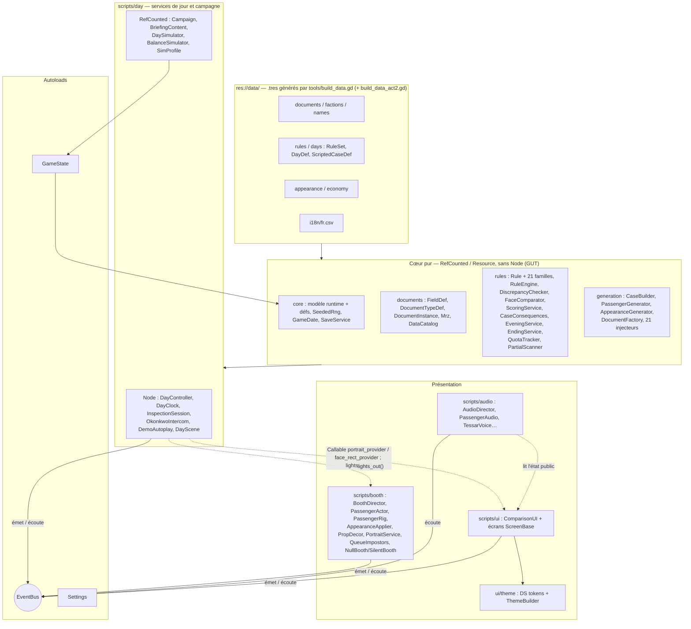
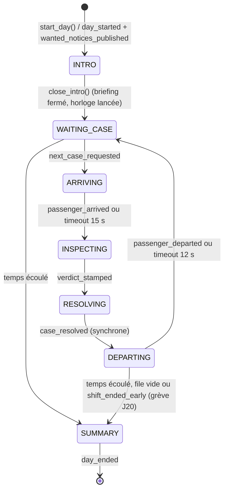

# ARCHITECTURE — CLEARANCE

> Propriétaire : **Godot Architect** · Statut : 🟢 validé par le client · Cible : **Godot 4.7.2**, GDScript typé, renderer Forward+
>
> Documents liés : [`AGENTS.md`](../AGENTS.md) · [`DECISIONS.md`](../DECISIONS.md) · [`DESIGN_SYSTEM.md`](../DESIGN_SYSTEM.md) · [`docs/UI_FLOW.md`](UI_FLOW.md) · [`docs/BOOTH_SCENE.md`](BOOTH_SCENE.md) (visuel du guichet, 3D Designer) · [`docs/ASSETS.md`](ASSETS.md) (rigs, clips, atlas, licences) · [`docs/AUDIO.md`](AUDIO.md) (Audio Designer) · [`docs/NARRATIVE.md`](NARRATIVE.md) (Scénariste)
>
> **Révision 3.6** (2026-10-31, M14 « Ambiance », lot A) : **§12 ter** (contrat d'interfaces M14 : formats musique et cinématiques, `CinematicService`, `QueueSilhouette`, profil v3, réglages, signaux, besoins des lots B → F) ; §7 (60 signaux) ; §8 bis.8 (`MusicDirector`). Décisions D-174 → D-192.
>
> **Révision 3.5** (2026-10-28, corrections techniques de la passe QA de l'Acte II — `docs/QA.md` §12) : **QA-030** cause racine et correctif (§13 R31, autoload `AudioMixBarrier` §4, barks sans nœud dans le thread de travail §8 bis.8) ; R28 et R30 résolus ; §5 (`DayDef.asylum_class_rate` / `focus_documents`, `EveningEventDef.economy_gauges_min`, noms réservés des personnages des deux actes).
>
> **Révision 3.4** (2026-10-28, passe documentaire après l'Acte II — M8 parties A et B, jeu J1–J20, **515 tests GUT**) : §3 (arborescence), §5 (classes et champs Acte II), §6 (21 familles, R23–R31), §7 (34 signaux, émetteurs / écouteurs réels), §7.2 (contrat UI M8 → **état réel**), §8 (enchaînement J10 pivot / J20), §10 (sauvegarde v4), §12 (515 tests), §13 (R19, R22, R28–R30), §14 (M8 livré), §15 (`build_data_act2.gd`, arguments de debug Acte II), §16.8 (smoke J15 / J20). Décisions : D-076 → D-082.
>
> **Révision 3.2** (2026-10-28, M8 export) : §16 passé de « plan » à « état réel » (presets versionnés, icônes, `export_all.sh`, `smoke_export.sh`, CI, bug d'export des `PackedStringArray`) ; §15 (outils d'export).
>
> **Révision 3.1** (2026-10-28, corrections de la passe QA — `docs/QA.md`) : R18, R23, R25 résolus ; §4 (réglages de session), §5 (noms réservés, dates « année seule », symboles), §6.3 (signalement du code 1), §10 (sauvegarde atomique, borne du jour, version), §15 (`qa_boot.gd`), §16.4 (filtres d'export).
>
> **Révision 3** (2026-10-27, passe documentaire après M7 — jeu complet J1–J10, 414 tests GUT) : le document décrit désormais **le code réel**. Les notes « Implémenté en Mx » des révisions précédentes ont été fondues dans les sections concernées. Sections réécrites : §2–§14 ; **nouvelles** : §15 « Outils et pipelines », §16 « Export et distribution ». La numérotation §1–§14 est conservée (renvois des autres documents).
>
> **Légende** : sans mention = **état réel** (vérifié dans le code). 🎯 **Intention** = prévu mais non implémenté (ou implémenté autrement, l'écart est alors décrit). ⚠️ = incohérence connue, à corriger dans le code (liste en §13).

---

## 1. Principes directeurs

| # | Principe | Conséquence concrète |
|---|---|---|
| P1 | **Données plutôt que code** | Documents, champs, origines, règles, jours, économie, apparences, cas scénarisés, briefings, soirées = Resources `.tres` dans `res://data/`, **produites par `tools/build_data.gd`** (D-029). Ajouter une règle d'une famille existante ou un jour ne demande aucun code de jeu. |
| P2 | **Le cœur ne connaît pas l'UI** | `scripts/core|documents|rules|generation` n'étendent jamais `Node`/`Control`, ne chargent aucune scène, n'accèdent à aucun autoload (vérifié : aucune référence hors commentaires). Ils tournent en headless → testables par GUT. |
| P3 | **Vérité terrain** | Chaque cas est généré valide puis corrompu de façon contrôlée ; la réponse attendue est **recalculée par le `RuleEngine`** sur le cas final (§6). |
| P4 | **Déterminisme** | Toute aléa logique passe par un `SeededRng` (SplitMix64 maison). Même graine ⇒ même cas, bit à bit (`CaseSerializer`). Les seuls `RandomNumberGenerator` libres sont cosmétiques (audio, clignements), eux aussi seedés. |
| P5 | **Communication par signaux** | Logique ↔ UI ↔ 3D via l'autoload `EventBus` (§7). Exceptions documentées : deux `Callable` injectés dans l'UI (D-038), la lecture directe de `ComparisonUI` par l'`AudioDirector` (§8 bis.8) et, depuis M8, l'extinction des lumières du J20 : `DayScene` (intégrateur) écoute `hall_announced` puis appelle directement `BoothDirector.lights_out()` et `ComparisonUI.set_lights_out()` (§7.2). |
| P6 | **Autoloads minimaux** | 3 autoloads de jeu (`EventBus`, `Settings`, `GameState`) + `AudioMixBarrier` (contournement moteur sans état, QA-030). Services de jour, booth, audio, portraits = nœuds de `day.tscn`, remplaçables et testables. |
| P7 | **Un script = une responsabilité** | Pas de « GameManager ». ⚠️ Plusieurs scripts dépassent largement le seuil d'alerte : `ComparisonUI` (≈ 1 700 lignes), `EveningScreen` (≈ 1 030), `CaseBuilder` (≈ 900), `AudioDirector` (≈ 820), `BoothDirector` (≈ 730) — §13 R19. |
| P8 | **La logique ne dépend pas de l'animation** | Le jour avance même si une animation ne rend jamais la main : watchdogs du booth + timeouts du `DayController` ; `NullBooth`/`SilentBooth` en test (§8 bis.6). |

---

## 2. Vue d'ensemble des couches



**Règle de dépendance** : `CORE` ne référence ni `scripts/day`, ni les autoloads, ni la présentation. `Campaign` (RefCounted, `scripts/day/`) est la seule couche statique qui manipule `GameState` et `SaveService` ensemble. L'UI et le booth ne reçoivent que des objets « présentés » (`Case`, `DocumentInstance`, `CaseResult` après verdict), **jamais `CaseKey`** (gardée par `DayController`).

**Règle du booth** : `PassengerActor` ne connaît **ni l'EventBus ni `Case`** — API impérative (`assign`, `apply_appearance`, `apply_markings`, `walk_to_desk`, `present_documents`, `play_reaction`, `remove_visor`, `leave_along`, `set_look_target`, `set_expression`, `release`) et signaux **locaux**. `BoothDirector` est le **seul** nœud 3D branché sur l'EventBus. `AudioDirector` ajoute un `PassengerAudio` à chaque acteur sans modifier le booth.

---

## 3. Arborescence `res://` (état réel)

```
res://
├── project.godot               # autoloads, actions d'entrée, avertissements de typage (Godot Architect)
├── icon.svg                    # source des icônes (.ico/.icns générés dans assets/icons/, §16.6)
├── default_bus_layout.tres     # bus audio, GÉNÉRÉ par tools/build_audio.gd (D-049)
├── .gutconfig.json             # tests/unit + tests/integration, préfixe test_
├── addons/gut/                 # GUT 9.7.1 — VERSIONNÉ (D-008)
├── art_src/                    # sources d'art, .gdignore (invisible pour Godot, jamais exporté)
│   ├── kenney_skins/           # 8 skins Kenney CC0 versionnées (entrée de build_passenger_skins)
│   └── downloads/              # packs bruts (fetch_assets.sh) + _audio_build/ — IGNORÉ par git
├── assets/                     # ressources importées et versionnées (licences : docs/ASSETS.md §10)
│   ├── audio/                  # ambience/, music/ (OGG), sfx/{passenger,booth,station}/, ui/, voice/pa/ (WAV) — générés (§15)
│   ├── fonts/                  # Chakra Petch, Inter, JetBrains Mono (+ OFL-*.txt)
│   ├── models/passenger/       # chr_kenney_medium.fbx, anim_ual1_standard.glb, bonemap_*.tres,
│   │                           # passenger_anims.res, imp_silhouette.res (générés), License_*.txt
│   ├── shaders/                # booth_glass, rain_sheet, impostor_silhouette, chr_toon, passenger_body, face_dither, ui_backdrop_blur
│   ├── textures/passenger/     # tex_chr_zones_<skin>.png (générés)
│   └── icons/, materials/      # vides (icônes UI dessinées en code : UiIcon)
├── data/                       # CONTENU (.tres générés, sauf i18n)
│   ├── documents/              # doc_id_card, doc_entry_permit, doc_bioscan, doc_mil_waiver ;
│   │                           # Acte II : doc_work_contract, doc_drift_pass, doc_asylum, doc_queue_ticket (8 types)
│   ├── factions/               # faction_{tyc,hal,ter,cer,thr,drv}.tres
│   ├── names/                  # namepool_<faction>.tres
│   ├── rules/                  # 31 rule_*.tres (§6 ; R23–R31 : rule_air_quota … rule_ter_closed)
│   ├── days/                   # day_01..20.tres (DayDef) + ruleset_day_01..20.tres (40 fichiers)
│   ├── appearance/             # appearance_catalog.tres (10 slots en sous-ressources, pas de slot_*.tres)
│   ├── economy/                # economy.tres (EconomyDef)
│   └── i18n/                   # fr.csv (+ .import ; fr.fr.translation généré, ignoré par git, D-040)
├── scenes/
│   ├── main/                   # main.tscn + main.gd (titre), day.tscn (DayScene)
│   ├── booth/                  # booth.tscn — GÉNÉRÉ (déterministe) par tools/build_booth.gd (M9)
│   ├── passenger/              # passenger_actor.tscn ; passenger_demo.tscn (bac à sable / captures)
│   ├── ui/                     # comparison_ui.tscn ; comparison_ui_demo.tscn (bac à sable)
│   └── documents/              # vide : DocumentView générique construite en code
├── scripts/
│   ├── autoload/               # event_bus.gd, settings.gd, game_state.gd, audio_mix_barrier.gd
│   ├── core/                   # modèle runtime, Resources de définition, SeededRng, GameDate, SaveService, Household… ;
│   │                           # Acte II : hall_announcement_def, revocation_def, revoked_entry
│   ├── documents/              # FieldDef, DocumentTypeDef, DocumentInstance, FieldRef, FieldValue, Mrz, DataCatalog
│   ├── rules/                  # Rule, families/ (21), RuleSet, RuleEngine, RuleContext, DiscrepancyChecker,
│   │                           # FaceComparator, ScoringService, CaseConsequences, EveningService, EndingService… ;
│   │                           # Acte II : quota_tracker (QuotaTracker), partial_scanner (PartialScanner) ;
│   │                           # families/ : air_quota, contract_consistent, curfew, drift_pass, revoked_id
│   ├── generation/             # CaseBuilder, PassengerGenerator, AppearanceGenerator/Roster, DocumentFactory,
│   │                           # CaseSerializer, NamePool, ScriptedCaseDef, injectors/ (21 + base + registre + état ;
│   │                           # Acte II : contract_mismatch, unregistered_vessel, outdated_firmware, revoked_id)
│   ├── day/                    # DayController, DayClock, InspectionSession, DayScene, Campaign, BriefingContent,
│   │                           # OkonkwoIntercom, DemoAutoplay, DaySimulator, BalanceSimulator, SimProfile, DebugArgs
│   ├── booth/                  # BoothDirector, PassengerActor/Rig/Locomotion/Anims, AppearanceApplier, ExpressionController,
│   │                           # FaceAtlas, HeadScaleModifier, ImplantDecor, PropDecor (Acte II), GreyboxStyle, BoothQuality,
│   │                           # PortraitService, QueueImpostors, NullBooth, SilentBooth, PassengerDemo
│   ├── audio/                  # AudioDirector, AudioBuses, AudioCueBank, AudioDsp, PassengerAudio, TessarVoice, VoicePool
│   └── ui/                     # ComparisonUI, Workbench, DocumentView, RulebookPanel, RulebookReference, LinkLayer,
│                               # écrans (ScreenBase)…, UiText, UiIcon ; Acte II : quota_counter_view (QuotaCounterView),
│                               # revoked_card_view (RevokedCardView), chapter_screen (ChapterScreen)
├── ui/theme/                   # tokens.gd (class_name DS), theme_builder.gd (D-025) — rien d'autre
├── tests/
│   ├── unit/                   # 40 suites (392 tests)
│   ├── integration/            # 17 suites (123 tests)
│   ├── helpers/                # case_factory.gd, day_harness.gd, generation_fixtures.gd, gut_pre_run.gd (preload, pas de class_name)
│   └── manual/                 # vide (🎯 booth_sandbox jamais créé : remplacé par les scènes *_demo)
├── tools/                      # générateurs et outils headless (§15) ; build_data.gd + build_data_act2.gd (contenu J10–J20)
└── docs/                       # documentation + mockups/ (dont m11_* : captures Acte II) — .gdignore, jamais exportés (§16.4)
```

- **`scripts/day/`** mélange des `Node` (services de la scène de jour) et des `RefCounted` statiques (campagne, simulateurs) : ils partagent le même domaine (le jour / la campagne) et dépendent tous de `GameState` ou de services de jour, donc ni de `core` ni de `ui`.
- **`scripts/booth/`** : scripts 3D (ni `Control`, ni cœur headless). `NullBooth`/`SilentBooth` y vivent car ils servent aussi au mode `--no-booth`.
- **`res://ui/`** ne contient que `theme/` (R10 résolu).
- Fichiers générés versionnés : `*.import`, `*.uid` (D-027), `.tres` de `data/`, `booth.tscn`, assets audio et passager. Ignorés : `.godot/`, `*.translation`, `art_src/downloads/`, `build/` (exports). `export_presets.cfg` est versionné sans secret (§16.2).

---

## 4. Autoloads

Déclarés dans `project.godot`, dans cet ordre (pas de `class_name` sur un autoload) :

```ini
[autoload]
EventBus="*res://scripts/autoload/event_bus.gd"
Settings="*res://scripts/autoload/settings.gd"
GameState="*res://scripts/autoload/game_state.gd"
AudioMixBarrier="*res://scripts/autoload/audio_mix_barrier.gd"
```

| Autoload | Rôle (état réel) | Ne fait PAS |
|---|---|---|
| `EventBus` | 50 signaux typés (catalogue §7 ; M11 : `save_slots_changed`, `profile_changed`, `difficulty_changed`, §10 ; M12 : 10 signaux, §11.2). Aucun état, aucune méthode. | Logique, stockage |
| `Settings` | Préférences dans `user://settings.cfg` (`ConfigFile`) : `volume_{master,music,ambience,sfx,voice,ui}` (appliqués aux bus `Master/Music/Ambience/SFX/Voice/UI`), `fx_intensity` (1 / 0,5 / 0), `reduce_motion`, `text_scale` (0,9–1,5, D-026), `subtitles`, `clock_slow_accessibility` (horloge ×0,5), `audio_mono`, `graphics_quality` (M9 : −1 Auto / 0 Bas / 1 Moyen / 2 Élevé ; `graphics_quality_level()` résout Auto = Moyen sur Steam Deck — variable `SteamDeck=1` —, Élevé ailleurs ; appliqué par `BoothQuality`). `set_value()` valide (`_sanitize`), applique et émet `settings_changed` (choix du joueur, persisté ; `persist = false` diffère seulement l'écriture). **Valeurs de session** (QA-006) : `set_session_value()` / `clear_session_value()` (argument `--reduce-motion`, outils, tests) appliquent sans jamais écrire — `save_settings()` écrit pour ces clés la dernière valeur persistée. `use_storage(path)` change de fichier : la suite GUT utilise `user://test_settings/settings.cfg` (crochet `tests/helpers/gut_pre_run.gd`, `.gutconfig.json`). M11 : `color_vision`, `holo_flicker`, `pad_glyphs`, tutoriels ; M14 : musique, cinématiques ; **M15** : `language` (`fr` / `en`, texte, à chaud, §17.1) et `pseudo_loc` (caché, debug). 🎯 Sensibilité manette : non implémentée. | État de partie |
| `GameState` | État de **campagne** : `campaign_seed`, `current_day`, `credits`, `score_total`, `citations`, `narrative_flags: Dictionary[StringName, Variant]` (drapeaux et jauges `loyalty` / `lucioles_trust` / `suspicion`), `day_history: Array[Dictionary]`, `household: Household`, `case_memory` (§9.4). `to_save_dict()` / `apply_save_dict()` / `save_to_slot()` / `load_from_slot()` (§10) ; M11 : `active_slot`, `difficulty` (`is_story_mode()`, `set_difficulty()`), `load_day_snapshot()`, `end_campaign()` (archive + profil, `ProfileService`), `play_time_sec`, `portrait_seed` (§10). `get_day_seed()`, `add_to_flag()`, `get_true_flags()`, `remember_case()`. Émet `credits_changed`, `narrative_flag_changed`, `game_saved`, `game_loaded`, `save_slots_changed`, `profile_changed`, `difficulty_changed`. | État du jour en cours (porté par `DayController`) |

| `AudioMixBarrier` (rév. 3.5, QA-030) | Barrière de mixage : `AudioServer.lock()` / `unlock()` une fois par image (`_process`, `PROCESS_MODE_ALWAYS`, avant `AudioServer.update()`) — contournement de la course de Godot 4.7.2 sur les `bus_details` (§13, R31). | Aucun état, aucun signal, aucun son |

`EventBus` est chargé en premier : les autres s'y connectent dans `_ready`.

---

## 5. Modèle de données

### 5.1 Vue d'ensemble


### 5.2 Définitions (Resources, `res://data/`)

| Classe | Script | Champs principaux (état réel) | Notes |
|---|---|---|---|
| `FieldDef` | `documents/field_def.gd` | `id`, `label_key`, `kind: FieldKind` (`TEXT, DATE, ID_CODE, ENUM, PORTRAIT, NUMBER, BOOL, LIST, TIME`), `truth_path`, `comparable`, `display_order`, `format` | `truth_path` = propriété de `Passenger` (`Passenger.TRUTH_PATHS`) ou `document.<prop>` (`serial`, `issue_date`, `expiry_date`, `issuer_id`, `seal_id`, `mrz`, `presented_at`) résolue par `DocumentInstance.get_value()`. `LIST` = `PackedStringArray` (implants). `TIME` (Acte II, valeur 8) = minutes depuis minuit, affichée `HH:MM` (`FieldValue.format_time`). |
| `DocumentTypeDef` | `documents/document_type_def.gd` | `id`, `title_key`, `fields`, `issuer_faction_ids`, `validity_days: Vector2i`, `holo_tint_token` (token `DS`), `issuer_id`, `seal_id`, `serial_pattern` | 8 types : `id_card` (dont `implants`, `firmware` (date du shunt `NX-`, Acte II), `seal`, `mrz`), `entry_permit`, `bioscan`, `mil_waiver` ; Acte II : `work_contract` (`contract_code` ↔ `employer_code`, `post`), `drift_pass` (`vessel`), `asylum` (`zone`), `queue_ticket` (`presented_at` en `TIME`, **sans sceau** : `seal_id` vide). ⚠️ `view_scene` n'est ni rempli ni lu (vue générique `DocumentView`). |
| `FactionDef` | `core/faction_def.gd` | `id`, `name_key`, `code`, `id_prefix`, `origin_sectors`, `name_pool`, `citizen_class_weights`, `purpose_weights`, `employers`, `implant_rate`, `implant_weights`, `year_only_birth_rate` (DRV 0,5 : naissances `00.00.AAAA`, §9.2) | 6 origines : TYC, HAL, TER, CER, THR, DRV. ⚠️ `seal_texture` non rempli, non lu. |
| `NamePool` | `generation/name_pool.gd` | `given_names_f/m/x`, `family_names`, `reserved_names` (jamais tirés : Okonkwo, noms de famille distinctifs, **nom de famille de chaque personnage scénarisé des deux actes et des avis nommés** — QA-022 —, prénoms du foyer), `reserved_full_names` (« Prénom Nom » des personnages scénarisés et des avis : prénom remplacé sans tirage, `avoid_reserved_full_name`) | Une par origine. Listes réservées **calculées** par `build_data.gd` depuis les `DayDef` (QA-002). |
| `Rule` (abstraite) | `rules/rule.gd` | `id`, `title_key`, `rulebook_text_key`, `category` (`DOCUMENTS, IDENTITY, FACTION, PURPOSE, SPECIAL`), `severity` 1–3 | §6. |
| `RuleSet` | `rules/rule_set.gd` | `id`, `rules`, `new_rule_ids` (badge « NOUVEAU »), `required_document_ids` | Liste **explicite et cumulative** par jour (pas d'héritage). Règles partagées entre RuleSets, **jamais mutées**. M12 : seule une **copie de shift** (`make_shift_copy`) accepte des changements en cours de shift (§11.3). |
| `DayDef` | `core/day_def.gd` | `day_number`, `game_date`, `rule_set`, `duration_sec`, `passenger_count`, `anomaly_count_weights`, `anomaly_weights: Dictionary[AnomalyType.Kind, float]`, `scripted_cases`, `intro_text_key`, `credit_per_correct`, `penalty_per_error` ; GDD : `faction_weights`, `visor_down_rate`, `legit_noise_rate`, `bribe_rate`, `luciole_rate`, `free_citations_per_day`, `penalty_escalated` ; M7 : `detain_enabled`, `has_evening`, `bribe_amounts`, `wanted_notices`, `briefing_messages`, `evening_events`, `hall_announcements: Dictionary[int, String]`, `rulebook_tabs` ; **Acte II** : `air_quota` (0 = pas de quota), `luciole_trust_on_breach` (faux à l'Acte II), `revocations: Array[RevocationDef]`, `revoked_decoys`, `announcements: Array[HallAnnouncementDef]`, `asylum_class_rate` (part des TER C-4 tirés en C-5 avec attestation, R28 ; J15 : 1,0), `focus_documents` (documents de la règle du jour visés en priorité par `MISSING_DOCUMENT` / `EXPIRED_DOCUMENT`, QA-026) ; constantes `SHIFT_START_MIN` (10:00), `SHIFT_LENGTH_MIN` (8 h), `minute_at()` | J1–J10 : 8→16 passagers, 540→720 s ; DÉTENTION dès J7. J11–J20 : 16→18 passagers, 720→780 s, quota 5 (J11–J14) → 4 (J15–J18) → 3 (J19–J20) ; soirée **tous les jours sauf le J20** (J10 = soirée pivot, D-076). Onglets cumulés : `employers` (J12), `vessels` (J13), `revoked` (J17). |
| `ScriptedCaseDef` | `generation/scripted_case_def.gd` | `id`, `at_index`, `passenger_overrides`, `appearance_overrides`, `forced_anomalies` (liste exacte), `injection_params`, `dialogue_id`, `sets_flag`, `requires_flag`, `flags_on_approve/deny` ; M7 : `flags_on_detain`, `flags_if_unprocessed`, `extra_effects: Array[CaseEffectDef]`, `forbids_flags`, `appearance_from_case`, `identity_from_case`, `truth_overrides`, `extra_documents`, `slipped_item: SlippedItemDef`, `luciole_codes`, `extra_tags` ; **Acte II** : `condition` (la **première** définition active d'un index l'emporte : SC-35 a/b/c, SC-49, SC-50 a/b), `fixed_appearance_seed`, `line_variants: Array[ConditionalKey]`, `third_party_documents`, `password_grants_trust`, `flags_on_password`, `document_dates` | SC-01 → SC-50 + tutoriels J1, saisis dans les `DayDef` (`build_data.gd` / `build_data_act2.gd`). |
| `HallAnnouncementDef` (Acte II) | `core/hall_announcement_def.gd` | `text_key`, `after_case` (−1), `at_minute` (−1 ; 960 = 16:00), `condition: FlagCondition`, `ends_shift` | Complète `hall_announcements` (inconditionnelles). `ends_shift` : grève du J20, shift clos après le passager en cours (`DayController.shift_ended_early`). |
| `RevocationDef` (Acte II) | `core/revocation_def.gd` | `id`, `scripted_case_id` ou `at_index`, `reason_key` (facultatif), `condition` | Résolue en `RevokedEntry` par le `CaseBuilder` au début du jour (comme les avis, D-056) ; leurres `DayDef.revoked_decoys`. |
| `AppearanceCatalog` | `core/appearance_catalog.gd` | `slots`, `min_distance` (5), `window_size` (15), `max_attempts` (12), `age_band_weights`, `height_step_range` | Slots : `silhouette, face, eyes, nose_mouth, skin, hair, headwear, outfit, accessory, palette`. Coiffes `visor_down/visor_up` de poids 0. |
| `AppearanceSlotDef` / `AppearanceOptionDef` | `core/appearance_*.gd` | slot : `id`, `identity`, `visible_in_portrait`, `options` ; option : `id`, `weight`, `faction_weights`, `tags` | Le rendu est déduit des **identifiants** (`AppearanceApplier` + `GreyboxStyle`). ⚠️ Les champs visuels `mesh`, `atlas_cell`, `material`, `portrait_layer` ne sont ni remplis ni lus. |
| `EconomyDef` | `core/economy_def.gd` | loyer / taxe d'air (et hausses datées), nourriture, chauffage, oxygène, soins, règles de santé du foyer, expulsion, `detain_bonus`, `report_bonus`, seuils d'audit, seuils F4/F6 ; **Acte II** : `pivot_day` (10), `pivot_suspicion_divisor`, rations (`ration_start_day` 11, `ration_self/ilan/noa/dora`), compteur (`meter_surcharge`, `meter_fee`), prélèvements D-079 (`levy_rate` 0,30, `levy_floor` 40, `levy_days` [11, 17]), hausses datées (nourriture J15, oxygène et soins J16), `lease_cost` (ACV-2), `ilan_job_income` / `ilan_job_first_day`, `bail`, `dora_ticket`, `drift2_cost`, Revue J17 (`review_arrest_score` 5, `review_demote_score` 3 — D-080, `review_retention`), seuils des fins du J20 (`double_game2_threshold`, `air2_trust_threshold`, `glory2_loyalty_threshold`, `strike_solidarity_threshold`, `registre_threshold`, `drift2_min_present`) ; `rations_for()`, `ration_of()`, `levy_for()`, `food_for()`/`oxygen_for()`/`medicine_for()` | `data/economy/economy.tres` (D-044, D-047, D-059, D-077 → D-080). |
| `SlippedItemDef` | `core/slipped_item_def.gd` | `kind` (`SlippedItem.Kind` : `ENVELOPE, NOTE, DOCK_CARD` ; Acte II : `FORM, OBJECT, FILE`, ajoutés en fin), `amount`, `label_key`, `text_key`, `extra_text_keys`, `allowed`, `default_decision`, `report_bonus`, `effects` | Objets glissés des cas scénarisés (D-054). |
| `WantedNoticeDef` | `core/wanted_notice_def.gd` | `id`, `scripted_case_id` ou `at_index`, noms, `reason_key` ; Acte II : `condition`, `faces_only` (avis « visages seuls » du J20, sans nom), `memory_case_id` (personne absente de la file, visage repris de `CaseMemory`) | Avis liés à des passagers du jour (D-056). |
| `BriefingMessageDef` | `core/briefing_message_def.gd` | `speaker_key`, `text_key`, `voice`, `condition`, `group`, `family_slot`, `priority` | Table conditionnelle (≤ 4 messages / jour). |
| `EveningEventDef` / `EveningOptionDef` | `core/evening_*_def.gd` | événement : `id`, `kind`, `order`, `condition`, textes, `options`, `flags`, `line_costs` ; Acte II : `audit_id` (vide = audit du J9, `review` = Revue du J17), `household`, `text_gauges` (valeurs des `%d`), `economy_gauges_min` (jauge → seuil lu dans l'`EconomyDef`, R28) ; option : `id`, `label_key`, `result_key`, `cost`, `gain`, `requires_funds`, `flags`, `line_costs`, `household` (Acte II : `ilan_released`, `ilan_soute`, `ilan_back`, `dora_tycho`), `condition`, `default_rank` ; Acte II : `ends_campaign` (« Embarquer » → `f6_drift`), `set_gauges` (valeurs absolues après les deltas) | Soirées J4–J19 (D-058, D-061, D-076). |
| `FlagCondition`, `ConditionalKey`, `CaseEffectDef` | `core/` | `all_of`, `any_of`, `none_of`, `gauges_min/max` ; clé conditionnelle (Acte II : `replaces` = suffixe de réplique remplacé) ; effet `verdict × condition → flags` (Acte II : `context` ∈ `quota_reached`, `after_curfew`, `overrun`, calculé par `CaseConsequences.contexts_for`) | Conditions narratives réutilisées partout. |

### 5.3 Objets runtime (RefCounted)

| Classe | Rôle | Champs principaux |
|---|---|---|
| `Passenger` | Identité (vraie ou présentée) | `id`, `given_name`, `family_name`, `birth_date`, `sex`, `faction_id`, `origin_sector`, `citizen_id`, `citizen_class`, `appearance_seed`, `appearance`, `purpose`, `stay_days`, `employer`, `health_status`, `implants` (visibles sur le corps) ; Acte II : `employer_code` (`CT-XX`, R25), `post` (R31), `vessel` (R26), `firmware_date` (`GameDate`, 0 = aucun shunt `NX-`, R27) ; `TRUTH_PATHS`, `copy()`, `apply_overrides()` |
| `PassengerAppearance` | Apparence modulaire, **pure** (identifiants seulement) | `traits`, `palette_id`, `height_step` (−2..+2), `age_band` ; `distance()`, `derive()`, `copy()`, `serialize()`, `is_face_covered()`, `without_visor()` |
| `PortraitValue` | Valeur d'un champ `PORTRAIT` | `appearance` (la personne sur la photo), `photo_seed`, `years_before_issue` |
| `DocumentInstance` | Document tendu | `type_def`, `serial`, `issue_date`, `expiry_date`, `issuer_id`, `seal_id`, `mrz` (bande `Mrz`), `marks` (`&"luciole"`), `values` ; Acte II : `presented_at` (minutes, ticket de file, −1 sinon), `third_party` (document d'un tiers, SC-27 : jamais comparé, ignoré par les règles du porteur) ; `get_value()` / `set_value()` / `copy()` |
| `FieldRef` | Pointeur vers un champ affiché | `document_id`, `field_id` ; pseudo-références : `passenger_face()`, `today()`, `rulebook_rule(id)`, `wanted(id)`, `symbol(id)` (bulletin « Symboles subversifs », `__symbols__`), `mark(document_id, mark_id)` (marque au coin d'un document, `mark:luciole`) ; Acte II : `revoked(entry_id)` (`__revoked__`, onglet Révocations), `quota_counter()` (`__counter__/quota`, compteur de la barre d'état) ; `is_revoked()`, `is_quota_counter()` |
| `Case` | **Ce que voit le joueur** | `case_id`, `index`, `case_seed`, `passenger_presented`, `documents`, `dialogue_tags`, `slipped_items`, `luciole_codes`, `presentation` (`&"knock_three"`) ; Acte II : `line_overrides` (suffixe → clé, résolu sur les drapeaux du matin) ; `remove_visor()`, `get_value(ref)`, `find_refs_by_*` (`find_refs_by_truth_path(path, include_third_party = false)`), `get_own_document()` / `has_own_document()` (hors tiers), `scripted_key(suffix, fallback, exists)` |
| `CaseKey` | **Clé de réponse** (jamais transmise) | `truth`, `anomalies`, `expected_violations`, `expected_verdict` |
| `Anomaly` / `AnomalyType.Kind` | Corruption injectée | 21 valeurs **figées** (D-033) : `EXPIRED_DOCUMENT`… `WANTED_PERSON = 16` ; Acte II (ajoutées en fin) : `CONTRACT_MISMATCH = 17`, `UNREGISTERED_VESSEL = 18`, `OUTDATED_FIRMWARE = 19`, `REVOKED_ID = 20` ; `cosmetic` |
| `Violation`, `Discrepancy`, `Verdict`, `VerdictKind` | Sorties règle / comparaison / décision | `Discrepancy.result` (`CONCORDANT, DISCORDANT, INCOMPARABLE`), `differing_traits`, `reason_key` ; `Verdict.kind` (`APPROVE, DENY, DETAIN`), `flagged`, `elapsed_sec` |
| `CaseResult` | Sortie du scoring (§8) | `verdict_kind`, `expected_verdict`, `correct`, `verdict_correct`, `documented`, `expected_violations` / `missed_violations` (révélées après verdict), `wage`, `fine`, `credits_delta`, `citation_*`, `procedure_missed`, `scripted_id`, `narrative_changes`, `item_decisions`, `bribe_credits`, `report_credits`, `password_answered`, `luciole_report` (§6.3) ; Acte II : `quota_counted`, `quota_full`, `quota_refusal` (REFUS motivé par le seul quota : correct, documenté d'office), `quota_overrun` (APPROUVÉ au-delà du quota : 0 ₵) |
| `DaySummary` | Bilan du jour | résultats, non traités, `time_expired`, `unprocessed_changes` ; `get_wage_total()`, `get_fine_total()`, `get_net()`, `get_bribe_total()`, `get_report_total()`, `get_total_income()` ; Acte II : `get_overrun_count()`, `get_quota_refusal_count()` |
| `RuleContext` | Contexte d'évaluation | `today`, `day_def`, `rule_set`, `faction_db`, `document_db`, `identity_slots`, `wanted` ; Acte II : `revoked: Array[RevokedEntry]`, `quota_used`, `quota_max` ; `find_revoked()`, `is_revoked(citizen_id)`, `is_quota_full()` |
| `RevokedEntry` (Acte II) | Entrée résolue de l'onglet Révocations | `id`, `citizen_id`, `given_name`, `family_name`, `reason_key`, `case_index` (−1 = leurre) ; `full_name()`, `get_ref()` = `FieldRef.revoked(id)` |
| `QuotaTracker` (Acte II, `rules/`) | Compteur du quota respiratoire d'un shift (pur ; partagé par `DayController` et `DaySimulator`) | `rule: AirQuotaRule`, `maximum`, `used`, `overruns` ; `for_day(day)` (inactif sans R23 ou sans `air_quota`), `is_active()`, `is_full()`, `counts(case)`, `before_verdict(case)` (quota atteint pour ce passager), `after_verdict(case, verdict)` (vrai si entrée imputée), `sync(ctx)` |
| `PartialScanner` (Acte II, `rules/`) | Scanner partiel du guichet, statique | `SOURCE_ACV` / `SOURCE_LUCIOLE` (drapeaux `scanner_consortium`, `scanner_luciole`, `scanner_luciole_removed` ; l'ACV-2 l'emporte) ; `source_for(flags)`, `suggestions(case, ctx)` = discordances **date ↔ jour** déjà calculées par le `DiscrepancyChecker` (zéro faux positif) |
| `RulebookEntry` | Ligne du Rulebook | `rule_id`, `title_key`, `text_key`, `category`, `severity`, `is_new`, `ref` |
| `SlippedItem`, `WantedNotice`, `CaseMemory`, `Household`, `EveningEvent`, `EveningReport`, `ExpenseLine` | M5/M7/M8 | objet glissé et sa décision ; avis (`get_ref()`) ; mémoire des cas scénarisés (Acte II : aussi les visages des avis `memory_case_id`) ; foyer (Ilan, Noa, Dora : santé, faim, froid, `detained` ; Acte II : `breathless`, `breathless_streak`, `away` ∈ {`soute`, `tycho`}, `is_present()`, `present_members()`, `present_count()`, `state_key()` ; « mis·e en attente » ≠ `LOST`) ; soirée (Acte II : `EveningEvent.text_args`, `EveningReport.income_lines`, `ExpenseLine.ration_of`) |
| `DataCatalog` | Chargement indexé de `res://data/` | `factions`, `documents`, `rules`, `rule_sets`, `days`, `errors` ; `load_from()`, `get_day()`, `get_economy()`, `make_context()` ; liste les fichiers par `DirAccess` et suit les `.remap` d'export (§16) |

- **Dates** : `GameDate` = entier « jours depuis 01.01.2100 » ; jamais `Time`/OS dans la logique. Date « année seule » (Dérivants, NARRATIVE §4.10) : `GameDate.year_only(AAAA)` = `YEAR_ONLY_BASE − AAAA` (hors de toute vraie date), lue `(AAAA, 0, 0)` par `to_ymd` ⇒ affichage `00.00.AAAA`, égalité par année (R07), `add_years` conservé ; `possible_ages()` = {âge − 1, âge} ; `latest_day()` = 31.12.AAAA ; `Passenger.is_birth_year_only()`. (NARRATIVE proposait 01.01.AAAA + booléen : l'encodage dans l'entier évite de propager un drapeau sur chaque champ de document.)
- **`Case` / `CaseKey` séparés** physiquement : l'UI ne peut pas tricher par erreur.
- **Invariant d'apparence** : l'acteur 3D affiche `case.passenger_presented.appearance`, toujours égale à l'apparence physique réelle ; aucun injecteur ne la modifie (seulement les `PortraitValue`). Exception assumée : la visière (état physique, posée sur la vérité *et* le présenté).

---

## 6. Moteur de règles

```gdscript
class_name Rule extends Resource   # @abstract
func evaluate(case: Case, ctx: RuleContext) -> Array[Violation]
func get_detectable_anomalies() -> Array[AnomalyType.Kind]
func check_against(case: Case, ref: FieldRef, ctx: RuleContext) -> Discrepancy.Result  # mode Inspection : règle ↔ champ
func get_required_document_ids() -> Array[StringName]
func get_referenced_truth_paths() -> Dictionary[StringName, Array]                       # validation des données
func get_rulebook_entry() -> RulebookEntry
```

- **Comportement par famille (script), paramètres par `.tres`.** Règles pures : pas d'état, pas d'aléa, pas d'arbre de scène ; contexte passé explicitement (`RuleContext`).
- **`RuleEngine`** : `validate(case, rule_set, ctx)`, `expected_verdict(violations)` — **DÉTENTION** si une violation a une sévérité ≥ 3, sinon **REFUS** s'il y en a au moins une, sinon **APPROBATION** (D-030) —, `build_case_key()`.
- **Vérité terrain** (R1 résolu) : la réponse attendue est recalculée sur le cas final ; invariants vérifiés par `CaseBuilder.check_invariants()` et par les tests : cas propre ⇒ 0 violation (8 re-tirages max), chaque anomalie prouvée par une règle active (sauf `cosmetic`), seuls les types détectables du jour sont tirés.
- **Procédures** (R06, R08) : `ProcedureRule` ne produit jamais de violation ; vérifiées par le `ScoringService` (D-031).

### 6.1 Familles (26, `scripts/rules/families/`)

| Famille | Paramètres `@export` | Règles |
|---|---|---|
| `RequireDocumentRule` | `document_id`, `exempt_faction_ids` ; Acte II : `applies_to_faction_ids`, `applies_to_purposes`, `applies_to_classes`, `require_valid` (document présent **et** non expiré), `permit_id`, `card_id` | R01, R04, R11, R24, R28 |
| `DocumentNotExpiredRule` | `document_id`, `max_age_days`, `detected_anomalies` ; Acte II : `field_path` (date lue dans un champ, ex. `firmware_date`) | R02, R05, R12, R27 |
| `PortraitMatchRule` | `check_passenger_face`, `check_between_documents`, `max_differing_traits`, `detected_anomalies` | R03, R17 |
| `ProcedureRule` | `procedure_id`, `applies_to_faction_ids` | R06, R08 |
| `FieldsMatchRule` | `truth_paths`, `document_ids`, `detected_anomalies` | R07 |
| `PurposeConsistentRule` | `permit_id`, `card_id`, `work_purpose`, `no_employer_values`, `short_stay_*` | R09 |
| `OriginIdBlockRule` | — | R10 |
| `IssuerAllowedRule` | `document_id`, `allowed_issuer_ids` | R13 |
| `FieldValueAllowedRule` | `document_id`, `truth_path`, `allowed_values`, `detected_anomalies` | R14 |
| `ImplantsDeclaredRule` | `document_id`, `escalated_prefixes`, `escalated_from_day`, `escalated_severity` | R15 |
| `BannedImplantsRule` | `document_id`, `always_banned`, `waiver_prefixes`, `waiver_document_id` | R16 |
| `ApparentAgeRule` | `document_id` | R18 |
| `FactionBannedRule` | `banned_faction_ids`, `exempt_purposes`, `card_id`, `permit_id` ; Acte II : `exempt_posts`, `contract_id` ; M9 : `exempt_if_sponsored` | R19, R31, R37 |
| `SealValidRule` | — | R20 |
| `MrzConsistentRule` | `document_id` | R21 |
| `WantedRule` | `document_id` (lit `RuleContext.wanted`) | R22 |
| `AirQuotaRule` (M8) | `exempt_faction_ids` (HAL), `exempt_purposes` (diplomatique), `permit_id` ; `find_in(rule_set)`, `counts(case)` | R23 — **règle de contexte souple** : jamais de violation ; `check_against` sur `FieldRef.quota_counter()` DISCORDANT si le quota est atteint pour ce passager ; le `ScoringService` en tire `quota_refusal` / `quota_overrun` |
| `ContractConsistentRule` (M8) | `contract_id`, `permit_id`, `employer_codes: Dictionary[String, String]` (employeur → code `XX`), `posts` | R25 |
| `DriftPassRule` (M8, hérite de `RequireDocumentRule`) | `registered_vessels` (+ paramètres hérités) | R26 : laissez-passer requis, vaisseau inscrit = nom de famille du porteur |
| `CurfewRule` (M8) | `ticket_id`, `permit_id`, `curfew_minute` (960 = 16:00), `banned_purposes`, `exempt_faction_ids` (HAL) | R29 |
| `RevokedIdRule` (M8) | `document_id` (lit `RuleContext.revoked`) ; M9 : ignore une entrée réintégrée si R33 est active | R30 |
| `ProrogationRule` (M9) | `window_start`, `window_end`, `extended_until` ; `covers()`, `in_window()` | R32 — **règle de lecture** : jamais de violation ; les règles d'expiration lisent `RuleContext.is_document_expired()` |
| `ReinstatementRule` (M9) | — | R33 (lecture de `RevokedEntry.reinstated_on`) |
| `SponsorRule` (M9) | `exempt_faction_ids` (HAL), `purposes` (visite familiale), `permit_id` ; `has_valid_sponsor()` | R34 — **contexte du shift** (Main courante) |
| `ContractSuspendedRule` (M9) | `faction_ids` (TYC), `suspended_codes` (`KA`), `contract_id`, `card_id` | R35 |
| `SummonsRule` (M9) | `permit_id`, `card_id` ; `is_valid_summons()`, `is_forged()` | R36 ; exemptions déclaratives par `Rule.summons_exempt` |

### 6.2 Les 37 règles (`data/rules/` ; cumulatives jusqu'au J20, liste explicite ensuite)

| Jour | Règles (id, sévérité) |
|---|---|
| J1 | R01 `r_id_card_required` (2), R02 `r_id_card_valid` (2) |
| J2 | R03 `r_portrait_match` (2) |
| J3 | R04 `r_permit_required`, R05 `r_permit_valid`, R07 `r_identity_fields_match` (2) ; R06 `r_face_uncovered` (procédure, 1) |
| J4 | R08 `r_tycho_interview` (procédure, 1), R09 `r_purpose_consistent`, R10 `r_origin_block` (2) |
| J5 | R11 `r_bioscan_required`, R12 `r_bioscan_valid`, R13 `r_bioscan_issuer`, R14 `r_bioscan_fit` (2) |
| J6 | R15 `r_implants_declared` (2 ; 3 pour un `MIL-` non déclaré dès J7), R16 `r_banned_implants` (2) |
| J7 | R17 `r_identity_fraud_detain` (sosie 1–2 traits, **3**) |
| J8 | R18 `r_apparent_age` (**3**), R19 `r_tharsis_banned` (2) |
| J9 | R20 `r_seals_valid`, R21 `r_mrz_valid` (2) |
| J10 | R22 `r_wanted_detain` (**3**) |
| J11 | R23 `r_air_quota` (`AirQuotaRule`, quota souple : **jamais de violation**, D-077), R24 `r_contract_required` (2) |
| J12 | R25 `r_contract_consistent` (`ContractConsistentRule`, code employeur ↔ registre, 2) |
| J13 | R26 `r_drift_pass` (`DriftPassRule` : laissez-passer requis, vaisseau inscrit = nom de famille, 2) |
| J14 | R27 `r_nx_firmware` (`DocumentNotExpiredRule` sur `firmware`, > 90 j, 2) |
| J15 | R28 `r_asylum_required` (TER C-5, 2) |
| J16 | R29 `r_curfew` (`CurfewRule` : ticket de file ≥ 16:00, VISITE/TOURISME refusés, HAL exemptés, 2) |
| J17 | R30 `r_revoked_ids` (`RevokedIdRule`, lit `RuleContext.revoked`, 2) |
| J18–J20 | R31 `r_ter_closed` (`FactionBannedRule` + `exempt_posts` : RECYCLEUR / SOINS / HYDROPONIE, 2) |
| J21 | R32 `r_prorogation` (lecture) ; R29 **retirée** (ticket de file retiré) |
| J22 | R33 `r_reinstated` (lecture) |
| J23 | R11–R14 **retirées** (bio-scan repris par les quais) |
| J24 | R34 `r_sponsor` (2) |
| J25 | R35 `r_tycho_lockout` (2) |
| J26 | R36 `r_summons` (2) |
| J28–J30 | R37 `r_tycho_closed` (`FactionBannedRule` TYC + `exempt_if_sponsored`, 2) |

Acte III (`tools/build_data_act3.gd`) : RuleSets J21–J30 **non cumulatifs** (M1), règles retirées rappelées au Rulebook (`RuleSet.retired_rules`) ; R19, R23, R30, R31 `summons_exempt` ; R31 `exempt_if_sponsored` (SC-61, D-091 proposé) ; R26 `retired_vessels` (`BASSE-MARÉE` au 02.04) ; code employeur `AR` (Arbitrage de Continuité).

Données des règles Acte II (`tools/build_data.gd` + `build_data_act2.gd`) : R24 = `RequireDocumentRule` (`work_contract`, motif `work`, `require_valid`) ; R26 = `DriftPassRule` (`drift_pass`, DRV, `require_valid`) ; R27 = `DocumentNotExpiredRule` (`id_card`, `field_path = firmware_date`, 90 j) ; R28 = `RequireDocumentRule` (`asylum`, TER, classe `C-5`, `require_valid`) ; R31 = `FactionBannedRule` (TER, `exempt_purposes` vide, `exempt_posts` = `post_recycleur` / `post_soins` / `post_hydroponie`). Codes employeurs : `Act2.EMPLOYER_CODES` (LORE + PI/DL/EQ/CR, D-081). Documents d'un **tiers** (`DocumentInstance.third_party`, SC-27) : jamais comparés (`INCOMPARABLE`), ignorés par R07/R10 et par les règles du porteur (`Case.get_own_document`). J19 et J20 : aucune règle nouvelle (31 règles actives).

### 6.3 Comparaison (mode Inspection)

- **`DiscrepancyChecker.check(case, a, b, ctx) -> Discrepancy`** compare ce qui est **affiché** (jamais `CaseKey`). Paires : même `truth_path` entre documents ; photo ↔ visage (`FieldRef.passenger_face()`) et photo ↔ photo ; date ↔ `FieldRef.today()` ; règle ↔ champ (`Rule.check_against`, R09, R15, R16, R19, R20, R21) ; visage ↔ `implants` (`disc_implant_mismatch`) ; visage ↔ naissance (`disc_age_mismatch`) ; MRZ ↔ N° ID / origine / nom / prénoms de la même carte (`disc_mrz_mismatch`) ; avis ↔ visage ou nom (`disc_wanted_match` / `disc_wanted_no_match`) ; marque d'un document ↔ symbole du bulletin, si l'onglet `symbols` est ouvert ce jour (J7+) ⇒ `disc_symbol_match`. Visage masqué ⇒ `INCOMPARABLE` (`disc_face_masked`). Naissance « année seule » ↔ visage : concordante si l'un des deux âges possibles est dans la tranche (`ApparentAgeRule.birth_matches_band`, zéro faux positif).
- **Signalement d'un porteur du code 1** (NARRATIVE §4.9) : DÉTENTION + `disc_symbol_match` épinglée sur un cas `luciole_codes ∋ 1` ⇒ `ScoringService.is_luciole_report` : cas correct, aucune citation ni procédure, salaire + prime de détention (`CaseResult.luciole_report`) ; `CaseConsequences.compute(…, luciole_report)` : `luciole_reported_at_booth`, `lucioles_trust −2`, `loyalty +1` une seule fois (pas de cumul avec la dénonciation générique) ; un cas scénarisé avec `flags_on_detain` (SC-13) garde ses drapeaux à la place des jauges. **L'UI doit rendre sélectionnables** la marque (`FieldRef.mark(doc, &"luciole")`) et l'entrée du bulletin (`FieldRef.symbol(&"luciole")`).
- **Paires Acte II** : entrée de l'onglet Révocations (`FieldRef.revoked(id)`) ↔ N° ID d'un document ⇒ `disc_revoked_match` (DISCORDANCE si égal) / `disc_revoked_no_match` ; compteur QUOTA (`FieldRef.quota_counter()`) ↔ règle R23 (via `AirQuotaRule.check_against`) — avec tout autre champ : `INCOMPARABLE` ; champ `firmware` ↔ `FieldRef.today()` évalué par la `DocumentNotExpiredRule` active de `field_path = firmware_date` (sinon `INCOMPARABLE`, règle inactive) ; document d'un tiers ↔ document du porteur : `INCOMPARABLE`. Les discordances de R23 / R29 / R30 / R25 débloquent un sujet d'interrogation **par famille** (`about_quota`, `about_curfew`, `about_revoked`, `about_contract` ; `InspectionSession` + `InterrogationTopics.RULE_TOPICS`).
- **Scanner partiel** (`PartialScanner`, §5.3) : ne crée aucune paire nouvelle ; il **pré-calcule** les discordances date ↔ jour, que le joueur confirme par `discrepancy_check_requested` (même chemin qu'une sélection A → B, D-082).
- **`FaceComparator.compare(a, b, identity_slots)`** renvoie les slots d'identité visibles en portrait qui diffèrent ; tenue, coiffe, accessoire et `age_band` ±1 ignorés. `identity_slots_of(catalog)` alimente `RuleContext.identity_slots`.

---

## 7. Catalogue des signaux `EventBus`

Source : `scripts/autoload/event_bus.gd` — **60 signaux** (dont **2 en M14**, lot A, détail en §12 ter.6 : `queue_progressed`, `ambient_announced` ; **8 en M13**, lot A, détail en §12.8 : `statement_given`, `search_requested`, `search_confirmation_required`, `search_opened`, `search_zone_scanned`, `search_closed`, `inspection_busy`, `upgrade_purchased` ; 50 jusqu'à M12), tous typés (liste exhaustive ci-dessous, vérifiée le 2026-10-29 ; 3 ajoutés en M8 : `quota_changed`, `revocations_published`, `scanner_suggested` ; 2 en M9 : `ledger_changed`, `summons_published` ; 4 en M11 : `save_slots_changed`, `profile_changed`, `difficulty_changed` (lot A) et `rulebook_consulted` (lot C) ; **10 en M12** (lot A, détail en §11.2) : `rules_changed`, `station_event_started`, `station_event_ended`, `rule_list_published`, `garde_directive`, `garde_scored`, `garde_error`, `garde_tier_changed`, `garde_ended`, `epilogue_concluded`). Convention : passé pour un fait, `*_requested` pour une intention de l'UI. Émetteurs / écouteurs **de production** relevés dans le code (les scènes de démo `comparison_ui_demo`, `passenger_demo`, `demo_booth_backdrop` émettent aussi la plupart des signaux pour simuler la logique).

| Signal | Paramètres | Émetteurs → Écouteurs (état réel) |
|---|---|---|
| **Jour** | | |
| `day_started` | `day: DayDef, rulebook: Array[RulebookEntry]` | DayController → ComparisonUI, BoothDirector (graine de la file), AudioDirector, OkonkwoIntercom |
| `day_clock_ticked` | `remaining_sec: float` | DayClock → ComparisonUI, AudioDirector (musique « tension ») |
| `day_time_expired` | — | DayClock → DayController |
| `day_ended` | `summary: DaySummary` | DayController → DayScene (sirène puis bilan ; après une grève du J20 : fondu au noir complet puis bilan), AudioDirector |
| `day_phase_changed` | `phase: DayPhase.Kind, case_id: StringName` | DayController → ComparisonUI (tampon, « Suivant »), AudioDirector, OkonkwoIntercom |
| `wanted_notices_published` | `notices: Array[WantedNotice]` | DayController (juste après `day_started`) → ComparisonUI (onglet Avis du Rulebook) |
| `hall_announced` | `text_key: String` | DayController (`hall_announcements` après le n-ième cas ; `HallAnnouncementDef` après un cas ou à `at_minute` ; `hall_quota_full` quand le compteur se remplit), DayScene (debug `--lights-out` seulement) → ComparisonUI (sous-titre haut-parleur), AudioDirector (`amb.pa_announce`), **DayScene** (annonce `ends_shift` ⇒ `lights_out()`, §7.2) |
| `quota_changed` | `used: int, maximum: int` | DayController (à `start_day` — `maximum` 0 si pas de quota — puis après **chaque tampon** tant que le quota est actif) → ComparisonUI (`TopBar.set_quota` → `QuotaCounterView` ; rafraîchit le texte de R23 dans le Rulebook) |
| `ledger_changed` | `entries: Array[LedgerEntry]` | DayController (début du shift, puis après chaque admission inscrite), DayScene (debug) → ComparisonUI (onglet Main courante, R34) |
| `summons_published` | `entries: Array[SummonsEntry]` | DayController (début du shift, trié par N°) → ComparisonUI (onglet Convocations, R36) |
| `revocations_published` | `entries: Array[RevokedEntry]` | DayController (à `start_day`, juste après `wanted_notices_published`, **chaque jour** : liste vide avant le J17) → ComparisonUI (`RulebookPanel.set_revoked`, onglet Révocations) |
| **Passager** | | |
| `next_case_requested` | — | ComparisonUI (« Suivant »), DemoAutoplay, DayScene (debug) → DayController (ignoré hors `WAITING_CASE`) |
| `case_presented` | `case: Case` | DayController → BoothDirector, ComparisonUI, AudioDirector, OkonkwoIntercom, NullBooth/SilentBooth |
| `passenger_arrived` | `case_id` | BoothDirector / NullBooth → DayController, AudioDirector |
| `documents_presented` | `case_id` | BoothDirector / NullBooth, **ou DayController sur timeout** → ComparisonUI, InspectionSession, DayController (objets glissés), AudioDirector, OkonkwoIntercom, DemoAutoplay, DayScene (captures) |
| `document_focused` | `doc: DocumentInstance` | ComparisonUI → ⚠️ **aucun écouteur** (prévu : télémétrie / tutoriel ; le commentaire d'`event_bus.gd` annonce encore InspectionSession) |
| `passenger_reaction_triggered` | `reaction: PassengerReaction.Kind` | InspectionSession → BoothDirector, ComparisonUI, AudioDirector |
| `passenger_departed` | `case_id` | BoothDirector (guichet libéré, `ClearMark`) / NullBooth → DayController, AudioDirector |
| `inspection_target_picked` | `ref: FieldRef` | BoothDirector (clic visage) → ComparisonUI, BoothDirector (travelling visage) |
| `scanner_suggested` | `case_id, links: Array[Discrepancy], source: StringName` | DayController (au premier `documents_presented`, si un scanner est branché : `PartialScanner.source_for`, liste éventuellement vide) → ComparisonUI (liens pointillés `LinkLayer.add_suggested`, pastille de source du `Workbench`, `confirm_suggestion()`) |
| `item_slipped` | `item: SlippedItem` | DayController (au premier `documents_presented`) → ComparisonUI, AudioDirector |
| `item_decision_requested` | `item_id, decision: SlippedItem.Decision` | ComparisonUI → DayController (ignoré hors `INSPECTING` ou si non autorisé) |
| `item_decided` | `item, decision` | DayController (décision, ou **défaut au tampon**) → ComparisonUI, AudioDirector |
| **Inspection** | | |
| `inspection_mode_changed` | `enabled: bool` | ComparisonUI, DayScene (debug) → InspectionSession, BoothDirector, AudioDirector |
| `discrepancy_check_requested` | `a: FieldRef, b: FieldRef` | ComparisonUI, DemoAutoplay → InspectionSession, AudioDirector |
| `discrepancy_checked` | `result: Discrepancy` | InspectionSession → ComparisonUI, AudioDirector, OkonkwoIntercom, DemoAutoplay |
| `interrogation_requested` | `topic: StringName` | ComparisonUI, DemoAutoplay, DayScene (debug) → InspectionSession |
| `interrogation_answered` | `topic, line_key: String` | InspectionSession → ComparisonUI (sous-titres), BoothDirector (parole, visière), AudioDirector (voix Tessar) |
| **Verdict / score** | | |
| `verdict_stamped` | `verdict: Verdict` | ComparisonUI (tampon maintenu), DemoAutoplay, DayScene (debug) → DayController, AudioDirector |
| `case_resolved` | `case_id, result: CaseResult` | DayController → ComparisonUI, BoothDirector (sortie selon `verdict_kind`), NullBooth, AudioDirector, OkonkwoIntercom |
| `citation_issued` | `reason_key: String` | DayController (après `case_resolved`) → ComparisonUI (ticket), AudioDirector, OkonkwoIntercom |
| `credits_changed` | `credits: int, delta: int` | GameState → ComparisonUI |
| **Méta** | | |
| `narrative_flag_changed` | `flag, value: Variant` | GameState → ⚠️ **aucun écouteur** (les drapeaux sont relus à la demande) |
| `settings_changed` | `key, value: Variant` | Settings → ComparisonUI, ScreenBase, PauseMenu, AudioDirector, BoothQuality, main.gd |
| `game_saved` / `game_loaded` | `slot: int` | GameState → ⚠️ **aucun écouteur** |
| `save_slots_changed` | — | GameState (sauvegarde du soir, archivage d'une fin, passage Récit → Dur inscrit dans l'emplacement — QA-046), LoadScreen (suppression) → écran titre `main.gd` (`refresh_menu`) |
| `profile_changed` | — | GameState (`ProfileService.record` a changé `profile.json` : fin vue, personnage croisé, mode Récit utilisé) → ⚠️ **aucun écouteur** (prévu M12 : galerie des fins) |
| `difficulty_changed` | `difficulty: StringName` | GameState (`set_difficulty`, Récit → Dur seulement) → DayController (`set_story_mode(false)`, horloge), ComparisonUI (barre Récit), DayScene (FERMER LE GUICHET) |
| `rulebook_consulted` | — | RulebookPanel (onglet changé, panneau déplié, carte sélectionnée) → TutorialOverlay (étape « Rulebook », D-111) |
| **M12** (§11.2) | | |
| `rules_changed` | `diff: RuleDiff` | DayController (changements appliqués avant le passager suivant : directive de Garde, rotation, événement) → 🎯 Rulebook (lot C) ; générateur appelé directement (`CaseBuilder.on_rules_changed`) |
| `station_event_started` / `station_event_ended` | `event: StationEventPlan` | DayController → 🎯 bandeau ÉVÉNEMENT, Rulebook, booth, audio (lots C, D) |
| `rule_list_published` | `label: StringName, entries: Array[RevokedEntry]` | DayController → 🎯 onglet « Cartes volées » |
| `garde_directive` | `number: int, unit_id: StringName, action: StringName` | DayController (mode garde) → 🎯 carte de directive |
| `garde_scored` / `garde_error` | `score, points` / `case_id, citation_key, errors` | DayController (mode garde) → 🎯 HUD de Garde |
| `garde_tier_changed` | `tier: int` | DayController (mode garde) → 🎯 HUD |
| `garde_ended` | `record: Dictionary` | DayController (mode garde, avant `day_ended`) → 🎯 écran de fin de garde |
| `epilogue_concluded` | `card: Dictionary` | Campaign.close_epilogue → 🎯 carte de conclusion du J31 |
| **M13** (§12.8) | | |
| `statement_given` | `case_id, statements: Array[Statement]` | InspectionSession → 🎯 journal à puces (lot C), OkonkwoIntercom |
| `search_requested` | `zone: StringName` | 🎯 UI (lot C) → InspectionSession |
| `search_confirmation_required` | `case_id` | InspectionSession → 🎯 confirmation « sans motif » (lot C) |
| `search_opened` / `search_closed` | `case_id, motive` / `case_id` | InspectionSession → 🎯 silhouette, bandeau MOTIF (C), booth (D), audio ; OkonkwoIntercom |
| `search_zone_scanned` | `case_id, zone, items: Array[SearchItem]` | InspectionSession → 🎯 liste d'objets (C), audio |
| `inspection_busy` | `case_id, duration_sec: float, action` | InspectionSession → 🎯 UI (interface rendue après la durée) |
| `upgrade_purchased` | `upgrade_id` | 🎯 soirée (lot B) → Économat, pastilles (C) |
| **M14** (§12 ter.6) | | |
| `queue_progressed` | `processed, total, upcoming: Array[QueueSilhouette]` | 🎯 DayController (lot F) → `QueueImpostors`, audio, `QueuePanel` |
| `ambient_announced` | `text_key: String, duration_sec: float` | 🎯 AudioDirector (lot B) → sous-titre « [Haut-parleur] » |

**Robustesse** : tous les signaux du booth portent `case_id` ; `DayController` ignore un signal d'un autre cas ou hors de l'état attendu ; `BoothDirector._emit_once()` n'émet chaque fait qu'une fois par cas, dans l'ordre `passenger_arrived → documents_presented → passenger_departed`. Seule exception à « un émetteur par fait » : le timeout `documents_presented` du `DayController`. `document_handed` a été supprimé au profit de `documents_presented(case_id)` (D-014).

**Signaux locaux hors EventBus** (contrats de composants) : `PassengerActor` (`arrived`, `departed`, `cleared`, `anim_event`, `reaction_finished`, `face_clicked`) ; `BoothDirector` (`glass_knocked`, `escort_started`, `escort_finished`) ; `ComparisonUI` (`hovered`, `toast_shown`, `departure_line_shown`, `passenger_line_shown`) ; `PortraitService.portrait_ready` ; `AudioDirector.cue_played` ; écrans (`closed`, `finished` — dont `ChapterScreen.finished(&"next")` —, `confirmed`, `luciole_decided`…).

**Appels directs hors EventBus (M8)** : `DayScene._on_hall_announced` → `BoothDirector.lights_out(duration)` (lampes à 6 %, `HalcyonSpill` à 35 %) et `ComparisonUI.set_lights_out(duration)` (voile de bande + panneaux assombris) ; sans `ComparisonUI` (`--no-ui`), un `ColorRect` « Blackout » de `DayScene` fait le voile. `DayScene` → `EveningScreen.set_income()`, `ChapterScreen.setup()`.

### 7.1 Contrat UI M7 — comportement réel avec et sans UI

Depuis la partie B de M7 (D-061), les comportements « par défaut » du contrat initial ne s'appliquent plus que **sans UI** : tests headless (`DayHarness`, `NullBooth`/`SilentBooth`), simulateurs (`DaySimulator`, `BalanceSimulator`, `SimProfile`) et `--no-ui`. La logique (DayController, Campaign) est identique dans les deux cas : seule la source des décisions change.

| Sujet | API logique | UI présente (`day.tscn` normal) | Sans UI (headless, simulateurs, `--no-ui`) |
|---|---|---|---|
| **Objets glissés** (enveloppe, mot, carte de quai) | `Case.slipped_items`, `SlippedItem` (`allowed`, `default_decision`, `credits_for()`), `item_slipped` / `item_decision_requested` / `item_decided` | `SlippedItemView` sur le plan de travail : GARDER / RENDRE / REMETTRE À LA GARDE, modifiable jusqu'au tampon ; réplique de pot-de-vin sous-titrée, sujet `about_envelope`. Un objet non tranché reçoit **quand même** la décision par défaut au tampon. | Décision par défaut au tampon (refus automatique : enveloppe et mot rendus, carte de quai gardée, D-054) ; `SimProfile.decision_for()` dans les simulateurs. Effets : `CaseResult.bribe_credits` (crédités immédiatement, hors salaire), `report_credits`. |
| **Tampon DÉTENTION** | `DayDef.detain_enabled` (J7+), `VerdictKind.DETAIN`, `CaseResult.verdict_kind` | 3ᵉ tampon visible à partir du J7 ; sortie escortée par la Garde (§8 bis.1). | Les bots/simulateurs peuvent détenir dès J7 ; une DÉTENTION avant J7 est lue comme REFUS par le DayController. Avec `NullBooth`, pas d'escorte (départ immédiat). |
| **Avis de recherche** (J10) | `wanted_notices_published`, `WantedNotice.get_ref()` = `FieldRef.wanted(id)`, `DiscrepancyChecker` avis ↔ visage/nom | Onglet « Avis » du Rulebook (`WantedCardView`), sélectionnable en mode Inspection. | R22 évaluée normalement ; aucune preuve sélectionnée par défaut. |
| **Onglets du Rulebook** | `DayDef.rulebook_tabs` (cumulatif : `origins` J4, `implants` J6, `symbols` J7, `seals` J9, `wanted` J10) | Seconde rangée « BULLETINS » (`RulebookReference`). | — |
| **Champs M7** | `implants` (LIST), `seal`, `mrz`, `DocumentInstance.marks`, `Passenger.implants`, document `mil_waiver` | `DocumentView` (MRZ en bande, marque luciole dessinée au coin) ; implants visibles sur l'acteur (`ImplantDecor`) et fil magenta (code 6). | Valeurs présentes dans `Case` ; rien n'est rendu. |
| **Codes Lucioles** | `Case.luciole_codes`, `Case.presentation`, étiquettes `luciole`, `luciole_password`, `magenta_thread`, `lumika` | Code 5 : trois tapes sur la vitre (booth + étiquette sous-titrée) ; code 7 : *lumika* affiché « [mot inconnu] » jusqu'à `lumika_learned`. | Effets narratifs calculés (`CaseConsequences`), aucune mise en scène. |
| **Phrase de passe** | `InspectionSession.luciole_reply_allowed` (étiquette + `lucioles_trust ≥ 2`), sujet `luciole_reply`, `CaseResult.password_answered` | Sujet proposé dans le menu de questions quand autorisé. | Jamais répondue (sauf profil simulé qui le prévoit). |
| **Répliques scénarisées** | `<dialogue>_arrival/_present/_password/_bribe/_exit_*…` (`fr.csv`), `InspectionSession.scripted_line()`, `exit_line_key()` | Sous-titrées (arrivée, présentation, pot-de-vin, départ), voix Tessar synthétisée. | Seules les clés `interrogation_answered` sont produites. |
| **Annonces du Hall** | `hall_announced(text_key)` | Sous-titre « haut-parleur » (≥ 6 s) + carillon. | Signal émis, sans effet. |
| **Briefings J4–J10** | `BriefingContent.build()` (≤ 4 messages conditionnels), voix `LUCIOLES` (magenta), `INSPECTION` (ambre, D-061) | `BriefingScreen`. | Non construits (simulateurs). |
| **Soirées à choix** (J4–J9) | `Campaign.prepare_events/prepare_evening/preview_evening/close_evening`, `EveningService.can_choose()` (option gratuite toujours possible), `default_choices()` | `EveningScreen` **attend tous les choix** ; `confirm()` complète par les défauts (D-061). Mot des Lucioles du J3 : SIGNALER (prime `report_bonus` affichée) / BRÛLER. | Choix par défaut `EveningOptionDef.default_rank` (refus / neutre, soins payés si finançables, jamais de dénonciation, D-058) ou choix du `SimProfile`. |
| **Foyer** | `Household.Member.detained` | `HouseholdView` (état « MIS·E EN ATTENTE »). | — |
| **Fin de campagne** | `Campaign.close_final_day()`, `EndingService` (F1–F7, audit J9), `Campaign.epilogue()` | `EndScreen` : épilogue révélé ligne à ligne (*skippable*), traces des choix, récapitulatif ; sauvegarde effacée (D-041). | `BalanceSimulator` : fin évaluée par `EndingService.evaluate_final`. |
| **Bilan** | `DaySummary.get_bribe_total()`, `get_report_total()`, `get_total_income()` | Tuile « DIVERS NON DÉCLARÉ », puces par cas. | Lu par la soirée / les simulateurs. |

🎯 Restent à trancher côté UI/UX : rendu italique des fragments Tessar (NARRATIVE §7.1, recopiés sans astérisques dans `fr.csv`).

### 7.2 Contrat UI M8 — Acte II (J10–J20) : état réel

Logique livrée en M8 partie A (D-076 → D-081), interfaces en M8 partie B (D-082, `test_m8_ui`). Comme pour M7 (§7.1), la logique est identique avec et sans UI : seule la source des décisions change. Colonnes : ce que la logique expose, ce que fait l'UI présente (`day.tscn` normal), ce qui se passe sans UI (headless, simulateurs, `--no-ui`).

| Sujet | API logique | UI présente (état réel) | Sans UI (headless, simulateurs, `--no-ui`) |
|---|---|---|---|
| **Quota respiratoire** (R23, D-077) | `quota_changed(used, maximum)` ; `DayController.quota` (`QuotaTracker`) ; `FieldRef.quota_counter()` (paire Compteur ↔ R23, famille `quota`) ; `CaseResult.quota_counted/quota_full/quota_refusal/quota_overrun` ; `DaySummary.get_overrun_count()/get_quota_refusal_count()` ; annonce `hall_quota_full` ; drapeau `overrun_yesterday` (briefing de la Commission) | `QuotaCounterView` dans la `TopBar` : « QUOTA n/max », ambre « QUOTA ATTEINT » quand plein, masqué si `maximum` 0, **sélectionnable en Mode Inspection** ; texte de R23 du Rulebook complété par le maximum du jour ; bilan : tuile « ENTRÉES IMPUTÉES », puces « IMPUTÉE » / « REFUS QUOTA » | Signal émis sans effet ; refus quota correct et documenté d'office ; entrée au-delà du quota = 0 ₵, sans citation ; tous les 3 dépassements `suspicion +1` (`CaseConsequences.OVERRUNS_PER_SUSPICION`) |
| **Nouveaux documents** | `work_contract`, `drift_pass`, `asylum`, `queue_ticket` ; `FieldDef.FieldKind.TIME` ; champ `firmware` ; `DocumentInstance.third_party` | Gabarit générique `DocumentView` : heure `HH:MM`, **pas de sceau dessiné** si `seal_id` vide (ticket), puce « DOCUMENT D'UN TIERS » | Valeurs présentes dans `Case` |
| **Couvre-feu** (R29) | Heure figée à la construction du cas (`CaseBuilder.presentation_minute` = horloge du shift au « Suivant », D-081) ; annonce horaire `HallAnnouncementDef.at_minute` (16:00 au J16) | Ticket + sous-titre du haut-parleur ; sujet `about_curfew` | Annonce émise à l'heure du shift |
| **Révocations** (R30, J17+) | `revocations_published(entries)` ; `RevokedEntry`, `FieldRef.revoked(id)` ; `disc_revoked_match/no_match` | Onglet « Révocations » (`rb_tab_revoked`) du `RulebookReference`, cartes `RevokedCardView` (N° ID en mono, nom, motif facultatif) **sélectionnables** ; sujet `about_revoked` | R30 évaluée ; aucune preuve par défaut |
| **Registres** | `ContractConsistentRule.employer_codes/posts`, `DriftPassRule.registered_vessels` ; `DocumentNotExpiredRule` firmware ; `WantedNoticeDef.faces_only` | Onglets « Codes employeurs » (J12+) et « Registre des cargos » (J13+) ; ligne « NX- : firmware de moins de 90 jours » dans l'onglet Implants si R27 active ; avis du J20 « AVIS DU JOUR · VISAGES SEULS » (carte « VISAGE SEUL ») | — |
| **Scanner partiel** | `scanner_suggested(case_id, links, source)` ; `PartialScanner` | Liens **pointillés** (`LinkLayer.add_suggested`) teintés par la source (ACV-2 ambre, boîtier magenta), pastille de source et compteur de liens en attente sur le `Workbench` ; `ComparisonUI.confirm_suggestion(index)` passe par la même sélection que A → B (`InspectionSelection.request_pair`, D-082) puis `discrepancy_check_requested` | Signal émis sans effet ; aucun lien confirmé |
| **Répliques** | `Case.line_overrides`, `Case.scripted_key(suffix, fallback, exists)` ; sujets par famille `about_quota/curfew/revoked/contract` | `ComparisonUI` lit `scripted_key` pour arrivée, présentation, note, phrase de passe, pot-de-vin, objets et départ ; accessoires annoncés par une didascalie sous-titrée (`PROP_TAGS` → `tag_*`) | Sous-titres d'interrogation corrects ; répliques d'arrivée non affichées |
| **Annonces / grève du J20** | `HallAnnouncementDef` (`after_case`, `at_minute`, `condition`, `ends_shift`) ; `DayController.shift_ended_early` | `hall_j20_strike` (`ends_shift`) : `DayScene.lights_out()` → `BoothDirector.lights_out()` (fondu des `Light3D` du guichet à 6 %, `HalcyonSpill` 35 %) + `ComparisonUI.set_lights_out()` (voile de la bande, panneaux à 38 %) ; à `day_ended`, fondu au noir complet (pas de sirène) puis bilan. `reduce_motion` : durées `DS.DUR_FAST` | Shift clos après le passager en cours ; bilan normal |
| **Briefings J11–J20** | `BriefingContent.Voice.COMMISSION`, `BRULANTS` ; `spk_note` (Dora / Ilan) | `BriefingScreen` : COMMISSION en bleu registre `DS.VOICE_COMMISSION` (`#8E9CFF`, icône registre), BRÛLANTS en rouille `DS.VOICE_BRULANTS` (`#D9663F`, fond `BG_VOID`, icône flamme) — hors familles sémantiques (D-082) | Non construits (simulateurs) |
| **Soirées J10–J19** | `EveningEvent.text_args` ; audit `review` (J17) ; `EveningOptionDef.ends_campaign` ; `ExpenseLine.ration_of`, lignes `ration_self` (obligatoire), `levy`, `lease` ; `EveningService.income_lines()` | `EveningScreen` : `%d` substitués (`format_args`) ; section « REVENUS DU FOYER » (`set_income`, appelée par `DayScene`) ; rations groupées (« qui respire ce soir ? ») ; prélèvement / location en couleur Commission ; option `ends_campaign` (« Embarquer », J10) **confirmée** par une boîte « QUITTER HALCYON ? » (`request_choice`) | Choix par défaut (`default_rank`) : jamais « Embarquer » ; `text_args` non formatés (aucun rendu) |
| **Foyer** | `Household.Member.breathless/away/detained` ; `state_key()` ; `present_count()` | `HouseholdView` : ESSOUFFLÉ·E (ambre, souffle), DANS LA SOUTE / PARTIE À TYCHO (gris, porte), MIS·E EN ATTENTE (jaune, tampon DÉTENTION), distinct de PERDU·E (muet, cadenas) | Clés d'état traduites |
| **Chapitre II** | `Campaign.is_act2()` (drapeau `act2_started` posé par `Campaign.close_evening` à la soirée pivot) | `ChapterScreen` (« CHAPITRE II · RÉÉQUILIBRAGE », révélation lente, *skippable*) quand `DayScene.chapter_two_pending()` (Acte II et `current_day == pivot_day + 1`), puis rechargement sur le J11 | Enchaînement direct sur le J11 |
| **Fins** | `EndingService` F1–F9 (`ACT2_PRIORITY`, `evaluate_final_act2`, `epilogue_act2` : `act = 2`) | `EndScreen` : surtitres / titres F8 (cyan, registre) et F9 (gris, cadenas), puce « ACTE II », traces des choix J11–J20, tableau des 20 shifts défilant | `Campaign.close_final_day()` choisit Acte I ou II |
| **Accessoires et figure finale** | Étiquettes `companion_child`, `prop_cat_crate`, `prop_drone`, `prop_shunt_led` ; `sc50_ilan` / `sc50_mira` (`Case.dialogue_tags`) | `PassengerActor.apply_props()` → `PropDecor` (caisse et LED fusionnées au maillage de l'acteur : 0 draw ; enfant : 1 draw + ombre ; drone : 1 draw) ; figure finale : accent du `PassengerPanel` (Ilan gris, Mira magenta, D-079) | Ignorées |

🎯 Restent ouverts côté UI/Audio : cue « power down » de la grève et *tick* par lien suggéré (proposés dans `AUDIO.md`, aucune cue nouvelle en M8).

### 7.3 Contrat UI M9 — Acte III (J20 pivot – J30) : logique livrée, UI à faire

Logique livrée en M9 partie A (docs/ACT3.md, D-086 → D-089 ; `test_act3_rules`, `test_act3_campaign`). **Le jeu se joue J1–J30 avec l'UI actuelle** : chaque ligne indique le comportement par défaut sans UI dédiée ; la colonne « À faire (M9 B) » est le travail UI/UX restant. Signaux nouveaux : **36** au catalogue (`test_event_bus`).

| Sujet | API logique | Par défaut (UI actuelle / headless) | À faire (M9 B) |
|---|---|---|---|
| **Main courante** (R34, M2) | `ledger_changed(entries: Array[LedgerEntry])` émis au début du shift (vide) puis après chaque admission inscrite ; `LedgerEntry` (`id`, `citizen_id`, `given_name`, `family_name`, `citizen_class`, `faction_id`, `case_index`, `get_ref()` → `FieldRef.ledger(id)`) ; `CaseBuilder.record_verdict(case, verdict)` (APPROUVÉ, carte HAL C-1–C-3, R34 active) ; `CaseBuilder.get_ledger()` ; `RuleContext.ledger`, `find_ledger_by_citizen()` ; discordance Répondant (permis) ↔ entrée : `disc_sponsor_match` (concordant) / R34 `viol_sponsor` | Signal sans effet ; R34 évaluée **au moment de la présentation** (verdict attendu de contexte, comme le quota, D-077) ; preuve = Répondant ↔ R34 au Rulebook | Onglet `rb_tab_ledger` (« Main courante », `DayDef.rulebook_tabs` contient `ledger` dès J24) : cartes sélectionnables (N° ID mono, nom, classe), `rb_ledger_hint`, `rb_ledger_empty` ; paire Répondant ↔ carte en Mode Inspection |
| **Convocations** (R36, M3) | `summons_published(entries: Array[SummonsEntry])` au début du shift (trié par N°) ; `SummonsEntry` (`number` `ENQ-NNNN`, nom, `reason_key` `summons_reason_*`, `get_ref()` → `FieldRef.summons(id)`) ; `RuleContext.summons`, `has_valid_summons(case)` ; `Rule.summons_exempt` (R19, R23, R30, R31, R34, R35, R37) ; `disc_summons_match` / `disc_summons_name` | R36 et exemptions évaluées ; quota : un convoqué n'est pas compté | Onglet `rb_tab_summons` (J26+) ; libellé `wb_summons_label` |
| **Champs du permis** | `entry_permit` : `sponsor` et `summons` (`FieldDef.optional` : **non affichés s'ils sont vides**, glue dans `DocumentView`) ; `Passenger.sponsor_id`, `summons_id` | Affichés en ligne générique (`field_sponsor`, `field_summons`) quand renseignés | Mise en page du permis (2 lignes en bas, mono) |
| **Prorogation, réintégrations** (R32, R33) | `RuleContext.prorogation()`, `is_prorogated(expiry)`, `is_document_expired(expiry)` ; `disc_prorogated` (date ↔ aujourd'hui **concordante**) ; `RevokedEntry.reinstated_on`, `excluded_reason_key`, `is_reinstated(today)` ; `disc_reinstated` | Comparaison date ↔ jour concordante pour un document prorogé ; entrée réintégrée non bloquante | Pastille « PROROGÉ (R32) » (`cmp_prorogated`) au comparateur ; colonne `rb_col_reinstated` + motif `rb_reinstated_excluded` / `rb_excluded_commission` dans l'onglet Révocations |
| **Retour aux quais** (M1) | `DayDef.retired_documents` (ticket J21, bio-scan J23) ; `DocumentInstance.retired`, `is_foreign()` (INCOMPARABLE, `disc_retired`) ; `RuleSet.retired_rules`, `retired_note_keys`, `build_retired_entries()` ; `RuleSet.rule_note_keys` (`r_air_quota` → `rb_suspended_quota` J21–J26) ; `RulebookEntry.note_key`, `retired` | Documents retirés jamais exigés ; un document retiré présenté (SC-58) s'affiche comme les autres | Puce « RETIRÉ » sur le document ; Rulebook : règles retirées barrées (`rb_retired_curfew`, `rb_retired_quais`), note « SUSPENDU » de R23 ; `tb_quota_suspended` dans la `TopBar` |
| **Sujets d'interrogatoire** | `InterrogationTopics.ABOUT_SPONSOR/SUMMONS/LOCKOUT` ; familles `sponsor`, `summons`, `lockout` (`InspectionSession.RULE_FAMILIES`) | Débloqués par une discordance de la famille ; répliques `line_about_*_generic` | Boutons des 3 sujets (`q_about_*`) |
| **Soirée pivot du J20** | `DayDef.has_evening` vrai au J20 ; carte de fin d'acte : 6 lettres `d20_card_<climat>` (`act2_card_*_l1/_l2`, une seule visible, climat prévisualisé par `EveningService.evening_context`) ; `d20_night`, `d20_double` (`enquete_cible`), sort de la figure finale, `d20_flat`, `d20_drift` (« Embarquer » `ends_campaign` → F6) ; `Campaign.is_act3()` (`act3_started`, posé à la clôture) ; soupçon ⌊/2⌋ (+1 si `purge_demoted`) | Soirée générique ; enchaînement direct sur le J21 ; « Embarquer » jamais par défaut (D-058) | Carte « FIN DE L'ACTE II » (`evt_d20_card_eyebrow`) en panneau 0 ; interstitiel `chapter3_title/sub/recall` quand `is_act3()` et `current_day == 21` ; confirmation de « Embarquer » (comme au J10) |
| **Soirées J21–J29** | Questions de l'Enquête (J22, J26, J28 : options `tell`/`silent`/`accuse`, libellés communs `evt_enq_opt_*`) ; Déposition J29 (`d29_deposition` puis AUDIT `deposition`, recalculé à l'application : `EndingService.deposition_outcome`, arrestation → F1, blâme −30 ₵) ; aides conditionnelles (`EveningEventDef.economy_gauges_below`, `gain`, `gain_gauge` : rappel J21 `%d`, avance J21, caisse J23) ; Contribution J25 (`levy_for`) ; `EveningOptionDef.conditional_flags` ; lignes `LINE_LOAN`, `LINE_HEAD_BONUS`, `LINE_SCAB`, `NOTE_INCLUDED` | `EveningScreen` générique : `%d` via `text_gauges` ; audit affiché comme celui du J17 | Libellés de lignes `exp_loan_repay`, `exp_contribution`, `inc_*`, `ev_note_*` ; mise en scène de la Déposition (choix puis verdict) |
| **Foyer** | `EveningOptionDef.HOUSEHOLD_ILAN_TYCHO` (`away` Tycho), `HOUSEHOLD_ILAN_HOME`, `HOUSEHOLD_DORA_SICK` ; `hh_ev_*` ; `EndingService.apply_final_household` (Dora figure finale) | États existants (`hh_state_away_tycho_x`) | — |
| **Briefings J21–J30** | `DayDef.intro_variants` (`ConditionalKey`, `day27_intro_vanne`) ; locuteurs `spk_arbitre` (COMMISSION), `spk_sato_greffier`, `spk_enquete` (INSPECTION), `spk_tycho` (LUCIOLES), `spk_okafor` (FOYER), `spk_comite` (MENTOR) | Voix existantes (aucune nouvelle) | — |
| **J30 et fins** | `DayDef.admission_gauges` (`tyc` → `pont`) ; F10 `EndingService.F10_PONT` ; `ACT3_PRIORITY` ; `evaluate_final_act3`, `epilogue_act3` (`act = 3`, `args` : `%d` de `end3_f10_l1`, `end3_f7_l3_pont`) ; surtitre `end_eyebrow_f10_pont` | `EndScreen` formate `args` (glue) ; titres `end3_*_title` | Bilan du J30 : ligne `ss_pont` ; écran de fin à 10 fins, puce « ACTE III », surtitre F10, tableau des 30 shifts ; traces `end_trace_*` de l'Acte III |
| **Accessoires** | Étiquettes `prop_bandaged_hands`, `prop_certificate_crate`, `prop_armband_pocket`, `prop_school_satchel`, `sc81b` | Ignorées | `PROP_TAGS` / `PropDecor` |

---

## 8. Flux d'un passager

```mermaid
sequenceDiagram
    autonumber
    actor J as Joueur
    participant UI as ComparisonUI
    participant EB as EventBus
    participant DC as DayController
    participant CB as CaseBuilder
    participant IS as InspectionSession
    participant BD as BoothDirector
    participant PA as PassengerActor

    J->>UI: « Suivant »
    UI->>EB: next_case_requested
    EB->>DC: (WAITING_CASE seulement)
    DC->>CB: build(next_index)
    CB-->>DC: GeneratedCase (Case + CaseKey)
    DC->>IS: begin(case, ctx) + luciole_reply_allowed
    DC->>EB: case_presented(case) + day_phase_changed(ARRIVING)
    EB->>BD: acteur libre : assign, apply_appearance, apply_markings, walk_to_desk
    PA-->>BD: arrived
    BD->>EB: passenger_arrived(id)
    EB->>DC: ARRIVING → INSPECTING
    Note over BD,PA: (code 5 : trois tapes) puis present_documents
    PA-->>BD: anim_event(documents_slot)
    BD->>EB: documents_presented(id)
    EB->>UI: documents glissent par la fente
    EB->>DC: item_slipped(item)… pour chaque objet glissé
    loop Inspection
        UI->>EB: discrepancy_check_requested / interrogation_requested / item_decision_requested
        IS->>EB: discrepancy_checked / interrogation_answered / passenger_reaction_triggered
    end
    J->>UI: maintient un tampon (actif en INSPECTING)
    UI->>EB: verdict_stamped(verdict)
    EB->>DC: RESOLVING : ScoringService.score, citation, objets (défauts), conséquences, GameState
    DC->>EB: case_resolved(id, result) [+ citation_issued] [+ hall_announced] + DEPARTING
    EB->>BD: sortie (approuvé : porte de la station ; refusé : demi-tour ; détenu : escorte)
    PA-->>BD: cleared (ClearMark)
    BD->>EB: passenger_departed(id)
    EB->>DC: WAITING_CASE ou SUMMARY (day_ended)
```

### Machine à états du `DayController`



| État | Tampon | « Suivant » | Horloge | Timeout de sécurité (`@export`) |
|---|---|---|---|---|
| `INTRO` | ✗ | ✗ | arrêtée | — |
| `WAITING_CASE` | ✗ | ✓ | tourne | — |
| `ARRIVING` | ✗ | ✗ | tourne (D-019) | `arrive_timeout_sec = 15` → `INSPECTING` + `push_warning` |
| `INSPECTING` | ✓ | ✗ | tourne | `present_timeout_sec = 6` : `documents_presented` émis par le DayController |
| `RESOLVING` | ✗ | ✗ | tourne | synchrone |
| `DEPARTING` | ✗ | ✗ | tourne | `depart_timeout_sec = 12` → état suivant |
| `SUMMARY` | ✗ | ✗ | arrêtée | — |

- Les timeouts sont pilotés par `advance(delta)` (appelé par `_process`, ou à la main en test) — pas de `Timer`.
- Le tampon est refusé hors `INSPECTING` **côté logique** (pas seulement côté UI). Une DÉTENTION avant `detain_enabled` devient un REFUS.
- Fin du temps : le cas en cours se termine normalement, puis `SUMMARY`. Les cas scénarisés restés dans la file appliquent `flags_if_unprocessed`.
- Acte II : une `HallAnnouncementDef.ends_shift` (grève du J20) pose `shift_ended_early` ; le passager en cours se termine, puis `SUMMARY`.
- Enchaînement de la scène (`DayScene`) : briefing → shift (tutoriel `OkonkwoIntercom` au J1) → sirène (1,2 s ; après une grève : fondu au noir) → `ShiftSummaryScreen` → `EveningScreen` (J1–J19, si `DayDef.has_evening` ; J10 = soirée pivot, D-076) ou `show_final` (J20) → rechargement de la scène, `ChapterScreen` puis rechargement (après la soirée pivot si l'Acte II commence), ou `EndScreen` (fin anticipée, y compris « Embarquer » au J10) ; `PauseMenu` au-dessus.

---

## 8 bis. Booth & PassengerActor

> Visuel : [`BOOTH_SCENE.md`](BOOTH_SCENE.md), [`ASSETS.md`](ASSETS.md) ; sons : [`AUDIO.md`](AUDIO.md). Cette section fixe la structure technique et les contrats.

### 8 bis.1 Scène `scenes/booth/booth.tscn` (générée, §15)

```
Booth (Node3D, BoothDirector)
├── WorldEnvironment, CameraRig/BoothCamera (FOV 14°), Lights/ (KeyLight, rims, Fill, HalcyonSpill,
│                                                SlotGlow, GateLight, BoothInterior, HallTeal, HallRose)
├── Decor/ StaticNear, StaticFar, Emissive, Holo, Rain   # décor définitif M9 : 5 maillages fusionnés
│                                                # (assets/models/booth/*.res), 1 draw call chacun
├── QueueImpostors (MultiMeshInstance3D)         # file d'attente en imposteurs (imp_silhouette.res)
├── BoothFront/Glass (booth_glass.gdshader)      # seule pièce du guichet hors fusion
├── Quality (Node, BoothQuality)                 # réglage « Qualité graphique » (Settings.graphics_quality)
├── ArrivalPath (Path3D) → DeskMark (Marker3D)
├── ExitApprovedPath (Path3D) / ClearMark       # vers la porte de la station (approuvé ET détenu)
├── ExitRefusedPath (Path3D) / ClearMark        # demi-tour vers le hall
├── LookTargetPlane (Marker3D)
└── PassengerSlots (Node3D)                     # PassengerA, PassengerB (pool), GuardEscort — créés au _ready
                                                # + GuardInPath, GuardOutPath, GuardMark créés en code
```

Les noms `ArrivalPath`, `DeskMark`, `Exit*Path`, `ClearMark`, `LookTargetPlane`, `PassengerSlots`, `QueueImpostors`, `BoothCamera` sont **contractuels** (ainsi que `%Glass`, `%SlotGlow`, `%GateLight` lus par `BoothDirector`). 🎯 Écart à l'intention initiale : pas de `HoloEmitter` ni de `WatchdogTimer` dans la scène — l'audio est porté par l'`AudioDirector` (§8 bis.8) et les watchdogs sont un dictionnaire d'échéances traité dans `_process`. **M9** : décor définitif (BOOTH_SCENE §17) — les nœuds `Hall/`, `Pillar/`, `Background/`, `Rain/`, `Queue/`, `StationDoor/` du greybox sont fusionnés dans `Decor/` (aucun script ne les lisait). `BoothQuality` (`scripts/booth/booth_quality.gd`) lit `Settings.graphics_quality_level()` et `fx_intensity` et règle ombre de la `KeyLight`, glow, MSAA du `SubViewport` hôte, cartes de normales / ruissellement du décor, nappes de pluie.

`BoothDirector` :
1. Écoute `day_started`, `case_presented`, `passenger_reaction_triggered`, `interrogation_answered`, `case_resolved`, `inspection_mode_changed`, `inspection_target_picked`. Il lit `Settings.reduce_motion` à chaque `case_presented` (pas d'écoute de `settings_changed`).
2. **Pool de 2 acteurs** (D-017) : `_by_case: case_id → acteur` ; l'acteur libre est ré-habillé même si l'autre finit sa sortie ; si aucun n'est libre, le plus ancien est libéré de force. `passenger_departed` part au `ClearMark` (guichet libéré), pas à la disparition.
3. **Garde d'escorte (M7, D-061)** : 3ᵉ `PassengerActor` hors pool (`GuardEscort`, uniforme gris + brassard jaune, sans collision). Sur `case_resolved` avec `DETAIN` : la Garde entre par `GuardInPath`, encadre le détenu, puis repart avec lui (`GuardOutPath`) ; signaux locaux `escort_started` / `escort_finished`.
4. M7 : implants visibles et fil magenta (`apply_markings`), trois tapes sur la vitre (code 5) avant `present_documents`.
5. Regard (projection souris), clic visage (test rayon ↔ sphère de tête dans `_unhandled_input`, pas de picking physique), travelling visage (FOV 14° → 6,5°), cadreur automatique désactivé (`framer_enabled`).
6. Ne lit que `Case.case_id`, `passenger_presented.appearance/.implants`, `presentation`, `dialogue_tags` et `CaseResult.verdict_kind`.
7. API pour l'intégration : `get_face_viewport_rect()` (cadre « VISAGE »), `get_desk_actor()`, `get_actor(case_id)`, `actors` (lu par l'AudioDirector).

### 8 bis.2 Scène `scenes/passenger/passenger_actor.tscn`

```
PassengerActor (CharacterBody3D, passenger_actor.gd)
├── CollisionShape3D
├── Locomotion (Node, PassengerLocomotion)      # échantillonnage de Path3D + move_and_slide (D-015)
├── Visual (Node3D, PassengerRig)               # échelle = taille (±3 %/pas)
│   └── Armature → Skeleton3D (Kenney characterMedium retargeté, pistes « Visual/Armature/Skeleton3D:<Os> »)
│       ├── Body (MeshInstance3D, chr_toon.gdshader + carte de zones de la tenue)
│       ├── HeadAttachment → Head (repère en mètres) : Face (plaque ditherée), Nose, EarL/R, Hair,
│       │                                              Headwear, HeadAccessory, HeadArea, implants
│       ├── NeckAttachment → NeckWear · UpperChestAttachment → Outfit · RightHandAttachment → HandSpace/Papers
│       ├── Parts (MeshInstance3D skinné, chr_parts.gdshader) — M10 : toutes les pièces ci-dessus fusionnées
│       ├── HeadScale (HeadScaleModifier : tête ×0,45, cou ×0,55, forme du visage — D-051)
│       └── NeckLook / HeadLook (LookAtModifier3D, cou 30 %, tête 100 %)
├── AnimationPlayer (bibliothèque « passenger ») + AnimationTree (construit par PassengerAnims)
├── LookTarget (Marker3D, top_level)
└── ExpressionController (Node)
```

Les pièces variables sont des `MeshInstance3D` **attachées aux os** (pas de meshes skinnés par slot) qui servent de **sources** : depuis M10, `PassengerRig.rebuild_parts()` les fusionne en un seul maillage `Parts` skinné sur le squelette (une liaison identité par os porteur, sommets exprimés dans l'espace de l'os), un matériau `chr_parts.gdshader` (albédo, émission, rugosité/métal et mode par sommet ; plaque visage, pièces unies, non éclairé, papiers), mis en cache par signature des pièces (acteur et portrait partagent le maillage). Les sources sont masquées mais gardent leurs noms (tests, débogage) ; seule la demi-visière translucide reste une instance à part. Toute modification de pièces (`AppearanceApplier`, `ImplantDecor`, brassard de la Garde) appelle `queue_parts_rebuild()` (différé, une fois par image) ; `face_material` = matériau des pièces (expressions, regard). `PassengerRig.merge_parts = false` restitue le rendu par pièce (comparaisons). `AppearanceApplier` est un `RefCounted` (pas un nœud). `PassengerAudio` est ajouté à l'exécution par l'`AudioDirector`. Signaux locaux : `arrived`, `departed`, `cleared`, `anim_event(name)`, `reaction_finished(kind)`, `face_clicked`.

### 8 bis.3 Animation et déplacement

- **Bibliothèque `passenger`** (`assets/models/passenger/passenger_anims.res`, générée, §15) — **9 clips** : `walk`, `idle`, `present_documents`, `leave`, `react_angry`, `react_nervous`, `shrug`, `talk`, `remove_visor`. Source : Quaternius UAL (CC0) retargeté sur `SkeletonProfileHumanoid`, gestes manquants en couches procédurales (D-050). Pas de Mixamo. Repères (« Call Method » → `_on_anim_marker`) : `footstep_l/r`, `documents_slot` (0,75 s), `papers_show/hide`, `glass_hit`, `visor_off`. Métadonnée `walk_v_ref` (0,724 m/s à l'échelle 1).
- **`PassengerAnims`** : contrat des clips, construction de l'`AnimationTree` (StateMachine `walk ⇄ idle`, `present_documents`, `leave` ; `TalkBlend` haut du corps ; `Reaction` OneShot) et **bibliothèque de secours** sans pistes si le `.res` manque.
- `speed_scale = v / walk_v_ref / échelle des jambes`. Réactions reçues pendant la marche mises en file (1 max). `RELIEVED` = expression + hochement procédural, sans clip (D-014).
- Pourquoi pas `PathFollow3D` ni `NavigationAgent3D` : D-015 (trajets auteurés, un seul parent stable).

### 8 bis.4 Regard (`LookAtModifier3D`)

`BoothDirector` projette la souris sur le plan de `LookTargetPlane`, bornée (x ±0,6 m, y 0,85–1,8 m : le passager peut baisser les yeux vers le comptoir) ; hors vitre ou sans souris : la caméra. L'acteur borne encore la cible (lacet ±40°, tangage −25°/+15°), la lisse, fond l'influence sur 0,2 s pendant marche / présentation / réactions (jamais `active = false`) et la **réactive après `present_documents`** ; les pupilles finissent le mouvement (décalage UV de l'atlas). Purement cosmétique.

### 8 bis.5 Apparence, visage, portraits

- **`AppearanceApplier.apply()`** — même code pour l'acteur et le studio portrait (D-012/D-018) : tenue = carte de zones d'une des 8 skins Kenney recolorée par `chr_toon.gdshader`, silhouette = échelle du squelette, forme du visage = échelle de l'os `Head`, pièces low-poly par identifiant. Couleurs : **matériaux dupliqués par acteur** (pas d'`instance uniform`) ; palettes en hex dans `GreyboxStyle`.
- **Visage** : plaque `face_dither.gdshader` (transition Bayer 4×4 entre cellules), atlas dessiné en code par `FaceAtlas` ; `ExpressionController` gère clignements (RNG seedé par cas), alternance `talk_a/b`, micro-expressions.
- **`PortraitService`** (nœud de `day.tscn`) : `get_portrait(appearance) -> Texture2D`, studio `SubViewport` 256×320 `UPDATE_ONCE` construit en code (pas de `portrait_studio.tscn`), même rig posé sur `idle` ; renvoie tout de suite une esquisse CPU puis met la texture à jour sur place (`portrait_ready`) ; cache par signature, vidé chaque jour. En headless : esquisse seule.
- **Intégration UI** (D-038) : `DayScene` injecte `portrait_provider` et `face_rect_provider` dans `ComparisonUI`.

### 8 bis.6 Synchronisation et timeouts

- `documents_slot` verrouillé une fois par cas (`documents_slot_fired()`, `force_documents_slot()` pour les watchdogs).
- **Watchdogs à deux niveaux** : (1) `BoothDirector` arme une échéance par étape (durée attendue + 1,5 s) et cale l'acteur sur l'état final à l'échéance ; (2) timeouts du `DayController` (§8).
- **`NullBooth`** : `passenger_arrived` puis `documents_presented` sur `case_presented`, `passenger_departed` sur `case_resolved`, chacun en `call_deferred` ; journal `emitted`. **`SilentBooth`** : n'émet rien (teste les timeouts). Utilisés par `DayHarness` et `--no-booth`.

### 8 bis.7 Horloge, accessibilité

- Horloge continue pendant la marche (D-019) ; `Settings.clock_slow_accessibility` la ralentit ×0,5.
- `Settings.reduce_motion` : marche ×2,5, départ à 70 % de `ArrivalPath`, sortie coupée après 1 s, réactions = expression seule, Garde accélérée.

### 8 bis.8 Audio (structure — détail dans `AUDIO.md`)

- Bus générés (`default_bus_layout.tres`, D-049) : `Master` → `Music`, `Ambience`, `SFX`, `SFX_World`, `Voice`, `UI` ; ducking par effets de bus ; `Settings.audio_mono`.
- **`AudioDirector`** (nœud de `day.tscn`, pas un autoload) : seul écouteur audio de l'EventBus ; pools 2D (`VoicePool`), ambiance, musique par état, `AudioListener3D` côté agent ; ajoute un `PassengerAudio` (pas, souffle, voix 3D) à chaque acteur ; voix Tessar synthétisées à l'exécution (`TessarVoice`, thread de travail, cache — D-048 ; le thread ne reçoit qu'un `BarkJob` sans nœud, rendus attendus à `_exit_tree` et à la libération, aucun son ni bark hors de l'arbre — QA-025, QA-030). Il lit l'état public de `ComparisonUI` (signaux `hovered`, `toast_shown`, `departure_line_shown`, `passenger_line_shown`, `selection`, `tool_bar.stamps`) : couplage accepté, documenté ici.

- 🎯 **M14** (§12 ter.2) : **`MusicDirector`** (nœud de scène, enfant d'`AudioDirector` dans `day.tscn`, une instance dans `main.tscn`) remplace `AudioDirector.set_music()` : un seul lecteur à `volume_db` fixe, `AudioStreamInteractive` de clips `AudioStreamSynchronized`, fondus par l'effet `Fade` du bus `Music` (D-176).

### 8 bis.9 Performance

- Au plus 3 acteurs animés (2 du pool pendant le chevauchement + la Garde lors d'une détention) ; pool et Garde créés au chargement du jour.
- File en imposteurs `MultiMesh` (silhouette ≤ 400 tris, teinte par `INSTANCE_COLOR`).
- Budgets cibles : acteur ≤ 15 k tris (réel : ≈ 1,6 k corps + ≤ 2 k pièces) ; décor ≤ 40 draws : **7 depuis M9** (5 maillages fusionnés + vitre + file ; greybox : 56), ≈ 31 k triangles, aucune ombre portée par le décor (seul le passager entre dans l'atlas d'ombres de la `KeyLight`). Mesures `opengl3` (BOOTH_SCENE §17.4) : guichet vide 56 → 7 draws ; J1 avec passager 84 → 34 ; J7 détention + escorte 87 → 37 ; M10 (BOOTH_SCENE §18) : pièces fusionnées par acteur → **4 draws par passager** (2 instances × passe de base + passe de l'ombre de la `KeyLight` ; 2 en Bas), J1 34 → **11**, J7 détention + escorte 38 → **15**, sans changement visuel. **FPS GPU non mesurés** sur PC d'entrée de gamme ni Steam Deck (rendu logiciel seulement) → §13 R27.
- **Qualité graphique** (`Settings.graphics_quality` : Auto / Bas / Moyen / Élevé ; Auto = Moyen sur Steam Deck, Élevé ailleurs) : Bas = sans ombre, sans glow, MSAA off, 1 nappe de pluie, sans cartes de normales ni ruissellement animé ; Moyen = ombre, glow, MSAA 2×, 2 nappes ; Élevé = MSAA 4×, 3 nappes, bloom. La résolution 3D n'est jamais réduite (comparaison visage ↔ photo).

---

## 9. Génération procédurale

### 9.1 Graines

```
campaign_seed (GameState, « Nouvelle partie » ou --seed)
  └─ day_seed  = SeededRng.day_seed(campaign_seed, day_number)   # mix SplitMix64
       ├─ case_seed = SeededRng.case_seed(day_seed, index)        # cas indépendants
       │    └─ sous-flux fork(SALT_PASSENGER | DOCUMENTS | INJECTION | PRESENTATION | IMPLANTS | BRIBE | LUCIOLE)
       └─ roster d'apparences du jour, avis de recherche           # dépendent de day_seed seul
evening_seed = mix_string(day_seed…, "evening") (Campaign)          # aléa du foyer
```

Interdits : `randi()`, `randf()`, `Array.shuffle()`, `Array.pick_random()` globaux (vérifié : aucun usage).

### 9.2 Pipeline `CaseBuilder`

`CaseBuilder.new(data, day, day_seed, flags, memory)` est **une instance par jour** : roster, avis du jour, continuité. `build(index)` / `build_clean(index)` / `build_with(index, anomalies, params)` / `build_day()` renvoient un `GeneratedCase` (`case`, `key`, `scripted_id`, diagnostics : `clean_attempts`, `photo_noise`, `visor_down`, `invariant_errors`).

1. **Cas scénarisé** à cet index (si `requires_flag` satisfait et aucun `forbids_flags`) : overrides, identité/visage repris d'un cas antérieur (`identity_from_case`, `appearance_from_case`, via `CaseMemory`).
2. **Passager vrai** (`PassengerGenerator`) : origine (lue dans le roster), nom (`NamePool`, jamais un nom réservé ni le nom complet d'un personnage — QA-002), naissance (`00.00.AAAA` pour une part `year_only_birth_rate` des DRV, décidée par l'empreinte du N° ID, sans tirage), secteur, N° ID `HG-#NNN-XXXX` (sans checksum), classe, motif, durée, employeur, implants civils les jours où R15 est active.
3. **Documents valides** (`DocumentFactory`) : documents exigés par les `RequireDocumentRule` actives pour l'origine (+ `extra_documents`) ; MRZ, sceau et implants déclarés présents dès J1 (jamais discordants avant leurs règles) ; photo officielle sans coiffe ni accessoire ; bruit légitime (`legit_noise_rate` : autre coupe, photo ancienne).
4. **Contrôle** : `RuleEngine.validate() == []`, sinon re-tirage (8 max).
5. **Visière** : `visor_down_rate` (×1,5 si anomalie de visage, plafond 0,40), sur la vérité et le présenté (D-035).
6. **Injection** : nombre (`anomaly_count_weights`) puis types (`anomaly_weights` filtrés sur les types détectables du jour) ; un injecteur ne modifie rien s'il échoue. **21 injecteurs** (`InjectorRegistry`, état partagé `InjectionState`) : un par `AnomalyType` (Acte II : `ContractMismatch`, `UnregisteredVessel`, `OutdatedFirmware`, `RevokedId`) ; `WANTED_PERSON` n'est produit que via les avis (D-056). MRZ recalculée après injection.
7. **Extras M7** : codes Lucioles (`luciole_rate`, `luciole_codes` scénarisés), enveloppes (`bribe_rate`, sur un cas en infraction), objets glissés scénarisés. **Extras Acte II** (`_post_generate_act2`, sels `SALT_FIRMWARE/CONTRACT/THIRD_PARTY/TICKET`) : code employeur et poste, firmware `NX-`, classe `C-5` des TER (`ASYLUM_C5_RATE`), ticket de file à l'heure figée `presentation_minute` (R29), documents de tiers, dates imposées (`document_dates`), révocations du jour (`get_revocations()`, leurres tirés de `day_seed`) ; « cas propre » tolérant pour les anomalies forcées des cas scénarisés (`_clean_violations`, D-081).
8. **Clé** : `RuleEngine.build_case_key()` + `check_invariants()`.

Sérialisation stable : `CaseSerializer` (tests de déterminisme). 🎯 Golden files : non réalisés.

### 9.3 Apparences

- **`AppearanceGenerator.new(catalog)`** (cache des poids par origine, catalogue jamais muté) : `generate()`, `reroll_slot()`, `derive_identity()`, `build_day_roster(day_seed, count, scripted, faction_weights, today) -> AppearanceRoster` (entrées `faction_id`, `appearance_seed`, `fallback`).
- Anti-répétition : rejet si `distance < min_distance` (5/10) avec l'un des 15 précédents, 12 essais puis meilleur candidat (D-037) ; signatures entières. L'origine de l'index `i` est tirée **dans le roster** (`roster_faction`).
- Anomalies de visage : `PORTRAIT_MISMATCH` (≥ 3 traits ⇒ R03), `IMPOSTOR_LOOKALIKE` (1–2 traits ⇒ R03 + R17 dès J7, D-055 ; `truth` = usurpateur, D-036), `RELATIVE_DOCUMENTS` (papiers d'un parent ; âge apparent ⇒ R18).
- Invariant : un injecteur de visage ne touche jamais `passenger_presented.appearance`.

### 9.4 Continuité, avis, objets (M7)

- **`CaseMemory`** : identité présentée, visage et verdict des passagers scénarisés, stockés dans `GameState.case_memory` (sauvegarde v3) ; **recalcul déterministe** si absente (`CaseMemory.resolve`, `Campaign.memory_for_day`) — D-057.
- **Avis de recherche** : calculés au début du jour (avant le premier passager) depuis les `WantedNoticeDef` ; les autres visages du jour sont rendus différents de l'avis et les homonymes évités ; ignorés par le contrôle « cas propre ».
- **Conséquences narratives** : `CaseConsequences.compute()` (verdict × objets × phrase de passe × codes) → `CaseResult.narrative_changes`, appliquées au `GameState` par le DayController.

---

## 10. Sauvegarde

### 10.1 Format v6 (M11, D-101) — état réel

- **Quand** : automatiquement à la validation de la soirée (`Campaign.close_evening` → `GameState.save_to_slot()`), jamais en plein shift (D-041). Une **fin** (F1–F10, fins anticipées comprises) **n'efface plus** la partie : elle l'**archive** (`GameState.end_campaign(ending)`, appelé par `Campaign.close_evening` / `close_final_day` puis, idempotent, par `DayScene.show_end`).
- **Où** (`SaveService.DEFAULT_DIR` = `user://saves`) ; préférences séparées dans `user://settings.cfg` ; jamais de `.tres` dans `user://` (D-008) :

```
user://saves/
  slot_1/ slot_2/ slot_3/   emplacements (SaveService.SLOT_COUNT = 3, DEFAULT_SLOT = 1)
    current.json            état courant (dernière soirée validée)
    day_NN.json             instantané « matin du jour NN » (même contenu que current.json à l'écriture)
    meta.json               résumé pour l'écran Charger
  profile.json              profil global (ProfileService, §10.3)
  slot_0.v5.bak             ancienne sauvegarde v5 après migration (jamais supprimée)
```

- **État** (`current.json`, `day_NN.json`) : le dictionnaire de `GameState.to_save_dict()` + `version` (**6**), `game_version`, `saved_at`. Clés v5 inchangées (`campaign_seed`, `current_day`, `credits`, `score_total`, `citations`, `narrative_flags`, `day_history`, `household`, `case_memory`) ; **v6** ajoute trois clés de premier niveau **optionnelles** (hors `SCHEMA`) : `difficulty` (`"hard"` | `"story"`, absente ⇒ `"hard"`), `play_time_sec` (s, cumulé entre deux sauvegardes), `portrait_seed` (visage de l'agent, réservé ; 31 bits pour rester exact en JSON).
- **`meta.json`** (`SaveService.build_meta`) : `version`, `game_version`, `saved_at`, `current_day`, `act` (1/2/3 d'après `act2_started` / `act3_started`), `credits`, `household_summary` (`alive`, `sick`, `absent` = vivants non présents (attente, Soute, Tycho), `total`), `difficulty`, `status` (`"active"` | `"ended"`), `ending_id` (vide si active), `portrait_seed`, `play_time_sec`, `campaign_seed` ; plus `saved_unix_ms` et `save_serial` (départage de « Continuer » dans la même seconde). Une méta absente ou illisible est **reconstruite** depuis l'état courant (`load_meta`), **statut d'archive compris** (QA-044 : `mark_ended` écrit aussi `status` / `ending_id` dans `current.json`). Emplacement occupé sans **aucun** état lisible (ni `current.json` et ses secours, ni instantané) : méta lue (sinon minimale : `status = active`, `current_day` = plus grand `day_NN` présent) avec **`damaged: true`** (`SaveService.META_DAMAGED`, `is_damaged(meta)`, QA-043) — jamais proposé par « Continuer » ni compté libre ; l'UI ne propose que supprimer / écraser. Champ absent sinon.
- **Écriture** (`SaveService.save_slot(data, slot, dir)`) : `day_NN.json` du jour courant, puis `current.json` (sans `status` / `ending_id` : une sauvegarde rouvre la partie), puis suppression des instantanés **postérieurs** au jour écrit (tous les fichiers `day_NN*`, lisibles ou non), puis `meta.json` (`status = active`, `ending_id` vide). Chaque fichier est écrit de façon **atomique** (`write_atomic`, QA-018 : `.tmp` écrit et vidé, renommé par-dessus ; si la plateforme refuse d'écraser, l'ancien passe d'abord en `.bak`) et relu avec secours (`read_json` : principal, sinon `.tmp`, sinon `.bak`).
- **Lecture de l'état courant** (`load_current`) : `current.json`, sinon son `.tmp` / `.bak`, sinon (QA-043) l'**instantané lisible le plus récent** (`day_NN.json` du même matin, même contenu à l'écriture ; `push_warning`). `has_save` est vrai dès qu'un `current.json*` ou un instantané existe.
- **Instantanés proposés** (`list_snapshots`) : seulement les jours **chargeables** (QA-045 : un `day_NN.json.tmp` orphelin tronqué n'est pas listé ; un `.tmp` complet l'est, QA-018).
- **« Continuer »** = `SaveService.latest_slot()` : emplacement `active` et non `damaged` au `saved_at` le plus récent (`NO_SLOT` = −1 si aucun). `GameState.load_from_slot()` sans argument fait exactement cela ; l'emplacement chargé devient `GameState.active_slot` (où écriront les soirées suivantes).
- **Reprendre un jour passé** : `GameState.load_day_snapshot(slot, day)` applique `day_NN.json` **sans rien écrire** (quitter avant le soir laisse `current.json` intact) ; la sauvegarde suivante (soirée du jour repris) supprime les instantanés postérieurs — une seule ligne de temps par emplacement — et repasse la partie en `active` (une partie terminée peut donc être reprise). Une partie passée en Dur reste en Dur même si l'instantané repris date du mode Récit (D-102). Le passage Récit → Dur est **inscrit aussitôt** (QA-046) : `GameState.set_difficulty(&"hard")` → `SaveService.persist_difficulty(active_slot, "hard", campaign_seed)` réécrit `difficulty` dans `current.json` et `meta.json` de l'emplacement actif s'il contient cette campagne (ni instantané, ni `saved_at`, ni temps de jeu touchés), puis `save_slots_changed` ; « Quitter » avant la soirée ne l'annule donc pas.
- **Fin** (`GameState.end_campaign(ending, slot = NO_SLOT, dir)`) : fin F1–F10 inscrite au profil (première fois : jour = dernier jour joué, date) avec les personnages croisés ; puis `SaveService.mark_ended(slot, ending_id)` (`status = ended`, `ending_id` dans `meta.json` **et** `current.json` ; `current.json` = état du matin du dernier jour joué, instantanés gardés) **si** l'emplacement contient bien cette campagne (même `campaign_seed` — garde-fou des écrans de debug `--screen=end`). Idempotent. Pas de sauvegarde pour une fin survenue avant la première soirée : rien à archiver.
- **Nouvelle partie** : `Campaign.new_game(data, seed, slot, difficulty)` → `GameState.new_campaign(seed, slot, difficulty)` ; **aucune écriture** avant la première soirée. L'appelant (écran Nouvelle partie, lot C : choix de l'emplacement, écrasement confirmé) choisit l'emplacement et le vide (`SaveService.delete_slot(slot)`) s'il réutilise un emplacement occupé : sinon d'anciens instantanés (jours antérieurs) d'une autre partie resteraient. (`slot_for_new_game`, provisoire avant le lot C, est supprimée.) Une graine tirée au hasard tient sur **53 bits** (`GameState.JSON_SAFE_MASK`) : exacte à travers JSON, où tout nombre est relu en flottant ; `GameState.same_seed` compare à cette précision (graines 64 bits des sauvegardes 0.10).
- **Migration des fichiers v5 → v6** (`SaveService.migrate_legacy(dir)`, appelée par `list_slots` / `latest_slot` / `first_free_slot`, idempotente) : `user://saves/slot_0.json` (ou son `.tmp` / `.bak`) est lu avec les migrations en chaîne (v1 → … → v6), écrit dans l'emplacement 1 (ou le premier libre) : `current.json`, `meta.json` et `day_NN.json` **du jour courant seulement**, `saved_at` d'origine conservé ; l'ancien fichier est renommé `slot_0.v5.bak` (même illisible ; jamais supprimé). Testée sur deux vraies sauvegardes 0.10.0 (`tests/fixtures/qa_save_v5_j25_{luciole,solidaire}.json`, soir du J24 — écrites par la 0.10.0 en rejouant `qa_save_v4_j20_*`) et une 0.9.0 (v4).
- **Migrations d'état** (`SaveService.migrate`, en chaîne) : v1 → v2 (foyer par défaut, historique complété) ; v2 → v3 (`case_memory` vide, `suspicion +1` rétroactif si SC-02 approuvée, D-052/D-057) ; v3 → v4 (M8 : `breathless`, `breathless_streak`, `away` ; un proche `lost` **et** `detained` redevient `well` + `detained`, D-076) ; v4 → v5 (numéro seul, Acte III) ; **v5 → v6** (`difficulty = "hard"` explicite). Version inconnue ou future ⇒ refus.
- **Lecture** : JSON → migrations → validation de schéma (`SCHEMA`, `1 ≤ jour ≤ SaveService.last_day()` = dernier `day_NN.tres` de `data/days`, **30**) ; nombres JSON lus par `as_int()`.
- **Tests** : `SaveService.use_root(dir)` redirige `DEFAULT_DIR` ; la suite GUT l'appelle (`tests/helpers/gut_pre_run.gd` → `user://test_default_saves`, vidé à chaque exécution) : la vraie scène de jour n'écrit plus dans `user://saves` pendant les tests.

**API** (`SaveService`, statique et pur, `dir` paramétrable ; `GameState` pour l'état) :

```gdscript
# SaveService
const VERSION := 6, SLOT_COUNT := 3, DEFAULT_SLOT := 1, NO_SLOT := -1
const STATUS_ACTIVE := "active", STATUS_ENDED := "ended", DIFFICULTY_HARD := "hard", DIFFICULTY_STORY := "story"
static func list_slots(dir := DEFAULT_DIR) -> Array[Dictionary]      # meta + "slot" par emplacement 1..3, {} si libre
static func latest_slot(dir := DEFAULT_DIR) -> int                   # « Continuer », NO_SLOT si aucune partie active
static func first_free_slot(dir := DEFAULT_DIR) -> int
static func save_slot(data: Dictionary, slot := DEFAULT_SLOT, dir := DEFAULT_DIR, saved_at := "") -> Error
static func load_current(slot := DEFAULT_SLOT, dir := DEFAULT_DIR) -> Dictionary   # repli : instantané lisible le plus récent
static func load_meta(slot: int, dir := DEFAULT_DIR) -> Dictionary
static func list_snapshots(slot: int, dir := DEFAULT_DIR) -> PackedInt32Array      # jours chargeables seulement
static func load_snapshot(slot: int, day: int, dir := DEFAULT_DIR) -> Dictionary
static func mark_ended(slot: int, ending_id: String, dir := DEFAULT_DIR) -> Error      # méta + current.json
static func persist_difficulty(slot: int, difficulty: String, campaign_seed := 0, dir := DEFAULT_DIR) -> Error  # QA-046
static func is_damaged(meta: Dictionary) -> bool                      # META_DAMAGED = "damaged" (QA-043)
static func delete_slot(slot: int, dir := DEFAULT_DIR) -> void       # le profil n'est jamais touché
static func has_save(slot := DEFAULT_SLOT, dir := DEFAULT_DIR) -> bool
static func migrate_legacy(dir := DEFAULT_DIR) -> int                # emplacement rempli ou NO_SLOT
static func build_meta(data: Dictionary, status := "active", ending_id := "") -> Dictionary
static func write_atomic(path: String, text: String) -> Error         # aussi utilisé par ProfileService
static func read_json(path: String, accept := Callable()) -> Dictionary
static func parse(text: String, origin := "<texte>") -> Dictionary   # migrations + validation
# GameState
var active_slot: int                         # emplacement de la partie en cours
var difficulty: StringName                   # &"hard" (défaut) | &"story"
var play_time_sec: int, portrait_seed: int
func new_campaign(p_seed := 0, slot := SaveService.DEFAULT_SLOT, p_difficulty := &"hard") -> void
func save_to_slot(slot := SaveService.NO_SLOT, dir := SaveService.DEFAULT_DIR) -> Error   # NO_SLOT = active_slot
func load_from_slot(slot := SaveService.NO_SLOT, dir := SaveService.DEFAULT_DIR) -> bool  # NO_SLOT = latest_slot
func load_day_snapshot(slot: int, day: int, dir := SaveService.DEFAULT_DIR) -> bool
func end_campaign(ending: StringName, slot := SaveService.NO_SLOT, dir := SaveService.DEFAULT_DIR) -> void
func is_story_mode() -> bool
func set_difficulty(value: StringName, dir := SaveService.DEFAULT_DIR) -> bool   # Récit → Dur seulement, inscrit aussitôt
```

Signaux (`EventBus`, §7) : `game_saved(slot)`, `game_loaded(slot)`, **`save_slots_changed()`** (écriture, archivage), **`profile_changed()`**, **`difficulty_changed(difficulty)`** (Récit → Dur).

### 10.2 Mode Récit (D-102, logique)

- `GameState.difficulty` (`&"hard"` par défaut, `&"story"`), choisi à la nouvelle partie, sauvegardé (`difficulty`) et affiché dans `meta.json`. `set_difficulty(&"hard")` en cours de partie ; `set_difficulty(&"story")` est refusé sur une partie en Dur (jamais l'inverse).
- `DayController.story_mode` (lu dans `GameState` à `start_day`, `apply_to_game_state`) : l'horloge (`DayClock.untimed`) s'affiche et avance mais s'arrête à 18:00 **sans** `day_time_expired` — le shift se termine quand la file prévue est traitée (ou sur une annonce `ends_shift`, ex. grève). `can_close_booth()` / `close_booth()` : « Fermer le guichet » une fois le quota du jour atteint (jours à quota ; bilan tout de suite entre deux passagers, sinon après le passager en cours). Passage en Dur pendant le shift (`difficulty_changed`) : `set_story_mode(false)` ; une horloge déjà au bout expire aussitôt.
- Citations émises, numérotées et comptées (`GameState.citations`, Revue, Déposition, fins) mais **amende 0 ₵** (`CaseResult.waive_fine()` après `ScoringService.apply_citation`).
- **Protection du Récit (D-113, QA-049)** : en Récit seulement, seuils d'arrestation relevés — Revue du J17 `story_review_arrest_score` = 7 (Dur : `review_arrest_score` = 5, D-080), Déposition du J29 `story_deposition_arrest_score` = 10 (Dur : 7, D-094) — et aggravation plus lente d'un proche non soigné, `story_untreated_worsen_evenings` = 3 soirs (Dur : 2). Valeurs dans `EconomyDef` (groupe « Mode Récit », `tools/build_data.gd`), lues par `review_arrest_for(story)`, `deposition_arrest_for(story)`, `untreated_worsen_for(story)`. Le mode passe par le pseudo-drapeau de contexte du soir `EndingService.FLAG_STORY_MODE` (`story_mode`, jamais sauvegardé), posé par `EveningService.evening_context(…, story)` (`Campaign.evening_flags` : `GameState.is_story_mode()` ; simulateur : `profile.story_mode`) ; sans lui, le Dur lit ses valeurs d'avant (sorties `balance_sim` identiques). Mesuré (`balance_sim --story`, 20 graines, 65 %) : F1 5–15 % hors `mercenary3` (80 %), F3 0 % ; F1 et F3 restent atteignables (`test_every_ending_is_reachable_in_story_mode`, `tests/unit/test_story_protection.gd`).
- Simulation : `SimProfile.story_mode` (`SimProfile.story(preset)`, préfixe `story_` dans `preset()` / `balance_sim --presets=`, ou `balance_sim --story`) ; `DaySimulator.play_day` annule les amendes. `tests/integration/test_story_mode.gd` vérifie que F1–F10 restent atteignables en Récit.

### 10.3 Profil global (`ProfileService`, D-101)

> **M12** : profil **v2** (D-132) — champs, migration et API en §11.7 ; le paragraphe ci-dessous décrit la v1 (M11).

Service statique (pas d'autoload) : `<dossier des sauvegardes>/profile.json` (`user://saves/profile.json`), écriture atomique et lecture de secours de `SaveService`. Champs : `version` (1), `endings_seen: [{id, day, date}]` (première fois seulement), `characters_met: [String]` (identifiants `ScriptedCaseDef.id` des cas scénarisés traités — clés de `case_memory`), `story_mode_used: bool`, réservés M12 `best_runs: []`, `epilogue_unlocked: false` ; champs inconnus conservés. Alimenté par `GameState.save_to_slot` (personnages, mode Récit) et `GameState.end_campaign` (fin F1–F10) — n'écrit que si quelque chose change, puis `profile_changed`. Jamais effacé par une fin ni par `delete_slot`. API : `load_profile(dir)`, `save_profile(profile, dir)`, `record(dir, ending_id, day, characters, story_mode) -> bool`, `ending_ids(profile)`, `has_seen_ending(profile, id)`, `sanitize(raw)`.

### 10.4 Outils

`tools/qa_campaign.gd` joue dans l'emplacement `SaveService.DEFAULT_SLOT` (vidé au départ et à la fin) ; `--qa-load=` accepte un ancien `slot_0.json` (v1–v5, vraie migration `migrate_legacy`) ou un état v6 ; `--qa-reload` = « Continuer » réel (`load_from_slot()`, emplacement vérifié) ; contrôles du soir : état relu identique + instantané du matin ; à la fin : partie archivée avec la bonne fin et fin présente au profil ; `--qa-story` : mode Récit.

- ✅ Version unique : `application/config/version` (`project.godot`) ; l'écran titre l'affiche (QA-013, UI).

---

## 11. M12 « Rejouabilité » — contrat d'interfaces (lot A)

Source : `docs/M12.md` (conception, §7.1 B51 → B59), décisions D-122 → D-133 (questions ouvertes de M12 §8 tranchées selon les recommandations). Ce paragraphe est le **contrat** entre le lot A (Godot Architect : services, sauvegarde, profil, `DayController`, `Campaign`) et les lots B (Gameplay Systems : règles, générateur, données, simulation) et C (UI). Tout écart passe par l'Orchestrateur.

### 11.1 Fichiers et formats de données (`scripts/core/*_def.gd`)

| Ressource (`class_name`) | Fichier de données (lot B) | Champs | Lu par |
|---|---|---|---|
| `RuleChangeDef` | dans `StationEventDef.changes` / `garde_changes` ; construit à la volée par `GardeService` | `op` (`ADD`, `RETIRE`, `FORGET`, `RESTORE`, `OVERRIDE`, `MODIFIER`), `rule`, `rule_id`, `note_key`, `mark_new`, `params: Dictionary[StringName, Variant]`, portée `faction_ids` / `purposes` / `from_minute` → `to_minute`, `modifier`, `amount` ; fabriques `add()`, `retire()`, `forget()`, `restore()`, `override()`, `modify()` ; constantes `MOD_*` (§11.3) | `RuleSet.apply_changes` |
| `EpilogueDef` | `data/epilogue/epilogue.tres` (`EpilogueService.DEF_PATH`) | `version`, `read_flags` (liste blanche de la graine, ≈ 45 ; vide = tous), `memory_case_ids` (`tuto_concordant`, `sc_04`, `sc_82a`, `sc_82b`), `worlds`, `endings`, `title_key` (`epi_title`), `tally_key` (`epi_tally`), `first_lines` (SC-90), `home_lines`, `max_lines` (8) | `EpilogueService` |
| `EpilogueWorldDef` | sous-ressource ou `data/epilogue/world_*.tres` | `id` (`a`…`d`), `day_def` (**`DayDef` du J31 du monde**), `eyebrow_key`, `name_key`, `line_groups: Array[EpilogueLineGroupDef]` (un groupe par cas, ordre §1.9), `farewell_lines` (réplique Tessar) | idem |
| `EpilogueLineGroupDef` | sous-ressource | `id`, `lines: Array[ConditionalKey]` (première vraie), `fallback_key` | idem |
| `EpilogueEndingDef` | sous-ressource | `key` (13 clés : `f1 f3 f4 f5b f7 f5c f5s f9 f8 f10 f2 f6t f6d`), `world`, `open_key`, `close_key` (ne nomment aucun proche), `open_lines` / `close_lines` (variantes `ConditionalKey`, première vraie, QA-056 : `epi_f6t_open_noa`, `epi_f5c_close_noa`, `epi_f6d_close_noa` si `hh_noa_present`), `open_gauge` (F10 : `pont31`), `home_lines` (sinon celles de l'`EpilogueDef`), `no_home_line` (F3), `intro_key` (`day31_d_intro_f6t`) | idem, `BriefingContent` (lot C) |
| `GardeDef` | `data/garde/garde.tres` (`GardeService.DEF_PATH`) | `version` (= `garde_version`), `day_template` (**`DayDef` mode `garde`** : socle R01/R02/R03/R07 dans son RuleSet, `passenger_count` = file maximale, `faction_weights`, `detain_enabled` faux), `units`, `tiers`, `directive_every` (5), `max_errors` (3), `tier_unlock_directive` ([1, 4, 9]), `date_min` / `date_max` (`GameDate` 01.05 → 30.11.2187), horloge cosmétique (`clock_start_minute` 22:00, `minutes_per_passenger` 6, `dawn_passenger` 80), `first_event_range` (16–20), `event_gap` (12–18), `event_quiet_after_directive` (2), `rotation_note_key` (`rb_retired_quais`) | `GardeService`, `GardeRun` |
| `GardeUnitDef` | `data/garde/unit_u01.tres`… | `id` (`u01`…), `title_key`, `rules: Array[Rule]` (ressources de `data/rules/`), `tier` (1–3), `prerequisites`, `document_ids`, `rulebook_tabs`, `enables_detain` (U11), `renews_lists` (`wanted`, `revoked` : U15, U20) | idem |
| `GardeTierDef` | sous-ressource | `index` (0–4), `name_key`, `from_passenger`, `anomaly_count_weights`, `subtle_rate`, `legit_noise_rate`, `visor_down_rate`, `rotation` | `GardeService.apply_tier` (recopie dans le `DayDef` de shift) |
| `StationEventsDef` | `data/events/station_events.tres` (`StationEventService.DEF_PATH`) | `version`, `events`, `eligible_days: Dictionary[int, int]` (jour → masque `CLASS_A` 1 / `CLASS_B` 2, §3.3), `min_per_campaign` / `max_per_campaign` (3 / 6 : calendrier stratifié, D-136), `probability` (0,30 : tirage v1, **plus lu**), `max_per_type` (2), `no_consecutive_days`, `class_b_free_citations` (1) | `StationEventService` |
| `StationEventDef` | `data/events/ev_01.tres`… | `id`, `key` (`mrz_reader`…), `event_class` (`A` / `B`), `required_rule_id`, `day_min` / `day_max`, `window_kind` (`PASSENGERS`, `REST_OF_DAY`, `CLOCK`, `SECONDS`), `window_passengers`, `start_delay` (EV-07 : 1), `clock_from` / `clock_to` (EV-08 : 780 / 840), `window_seconds` (EV-05 : 60), `changes`, `announce_key`, `title_key`, `rulebook_key`, `end_key`, `list_label` / `list_size` (EV-07 : `stolen`, 3), `garde_allowed`, `garde_window_passengers`, `garde_required_unit` (`u05`, `u07`), `garde_changes` (EV-04 : `score_per_correct` +1), `garde_announce_key`, `garde_title_key`, `garde_rulebook_key` (D-138, EV-08 : `sev_exemption_*_garde`) | idem, `GardeRun` |
| `CharacterDef` / `CharacterTableDef` | `data/dossier/characters.tres` (`CharacterTableDef.PATH`) | `id` (`chr_*`), `case_ids`, `display_name`, `true_name` (vide = pas de faux nom), `known_name_if: FlagCondition`, `known_on_ending` (Arkady), `faction`, `blurb_key` ; `is_name_known()`, `character_of()`, `known_names()` | `GameState.end_campaign` (→ `known_names` du profil), Dossier (lot C) |
| `DayDef` (champs M12) | jours J31 et gabarit de Garde | `mode` (`campaign` / `epilogue` / `garde` : **seuls les jours `campaign` entrent dans `DataCatalog.days`**), `epilogue_world`, `economy_disabled`, `untimed`, `subtle_rate` (générateur) ; `make_shift_copy()`, `scripted_indices()` | `DayController`, services |

**Chargement** : les services chargent leurs données **par chemin** (`load_def()`, mis en cache) ou les reçoivent en paramètre (tests, simulateurs) ; ils ne dépendent pas de `DataCatalog`. Les J31 (`day_31_a.tres` … `day_31_d.tres`) sont référencés par `EpilogueWorldDef.day_def` ; s'ils sont rangés sous `data/days/`, `DataCatalog._register` (lot B) doit ignorer les `DayDef` de `mode` ≠ `campaign` (sinon « jour 31 en double ») et accepter les nouveaux types de ressources (sinon « type de ressource inattendu »). Le nom `day_31_a` n'est pas lu par `SaveService.last_day()` (suffixe non entier) : le dernier jour de campagne reste 30.

### 11.2 Signaux EventBus (ajoutés en fin de fichier : 50 signaux)

| Signal | Paramètres | Émetteur → écouteurs prévus |
|---|---|---|
| `rules_changed` | `diff: RuleDiff` | DayController (juste avant de construire le passager qui subit le changement) → Rulebook (`diff.rulebook`, `diff.retired_entries`), générateur (`CaseBuilder.on_rules_changed`, appelé directement) |
| `station_event_started` / `station_event_ended` | `event: StationEventPlan` | DayController (annonce après un passager ; fin de fenêtre, fin du jour, ou clôture avant un cas scénarisé) → bandeau ÉVÉNEMENT, ligne ambre du Rulebook, booth (EV-05), audio. L'annonce passe aussi par `hall_announced(announce_key)` |
| `rule_list_published` | `label: StringName, entries: Array[RevokedEntry]` | DayController (`publish_list`, fin d'événement : liste vide) → onglet « Cartes volées » (`rb_tab_stolen`) |
| `garde_directive` | `number: int, unit_id: StringName, action: StringName` | DayController (mode garde, après le passager qui la déclenche) → carte « DIRECTIVE DE GARDE N° n » avant le suivant ; `action` : `add`, `retire`, `restore` |
| `garde_scored` | `score: int, points: int` | DayController (verdict sans citation) → HUD |
| `garde_error` | `case_id: StringName, citation_key: String, errors: int` | DayController (verdict cité) → voyants d'erreur |
| `garde_tier_changed` | `tier: int` | DayController → HUD |
| `garde_ended` | `record: Dictionary` (`GardeRun.to_record()`) | DayController (avant `day_ended`) → écran de fin de garde, qui appelle `Campaign.finish_garde(run)` (records) |
| `epilogue_concluded` | `card: Dictionary` | `Campaign.close_epilogue` → carte de conclusion |

### 11.3 Règles mutables en cours de shift (B54)

Principe : un `.tres` partagé n'est **jamais** muté. Au début de tout shift, le `DayController` travaille sur une **copie** du `DayDef` (`DayDef.make_shift_copy()`, champs simples réglables pour ce shift) dont le RuleSet est une **copie de shift** (`RuleSet.make_shift_copy()`, `is_shift_copy`). Le `CaseBuilder` reçoit cette copie : `day.rule_set` (générateur, scoring des procédures) et `ctx.rule_set` (moteur, comparateur) sont **le même objet**.

```gdscript
# RuleSet (copie de shift seulement)
func make_shift_copy() -> RuleSet
func apply_changes(changes: Array[RuleChangeDef], source: StringName = &"") -> RuleDiff   # journalisé par source
func revert_source(source: StringName) -> RuleDiff        # ajout → retiré ; retrait → rétabli à sa place ; surcharge/modificateur → supprimé
func active_sources() -> Array[StringName]
func get_param(rule_id, param, default, faction_id := &"", purpose := &"", minute := -1) -> Variant
func get_modifier(name: StringName) -> int                # somme des MODIFIER en vigueur
var overrides: Array[RuleChangeDef]; var modifier_changes: Array[RuleChangeDef]
var lists: Dictionary[StringName, Array]                  # listes nommées (`stolen`)
var overlay_suspended: bool                               # cas scénarisé : surcharges et modificateurs ignorés
# RuleContext
var now_minute: int                                       # heure de présentation du passager en cours
func ensure_shift_rules() -> RuleSet
func apply_changes(changes, source) -> RuleDiff           # tout de suite
func revert_source(source) -> RuleDiff
func queue_changes(changes, source) -> void               # au passager suivant
func queue_revert(source) -> void
func has_pending_changes() -> bool
func apply_pending() -> RuleDiff                          # appelé par le DayController avant `builder.build(index)`
func param(rule_id: StringName, key: StringName, default: Variant, case: Case = null) -> Variant
func modifier(name: StringName) -> int
func get_list(label: StringName) -> Array[RevokedEntry]   # &"" / &"revoked" → `revoked`
func set_list(label: StringName, entries: Array[RevokedEntry]) -> void
func is_listed(label: StringName, citizen_id: Variant) -> bool
```

- **Verdict attendu à la présentation (D-077)** : les changements sont mis en attente (annonce, directive) et appliqués par `apply_pending()` juste avant de construire le passager suivant ; la clé du cas est donc calculée avec les règles en vigueur à sa présentation, et un changement ne touche jamais le passager déjà à la vitre (D-129, règle 1).
- **Opérations** : `ADD` (badge NOUVEAU : un `ADD` marqué remplace les badges précédents), `RETIRE` (ligne barrée, motif `note_key`), `FORGET` (la ligne barrée disparaît : rotation de la Garde, un passager après le retrait), `RESTORE` (à sa place d'origine), `OVERRIDE` (paramètre surchargé, portée origine / motif / plage horaire), `MODIFIER` (entier additif).
- **Surcharges lues par les familles (lot B)** : toute règle dont un paramètre peut être surchargé le lit par `ctx.param(id, &"param", valeur_exportée, case)` — EV-03 : `r_bioscan_valid`/`max_age_days` = 7 pour `TYC` ; EV-08 : `r_bioscan_required`/`exempt_purposes` += `transit` de 13:00 à 14:00 (`from_minute` 780, `to_minute` 840). Listes nommées : `RevokedIdRule.list_label` lit `ctx.get_list(list_label)` (EV-07 `stolen`, B55). Sans copie de shift, `param()` renvoie la valeur par défaut : aucun changement de comportement en dehors des shifts mutés.
- **Modificateurs** (`RuleChangeDef.MOD_*`) : `free_citations` (compensation des classes B : le `DayController` ajoute plutôt `StationEventPlan.free_citations_bonus` aux avertissements du jour dès le début du shift), `no_free_citations` (EV-04, DayController), `correct_bonus` (EV-04, +2 ₵, DayController), `score_per_correct` (EV-04 en Garde, DayController/`GardeRun`), `comparator_down` (EV-02 : REFUS / DÉTENTION justes mais non motivés non cités, DayController ; le comparateur de l'UI lit le même modificateur pour masquer CONCORDANCE / DISCORDANCE), `max_anomalies` et `no_subtle` (**générateur, lot B**), `clock_frozen` (EV-05, DayController), `extra_passengers` / `extra_seconds` (EV-06, DayController, une fois).
- **Rulebook des listes nommées** (lot A2) : `RulebookEntry.list_label` / `list_title_key` (posés par `RevokedIdRule.get_rulebook_entry`) — l'UI ouvre l'onglet sans lire la ressource de la règle (souvent une sous-ressource).
- **Listes renouvelées (lot A2)** : après `on_rules_changed`, le `DayController` émet `rules_changed` puis republie `builder.changed_lists` (une fois chacune, liste consommée) : `wanted` → `wanted_notices_published(builder.get_wanted_notices())`, `revoked` → `revocations_published(builder.get_revocations())`, toute autre étiquette (EV-07 `stolen`) → `rule_list_published(label, ctx.get_list(label))`. L'onglet existe donc avant sa liste ; `publish_list` reste disponible pour une liste fournie de l'extérieur.
- **Règles remplacées par un cas scénarisé** (SC-89a, `ScriptedCaseDef.rule_replacements`, lot A2) : appliquées par le `CaseBuilder` sur la copie de shift (`RETIRE` puis `ADD` sous la source `scripted_<règle>`, sans badge ni ligne barrée) ; le `DayController` (et le `DaySimulator`) **reprennent `builder.day`** après construction : `day.rule_set`, `ctx.rule_set` et le Rulebook de `day_started` sont le même objet. Un `ADD` d'une règle de l'ordre d'origine (règle remplacée) la place **à son rang** (`RuleSet._insert_at_origin`, comme `RESTORE`) ; une règle nouvelle va à la fin. Un retrait puis rétablissement ultérieur rétablit la variante du cas.
- **Générateur (lot B)** : `CaseBuilder` doit lire les règles par `ctx.rule_set` **ou** `day.rule_set` (même objet) à chaque construction (pas de cache figé au début du jour pour les types détectables, documents exigés, plan d'Acte III) ; crochet facultatif `func on_rules_changed(diff: RuleDiff) -> void` appelé par le `DayController` après chaque différence appliquée (exercice garanti d'une directive : `diff.context` / `diff.added`, listes renouvelées des unités `renews_lists`, liste `stolen` d'EV-07 puis `DayController.publish_list(label, entries)`), et support d'un `passenger_count` qui augmente en cours de shift (EV-06 : `func extend_queue(count: int) -> void`, appelé par le `DayController` avant d'allonger la file ; sans cette méthode, EV-06 n'ajoute aucun passager) ou très grand (Garde).
- **Cas scénarisés** (D-129, règle 3) : avant de construire un cas scénarisé, le `DayController` clôt les événements qui ajoutent ou retirent des règles (`StationEventPlan.is_structural`) et pose `overlay_suspended` (surcharges, modificateurs et listes nommées ignorés) le temps de ce cas.
- **Tests** : `tests/unit/test_m12_rule_mutation.gd`.

### 11.4 Épilogue J31 (B52, B53 ; D-122 → D-125)

```gdscript
# EpilogueService (statique)
const EPILOGUE_DAY := 31; WORLD_A..WORLD_D; VARIANT_*; WORLD_OF_KEY
static func load_def() -> EpilogueDef
static func act_of(flags) -> int
static func variant_of(ending: StringName, flags) -> StringName      # audit/review/deposition/double ; b/c/s ; j10/j20/t/d ; &""
static func ending_key(ending, variant) -> StringName                # 13 clés, &"" sans épilogue
static func is_eligible(ending, flags) -> bool                       # fin F1–F10 et `act3_started`
static func world_of(ending, flags, def = null) -> StringName        # données d'abord, sinon WORLD_OF_KEY
static func make_seed(ending, flags, household, memory, campaign_seed, day, def = null) -> Dictionary
static func sanitize_seed(raw) -> Dictionary
static func profile_key(epi) -> String                               # "<fin>:<variante>"
static func morning_flags(epi) -> Dictionary[StringName, Variant]    # + act3_started + pseudo_flags (un vrai drapeau l'emporte)
static func pseudo_flags(epi) -> Dictionary[StringName, Variant]     # epi_ending_<clé> + foyer hh_* (EveningService.context_flags)
static func ending_flag(key) -> StringName                           # &"epi_ending_f10" ; ENDING_FLAG_PREFIX
static func household_of(epi) -> Household ; memory_of(epi) -> Dictionary
static func day_for(epi, def = null) -> DayDef ; day_seed(epi) -> int ; intro_key(epi, def = null) -> String
static func conclusion(epi, flags, warnings: int, def = null) -> Dictionary
```

- **Pseudo-drapeaux du J31** (lot A2) : `morning_flags` ajoute, **recalculés** à chaque matin du J31 (jamais dans la graine, exclus de `read_flags`) : `epi_ending_<clé>` (clé de variante : `epi_ending_f1`, `epi_ending_f10`…) et le foyer de la graine par `EveningService.context_flags` (`hh_<proche>_present|alive|held|away|sick`, `hh_any_sick`, jauges `hh_alive`, `hh_present`). `GameState.begin_epilogue` les place dans `narrative_flags` : générateur (conditions des cas, répliques, briefing), `get_true_flags()` et conclusion (`Campaign.close_epilogue`) les voient.
- **Graine** : `{epilogue_version, ending, variant, ending_key, world, day, campaign_seed, flags (liste blanche), household (Household.to_dict), memory (entrées CaseMemory de memory_case_ids)}` (≈ 3 Ko).
- **Fin de partie** (`GameState.end_campaign`, idempotent) : profil (`record_ending` : variante, `count`, `last_campaign` ; `unlock_epilogue` si éligible ; `record_known_names`) puis, si l'emplacement est archivé, `SaveService.write_epilogue(slot, graine)` → `slot_N/day_31.json` (`{version, kind: "epilogue_seed", current_day: 31, seed}`) et méta `epilogue_available`.
- **Jouer** : graine = `Campaign.epilogue_seed_for_slot(slot)` (Charger) ou `Campaign.epilogue_seed_from_profile(key)` (Dossier) ; `var day := Campaign.start_epilogue(graine, slot)` (session `epilogue` du `GameState` : matin du J31, aucun crédit, **aucune écriture** possible — `save_to_slot` refuse, `end_campaign` ne fait rien) ; `DayController.start_epilogue(data, day, EpilogueService.day_seed(graine), GameState.get_true_flags(), CaseMemory.resolve(data, day, GameState.campaign_seed, GameState.case_memory))` ; briefing (lot C) : `EpilogueService.intro_key(graine)` puis `BriefingContent` habituel ; à `day_ended` : **pas de soirée**, `var card := Campaign.close_epilogue(summary)` (conclusion, profil `epilogues[clé].count/last_lines`, `characters_met`, méta `epilogue_done`, signal `epilogue_concluded`) ; retour au titre : `GameState.end_session()`.
- **Mode epilogue du `DayController`** : copie de shift, horloge non terminale (`untimed`), aucune économie (`is_economy_disabled()` : salaire, amende, prime à 0, citations comptées « AVERTISSEMENT »), drapeaux et mémoire appliqués **en mémoire seulement**, fin à la file vide, aucun événement de station, pas de scanner.
- **Conclusion** (`conclusion`) : `{title_key, eyebrow_key, name_key, tally_key, tally_args [avertissements], lines, args {clé: [%d]}, farewell_key, world, ending, variant, ending_key, profile_key}` ; ordre : ouverture → SC-90 → lignes de monde (un groupe par cas) → foyer → clôture, au plus `max_lines` (les dernières lignes de monde sautent d'abord). `%d` de F10 : jauge `open_gauge` (`pont31`, posée par `DayDef.admission_gauges` du monde C).
- **Sauvegarde** (B53) : `day_31.json` jamais listé (`list_snapshots`), jamais chargé comme état (`load_snapshot(31)` vide, `load_current` l'ignore), supprimé avec les instantanés postérieurs quand on reprend un jour passé ; la partie garde `status = ended` et son `ending_id`.

```gdscript
# SaveService (ajouts)
const EPILOGUE_DAY := 31, KEY_EPILOGUE_AVAILABLE := "epilogue_available", KEY_EPILOGUE_DONE := "epilogue_done"
static func write_epilogue(slot, epi, dir) -> Error ; load_epilogue(slot, dir) -> Dictionary
static func has_epilogue(slot, dir) -> bool ; mark_epilogue_done(slot, dir) -> Error
# Campaign (ajouts)
static func epilogue_seed_for_slot(slot, dir) -> Dictionary ; epilogue_seed_from_profile(key, dir) -> Dictionary
static func start_epilogue(epi, slot := NO_SLOT, def = null) -> DayDef ; close_epilogue(summary, dir, def = null) -> Dictionary
# GameState (ajouts)
const SESSION_CAMPAIGN, SESSION_EPILOGUE, SESSION_GARDE ; var session_mode, epilogue_seed, epilogue_slot
func is_campaign_session() -> bool ; begin_epilogue(epi, slot) ; begin_garde() ; end_session()
```

### 11.5 Garde de nuit (B57 ; D-126 → D-128)

```gdscript
# GardeService (statique)
const ID_ALPHABET := "ABCDEFGHJKLMNPQRSTUVWXYZ23456789", DAILY_PREFIX := "NUIT-", KIND_DAILY, KIND_FREE
static func load_def() -> GardeDef
static func seed53(text) -> int                  # FNV-1a 64 (SeededRng.hash_string) & 53 bits
static func daily_code(unix_time) -> String ; today_code() -> String   # NUIT-AAAA-MM-JJ (UTC)
static func normalize_code(text) -> Dictionary   # {ok, code, kind, error_key, reason} (QA-055, ci-dessous)
static func days_in_month(year, month) -> int
static func code_from_bits(bits) -> String ; bits_of(code) -> int ; random_code(entropy := 0) -> String   # « K2Q-9TX »
static func seed_of(code) -> int ; stream_seed(seed, &"order"|&"queue"|&"events"|&"notices"|&"date") -> int
static func is_unlocked(profile) -> bool         # max_day_reached ≥ 2
static func directive_plan(def, seed, count) -> Array[Dictionary]   # {number, unit_id, action: add|retire|restore}
static func directive_changes(def, entry) -> Array[RuleChangeDef]
static func game_date_for(def, seed) -> int ; make_day(def, run) -> DayDef ; apply_tier(day, tier)
static func new_run(code, def = null, events = null) -> GardeRun ; record_run(run, dir) -> Dictionary
# GardeRun (RefCounted, pur)
var code, kind, run_seed, version, game_date, queue_seed, notices_seed, score, passengers, errors, directives,
	active_units, tier_index, ended, end_reason, duration_sec, events: Array[StationEventPlan]
func after_case(result: CaseResult, ctx: RuleContext = null) -> Dictionary
	# {points, error, over, directive {number, unit_id, action, unit, source}, tier_changed, events_started, events_ended,
	#  queued: [{source, changes} | {source, revert: true}]}
func plan_entry(n) -> Dictionary ; current_tier() -> GardeTierDef ; clock_minute() -> int ; is_dawn() -> bool
func quit() -> void ; to_record() -> Dictionary   # + clock_minute ; errors[i].violations (lot A2)
static func violation_refs(result: CaseResult) -> Array[Dictionary]   # [{rule_id, reason_key, refs: ["document.champ"]}]
```

- **Codes refusés** (QA-055) : `error_key` (clé i18n du message) / `reason` (identifiant stable) — `ERROR_BAD_DATE` `garde_seed_bad_date` / `date` (préfixe `NUIT-` sans vraie date du calendrier : `NUIT-2026-13-40`, 30 février), `ERROR_INVALID_CHARS` `garde_seed_invalid` / `invalid_chars` (O, I, 0, 1), `ERROR_BAD_CHAR` `garde_seed_bad_char` / `char` (autre caractère hors alphabet : accent, ponctuation), `ERROR_BAD_LENGTH` `garde_seed_input` / `length` (code libre ≠ 6 symboles). Ordre : date, puis O/I/0/1, puis hors alphabet, puis longueur.
- **Record** (lot A2) : `to_record()` porte `clock_minute` (heure cosmétique de fin) et, pour chaque erreur, `violations` (`violation_refs` : violations manquées, sinon toutes celles du cas, avec les références `document.champ` en cause) pour un écran « REVOIR ».

- **Flux** : `Campaign.start_garde(code)` (session `garde`, code canonique ; null si invalide) → `DayController.start_garde(data, run)` (jour `GardeService.make_day` : gabarit copié, date de la graine, palier 0 ; `CaseBuilder` sur `run.queue_seed`) → `close_intro()`. Après chaque verdict : `GardeRun.after_case` (erreur = toute citation, M12 §8 q. 4 ; +1 par verdict juste, +`score_per_correct` en inspection), puis signaux `garde_error` / `garde_scored`, mise en attente des changements (directive : `ADD` des règles de l'unité ; rotation : `RETIRE` puis `FORGET` un passager plus tard, `RESTORE` à la directive suivante), palier (`GardeService.apply_tier` sur le jour de shift, `garde_tier_changed`), événements (`station_event_started`), `garde_directive`. 3ᵉ erreur → `garde_over` : bilan après le passager, `garde_ended(record)` puis `day_ended`. « Terminer la garde » : `DayController.request_end_garde()`. Records : `Campaign.finish_garde(run)` → `ProfileService.record_garde` (pastilles `{new_record, daily_record, first_try, rank}`).
- **Déterminisme** : le plan des directives, les paliers, les événements (`events` : premier entre 16 et 20, puis tous les 12 à 18, jamais deux à la fois ni dans les 2 passagers qui suivent une directive), la date et la file ne dépendent que de la graine ; les verdicts ne font que tronquer la garde.
- **Tampon DÉTENTION et onglets** : ouverts quand une unité active les déclare (`enables_detain`, `rulebook_tabs`), au passager suivant.
- **Lot B** : file sans fin (`passenger_count` du gabarit), `subtle_rate`, exercice garanti (au moins 1, au plus 3 violations de la règle nouvelle dans les 5 passagers : `on_rules_changed`), avis et révocations renouvelés (`renews_lists`, flux `notices_seed`), `balance_sim --garde` (pilote `GardeRun` sans `DayController` : `after_case` puis `ctx.queue_changes` / `apply_pending`).
- **Tests** : `tests/unit/test_m12_garde.gd`.

### 11.6 Événements de station (B58 ; D-129)

```gdscript
# StationEventService (statique, pur)
static func load_def() -> StationEventsDef
static func schedule(campaign_seed, def, days: Dictionary[int, DayDef]) -> Dictionary[int, StationEventPlan]
static func plan_for_day(campaign_seed, def, days, day_number) -> StationEventPlan
static func is_allowed_on(event, day, classes) -> bool ; place(event, day, rng) -> StationEventPlan
static func garde_plan(event, processed) -> StationEventPlan
# StationEventPlan (RefCounted)
var event, day_number, garde, announce_after, start_index, end_index (−1 : fin du jour), announce_minute,
	clock_from, clock_to, seconds, free_citations_bonus, list_label, list_size, state (PENDING/ACTIVE/ENDED)
func source() -> StringName ; changes() -> Array[RuleChangeDef] ; announce_key() -> String
func covers(index) -> bool ; remaining(processed) -> int ; is_structural() -> bool ; modifier(name) -> int
func title_key() -> String ; rulebook_key() -> String       # Garde : garde_title_key / garde_rulebook_key s'il y en a (D-138)
func window_kind() -> StationEventDef.WindowKind            # Garde : toujours PASSENGERS
func counts_passengers() -> bool                            # bandeau « n PASSAGERS »
```

- **Garde (D-138, QA-062)** : toute fenêtre s'y compte en passagers (`garde_window_passengers`) ; `remaining(processed)` renvoie le nombre de passagers restants même pour un événement à plage horaire en campagne (EV-08), jamais −1. L'UI lit `plan.title_key()`, `plan.rulebook_key()` (`%d` = `remaining`) et `plan.remaining(processed)` ; l'annonce passe déjà par `plan.announce_key()`. EV-08 en Garde : « pour les cinq prochains passagers » (`sev_exemption_announce_garde`), bandeau `sev_exemption_title_garde`, Rulebook `sev_exemption_rb_garde`.

- **Calendrier stratifié** (D-136, lot A2) : fonction pure de la graine de campagne et des données (jamais sauvegardé). Nombre cible tiré uniformément entre `min_per_campaign` et `max_per_campaign` (3 à 6, moyenne 4,5 ; graine de campagne salée `station_event_count_v<version>`), borné à un jour sur deux des jours disponibles ; les jours éligibles présents sont coupés en autant de **strates** consécutives (`strata`, tailles égales à un jour près) ; dans chaque strate, jours essayés dans un ordre tiré jusqu'au premier possible ; une strate sans jour possible est rattrapée sur les jours restants (ordre tiré). Un jour est possible si : ni la veille ni le lendemain d'un événement, et au moins un type y passe (`max_per_type`, classe permise, bornes, règle prérequise active ce jour, fenêtre plaçable) ; le type et la fenêtre sont tirés sur la graine du jour (`day_seed` salée `station_event_v<version>`). `static func target_count(def, rng, available) -> int`, `static func strata(numbers, count) -> Array[Array]`. Mesuré (1 000 graines, vraies données) : voir §11.10. Placement : fenêtre en passagers sans index scénarisé (`DayDef.scripted_indices()`, emplacements `slot_groups` compris) ; « reste du jour » après le dernier cas scénarisé ; plage horaire annoncée 30 min avant (`announce_minute`) ; fenêtre en secondes sur ≈ 3 passagers non scénarisés.
- **Campagne** (`DayController.start_day`, si `apply_to_game_state`, `station_events_enabled` et session de campagne) : classe B → `free_citations_per_day += free_citations_bonus` sur le jour de shift ; annonce après le passager `announce_after` (`hall_announced` + `station_event_started`), changements en attente du passager suivant ; fin de fenêtre → annulation en attente (`queue_revert`), `end_key`, `station_event_ended`. EV-05 : horloge arrêtée `seconds` s réelles (`advance`). EV-06 : `passenger_count` et durée allongés. `active_station_events()` pour le bandeau.
- **Mode Récit** : même calendrier (D-129, M12 §8 q. 10) ; amendes déjà à 0 ₵.
- **Tests** : `tests/unit/test_m12_station_events.gd`.

### 11.7 Profil v2 (B51 ; D-132)

`ProfileService.VERSION = 2`. Champs : `endings_seen [{id, variant, act, day, date, count, last_date, first_line_key}]` (unicité `(id, variant)`), `characters_met`, `known_names`, `max_day_reached`, `story_mode_used`, `epilogue_unlocked`, `epilogues {"<fin>:<variante>": {world, key, seed, first_date, count, last_date, last_lines}}`, `best_runs` (10 meilleures : `score, seed_code, kind, date, garde_version, duration_sec, directives, palier`), `garde_daily {"AAAA-MM-JJ": {best, first_try, attempts, garde_version}}` (60 jours), `garde_seeds [{seed_code, best, garde_version}]` (20), `garde_stats {runs, total_correct, longest_run}`, `last_campaign {ending, variant, ending_key, act, day, date, campaign_seed, climate, traces, world}`.

```gdscript
static func load_profile(dir) -> Dictionary          # migre un profil v1 au premier chargement
static func migrate_v1(raw, dir) -> Dictionary       # profile.v1.bak ; reconstruction depuis les emplacements terminés
static func record(dir, ending_id, day, characters, story_mode, max_day := 0) -> bool   # inchangé (+ max_day)
static func record_ending(dir, info) -> bool         # {id, variant, act, day, ending_key, campaign_seed, climate, traces, world, first_line_key}
static func record_known_names(dir, chr_ids) -> bool
static func unlock_epilogue(dir, epi) -> bool ; record_epilogue_played(dir, key, lines, epi := {}) -> bool
static func epilogue_seed(profile, key) -> Dictionary
static func record_garde(dir, run_record) -> Dictionary   # {new_record, daily_record, first_try, rank}
static func ending_count(profile, id, variant := "*") -> int ; is_garde_unlocked(profile) -> bool ; act_of_day(day) -> int
```

- **Migration v1 → v2** : `count = 1`, `act` déduit du jour (≤ J10 : 1, ≤ J20 : 2, sinon 3), variante vide ; **depuis les fins vues du profil lui-même** (QA-052, sans emplacement) : `max_day_reached` ≥ jour de chaque fin, `epilogue_unlocked` si une fin F1–F10 de l'Acte III est vue (graine d'épilogue seulement avec la partie), `known_names` appris à toute fin (`known_on_ending`) et par les drapeaux des parties terminées encore présentes ; puis, pour chaque emplacement : `max_day_reached` (plus grand `current_day`) ; pour chaque partie terminée : variante recalculée depuis `current.json` (matin du dernier jour joué : les drapeaux du dernier jour peuvent manquer, repli assumé), graine d'épilogue (Acte III : profil, `day_31.json`, méta `epilogue_available`), `last_campaign` (la plus récente, traces vides). L'ancien fichier est copié en `profile.v1.bak` (jamais écrasé). Champs inconnus conservés.
- **Traces** (`last_campaign.traces`) : `GameState` appelle `EndingService.traces(flags) -> PackedStringArray` **si elle existe** (B63 : liste `NARRATIVE_FLAGS` à déplacer de `EndScreen`, qui la réutilisera) ; vide sinon.
- **Tests** : `tests/unit/test_m12_profile.gd`.

### 11.8 Dossier (données, B63)

`CharacterTableDef.load_default()` ; `known_names` alimenté à chaque fin par `GameState.end_campaign` (`CharacterDef.is_name_known(flags, ending_seen = true)`). Le Dossier (lot C) lit le profil seul (anti-spoiler, M12 §5.4) et la table des personnages.

### 11.9 Échos (B59 ; D-130)

```gdscript
# CaseMemory (ajouts)
const PSEUDO_PREFIX := "cm_"
static func pseudo_flag(scripted_id: String, verdict: String) -> StringName     # cm_sc_03_deny
static func pseudo_flags(memory) -> Dictionary[StringName, Variant]
static func with_pseudo_flags(flags, memory) -> Dictionary[StringName, Variant]
static func pseudo_flag_names(memory) -> Array[StringName]
static func photo_appearance_of(entry) -> PassengerAppearance                    # null si la photo = le porteur
```

- Pseudo-drapeaux **calculés au matin** par le `DayController` (`_begin` : mémoire du `GameState`, ou `memory` sans `GameState`) et passés au `CaseBuilder` (`true_flags` et valeurs) : lisibles par `ScriptedCaseDef.condition`, `requires_flag`, `line_variants`, avis, révocations. Jamais sauvegardés ; un vrai drapeau de même nom l'emporte ; une entrée recalculée (`recalled`, verdict inconnu) n'en donne aucun. Pour les briefings et soirées (lot B/C) : `CaseMemory.with_pseudo_flags(GameState.narrative_flags, GameState.case_memory)`.
- `CaseMemory.snapshot` mémorise `photo_appearance` quand la photo de la carte d'identité n'est pas le visage du porteur (SC-03 : photo du titulaire). Le générateur (lot B, SC-84b) la lit par `photo_appearance_of(entry)` (`ScriptedCaseDef.appearance_from_photo`).
- **Mémoire 0.11 sans `photo_appearance`** (QA-060) : `CaseMemory.resolve` la recalcule (`static func recall_photo(data, campaign_seed, scripted_id, entry := {}) -> Dictionary` : cas source rejoué en entier sur la graine de campagne, D-057) si l'identité rejouée est celle de l'entrée ; sinon le `CaseBuilder` donne à SC-84b le visage générique du roster, tranche d'âge recalculée depuis l'identité reprise (cas propre toujours possible).
- **Homonymes** (QA-051) : aucun passager généré du jour ne porte le nom complet d'une identité reprise par `identity_from_case` (prénom suivant de la réserve, sans tirage) — un avis de recherche ne vise jamais aussi le cas scénarisé.
- **Tests** : `tests/unit/test_m12_echoes.gd`.

### 11.9 bis Correctifs QA M12 (générateur, Garde)

- **QA-050** : `CaseBuilder._clean_ctx` (contrôle « cas propre ») est resynchronisé avant chaque validation (`_sync_clean_ctx` : `now_minute` = heure de présentation, `rule_set` = celui du shift) — une surcharge horaire (EV-08) ne fait plus re-tirer le passager ; les porteurs pré-calculés (révocations, avis, listes) gardent leur identité.
- **QA-053** : `PortraitService` est un cache **LRU** : `max_entries` (0 = automatique : `DEFAULT_MAX_ENTRIES` 24 en campagne, `GARDE_MAX_ENTRIES` 12 en session de Garde), `cache_limit()`. Une texture évincée reste valide pour qui l'affiche ; redemandée, elle est re-rendue.

### 11.10 Tests du lot A

`tests/unit/test_m12_rule_mutation.gd` (7), `test_m12_station_events.gd` (7), `test_m12_garde.gd` (10), `test_m12_epilogue.gd` (6), `test_m12_profile.gd` (5), `test_m12_echoes.gd` (3) ; `tests/integration/test_m12_flows.gd` (3, **sur les vraies données du lot B**, `pending` si elles manquent : J31 de 4 mondes jusqu'à la conclusion, Garde réelle déterministe, calendrier réel). `test_event_bus` : 50 signaux.

**Outils de test et de capture** (lot A2) : `DebugArgs.ONE_SHOT` couvre les captures M12 (`garde`, `epilogue`, `skip-cases`, `wrong-cases`, `hold-card`, `call-next`, `station-event`) ; `tests/helpers/gut_pre_run.gd` isole chaque processus GUT dans `user://test_runs/<PID>/` (`settings.cfg`, `saves/`), et supprime au départ les dossiers des processus terminés.

**Lot A2 (finitions d'intégration)** : `tests/unit/test_m12_finishing.gd` (5 : pseudo-drapeaux du J31 `epi_ending_*` / `hh_*`, J31 réel lisant `hh_ilan_alive` et `epi_ending_f1`, liste `stolen` publiée après `on_rules_changed`, correspondance `changed_lists` → signaux, SC-89a suivi par le RuleSet du shift) ; `test_m12_station_events.gd` + `test_stratified_schedule_counts_and_strata` ; `tests/integration/test_m12_balance.gd` : 3 à 6 événements dans **≥ 90 %** des 1 000 graines (au lieu de 72 %), bot dégressif de Garde médiane **30 à 40** (D-136). Mesures du calendrier stratifié (vraies données, 1 000 graines) : 3 → 26,5 %, 4 → 23,4 %, 5 → 25,8 %, 6 → 24,3 % (100 % dans [3, 6]), moyenne 4,48 ; `balance_sim --events=compare` (200 graines) : écart maximal sur les fins 0,5 point (60 %), 2,5 points (80 %), 0,0 point (95 %) — D-060 tenu.

---

## 11 bis. Conventions de code

| Sujet | Règle |
|---|---|
| Fichiers / dossiers | `snake_case` |
| Classes | `class_name PascalCase` pour toute classe réutilisée (sauf autoloads, helpers de test et outils : `preload`) |
| Données `.tres` | préfixes `doc_`, `rule_`, `ruleset_`, `day_`, `faction_`, `namepool_`, `appearance_` ; `day_01.tres` |
| Identifiants | `StringName` littéraux ; constantes dans la classe concernée |
| Membres | `snake_case`, privés `_`, constantes `UPPER_SNAKE`, enums `PascalCase` / `UPPER_SNAKE` ; valeurs d'enum sérialisées **figées** (D-033) |
| Signaux | passé ou `*_requested`, toujours typés |
| **Typage statique** | Obligatoire. `project.godot` : `untyped_declaration` = erreur ; `unsafe_property_access`, `unsafe_method_access`, `unsafe_cast`, `unsafe_call_argument` = avertissement |
| Responsabilité | 1 script = 1 responsabilité ; > ~300 lignes = alerte (⚠️ `BoothDirector`, `ComparisonUI`, `EveningScreen`, `CaseBuilder`, `AudioDirector`) |
| Couches | `core/documents/rules/generation` : `RefCounted`/`Resource`, jamais `Node`, pas de `get_tree()`, pas de scène, pas d'autoload |
| Nœuds | `%UniqueName`, références injectées par `@export` / `node_paths` |
| UI | aucune valeur visuelle en dur → `DS.*` ou thème (`ThemeBuilder`) ; textes via `UiText.t(key, fallback)` |
| Erreurs | `assert()` pour invariants de dev, `push_error()` + repli pour données invalides, `push_warning()` pour les timeouts |
| Docs | `##` sur classes et méthodes publiques ; en-tête de script = rôle + renvoi au § de ce document |

---

## 12. M13 « Gameplay » — contrat d'interfaces (lot A)

Source : `docs/M13.md` (conception, §6.1 B64 → B78, I35 → I41), décisions D-139 → D-155 ; les questions ouvertes de M13 §7 sont tranchées **selon les recommandations** (R43 au J4 ; violation verbale même sans question ; FOUILLE SANS MOTIF = citation ordinaire ; motif affiché avant la fouille ; 5 zones ; pas de refus de fouille ; R47 au J19 ; compensation par `duration_sec` ; 3ᵉ avertissement aux J4 et J8 ; AG-04 gardée ; AG-03 transmet ; un achat par soir ; réponses scénarisées non épinglables sauf `statements` ; U21 → U24 ; EV-09 ; noms acceptés ; J31 inchangé ; pas de questions gratuites en Récit). Ce paragraphe est le **contrat** entre le lot A (Godot Architect : modèle, session, scoring des citations, sérialisation, signaux) et les lots B (Gameplay Systems : générateur, injecteurs, règles R43 → R47, comparateur, données, textes, simulation) et C (UI). Tout écart passe par l'Orchestrateur. **Sauvegarde v6 inchangée** (§12.10).

### 12.1 Fichiers et formats

| Classe (`class_name`) | Fichier (lot A) | Rôle | Rempli / lu par |
|---|---|---|---|
| `Statement` (RefCounted) | `scripts/core/statement.gd` | déclaration orale comparable (puce), §12.2 | générateur (B) → `Case.statements` ; session, comparateur et R43 (B), journal (C) |
| `SearchItem` (RefCounted) | `scripts/core/search_item.gd` | objet révélé par la fouille, §12.3 | générateur (B, depuis `SearchItemDef`) ; session ; R45/R46/R15 et comparateur (B) ; liste d'objets (C) |
| `SearchLayout` (RefCounted) | `scripts/core/search_layout.gd` | contenu de la fouille par zones Z1 → Z5 ; constantes de zones, d'indices et de motifs, §12.3 | idem |
| `InterrogationTiming` (Resource) | `scripts/core/interrogation_timing.gd` | coûts en temps des questions et de la fouille, §12.4 | `EconomyDef.interrogation_timing` (données B, facultatif) ; session ; simulation (B) |
| `UpgradeDef` (Resource) | `scripts/core/upgrade_def.gd` | amélioration AG-01 → AG-06, drapeaux `upg_*`, §12.6 | `data/upgrades/ag_0N.tres` + `EconomyDef.upgrades` (B) ; soirée (B), Économat (C) |
| `IntercomLineDef` (Resource) | `scripts/core/intercom_line_def.gd` | réplique d'intercom pilotée par les données, §12.7 | `DayDef.intercom_lines` (B) ; `OkonkwoIntercom` |
| `Case` (ajouts) | `scripts/core/case.gd` | `statements`, `statement_frames`, `search_layout`, `search_cues`, `cargo_reply`, `cargo_line_key` ; `get_statement[_by_ref]`, `is_statement_given`, `statements_for_question`, `get_scan_item`, `is_scan_item_revealed`, `declared_implants`, `search_found_forbidden` ; constantes `CARGO_NONE/GOODS/EVASIVE` | générateur (B) ; session ; comparateur (B) ; UI (C) |
| `Passenger` (ajout) | `scripts/core/passenger.gd` | `concealed_implants: PackedStringArray` (nouveau `truth_path`, copié et sérialisé) | générateur (B) |
| `Verdict` (ajouts) | `scripts/core/verdict.gd` | `search_done`, `search_motive` (`&""` = aucun), `zones_scanned` | session (au tampon) ; `ScoringService` |
| `DayDef` (groupe M13) | `scripts/core/day_def.gd` | `statement_topic_weights` (B67), `search_cue_noise_rate` (B69), `search_directive_factions` / `search_directive_purposes` (MF-4 du briefing ; `*` = tous) + `search_directive_covers(case)`, `intercom_lines` | données (B) |
| `EconomyDef` (groupe M13) | `scripts/core/economy_def.gd` | `interrogation_timing`, `upgrades`, `shop_open_evening` (5), `upgrades_per_evening` (1) ; `get_interrogation_timing()`, `get_upgrade(id)` | données (B) |
| `DaySummary` (ajouts) | `scripts/core/day_summary.gd` | `get_search_count()`, `get_unmotivated_search_count()`, `get_statement_mismatch_count()` (bilan I39) | bilan (C) |
| `FieldRef` (ajouts) | `scripts/documents/field_ref.gd` | pseudo-documents `__statement__`, `__scan__`, `__contraband__`, §12.2–12.3 | tous |

Les formats de données du lot B déjà créés s'y branchent : `StatementTablesDef` (`data/statements/`), `SearchItemDef` / `SearchCatalogDef` (`data/search/`), `ProcedureRule.PROCEDURE_SEARCH_CAUSE` / `PROCEDURE_BELT_SEARCH`, `min_stay_days`, `requires_search(case)` (lot B, lus par la session et le `ScoringService`).

### 12.2 Déclarations (B64, D-142, D-143)

```gdscript
# Statement (RefCounted)
enum Match { CONCORDANT, DISCORDANT, INCOMPARABLE }
const ID_PURPOSE := &"purpose", ID_STAY := &"stay", ID_EMPLOYER := &"employer", ID_ORIGIN := &"origin",
	ID_PROVENANCE := &"provenance", ID_HOST := &"host"
const IDS_BY_QUESTION := {purpose: [purpose, stay, employer, host], stay: [stay], origin: [origin, provenance]}
const PATH_PURPOSE := &"purpose", PATH_STAY := &"stay_days", PATH_EMPLOYER := &"employer",
	PATH_ORIGIN := &"faction_id", PATH_VESSEL := &"vessel", PATH_SPONSOR_NAME := &"sponsor_name"
const PLACEHOLDERS := {"motif": purpose, "duree": stay, "employeur": employer, "hote": host, "origine": origin,
	"provenance": provenance}; PLACEHOLDER_STRUCK := "duree_barree"
var id, topic, truth_path: StringName; var value: Variant   # code | Vector2i(min, max) jours | nom canonique | faction_id
var vague: bool; var phrase_key: String; var args: Array; var corrected_from: String; var corrected_args: Array
var given: bool                                             # réponse émise dans la session
static func make(id, value, phrase_key := "", args := []) -> Statement     # topic et truth_path par défaut
static func duration(min_days, max_days, phrase_key := "", args := []) -> Statement
static func vague_answer(id, phrase_key := "") -> Statement
static func ids_for_question(question) -> Array[StringName]
func get_ref() -> FieldRef                                 # FieldRef.statement(id)
func is_comparable() -> bool                               # ni vague, ni provenance, champ et valeur connus
func compare_to(document_value: Variant) -> Match          # §1.8 de M13, au niveau du modèle
static func normalize_text(text) -> String                 # sans casse, sans diacritique, tirets → espaces
func fragment_text(translate: Callable) -> String ; struck_text(translate) -> String
static func format_fragment(text, args) -> String          # jetons {…} dans l'ordre, sinon %
static func segments(frame_text) -> Array[Dictionary]      # [{text} | {statement: id, struck: bool, sentence_start: bool}]
static func compose(frame_text, statements, translate) -> String   # texte brut (sous-titre, test ≤ 90 car.), casse de phrase
func cased_fragment_text(translate, sentence_start, struck := false) -> String   # finition M13 (§12.13)
static func apply_case(text, sentence_start) -> String ; is_sentence_start(prefix) -> bool
func serialize() -> Dictionary ; copy() -> Statement
```

- **Comparaison au niveau du modèle** (`compare_to`, la seule source) : vague, provenance, valeur absente → INCOMPARABLE ; durée → DISCORDANT si la durée du document est **hors** de l'intervalle ; texte (motif, origine, employeur canonique, vaisseau, nom de la personne visitée) → égalité après `normalize_text`. Un passager **honnête** (valeurs lues sur ses papiers, intervalles qui contiennent la vraie durée, auto-correction dont la valeur finale est vraie, provenance libre) ne produit **jamais** de DISCORDANCE (test `test_m13_model`). L'appelant (lot B) choisit le champ (`truth_path`, permis, contrat, carte, laissez-passer, nom imprimé du répondant) et résout les tables (alias d'employeur → nom canonique **à la génération** ; code CT-XX → employeur par la table de R25).
- **Pseudo-document** : `FieldRef.statement(id)` = `(__statement__, <id>)`, `is_statement()`, `get_statement_id()` ; exclu de `is_document_field()`. **Résoluble** (lot B, `DiscrepancyChecker._is_resolvable`) seulement si `case.is_statement_given(id)` (on ne compare pas une réponse non obtenue). Puce ↔ puce, puce ↔ règle, puce ↔ visage : INCOMPARABLE ; puce d'un sujet inactif ce jour : `disc_rule_inactive`.
- **Cas** : `Case.statements` (générées avec le cas, graine du cas, jamais depuis `CaseKey`, vides avant R43 et pour un cas scénarisé sans `statements`) ; le générateur suit le calendrier de R43 (employeur J12+, origine J13+, personne visitée J24+) : la session émet **ce qui est dans le cas**. `Case.statement_frames[question]` = cadre composé (`line_stmt_frame_*`), facultatif.
- **Émission** (session) : `purpose`, `stay`, `origin` → réplique = `<dialogue_id>_<sujet>` (scénarisée, prose) sinon `statement_frames[question]` s'il y a des déclarations, sinon la réplique générique d'avant M13 ; puis `Statement.given = true` et `statement_given(case_id, puces)` **après** `interrogation_answered`. Journal (C) : cadre → `Statement.segments()` (puces aux emplacements, valeur barrée via `struck`) ; réplique scénarisée → texte + rangée de puces à part.
- **Violation** (R43, lot B : `StatementsConsistentRule`, paramètre `topics`) : références `FieldRef.statement(id)` + champ du document ; sévérité 2. Elle existe sans question (D-005) ; documentée seulement si la puce est épinglée (`Violation.is_documented_by`).

### 12.3 Fouille : modèle (B64, B69)

```gdscript
# SearchLayout (RefCounted) — constantes partagées
const ZONE_HEAD := &"z1", ZONE_TORSO := &"z2", ZONE_ARMS := &"z3", ZONE_LEGS := &"z4", ZONE_LUGGAGE := &"z5"
const ZONES := [z1…z5]; ZONE_ALL := &"all"
const CUE_SATCHEL := &"satchel", CUE_BULGE := &"bulge", CUE_GLOVE := &"glove", CUE_GAIT := &"gait", CUE_COLLAR := &"collar"
const CUE_ZONES := {satchel: z5, bulge: z2, glove: z3, gait: z4, collar: z1}; GENDERED_CUES := [satchel]
const MOTIVE_NONE := &"", MOTIVE_DISCORD := &"discord", MOTIVE_CUE := &"cue", MOTIVE_EVASIVE := &"evasive",
	MOTIVE_DIRECTIVE := &"directive", MOTIVE_MANDATORY := &"mandatory"      # MF-1 → MF-5, textes srch_motive_<motif>
var items: Array[SearchItem]; var scanned_zones: Array[StringName]        # état de session
func add(zone, item) -> SearchItem          # pose zone, index, id "<zone>:<index>"
func items_in(zone) ; get_item(zone, index) ; get_item_by_ref(ref) ; is_scanned(zone) ; scan(zone) -> Array[SearchItem]
func revealed_items() ; implant_codes() -> PackedStringArray ; revealed_forbidden(declared: PackedStringArray) -> bool
static func zone_of_cue(cue) -> StringName ; cue_line_key(cue, sex) -> String   # cue_satchel_f, cue_glove
# SearchItem (RefCounted)
enum Kind { LEGIT = 0, CONTRABAND = 1, WEAPON = 2, SUBVERSIVE = 3, IMPLANT = 4 }   # = SearchItemDef.Category
var id, item_id, category, zone: StringName; var kind: Kind; var index: int
var name_key, desc_key: String; var args: Array; var attribute_keys: PackedStringArray
var implant_code: String; var unreadable: bool; var revealed: bool
static func make(item_id, kind, category := &"") -> SearchItem ; implant(code, item_id := &"ol10") -> SearchItem
func get_ref() -> FieldRef ; is_implant() ; is_forbidden()   # CONTRABAND ou WEAPON
```

- `Case.search_layout` : null avant le J8 ; à partir du J8, **tout** passager généré en porte un (objets légitimes, M13 §2.7), un cas scénarisé aussi sauf déclaration contraire (lot B). Caché jusqu'au scan ; jamais dans `CaseKey` : R45 / R46 (lot B) le lisent pour le verdict attendu (approuver un porteur = ENTRÉE IRRÉGULIÈRE, même sans fouille).
- `Case.search_cues` (IV-1 → IV-5) : invariants du générateur (lot B) : tout porteur de `CONTRABAND`, `CONCEALED_IMPLANT`, `CONCEALED_WEAPON` en a au moins un (ou IV-6 : `cargo_reply = evasive`) ; innocents au taux `DayDef.search_cue_noise_rate`, avec une explication légitime dans la zone de l'indice. Didascalie : `SearchLayout.cue_line_key()` (lot C l'affiche au journal, D-107).
- `Case.cargo_reply` (`none`, `goods`, `evasive`) et `cargo_line_key` (`line_cargo_<type>_<n>` ou réplique scénarisée `<dialogue_id>_cargo`, prioritaire).
- **Pseudo-documents** : `FieldRef.scan(zone, index)` = `(__scan__, "<zone>:<index>")`, `is_scan()`, `get_scan_zone()`, `get_scan_index()` ; `FieldRef.contraband_entry(catégorie)` = `(__contraband__, <catégorie>)` (onglet Contrebande), `is_contraband_entry()`. Exclus de `is_document_field()`. Un objet n'est résoluble que **révélé** (`case.is_scan_item_revealed(ref)`).
- **Implants dissimulés** : `Passenger.concealed_implants` (vérité) ; un implant dissimulé présent est un `SearchItem` `IMPLANT` (`implant_code`, `unreadable` pour un `DER-19`) ; `Case.declared_implants()` lit la carte (liste ou texte). La comparaison visage ↔ déclarés ne porte que sur les implants visibles (lot B, D-147).

### 12.4 Coûts en temps (B68, D-144, D-145)

`InterrogationTiming` (défauts = M13 §1.10 et §2.3) : `question_sec` 3 / `question_sec_upgraded` 2 (AG-01), `confront_sec` 4 / 3, `repeat_sec` 2, `correction_extra_sec` 1, `other_sec` 3 / 2 (visière, enveloppe, phrase de passe), `compare_sec` 0,25 (information), `search_activation_sec` 2 / 1 (AG-03), `search_zone_sec` 2 / 1, `search_all_sec` 10 / 5 (TOUT SCANNER : M13 §2.3 donne une fouille complète de 12 s → 6 s ; §3.2 annonce 4 s pour AG-03 : **écart signalé au Game Designer**, la donnée tranche). Méthodes : `question_cost(hygiaphone, repeated, corrected)`, `confront_cost(hygiaphone, repeated)`, `other_cost`, `activation_cost(calibrated)`, `zone_cost(calibrated)`, `zone_cost_in_full_scan(calibrated)`, `full_search_cost(calibrated)` (simulation, lot B).

- **Horloge réelle** : l'horloge du shift tourne. Pour les questions, le coût est **indicatif** : la session émet `inspection_busy(case_id, durée, action)` et l'UI rend la main après la durée ; la logique n'ignore pas une question pendant ce temps (tests, bots). Pour la fouille, la durée est **logique** : l'objet n'est révélé qu'après l'activation puis la durée de la zone (`InspectionSession.advance`).
- La session reçoit les coûts et les améliorations au début de chaque cas : `InspectionSession.configure(timing, flags)` (appelé par le `DayController` avec `EconomyDef.get_interrogation_timing()` et `CaseBuilder.get_flag_values()` : `upg_ag01` → `hygiaphone`, `upg_ag03` → `calibrated_gate`). Effet « dès le shift suivant » : les drapeaux sont ceux du matin.

### 12.5 Session d'inspection (B68, B70)

Sujets (`interrogation_requested(topic)`) — constantes d'`InspectionSession` :

| Sujet | Effet | Coût (`inspection_busy`) |
|---|---|---|
| `purpose`, `stay`, `origin` | réplique (§12.2) + `statement_given` si le cas a des déclarations pour la question | `question` 3 s (+1 s si auto-correction) |
| `cargo` (`TOPIC_CARGO`, J8+ côté UI) | `<dialogue_id>_cargo` sinon `Case.cargo_line_key` sinon `line_cargo_none_1` ; mémorise la question (MF-3) | `question` 3 s |
| question de base **répétée** | même réponse, `statement_given` réémis, réaction ANGRY | `repeat` 2 s |
| `about_<raison>[:<doc>]`, `confront` | confrontation existante ; **réelle répétée** (même sujet, réponse déjà obtenue) → même réplique + ANGRY, `repeat` 2 s ; non constatée → indignation + ANGRY ; familles M13 : `about_statement[:<doc>]` (famille `statement`, `line_about_statement_<n>` / `_outrage_<n>`, réplique scénarisée `<dialogue_id>_about_<raison>` puis `<dialogue_id>_about_<famille>`, ex. `sc104_strand_about_statement`), `about_contraband` (`line_about_contraband_<n>`), `about_weapon` (`line_about_weapon_generic`), `about_concealed_implant` (implant trouvé, `line_about_concealed_implant_<n>`) ; le document filtre (`DOC_FAMILIES`) ; aucune réponse ne retire une discordance | `confront` 4 s (répétée : `repeat`) |
| `search` (`TOPIC_SEARCH`) | demande de fouille (ci-dessous) ; **ne compte pas** comme question pour R08 | — |
| autres (`remove_visor`, `about_envelope`, `luciole_reply`) | inchangés | `question` 3 s |

Familles : `family_of()` reconnaît `disc_statement_mismatch` → `statement`, `disc_contraband` → `contraband`, `disc_weapon` → `weapon`, `disc_implant_mismatch` avec un objet du portique → `concealed_implant`, et les règles du lot B par nom de classe (`StatementsConsistentRule` → `statement`, `ContrabandRule` → `contraband` ou `weapon` si sévérité 3). Raisons attendues du comparateur (lot B, `Discrepancy`) : `disc_statement_mismatch`, `disc_statement_vague`, `disc_provenance`, `disc_contraband`, `disc_weapon`, `disc_item_allowed`, `disc_scan_unreadable`.

**Fouille** (machine d'état `SearchState` : `IDLE → [AWAITING_CONFIRM] → ACTIVATING → OPEN → CLOSED`) :

1. `interrogation_requested(&"search")` : si R44 n'est pas active (`search_available()` : une `ProcedureRule` `search_cause` dans le RuleSet du shift ; EV-05 la retire) → `line_generic_shrug`. Sinon le **motif est calculé et figé** (`compute_search_motive()`, statique `search_motive_for(case, ctx, confirmed, asked)`), dans l'ordre : MF-1 une discordance confirmée de la session (`discord`) ; MF-2 un indice du cas (`cue`) ; MF-3 `cargo` posée avant et réponse évasive (`evasive`) ; MF-4 surcharge `search_authorized = true` de R44 pour ce passager (EV-09 : `RuleChangeDef` `OVERRIDE` sur l'id de R44, portée origine / motif, lot B) ou `DayDef.search_directive_covers(case)` (briefing) (`directive`) ; MF-5 une `ProcedureRule.requires_search(case)` active (R47, `mandatory`). Jamais `CaseKey` ; un code Luciole 2–7 n'est pas un motif.
2. Motif présent → fouille engagée : `search_done = true`, réplique d'entrée (`<dialogue_id>_search`, sinon `line_search_comply_<n>` / `line_search_protest_<n>` tirée de la graine du cas, jamais de la vérité), `search_opened(case_id, motif)`, `inspection_busy(…, activation, search_activation)`. Aucun motif → `search_confirmation_required(case_id)` (état `AWAITING_CONFIRM`) ; l'UI affiche la confirmation puis émet `search_requested(&"confirm")` (fouille engagée avec le motif vide : `search_opened(case_id, &"")`) ou `search_requested(&"cancel")` (retour à `IDLE`, rien n'est compté). Afficher le motif ne coûte rien.
3. `search_requested(zone)` (`z1` … `z5`) ou `(&"all")` pendant `ACTIVATING` / `OPEN` : zones mises en file (une zone déjà scannée ou en file est ignorée) ; chacune est scannée après sa durée (`zone_cost`, ou `zone_cost_in_full_scan` pour TOUT SCANNER) : `SearchLayout.scan`, `search_zone_scanned(case_id, zone, objets)` (vide = « RAS »), `inspection_busy(…, search_zone)` au début de chaque zone. Première trouvaille interdite (`Case.search_found_forbidden`) : `<dialogue_id>_search_found` s'il existe + réaction NERVOUS.
4. `search_requested(&"close")` : file vidée, `search_closed(case_id)` ; si au moins une zone a été scannée sans trouvaille interdite : `<dialogue_id>_search_clean` sinon `line_search_clean_<n>`. Une nouvelle demande `search` rouvre la silhouette (même motif, nouvelle activation, sans nouvelle réplique). Le tampon referme une fouille ouverte (`search_closed`).
5. Au tampon : `Verdict.search_done`, `search_motive` (figé à la première demande), `zones_scanned`.

### 12.6 Améliorations du guichet (B74, D-150)

```gdscript
# UpgradeDef (Resource) — data/upgrades/ag_0N.tres
const FLAG_PREFIX := "upg_", ID_HYGIAPHONE := &"ag01", ID_WOOD_LAMP := &"ag02", ID_CALIBRATED_GATE := &"ag03",
	ID_DOUBLE_DRAWER := &"ag04", ID_ANNOTATED_BOOK := &"ag05", ID_QUEUE_MONITOR := &"ag06"
const FLAG_DRAWER_FOUND := &"upg_ag04_found", FLAG_SEARCH_ABUSE := &"fouille_abus"
const EFFECT_ENVELOPE_TRACE_EVERY := &"envelope_trace_every", EFFECT_SUSPICION_ON_FOUND := &"suspicion_on_found",
	EFFECT_AUDIT_PENALTY := &"audit_penalty"
@export var id, name_key, desc_key, note_key, price, expense_key, first_evening (5), last_evening (29),
	condition: FlagCondition, off_catalog, offer_message_key, purchase_flags: Dictionary[StringName, int],
	effects: Dictionary[StringName, Variant]
func owned_flag() -> StringName ; static flag_of(id) ; static owns(flags, id) -> bool   # AG-04 : faux si confisquée
func is_owned(flags) ; is_offered(evening_day, flags) ; is_new(evening_day) ; can_buy(evening_day, flags, balance) ; get_effect(key, default)
# GameState (ajouts) : has_upgrade(id) -> bool ; owned_upgrades(ids) -> Array[StringName]
```

- Possession = drapeau `upg_<id>` (delta 0), jauge `fouille_abus`, `upg_ag04_found` : **dans le dictionnaire de drapeaux** déjà sauvegardé.
- **Lot B** (soirée) : `EveningService.shop_lines()` (offres du soir : `is_offered`, badge `is_new`, hors catalogue), un achat par soir (`EconomyDef.upgrades_per_evening`), pas de découvert (`can_buy` sur le solde après les postes cochés), `default_choices` sans achat, ligne de dépense `exp_upgrade_<id>`, `purchase_flags` appliqués, émission de `upgrade_purchased(id)` à la clôture du soir ; AG-04 dans les enveloppes et les audits (J9, J17, J29), AG-05 (Rulebook) et AG-06 (File) côté C.
- **Lot A** (fait) : AG-01 et AG-03 dans les coûts (§12.4) ; relevé du PH-2 (§12.9).

### 12.7 Intercom piloté par les données (B68)

`IntercomLineDef` : `speaker_key` (`spk_okonkwo`, `spk_sato`), `text_key`, `trigger`, `trigger_arg`, `condition: FlagCondition`, `once` (vrai). Déclencheurs : `shift_open` ; `statement_given` (argument : id de déclaration, ex. `employer` pour Sato au J12) ; `statement_pinned` (discordance confirmée sur une puce) ; `statement_vague` (`disc_statement_vague`) ; `search_opened` (argument : motif, `none` = sans motif) ; `search_clean` / `search_found` (à `search_closed`, au moins une zone scannée) ; `case_resolved` (argument `<scripted_id>` ou `<scripted_id>:<approve|deny|detain>`, ex. `sc_104:approve` → `okonkwo_j4_statement_missed`) ; `citation` (argument : clé `cit_*`). `OkonkwoIntercom` lit `DayDef.intercom_lines` à `day_started`, garde le tutoriel du J1 codé, évalue les conditions sur les drapeaux du `GameState` (ou `flags` si `use_game_state` est faux) et émet `spoke(speaker_key, text_key)` ; `fire(trigger, arg) -> int` est public (tests, scène).

### 12.8 Signaux EventBus (ajoutés en fin de fichier : 58 signaux)

| Signal | Paramètres | Émetteur → écouteurs prévus |
|---|---|---|
| `statement_given` | `case_id: StringName, statements: Array[Statement]` | InspectionSession (après `interrogation_answered`) → journal de dialogue (C), OkonkwoIntercom |
| `search_requested` | `zone: StringName` (`z1`…`z5`, `all`, `confirm`, `cancel`, `close`) | UI (C), bots → InspectionSession |
| `search_confirmation_required` | `case_id: StringName` | InspectionSession → `ConfirmDialog` « AUCUN MOTIF ÉTABLI » (C) |
| `search_opened` | `case_id: StringName, motive: StringName` | InspectionSession → silhouette et bandeau MOTIF (C), booth (bras levés, cadre ; D), audio, OkonkwoIntercom |
| `search_zone_scanned` | `case_id: StringName, zone: StringName, items: Array[SearchItem]` | InspectionSession → liste d'objets, onglet FOUILLE du journal (C), audio (« RAS » / « trouvaille ») |
| `search_closed` | `case_id: StringName` | InspectionSession → la File revient (C), booth, OkonkwoIntercom |
| `inspection_busy` | `case_id: StringName, duration_sec: float, action: StringName` | InspectionSession → UI (interface rendue après la durée ; `question`, `confront`, `repeat`, `search_activation`, `search_zone:<zone>` — finition M13 : la zone scannée est dans l'action, `InspectionSession.busy_kind(action)` / `busy_zone(action)` la décomposent) |
| `upgrade_purchased` | `upgrade_id: StringName` | Campaign / EveningService (B) → Économat, pastilles du guichet (C), audio |

### 12.9 Scoring et conséquences (B72)

- `ScoringService.CIT_UNWARRANTED_SEARCH` (`cit_unwarranted_search`, FOUILLE SANS MOTIF) et `CIT_SEARCH_SKIPPED` (`cit_search_skipped`, FOUILLE OMISE), gravité **1** (comme INTERROGATOIRE OMIS), contrôlées par la boucle des procédures (règle présente dans le RuleSet du jour) : `search_cause` → `is_unwarranted_search(verdict, attendu)` (fouille faite, motif vide, attendu APPROUVÉ ; aucune sanction si le passager était en infraction) ; `belt_search` → APPROUVÉ sans fouille d'un passager visé (`requires_search`). Au plus une citation par cas, la plus grave (REFUS INJUSTIFIÉ 3 l'emporte). Cas à 0 ₵, compté dans les avertissements ; Récit : 0 ₵ ; Garde : une erreur (D-152).
- **Conséquences** (`DayController._apply_search_consequences`, après `CaseConsequences.compute`, valeurs absolues) : fouille sans motif → `fouille_abus +1` (que le passager soit en règle ou non) ; AG-03 possédée + APPROUVÉ + fouille + trouvaille interdite visible (`Case.search_found_forbidden` : objet R45/R46 révélé ou implant révélé absent de la carte) → `suspicion +get_effect(suspicion_on_found, 1)` ; cas scénarisé avec fouille → `ScriptedCaseDef.flags_on_search` (lot B, `Dictionary[StringName, int]`, SC-105 `sc105_searched`), **posés avant** `CaseConsequences.compute` par `_apply_narrative` (`DayController.search_flag_changes`, finition M13 §12.13) pour que les `extra_effects` conditionnés à `sc10N_searched` (SC-106, SC-108) s'appliquent.
- Requêtes du `DayController` : `statements_active()` (une `StatementsConsistentRule` dans le RuleSet du shift), `search_available()` (R44).

### 12.10 Sauvegarde, tutoriels, sérialisation

- **Sauvegarde v6 inchangée** (M13 §6.5) : améliorations, `upg_ag04_found`, `fouille_abus`, `sc10N_*` sont des drapeaux ; déclarations et fouille vivent dans le cas, régénéré chaque jour (pas de sauvegarde en cours de shift). Aucune migration.
- **Tutoriels** : `Settings.KEY_TUTORIAL_M13_STATEMENTS` (`tutorial_m13_statements`) et `KEY_TUTORIAL_M13_SEARCH` (`tutorial_m13_search`), vrais par défaut ; `Settings.m13_tutorials_due(statements_active, search_active) -> Array[StringName]`. Lot C : carte d'aide au premier jour où `DayController.statements_active()` / `search_available()` est vrai, puis réglage à faux (comme `tutorial_j1`).
- **`CaseSerializer`** format **2** (`VERSION`, clé `version` de `to_json`) : `statements`, `statement_frames`, `search_layout`, `search_cues`, `cargo_reply`, `cargo_line_key` ; `concealed_implants` dans le passager. L'état de session (`given`, `revealed`) n'est pas sérialisé.

### 12.11 Besoins envers les lots B et C

- **B** : `StatementGenerator` (→ `Case.statements`, `statement_frames` ; déterministe ; aucune déclaration tirée de `CaseKey` ; `Statement.compare_to` = vérité du comparateur et de R43) ; injecteur 24 (une seule fausse déclaration, AV-2 disjoint) ; `DiscrepancyChecker` : branches puce ↔ champ, objet ↔ règle / onglet, implant trouvé ↔ carte, `_is_resolvable` (puce `given`, objet `revealed`) ; R43 (`StatementsConsistentRule`), R44 / R47 en `ProcedureRule` (`search_cause`, `belt_search`, `min_stay_days` 7, `applies_to_faction_ids [cer]`), R45 / R46 (`ContrabandRule`) ; `SearchGenerator` (→ `search_layout`, `search_cues`, `cargo_reply`, `cargo_line_key`, `Passenger.concealed_implants`) ; EV-09 = `OVERRIDE` de R44 `{search_authorized: true}` à portée origine / motif ; EV-05 = `RETIRE` de R44 ; `DayDef` M13 et `intercom_lines` ; `UpgradeDef` × 6 et `EconomyDef.upgrades` / `interrogation_timing` ; `ScriptedCaseDef.statements`, `search_layout`, `search_cues`, `flags_on_search` ; textes (`fr.csv`) ; simulation (`InterrogationTiming` pour le modèle de temps).
- **C** : journal à puces (I35, `statement_given`, `Statement.segments`), fouille (I36 : menu `search`, `search_confirmation_required`, `search_opened` / `search_zone_scanned` / `search_closed`, `search_requested`), blocage d'interface sur `inspection_busy`, sujets `cargo`, `about_statement`, `about_contraband` dans `InterrogationTopics`, Économat (I38), indicateurs (I39 : `DaySummary.get_search_count()`…), cartes d'aide (§12.10).

### 12.12 Tests du lot A

`tests/unit/test_m13_model.gd` (17 : déclarations comparables, zéro discordance chez un honnête au niveau du modèle, composition des cadres, `FieldRef`, fouille et objets, améliorations, intercom, sérialisation et déterminisme), `test_m13_session.gd` (12 : émission des puces, coûts, question répétée, motif MF-1 → MF-5 figé à la demande, confirmation sans motif, durées des zones et AG-03, réouverture, confrontations M13), `test_m13_scoring.gd` (6 : FOUILLE SANS MOTIF, FOUILLE OMISE, gravité, conséquences `fouille_abus` / PH-2 / `flags_on_search` via le `DayController`) ; `test_event_bus` : 58 signaux ; `test_settings` : 19 réglages.

### 12.13 Finitions M13 (logique et équilibrage)

Correctifs et reprises d'API après les lots A et B (Godot Architect + Gameplay Systems) ; aucun changement de sauvegarde (v6), de signaux ni de comportement hors M13 sauf mention.

| Sujet | Avant | Maintenant | Tests |
|---|---|---|---|
| `flags_on_search` | posés par `_apply_search_consequences`, **après** `CaseConsequences.compute` : les `extra_effects` de SC-106 (APPROUVER après fouille → `suspicion +1`) et SC-108 (REFUSER après fouille → `lucioles_trust −1`) ne se déclenchaient jamais | `DayController._apply_narrative` calcule `search_flag_changes(verdict, flags)` et les fusionne dans une **copie** des drapeaux passée à `compute` ; le `DaySimulator` fait de même (et garde les drapeaux dans `narrative_changes`) | `test_m13_scoring` : `test_flags_on_search_precede_verdict_effects` |
| Casse des déclarations | fragment inséré tel quel (« Le commerce, pour Cinq jours ») | `Statement.cased_fragment_text(translate, sentence_start, struck)` : majuscule en début de phrase (texte vide, après `.`/`!`/`?`, éventuellement suivi de `›`/`»`/`"`), minuscule sinon (après `…`, `:` ou `,`) ; la casse porte sur le **gabarit** traduit, jamais sur les arguments (noms propres), ni sur un sigle ou un gabarit qui commence par `%s`/`{…}`. `segments()` ajoute `sentence_start` à chaque puce (**lot C** : texte d'une puce = `cased_fragment_text(…, segment.sentence_start, segment.struck)`) | `test_m13_model` : `test_fragment_case_follows_the_sentence` ; `test_m13_generation` (10 000 réponses : début de phrase en majuscule, « , pour » en minuscule) |
| `bribe_seen` | jamais posé : AG-04 jamais proposée | `CaseConsequences.compute` pose `UpgradeDef.FLAG_BRIBE_SEEN` à la **première enveloppe présentée** (gardée, rendue ou signalée ; une seule fois) ; effets des enveloppes inchangés | `test_m13_data` : `test_first_envelope_sets_bribe_seen_and_offers_the_drawer` |
| `Passenger.sponsor_name` | « contournement local » du lot B | champ de vérité ordinaire (`TRUTH_PATHS`, copié, sérialisé par `CaseSerializer`), posé avec `sponsor_id` par le générateur, lu par R43 s4 via `Statement.PATH_SPONSOR_NAME` (D-157) : rien à reprendre | existants |
| Palier de R43 en Garde (U24) | retrait + oubli + ajout (le défaire d'une source aurait rétabli le mauvais palier) | `RuleChangeDef.replace(rule)` (`ADD` avec `replaces = true`) : remplace **à sa place** la règle active de même identifiant, badge NOUVEAU, sans ligne barrée ; journal `replaced` + `previous` ; `revert_source` rétablit le palier remplacé ; un `ADD` ordinaire d'un identifiant actif reste ignoré | `test_m13_data` : `test_garde_tier_replaces_r43_in_place` |
| EV-09 | profil figé (Cérès) | `StationEventDef.override_profiles` (Tycho, Cérès, motif COMMERCE, motif TRANSIT : `{faction_ids, purposes, label_key}`) ; `StationEventPlan.draw_profile(rng)` tiré **après** la fenêtre par `StationEventService.place` (graine du jour : les autres événements ne consomment rien de plus) ou par `garde_plan(event, processed, profile_seed)` (flux `events` de la graine de Garde, salé par passager, sans toucher au flux des tirages) ; `changes()` rend des **copies** des surcharges à la portée du profil (mêmes copies à chaque appel) ; `profile()`, `profile_label_key()`. **Lot C** : l'argument `%s` de `sev_contraband_alert_announce(_garde)` et de `sev_contraband_alert_rb` est `UiText.t(plan.profile_label_key())` | `test_m13_data` : `test_alert_profile_is_drawn_per_seed` |
| `inspection_busy` d'une zone | action `search_zone` (zone lue dans le panneau) | action `search_zone:<zone>` (`busy_zone_action`), décomposée par `busy_kind` / `busy_zone` ; `ComparisonUI.busy_text` les utilise (retombe sur la zone du panneau sinon) | `test_m13_session` |
| Voix d'une réponse à cadre | `AudioDirector` lisait le cadre brut (`{motif}`) | `AudioDirector.answer_text(case, line_key)` : cadre composé par `Statement.compose` | `test_audio_director` : `test_statement_frame_is_spoken_composed` |
| EV-09 par motif et R19 | un porteur forcé « motif COMMERCE / TRANSIT » pouvait être un Tharsien (R19) : aucun cas propre (`test_m12_balance`, Garde) | `CaseBuilder._purposes_allowed` : un profil par motif ne choisit jamais un passager dont l'origine est interdite pour ce motif | `test_m12_balance` (10 000 passagers de Garde) |
| Prime de relevé (D-168) | — | `EconomyDef.finding_bonus` (groupe M13, **2 ₵**, posé par `build_data_m13.configure_economy`) ; `ScoringService.score(…, quota_full, finding_bonus = 0)` l'ajoute au salaire d'un REFUS / d'une DÉTENTION **corrects** (donc documentés) hors refus « quota atteint » quand `ScoringService.is_m13_finding(expected_violations)` (une référence `FieldRef.is_statement()` ou `is_scan()`) ; passé par le `DayController` (`finding_bonus`, lu au début du shift) et le `DaySimulator` ; rien en Garde (économie coupée), rien sur un jour « 0.12 » (aucune violation de M13) ; EV-02 ne la rend pas (refus non motivé repêché) | `test_m13_balance` : `test_finding_bonus_pays_documented_m13_findings_only` |
| Compensation de temps (D-168) | +15 / +20 / +10 s | **+15 s (J4–J7), +10 s (J8–J20), +5 s (J21–J30)** : `M13Sim.EXTRA_SECONDS_*`, lues par `build_data_m13` ; AG-01 → AG-03 à **25 ₵** | `test_m13_data` (durées, prix) |
| Fuite d'état entre générations | `Array.sort()` sur des `StringName` ordonne par **adresse interne** : l'ordre des origines (leurres de Convocations, de Révocations, avis) dépendait de l'histoire du processus ; un leurre de Convocation pouvait porter le nom du passager (1 `FORGED_SUMMONS` non détectée sur ~18 700 au J30) | `SeededRng.sort_names()` (ordre alphabétique) pour toute liste d'identifiants dans laquelle on tire ; `ForgedSummonsInjector` n'utilise jamais un leurre homonyme du passager. Règle : **jamais `Array.sort()` sur des `StringName`** (les `sort()` restants trient des entiers ou des `String`) | `test_m13_generation` : `test_successive_generations_in_one_process_are_identical` ; `gen_stats` J30, 40 campagnes : 0 invariant violé |
| EV-05 × R47 (QA-063, D-172) | la coupure retirait R44 seule : R47 restait active sans portique (FOUILLE OMISE inévitable ou REFUS INJUSTIFIÉ) | `build_data_m13.extend_events` : EV-05 retire **R44 et R47** (campagne et Garde ; `sev_blackout_rb_belt_search`) ; retirer une règle absente (R47 avant le J19) ne fait rien ; `revert_source` les rétablit | `test_qa_m13` : `test_qa063_*` (pendant, construits pendant, après) |
| Puce honnête ↔ document faux (QA-064) | puce employeur ↔ Code du contrat d'un contrat faux (R25) : `disc_statement_mismatch`, compté « déclaration contradictoire », `about_statement` | `DiscrepancyChecker.is_document_at_fault` : une puce discordante avec un champ **autre** que sa référence (`StatementsConsistentRule.primary_ref`) qu'elle ne contredit pas → `disc_mismatch` (documentaire ; documente R25) ; `DaySummary.get_statement_mismatch_count` et l'intercom (`TRIGGER_STATEMENT_PINNED`) ne comptent que `disc_statement_mismatch` | `test_qa064_*` |
| EV-09 sans porteur (QA-066) | porteurs pris parmi les passagers déjà du profil : 14 alertes sur 77 ne visaient personne | `CaseBuilder._plan_search_alert` : sinon profil **imposé** à 1–2 passagers libres (sonde `_plant_alert_carrier` : cas propre, contrebande, origine et motif du profil ; hors répondants, hors protégés pour un profil par motif) ; `CaseBuilder.can_place_alert(change, start)` et **`fit_alert_profile(plan, start = prochain index)`**, appelé par `DayController._start_station_event` et le `DaySimulator` **avant l'annonce** : profil suivant (cyclique) si le tiré ne peut viser personne ; `StationEventPlan.set_profile_index` | `test_qa066_*` (300 campagnes : 0 / 77 sans porteur, porteurs du profil) |
| Prime de relevé (QA-067) | `is_m13_finding(expected_violations)` : payée sur un refus documenté par une autre anomalie | `ScoringService.is_m13_finding_pinned(verdict.flagged, expected_violations)` : une discordance confirmée épinglée dont le côté puce / objet révélé est une preuve d'une violation attendue ; `DaySimulator.evidence_for(case, key, ctx, played)` n'épingle une trouvaille de M13 que si le joueur simulé l'a vue (`M13Sim.is_observed`), sauf verdict imposé sans autre preuve | `test_qa067_*`, `test_m13_balance` |
| Réponses composées (QA-068) | « pour je ne sais pas encore », « Quelques jours. Pas un jour de plus. », « chez le Bureau »… | `StatementTablesDef` : `vague_work_keys`, `vague_unfit_frames`, `stay_frames_vague`, `origin_contrast_frames` + `origin_places`, `employer_article_keys` (`employer_fragment`) ; `StatementGenerator` filtre en conséquence | `test_qa068_*` ; `tools/qa_statements_audit.gd` (`TOURNURE`, `--campaigns=N`) |
| Messages d'offre et de confiscation (QA-069) | `offer_message_key` jamais lu ; `msg_okonkwo_drawer_found` jamais posé | `UpgradeDef.offer_speaker_key` / `offer_voice` / `offer_seen_flag()` / `offer_message_due()` ; `EveningService.offer_messages(economy, day, flags)` (format des messages du briefing + `upgrade_id`) et `offer_events(…)` : lettres `offer_ag0N` ajoutées par `build_events(defs, flags, economy, day_number)` (`Campaign.prepare_events`, `BalanceSimulator`), qui posent `upg_ag0N_offer_seen` à l'application ; `EveningEvent.upgrade_id` / `speaker_key` / `voice` / `is_offer()` ; tiroir trouvé : `outcome.drawer_message_key` / `drawer_speaker_key` et `EveningReport` (`event_texts`, `events`, ton WARNING) | `test_qa069_*` |

**Simulation** (`tools/balance_sim.gd`, `BalanceSimulator`) : `--from=K` (graines K → K + N − 1, lots d'une même mesure) ; ligne `M13RAW {…}` (comptes bruts, agrégeables) ; `--smart=marge[,dernier_soir]`. Compensation de temps : source unique `M13Sim.extra_seconds(jour)` (lue par `build_data_m13.gd` et par `M13Sim.strip`).

**Équilibrage des finitions** (`balance_sim --m13=compare --upgrades=smart`, 80 %, graine 1, **200 graines** en lots `--from` de 50 ; remplacé par la passe économique D-168 ci-dessous) :

| Préréglage | Écart max 0.12 → 0.13 (lot B → finition) | Détail (finition) |
|---|---|---|
| `curieux` | 4 → **1,0** | F7 81,5 → 80,5 ; F1 Déposition 12 → 11,5 |
| `default` | — → **4,0** | F7 83,5 → 79,5 ; F1 Déposition 12 → 14 ; F3 3,5 → 5,5 |
| `luciole` | 4 → **5,5** | F5 65,5 → 60 ; F1 Revue 8 → 12, Déposition 18,5 → 21 |
| `drift` | à remesurer → **9,0** | F6 39,5 → 30,5 ; F7 44,5 → 48 ; F3 3 → 6,5 (identique sans aucun achat : 8,5) |
| `passeur` | 7 → **13,0** (deux moitiés de 100 graines : 8 et 18) | F7 60,5 → 47,5 ; F10 11 → 17 ; F1 Revue 3 → 8 |

- **Bruit** : l'écart-type d'une différence de parts sur 100 graines est de 5 à 7 points (les deux moitiés de `passeur` donnent 8 et 18) ; le seuil de 3 points de D-151 n'est mesurable qu'au-delà de 500 graines par préréglage. Les compensations essayées (+10/+10/+5, +15/+25/+5, +15/+20/+10, +15/+25/+25 s) restent dans ce bruit pour les fins ; elles se séparent nettement sur la file traitée.
- **Causes structurelles** (mesurées, pas du bruit) : (1) **argent** — même sans achat, M13 retire 7 à 10 ₵ au soir du J20 et du J29 (citations des mensonges et objets manqués) : `drift` achète moins souvent ses laissez-passer (F6), F3 monte de 2 à 3 points ; (2) **suspicion** — les effets restaurés de SC-106 (APPROUVER après fouille), le relevé du PH-2 (AG-03) et les dépassements de quota des profils `overrun` (`passeur`, `luciole`) quand la file traitée dépasse la 0.12 ; (3) **récit** — `passeur` passe plus souvent par le réseau des répondants (SC-81b) : F10 +6.
- **Compensation retenue** : +15 s (J4–J7), +20 s (J8–J20), +10 s (J21–J30) (`M13Sim.extra_seconds`) : file traitée entre −2 et +2 points de la 0.12 chaque jour (avec +25 s : +2 à +3 à l'Acte II, +4 à +6 à l'Acte III).
- **Achats** (`smart` : 30 ₵ restants après l'achat, aucun achat après le soir du J22) : `default` AG-01 74 %, AG-02 32 %, AG-03 51 %, AG-05 34 %, AG-06 34 % (lot B : 76 / 48 / 64 / 20 / 52 %) ; soldes J10 −10, J20 −24, J29 −12 ₵ ; soirs sacrifiés +4,6 points.
- **AG-04** (`--upgrades=eager`, 100 graines ; le tiroir n'est acheté que par un profil qui garde déjà les enveloppes) : achat 86 % (`mercenary`), 84 % (`mercenary2`), 0 % (`mercenary3`, honnête jusqu'au J20 ; 62 % avant la règle). F1 total : `mercenary` 100 → 100, `mercenary2` 100 → 98 (mais Revue 45 → 86 et Déposition 55 → 12 : le tiroir trouvé à la Revue, +2, avance l'arrestation), `mercenary3` 80 → 88 (Déposition 79 → 86 : relevés du PH-2, acheté à 96 % en `eager`).

**Passe économique D-168** (Game Designer ; détail, essais et causes : docs/M13.md §4.7 ; décisions proposées D-169 → D-171). Leviers : **prime de relevé 2 ₵** (`finding_bonus`), compensation **+15 / +10 / +5 s**, **AG-01 → AG-03 à 25 ₵**. Mesure : chaque bras joué par `BalanceSimulator.run_campaign` avec le profil de `balance_sim --m13=compare` (identique graine par graine), `upgrades=smart`, graine 1, 500 graines par préréglage, 1 000 pour les quatre premiers ; F1 compté par cause.

| Préréglage (80 %) | Graines | Finitions (même protocole) | **D-168** | Détail D-168 (0.12 → 0.13) |
|---|---|---|---|---|
| `passeur` | 1 000 | 12,0 | **9,0** | F7 58,7 → 49,7 ; F1 Déposition 15,8 → 22,1 ; F10 13,5 → 15,2 |
| `luciole` | 1 000 | 5,8 | **3,0** (F1 réunies 3,6) | F1 Déposition 16,6 → 19,6 ; F5 68,5 → 66,4 |
| `drift` | 1 000 | 3,4 (500) | **2,8** | F7 44,1 → 41,3 ; F1 Déposition 11,4 → 13,5 ; F6 36,4 → 37,6 |
| `default` | 1 000 | 3,4 (500) | **2,4** | F1 Déposition 10,9 → 13,3 ; F7 83,0 → 81,1 |
| `curieux` | 500 | 4,0 | **2,0** | F1 Déposition 10,2 → 12,2 |
| `solidaire` | 500 | 3,2 | **2,2** | F9 79,8 → 77,6 |
| `loyal` | 500 | 1,0 | **0,6** | — |

- **65 %** (500 graines) : 1,4 à 3,4 (`passeur` 5,0 → 3,4) ; `loyal` **3,3** à 1 000 graines (0,2 avant : survie au J30 7,9 → 11,2 %, la prime aide les joueurs faibles). **95 %** : ≤ 2,8, sauf `passeur` 20,0 → **17,2** (F10 : file du J30 et achats complets, déjà là avant). **Récit** (80 %) : ≤ 1,2.
- **Économie** (`default`, 80 %) : soldes −8 / −19 / −6 ₵ aux J10 / J20 / J29 (finitions −11 / −19 / −6) ; achats AG-01 75 %, AG-02 29 %, AG-03 45 %, AG-05 42 %, AG-06 44 % ; soirs sacrifiés +0,6 point. À 95 % : J29 +48 à +79 ₵ (finitions +44 à +59).
- **Bruit** : écart-type de l'écart d'une part de fin ≈ √(2p(1−p)/N), 3,2 points à 500 graines et 2,2 à 1 000 pour p = 0,5.
- **Causes** : dépassements de quota (+1 à +1,5 par campagne chez les profils `overrun` : file plus longue qu'en 0.12, menteurs non vus approuvés, SC-109 compté au J19) et argent (achats et citations à l'Acte II). Relevé du PH-2 et effet de SC-106 : jamais déclenchés par le joueur simulé (un objet révélé impose le verdict juste).

**Re-mesure après QA-067** (prime pour la trouvaille épinglée seulement ; détail : docs/M13.md §4.7) : 80 %, 1 000 graines — `passeur` **8,9**, `luciole` **3,1**, `drift` **3,5** (2,8 à 1 200), `default` **3,5** (3,6 à 2 000) ; `loyal` 65 % **2,8**. Part propre de QA-067 sur `default` (mêmes graines 0–399) : 0,5 → 1,5 point, solde J29 −4 ₵. Prime à 3 ₵ essayée : AG-01 / AG-03 achetés au-delà des cibles de §4.4 ; **aucun réglage changé** (écart de `default` / `drift` à arbitrer, Orchestrateur).


---

## 12 bis. Stratégie de test

> Numérotation : ce paragraphe était le §12 jusqu'à la 0.12 ; les renvois « ARCHITECTURE §12 » des en-têtes de tests antérieurs à M13 le désignent.


- **Outil** : GUT 9.7.1, versionné dans `addons/gut/`. **515 tests** (après M8 parties A et B, tous verts) : **40 suites unitaires (392) + 17 suites d'intégration (123)**. Historique : 414 (M7) → 445 (passe QA) → 457 (M9 décor) → 460 (M10 personnages) → 498 (M8 A) → 515 (M8 B). Dont les suites `test_qa_*` (non-régression des bugs QA : `pending("QA-xxx")` tant qu'un bug est ouvert). Crochet `pre_run_script` (`tests/helpers/gut_pre_run.gd`) : préférences isolées dans `user://test_settings/` (jamais le `settings.cfg` du joueur).
- **Commande** (README) : `godot --headless --import` puis `godot --headless -s addons/gut/gut_cmdln.gd -gconfig=.gutconfig.json -gexit` (`.gutconfig.json` : `tests/unit/` + `tests/integration/`, préfixe `test_`).
- **Helpers** (`tests/helpers/`, par `preload`) : `case_factory.gd` (cas construits à la main sur les vraies données), `generation_fixtures.gd` (catalogue réel, jour « toutes règles », collecte sur N graines), `day_harness.gd` (DayController + DayClock + InspectionSession + booth au choix, `set_process(false)`, temps piloté par `advance()`, journal des signaux).

| Domaine | Suites |
|---|---|
| Fondations | `test_seeded_rng`, `test_game_date`, `test_event_bus` (34 signaux), `test_settings`, `test_game_state`, `test_theme_builder`, `test_debug_args` |
| Données | `test_data_integrity` (chargement, comptes attendus, origines, documents, règles, RuleSets, jours, progression GDD), `test_document_model` |
| Règles | `test_rule_<famille>` (8 familles M2), `test_rule_m7_families`, `test_rule_engine`, `test_discrepancy_checker`, `test_scoring_service` ; **Acte II** : `test_act2_rules` (19 tests : R23–R31, quota souple, couvre-feu, révocations, scanner partiel, 4 nouveaux injecteurs, SC-23 → SC-50 au verdict calculé par le moteur) |
| Générateur | `test_generator_properties` (**1 000 graines** : déterminisme, cas propre, verdict, N° ID, noms, Okonkwo, visages, visière), `test_generator_injectors`, `test_generator_units`, `test_generator_scripted`, `test_appearance_generator`, `test_m7_generation`, `test_qa_generation` |
| Jour / campagne | `test_day_controller_states`, `test_inspection_session`, `test_evening_service`, `test_save_service`, `test_m7_narrative` (dont sauvegarde v3 et migration v2 → v3), `test_narrative_v02` ; **Acte II** : `test_act2_economy` (11 tests : rations, prélèvements, revenus, pivot du J10, Revue du J17, fins F1–F9 et épilogues, **sauvegarde v4** et migration v3 → v4) ; intégration : `test_day_flow` (NullBooth + SilentBooth, ordre des signaux, timeouts), `test_campaign`, `test_m7_campaign` (Acte I J1–J10 jusqu'au pivot, détention lue comme refus avant J7, déterminisme), **`test_act2_campaign`** (8 tests : J1–J20 réelle sans UI pour trois bots, signaux du contrat M8, chaque fin F1–F9 atteinte par un profil, déterminisme), `test_balance` (non-régression d'équilibrage), `test_qa_saves`, `test_qa_robustness` |
| Présentation | `test_booth_actor` (clips, repères `documents_slot`, pistes résolues sur le squelette, options du catalogue, atlas, portraits headless, palettes, cartes de zones), `test_booth_director`, `test_booth_decor` (budget de draw calls), `test_audio_core`, `test_audio_director`, `test_comparison_ui`, `test_m5_screens`, `test_m7_ui`, `test_luciole_report_ui`, `test_day_scene`, `test_m7_day_scene`, `test_qa_layout`, `test_qa_screens` ; **Acte II** : **`test_m8_ui`** (17 tests : compteur QUOTA et paire Compteur ↔ R23, lien suggéré confirmable, onglets Employeurs / Vaisseaux / Révocations, avis « visages seuls », soirée `%d` / revenus / rations / confirmation « Embarquer », `ChapterScreen`, fins F8 / F9, lumières coupées du J20, figure finale, `PropDecor`, voix) |

- **Outils de mesure hors GUT** (§15) : `tools/gen_stats.gd` (distribution des anomalies, verdicts, visière, replis du roster), `tools/balance_sim.gd` (fins par profil, J1–J20 depuis M8) et `tools/qa_campaign.gd` (vraie scène, J1–J20 avec `--qa-credits`). Leurs conclusions sont consignées dans `DECISIONS.md` (D-037, D-047, D-059, D-060).
- **Conventions** : un test par branche de règle ; propriétés sur graines plutôt qu'exemples ; temps simulé (jamais d'attente réelle) ; aucune dépendance au GPU (portraits en esquisse CPU) ; nouvelles données ⇒ `test_data_integrity` mis à jour ; tout outil qui change une valeur d'équilibrage met à jour `test_balance`.
- **Bacs à sable** (hors CI) : `scenes/passenger/passenger_demo.tscn`, `scenes/ui/comparison_ui_demo.tscn` ; captures via les arguments de `DayScene` (`--screen=…`, `--autoplay`… — liste en §15.1 ; captures Acte II `docs/mockups/m11_*`).
- Le plan de test et les rapports de playtest sont la propriété de QA (`docs/QA.md`).
- **Hors GUT** : rendu, animation, feel, perf → playtests QA.
- 🎯 Non couverts : golden files du générateur ; test de **non-mutation** des Resources partagées (R7) — le build exporté est couvert hors GUT par `tools/smoke_export.sh` (§16.8).

---

## 12 ter. M14 « Ambiance » — contrat d'interfaces (lot A)

Source : `docs/M14.md` (conception, §7.1 B79 → B94, I42 → I48), décisions **D-174 → D-192**. Les questions ouvertes de M14 §8 sont tranchées **selon les recommandations** : moteur `AudioStreamSynchronized` dans `AudioStreamInteractive` sous réserve du prototype de stress D-083, repli prémixé ; `MusicDirector` **nœud de scène** ; musique **discrète par défaut** en inspection ; couches 32 kHz / thèmes 48 kHz q3 ; MO-1 et MO-2 réunis seulement dans F5 Charte et F10 ; annonces en Tessar synthétisé à l'exécution + sous-titres FR ; planches **hors ligne**, figures nommées à l'exécution (apparence de la partie, sinon silhouette) ; légendes nouvelles ; cinématique **avant** l'écran de fin (inchangé) ; cinématique aussi pour les fins anticipées, **aucune** pour F4/F5/F7/F8/F9 des actes I–II ; REVOIR au Dossier ; file = vrais passagers ; patrouille à l'arrêt pendant l'inspection ; graffiti évolutif ; portrait = **dernière** rencontre ; pas de cache disque ; MO-2 au titre après une fin vue ; TH-F7 = couches de l'Acte I ; option « Musique : Stable » ; monde D au Hall si l'outil S7 est prêt.

Ce paragraphe est le **contrat** entre le lot A (Godot Architect : formats, sélection pure, file, profil, réglages, signaux) et les lots B (Audio Designer), C (3D Designer / Asset Lead), D (UI/UX + Design System), E (Scénariste + Game Designer), F (Gameplay Systems). Tout écart passe par l'Orchestrateur. **Sauvegarde v6 inchangée** (un champ facultatif de plus dans `case_memory`) ; **profil v3**.

### 12 ter.1 Fichiers et formats (`scripts/core/`, lot A)

| Classe (`class_name`) | Fichier | Rôle | Données / lu par |
|---|---|---|---|
| `MusicLayerDef` (Resource) | `music_layer_def.gd` | couche d'un ensemble : `id`, `role` (`ROLE_PAD`…`ROLE_VARIANT`), `stream`, `gain_db`, `enter_level`, `exit_level` (−1 = jamais), `exposed`, `melodic`, `keeps_on_power_down`, `group` ; `is_active_at(level)` | B (`sets/ms_0N.tres`) ; `MusicDirector` |
| `MusicSetDef` (Resource) | `music_set_def.gd` | ensemble MS-01 → MS-07 : `id`, `tempo_bpm`, `beats_per_bar`, `bars`, `sample_rate`, `layers`, `thresholds` ([0,15 ; 0,35 ; 0,60 ; 0,80]), `hysteresis` (0,05), `max_level`, `rise_every_bars` (2), `fall_every_bars` (4), `layer_ramp_bars` (1), `enter_crossfade_bars` (2), `exposed_gain_db` ; **pur** : `seconds_per_bar()`, `samples_per_bar(rate)`, `loop_samples(rate)`, `is_sample_exact(rate)`, `bar_at(pos)`, `next_bar_time(pos)`, `layer_index(id)`, `active_layers(level, mask, groups)`, `level_for(value, current)` ; masques `MASK_EXPOSED`, `MASK_NO_MELODY`, `MASK_POWER_DOWN` | B ; `MusicDirector`, `MusicIntensity`, `test_music_sets` (M-06) |
| `MusicSectionDef` (Resource) | `music_section_def.gd` | section d'un thème : `id` (`OPENING`, `A`, `B`, `TAIL`), `start_bar`, `bars`, `loop` | B |
| `MusicThemeVariantDef` (Resource) | `music_theme_variant_def.gd` | variante de thème : `id`, `condition: FlagCondition`, `stream`, `tail_stream`, `section` | B |
| `MusicThemeDef` (Resource) | `music_theme_def.gd` | thème TH-F… / TH-E… : `id`, `tempo_bpm`, `beats_per_bar`, `sample_rate` (48 kHz), `endings`, `ending_variants`, `worlds`, `stream` (ouverture → B), `tail_stream` (queue bouclable), `reduced_fx_stream`, `sections`, `variants`, `reuse_set_id` / `reuse_level` (TH-F7) ; `main_bars()`, `section(id)`, `variant_for(flags)`, `main_stream(flags, reduced_fx)`, `tail_for(flags)`, `matches_ending(ending, variant)` | B (`themes/th_*.tres`) |
| `MusicLibraryDef` (Resource) | `music_library_def.gd` | `PATH` = `res://assets/audio/music/music_library.tres` : `sets`, `themes` ; `load_default()` (null tant que la musique n'est pas rendue) ; statiques `set_id_for_day(day, mode)`, `max_level_for(day, story_mode)` (N2 en Récit et au J31), `world_group(world)` ; `get_set`, `get_theme`, `theme_for_ending(ending, variant)` (variante nommée d'abord, sinon générique, sinon null), `theme_for_world(world)` ; constantes `SET_TITLE` (`ms_01`) … `SET_EPILOGUE` (`ms_07`), `GROUP_WARM`, `GROUP_CRISIS`, `GROUP_ENDING_SEEN`, `STORY_MAX_LEVEL` (2), `STABLE_LEVEL` (1) | B ; `MusicDirector` |
| `PlateLayerDef` (Resource) | `plate_layer_def.gd` | couche `BG` / `MID` / `FIG` / `FX` : `kind`, `texture_path` (chemin, pour le préchargement en tâche de fond), `rect` (0..1 sur 2048×1152), `depth` (parallaxe), `fx_kind` (`rain`, `smoke`, `dust`, `air`, `fog`), `fx_density` ; groupe « Rendu hors ligne » : `figure_seed`, `pose`, `pose_frame`, `world_position`, `facing_deg`, `props` | E (composition), C (rendu), D (affichage) |
| `PlateLabelDef` (Resource) | `plate_label_def.gd` | texte de la couche `HOLO` posé à l'exécution : `text_key`, `rect`, `style` (`holo_display`, `holo_small`, `clock`) | E ; D |
| `FigureSlotDef` (Resource) | `figure_slot_def.gd` | figure nommée (`fg_figure`, `fg_wren`, `fg_figure31`) : `memory_cases: Array[ConditionalKey]` (clé = cas mémorisé, première condition vraie avec un visage), `pose`, `pose_frame`, `framing`, `lighting`, `render_size` (512×768), `rect`, `depth`, `silhouette_path`, `omit_plate_if_missing` (PL-E-FIG) | E ; C (`PlateFigureService`) |
| `PlateDef` (Resource) | `plate_def.gd` | planche : `id`, `min_act` / `max_act` (rien de l'Acte III dans une fin anticipée), `condition`, `layers`, `figures`, `labels`, `caption_key` + `captions` (première vraie), `duration_sec` (0 = durée DS), `parallax_px` (≤ 12), `zoom_to` (≤ 1,04), `pan`, `holo_effect` (`glass_off_sequence` : PL-F9-1) ; groupe « Rendu hors ligne » : `set_id` (`s1`…`s8`), `set_variant`, `camera_position`, `camera_target`, `fov`, `lighting`, `dominant` (nom de jeton, jamais une couleur), `paint_tones` (8), `paint_radius_px` (4), `plate_time` ; `caption_for(flags)`, `is_eligible(act, flags)`, `all_caption_keys()` ; constantes `PARALLAX_MAX_PX`, `ZOOM_MAX`, `CAPTION_MAX_CHARS` (70) | E (`data/cinematics/plates/pl_*.tres`), C, D |
| `CinematicDef` (Resource) | `cinematic_def.gd` | séquence CIN-… : `id`, `endings`, `ending_variants`, `acts`, `worlds` (J31), `theme_id`, `plates` (3–5 après filtrage), `title_card` ; `is_epilogue()`, `matches_ending(ending, variant, act)` | E |
| `CinematicLibraryDef` (Resource) | `cinematic_library_def.gd` | `PATH` = `res://data/cinematics/cinematics.tres` : `version`, `cinematics` ; `load_default()`, `get_cinematic(id)` | E |
| `CinematicService` (RefCounted, statique) | `cinematic_service.gd` | sélection **pure** : `select(ending, variant, flags, act, day = 0, library = null)`, `select_epilogue(world, library = null)`, `context_flags(flags, act, variant, day)` (pseudo-drapeaux `cin_act_<n>`, `cin_variant_<v>`, `cin_day_<n>`), `plates_for(def, flags, act, memory = {})`, `figure_appearance(slot, memory, flags)`, `caption_key(plate, flags)` ; `MIN_PLATES` 3, `MAX_PLATES` 5 | D (`CinematicScreen`), C (`PlateFigureService`), QA |
| `QueueSilhouette` (RefCounted) | `queue_silhouette.gd` | passager à venir **sans information de jeu** : `index`, `palette_index` (0–11), `shape` (`bare`, `hood`, `cap`), `height_step` (−2..+2) — liste blanche `FIELDS` ; `from_appearance`, `shape_of`, `palette_index_of`, `upcoming(roster, next_index, total, limit)`, `visible_count(processed, total, places)`, `serialize()` ; `MAX_UPCOMING` = 10 | F (émission), C, B, D |
| Ajouts | `day_def.gd` | groupe M14 : `music_tension` (0–3, P6), `music_floor` (−1 = aucun, P7) | F (`build_data_m14.gd`) ; B |
| | `station_event_def.gd` | `music_weight` (0–1, P5 ; EV-05 = 0, cas particulier) | F ; B (via `StationEventPlan.event`) |
| | `hall_announcement_def.gd` | `music_action` (`MUSIC_DROP`, `MUSIC_SILENCE`, `MUSIC_SWELL`, vide = aucun) | F ; B |
| | `character_def.gd` | `portrait_cases` (liste blanche, vide = tous les `case_ids`) ; `allows_portrait(case_id)` | F ; profil |
| | `case_memory.gd` | champ `visor` des entrées (§12 ter.5) ; `visor_state_of`, `visor_of`, `visor_lifted`, `seen_appearance` ; `VISOR_DOWN` / `VISOR_UP` / `VISOR_NONE` | profil, `CinematicService`, C |
| | `profile_service.gd` | v3 (§12 ter.5) | D (Dossier, CinematicScreen) |
| | `settings.gd`, `event_bus.gd`, `game_state.gd` | 3 réglages, 2 signaux, inscription des portraits | tous |

**Chargement** : comme M12, les bibliothèques se chargent **par chemin** (`load_default()`, cache de `ResourceLoader`) ou se passent en paramètre (tests) ; elles ne dépendent pas de `DataCatalog`. Données absentes → `null` → comportement 0.13 (aucune musique nouvelle, pas de cinématique : écran de fin direct).

### 12 ter.2 Musique (B81, B82, B83 ; D-176 → D-182)

**Arborescence (lot B)** : `assets/audio/music/music_library.tres`, `sets/ms_01.tres` … `ms_07.tres`, `themes/th_f1.tres` … `th_ed.tres`, fichiers `mus_<set>_l<n>_loop.ogg`, `mus_<set>_<couche>_loop.ogg`, `mus_th_<fin>[_<variante>][_tail].ogg`, `manifest.json`.

**Couches canoniques** (MS-02 → MS-05 ; `active_layers` reproduit M14 §2.5) :

| Couche | `role` | `enter_level` | `exit_level` | `exposed` | `melodic` | `keeps_on_power_down` |
|---|---|---|---|---|---|---|
| L0 | `pad` | 0 | −1 | oui | non | oui |
| L1 | `pulse` | 1 | −1 | non | non | non |
| L2 | `rhythm` | 2 | −1 | non | non | non |
| L3 | `motif` | 3 | 4 | oui | **oui** | non |
| L4 | `tension` | 4 | −1 | non | non | non |

MS-01 : `bed`, `rain`, `motif` (toutes `enter_level` 0, `max_level` 0) + couche MO-2 de groupe `ending_seen` (titre après une première fin vue, §8 n° 20). MS-06 : `bed` + `warm` (groupe `warm`) + `crisis` (groupe `crisis`), échangées à la mesure. MS-07 : deux couches communes + `world_a` … `world_d` (groupes `MusicLibraryDef.world_group(world)`).

**`MusicDirector`** (lot B, `scripts/audio/music_director.gd` ; **nœud de scène**, pas d'autoload : enfant d'`AudioDirector` dans `day.tscn`, une instance dans `main.tscn` pour le titre, le Dossier et REVOIR). Interface attendue (le prototype B82 en fournit déjà la première moitié) :

```gdscript
signal level_changed(level: int)                       # tests, outils QA
const LEVEL_EXPOSED: int = -1
var mute_motif: bool                                   # Mode Inspection discret, chrono critique
func play(clip: StringName, start_level := 0, fade_in_sec := 0.0) -> void
func switch_clip(clip: StringName, start_level := 0) -> void   # à la mesure suivante, fondu de 2 mesures dans le flux
func request_level(value: int) -> void                 # appliqué en début de mesure, +1 / 2 mesures, −1 / 4 mesures
func force_level(value: int) -> void                   # outils QA
func fade_to(db: float, seconds: float, stop_at_end := false) -> void   # effet `Fade` du bus Music
func stop_music() -> void
static func next_level(current: int, wanted: int, bars_since_change: int) -> int
# Phase 2 (à brancher sur les formats de §12 ter.1) :
func use_library(library: MusicLibraryDef) -> void     # clips construits depuis MusicSetDef / MusicThemeDef
func set_groups(groups: Array[StringName]) -> void     # warm / crisis, world_x, ending_seen
func set_mask(mask: int) -> void                       # MusicSetDef.MASK_* (exposé, sans mélodie, power down)
func play_theme(theme: MusicThemeDef, flags: Dictionary[StringName, Variant], reduced_fx := false) -> void
func skip_to_tail() -> void                            # cinématique passée : queue à la mesure suivante
```

Les couches visées viennent de `MusicSetDef.active_layers(level, mask, groups)` (la table codée `LEVEL_LAYERS` du prototype en est le cas particulier MS-02 → MS-05) ; les gains de `MusicLayerDef.gain_db` ; le calage de `seconds_per_bar()`. Plafond : `MusicLibraryDef.max_level_for(day, story_mode)` et `MusicSetDef.max_level`. Option Stable : niveau `STABLE_LEVEL` pendant le shift (`Settings.is_music_stable()`). Mode Inspection : `Settings.music_inspection_reduce` + `inspection_mode_changed` → −6 dB, passe-bas 3,5 kHz, `MASK_NO_MELODY`. `volume_music` à 0 → lecteur arrêté.

**Bus (D-176, D-083)** : `Music` ── [Duck (Amplify)] [Muffle (LowPass, pause)] **[Fade (Amplify)]** (`AudioBuses.FX_FADE` = `"Fade"`, `default_bus_layout.tres` régénéré par `tools/build_audio.gd`, lot B). `Fade` est le **seul** gain animé de la musique ; aucun `volume_db` de lecteur n'est animé ; `AudioDirector.set_music()` et ses tweens disparaissent (lot B) ; `_exit_tree` arrête le lecteur et vide son flux (QA-039) ; `AudioMixBarrier` inchangé. Le lot A revoit le prototype de stress (M-17) avant la phase 2.

**Intensité** (`MusicIntensity`, lot B, `scripts/audio/`, `RefCounted` pur) : `I = clamp(0,25·Q + 0,35·T + 0,15·D + 0,15·K + 0,20·E + τ, 0, 1)`, quantifiée par `MusicSetDef.level_for(I, niveau)` puis limitée par `MusicDirector.next_level`. Sources **publiques uniquement** (jamais `CaseKey`, jamais `Case.key`) :

| Entrée | Signal | Champ |
|---|---|---|
| P1 file | `queue_progressed(processed, total, _)` | `Q = clamp((total − processed − 2) / 6, 0, 1)` ; Garde (`total = −1`) : ignorée |
| P2 chrono | `day_started` (`DayDef.duration_sec`, `untimed`), `day_clock_ticked` | |
| P3 discordances | `discrepancy_checked` (confirmées), remise à zéro à `case_resolved` | |
| P4 quota | `quota_changed(used, maximum)` | |
| P5 événement | `station_event_started` / `_ended` | `StationEventPlan.event.music_weight` |
| P6, P7 | `day_started` | `DayDef.music_tension`, `DayDef.music_floor` |
| Annonce | `hall_announced(text_key)` | `HallAnnouncementDef.music_action` de l'annonce de `DayDef.announcements` de même clé |

### 12 ter.3 Cinématiques (B89 → B91 ; D-183 → D-186)

**Données (lot E)** : `data/cinematics/cinematics.tres` (`CinematicLibraryDef`), `data/cinematics/plates/pl_<séquence>_<n>[_<variante>].tres` (`PlateDef`, partagées entre séquences) ; images (lot C) `assets/cinematics/bg/<id>.png`, `mid/`, `fig/` (silhouettes de repli des `FigureSlotDef`), `assets/cinematics/manifest.json`.

**Sélection et résolution** (appelant : `DayScene`, lot D) :

```gdscript
var variant: StringName = EpilogueService.variant_of(ending, flags)
var act: int = EpilogueService.act_of(flags)
var def: CinematicDef = CinematicService.select(ending, variant, flags, act, day)   # null → EndScreen direct
var ctx: Dictionary[StringName, Variant] = CinematicService.context_flags(flags, act, variant, day)
var plates: Array[PlateDef] = CinematicService.plates_for(def, ctx, act, GameState.case_memory)
# par planche : CinematicService.caption_key(plate, ctx) ; par figure :
var face: PassengerAppearance = CinematicService.figure_appearance(slot, GameState.case_memory, ctx)  # null → slot.silhouette_path
```

- `figure_appearance` rend le visage **tel que vu** (`CaseMemory.seen_appearance` : visière remise si jamais relevée) ; ignore les entrées recalculées (`recalled`). Mémoire vide (REVOIR du Dossier, headless, tests) → silhouette. Au J31, `GameState.case_memory` contient la mémoire de la graine d'épilogue **et** les cas du J31 (`remember_case`).
- **Flux** (I43, lot D) : `DayScene.show_end(ending)` → `select` → `CinematicScreen` → `finished(skipped: bool)` → `EndScreen` (inchangé). J31 : `epilogue_concluded(card)` → `select_epilogue(world)` → `CinematicScreen` → `EpilogueScreen`. Fin de démo, fins des actes I–II de F4/F5/F7/F8/F9 : `null`. Dossier › FINS › REVOIR : seulement si `ProfileService.has_seen_cinematic(profile, id)`, mémoire vide.
- **Profil** : à `finished`, `ProfileService.record_cinematic_seen(dir, def.id)` ; invite « Maintenir pour passer » dès la première image si déjà vue, sinon après la première planche.
- **Musique** : le thème (`MusicLibraryDef.theme_for_ending(ending, variant)` ou `def.theme_id`) démarre sur la carte de titre et **continue** sous l'`EndScreen` ; `finished(true)` → `MusicDirector.skip_to_tail()`.
- **Rendu** : pendant la cinématique, la bande 3D passe en `UPDATE_DISABLED` (appel direct du lot D vers le booth, méthode fournie par C).
- **Règles de données** (tests E / QA, `test_cinematics_data.gd`) : 3–5 planches après filtrage pour chaque fin et variante d'`EpilogueService` (13 clés + `f1_audit`, `f1_review`, `f6_j10`, `f6_j20`) ; légendes ≤ `PlateDef.CAPTION_MAX_CHARS`, présentes dans `fr.csv` ; textures présentes ; aucune planche `min_act` 3 dans une fin anticipée.

### 12 ter.4 File réelle (B86 ; D-187)

- **Source** : le roster d'apparences du jour (`CaseBuilder.roster`, `AppearanceRoster`, lecture seule), calculé au matin depuis la seule graine du jour, **avant** toute injection d'anomalie : la file ne dépend jamais de `CaseKey`, des documents, de l'origine ni du verdict. Visière baissée et capuche ont la **même** forme (`hood`). Les visières de présentation (`visor_down_rate`) ne passent pas par le roster : la silhouette ne les montre pas.
- **Émission (lot F, `DayController`)** : `EventBus.queue_progressed.emit(processed, total, QueueSilhouette.upcoming(builder.roster, processed, total))` à `start_day` (après `day_started`), après chaque `case_resolved`, et quand EV-06 allonge la file (`CaseBuilder.extend_queue`). `processed` = cas traités ; `total` = `day.passenger_count` (−1 en Garde) ; `upcoming[0]` = le prochain appelé (ou celui déjà à la vitre).
- **Lecture (lot C, `QueueImpostors`)** : silhouettes visibles = `QueueSilhouette.visible_count(processed, total, places)` = `min(restants − 1, places)` (la tête est à la vitre) ; teinte `GreyboxStyle.PALETTES[palette_index][0]` désaturée ; 3 maillages par `shape` ; débordement EV-06 sur `upcoming[places + 1 …]`. Lot B : murmure ∝ silhouettes visibles, P1.

### 12 ter.5 Profil v3, mémoire des cas, réglages (B92, B93 ; D-191)

**Mémoire des cas** : `CaseMemory.snapshot` écrit `visor` = état de la visière **au départ du guichet** (`down` jamais relevée, `up` relevée — c'est le `visor_lifted` de M14 §3.5 —, `none`) ; `appearance` reste le visage sans visière. Entrée 0.13 sans `visor` : une coiffe `visor_up` vaut `down` (anti-spoiler). `CaseMemory.seen_appearance(entry)` = visage tel que vu. Sauvegarde v6 inchangée.

**Profil** (`ProfileService.VERSION = 3`) : champs v2 + `portraits {chr_id: {appearance, visor, case_id, day, act}}` (≤ 400 o chacun, `PORTRAIT_MAX_BYTES`) et `cinematics_seen` (ids).

**Rejeu fidèle (QA-073, D-212)** : champ `cinematic_replays {cin_id: {ending, variant, world, act, day, plates, flags}}` (≤ 8 planches, ≤ 32 drapeaux, seulement ceux lus par les conditions de la séquence et les variantes de son thème), écrit par `record_cinematic_seen(..., context)` ; lu par `cinematic_replay()`. Version inchangée (v3) : un profil sans le champ le reçoit vide ; sans contexte, REVOIR retombe sur la sélection sans drapeaux.

```gdscript
static func record_portraits(dir, memory: Dictionary, day := 0, table: CharacterTableDef = null) -> bool
static func portraits_from_memory(memory, day := 0, table = null) -> Dictionary   # dernière rencontre (jour, index), liste blanche
static func record_portrait(dir, chr_id: String, entry: Dictionary) -> bool
static func portrait_entry(case_id: String, memory_entry: Dictionary) -> Dictionary
static func portrait_of(profile, chr_id: String) -> Dictionary          # vide = jamais vu → initiales
static func portrait_appearance(entry: Dictionary) -> PassengerAppearance   # visière remise si `down`
static func record_cinematic_seen(dir, cinematic_id: String) -> bool
static func has_seen_cinematic(profile, cinematic_id: String) -> bool
static func migrate_v2(raw, dir) -> Dictionary                          # profile.v2.bak
```

- **Écriture** : `GameState._record_profile` (après chaque sauvegarde du soir) et `GameState.end_campaign` appellent `record_portraits(dir, case_memory, jour joué)` : seuls les cas **du jour joué** sont inscrits, si bien qu'une ancienne partie reprise n'écrase pas une rencontre plus récente d'une autre partie (« dernière rencontre » en temps réel). Sessions épilogue et Garde : rien. Entrées recalculées ou sans visage : jamais.
- **Migration** : v2 → v3 (`migrate_v2`) et v1 → v3 (`migrate_v1` puis la même reconstruction) : `portraits` reconstruits depuis la `case_memory` de `current.json` de chaque emplacement lisible, du plus ancien au plus récent (`saved_at`) ; copie `profile.v2.bak` (jamais écrasée) ; champs inconnus conservés.
- **Dossier (lot D)** : `portrait_of` → `portrait_appearance` → `PortraitService` autonome (taille 128×160, paramètre `size` : lot C) ; entrée vide → initiales et `dos_portrait_hidden`.

**Réglages** (`user://settings.cfg` ; `Settings` ne connaît que booléens et nombres) :

| Clé | Défaut | Domaine | Aide |
|---|---|---|---|
| `music_inspection_reduce` | `true` | booléen | — |
| `music_dynamics` | `0.0` | `MUSIC_DYNAMIC` 0 / `MUSIC_STABLE` 1 | `is_music_stable()` |
| `cinematic_advance` | `0.0` | `CINEMATIC_AUTO` 0 / `CINEMATIC_MANUAL` 1 | `is_cinematic_manual()` |

### 12 ter.6 Signaux EventBus (ajoutés en fin de fichier : 60 signaux)

| Signal | Paramètres | Émetteur → écouteurs prévus |
|---|---|---|
| `queue_progressed` | `processed: int, total: int, upcoming: Array[QueueSilhouette]` | DayController (F) → `QueueImpostors` (C), `AudioDirector` / `MusicIntensity` (B), `QueuePanel` (D) |
| `ambient_announced` | `text_key: String, duration_sec: float` | `AudioDirector` (B, annonce `pa_*` jouée) → `ComparisonUI` / `SubtitleBar` (D : « [Haut-parleur] … » si sous-titres) |

Signaux locaux : `CinematicScreen.finished(skipped: bool)` (D), `MusicDirector.level_changed(level: int)` (B).

### 12 ter.7 Besoins envers les autres lots

- **B (Audio)** : prototype de stress D-083 (M-17) puis `MusicDirector` phase 2 sur `MusicLibraryDef` (§12 ter.2) ; `MusicIntensity` (entrées publiques seulement, test d'analyse des dépendances sans `CaseKey`) ; `music_library.tres`, ensembles et thèmes aux formats de §12 ter.1 (couches de longueur `loop_samples()` exacte, M-06) ; `PaScheduler` + émission de `ambient_announced` ; murmure branché sur `queue_progressed` ; lecture de `HallAnnouncementDef.music_action`.
- **C (3D)** : `QueueImpostors` sur `queue_progressed` (3 maillages par `QueueSilhouette.shape`, `visible_count`, débordement, `reduce_motion`) ; `tools/build_plates.gd` lit `PlateDef` / `PlateLayerDef` (groupe « Rendu hors ligne ») ; `PlateFigureService` rend `CinematicService.figure_appearance` avec `FigureSlotDef` (pose, cadrage, `render_size`), repli `silhouette_path` ; `PortraitService.size` ; méthode du booth pour `UPDATE_DISABLED`.
- **D (UI)** : `CinematicScreen` (`finished(skipped)`, `CinematicService`, `record_cinematic_seen`), enchaînements de `DayScene` (§12 ter.3), Options (3 réglages de §12 ter.5), Dossier (portraits, REVOIR), sous-titre `ambient_announced`.
- **E (Scénariste + Game Designer)** : `cinematics.tres` et `pl_*.tres` (conditions par drapeaux et pseudo-drapeaux `cin_*`, `min_act` / `max_act`, `FigureSlotDef.memory_cases` : SC-82a / SC-82b selon `final3_dora`, Wren, SC-93 → SC-103), légendes `cin_*`, lignes `pa_*`.
- **F (Gameplay Systems)** : émission de `queue_progressed` (§12 ter.4) ; valeurs `DayDef.music_tension` / `music_floor`, `StationEventDef.music_weight`, `HallAnnouncementDef.music_action`, `CharacterDef.portrait_cases` (sosies, usurpateurs, personnages seulement entendus : SC-84b, SC-13…) dans `tools/build_data_m14.gd`.

### 12 ter.8 Tests du lot A

`tests/unit/test_m14_formats.gd` (11 : calage des tempos à 32/48 kHz, table des niveaux, masques, groupes, hystérésis, bibliothèque et thèmes, variantes, sélection des cinématiques par fin / variante / acte, planches par acte et condition, légendes, figures vues ou silhouettes sur une **vraie** mémoire, plafonds DS, champs M14 neutres sur les vraies données), `test_m14_queue.gd` (6 : liste blanche des champs, formes, **déterminisme et insensibilité aux anomalies** sur 6 graines, correspondance au roster, bornes de la file, signal typé), `test_m14_profile.gd` (7 : visière mémorisée sur un vrai cas SC-04, migration v2 → v3 et v1 → v3 sur de **vraies** `case_memory` d'emplacements, dernière rencontre et liste blanche, taille ≤ 400 o, `cinematics_seen`, réglages M14). `test_event_bus` : 60 signaux ; `test_settings` : 22 réglages ; `test_m12_profile` : version lue sur `ProfileService.VERSION`.

**Précisions par rapport à M14.md** : `upcoming` commence au prochain appelé (tête de file comprise) et compte au plus 10 entrées (6 places + 3 de débordement + la tête) ; `music_dynamics` et `cinematic_advance` sont numériques (0/1) ; le drapeau de visière est le champ `visor` de la mémoire des cas (pas de `Case.visor_lifted`) ; les portraits s'inscrivent à la sauvegarde du soir et à la fin (cas du jour joué) plutôt qu'à chaque `case_resolved`.

---

## 13. Risques et questions ouvertes

| # | Sujet | Statut | Note |
|---|---|---|---|
| R1 | Vérité terrain vs règles | ✅ Résolu | Verdict recalculé par le RuleEngine + invariants (§6) |
| R2 | UI projetée sur la 3D | ✅ Résolu | UI `Control` 2D au-dessus d'un `SubViewport` 3D (bande B transparente) |
| R3 | Portraits procéduraux | ✅ Résolu | Rendu du même rig (`PortraitService`, D-018) |
| R4 | Localisation | ✅ Résolu (FR) | Clés partout, `fr.csv`, `UiText` (D-040). 🎯 Autres langues : non prévues |
| R5 | Équilibrage opaque | ✅ Résolu | `gen_stats`, `balance_sim`, `test_balance` |
| R6 | Version moteur | 🟢 | 4.7.2 figé (D-003, `install_godot.sh`, modèles d'export compris) ; CI de build sur tag / à la main (§16.7) |
| R7 | Resources partagées mutées | 🟡 Ouvert | Règle respectée par convention ; aucun test de non-mutation |
| R8 | Format des dialogues | ✅ Résolu autrement | Pas de `DialogueDef` : clés `<dialogue_id>_<suffixe>` dans `fr.csv` |
| R9 | Temps réel vs horloge | ✅ Résolu | `duration_sec` réel + ralenti d'accessibilité |
| R10 | `res://ui/` | ✅ Résolu | Thème seulement |
| R11 | Retarget UAL → Kenney | ✅ Résolu | D-050 + `test_booth_actor` |
| R12 | Désync anim ↔ logique | ✅ Résolu | Signaux idempotents, watchdogs, timeouts, NullBooth/SilentBooth |
| R13 | Horloge pendant la marche | ✅ Résolu | D-019 |
| R14 | `PassengerReaction` | ✅ Résolu | `.Kind` ; RELIEVED sans clip |
| R15 | Choix de la sortie | ✅ Résolu | `CaseResult.verdict_kind` |
| R16 | Anti-répétition vs indépendance | ✅ Résolu | Roster du jour = f(`day_seed`) |
| R17 | Clic visage accessible | ✅ Résolu | Action `inspect_face` (F / manette) + vignette UI |
| R18 | Arguments de debug actifs en build final | ✅ Résolu | `DebugArgs.for_scene()` (`scripts/day/debug_args.gd`) : vide hors `OS.is_debug_build()` sauf fonctionnalité d'export `debug_args` ; les arguments qui modifient la partie (`ONE_SHOT` : `--seed`, `--day`, `--screen`, `--flags`…) ne valent que pour la première scène du processus (QA-017) |
| R19 | Scripts trop gros | ⚠️ Ouvert (aggravé en M8) | `ComparisonUI` ≈ 1 700 lignes (quota, scanner, révocations, lumières, accessoires : à extraire en contrôleurs), `EveningScreen` ≈ 1 030, `CaseBuilder` ≈ 900 (`_post_generate_act2`, tickets, tiers, révocations), `AudioDirector` ≈ 820, `BoothDirector` ≈ 730 (escorte, codes, regard, zoom, lumières), `DayScene` ≈ 590 (dont ~200 lignes de debug) |
| R20 | `build_booth_greybox` non déterministe | ✅ Résolu (M9) | `tools/build_booth.gd` normalise la scène après sauvegarde (`unique_id` = hachage du chemin du nœud, identifiants de ressources renumérotés) : deux exécutions = fichiers identiques |
| R21 | Champs de Resource morts | ⚠️ Ouvert | `DocumentTypeDef.view_scene`, `FactionDef.seal_texture`, `AppearanceOptionDef.mesh/atlas_cell/material/portrait_layer` |
| R22 | Signaux sans écouteur | 🟡 Ouvert | `document_focused`, `narrative_flag_changed`, `game_saved`, `game_loaded` (garder si un usage est prévu, sinon retirer). Les 3 signaux M8 ont désormais leur écouteur UI (§7) |
| R23 | Version du jeu dispersée | ✅ Résolu | `application/config/version` (actuellement `"0.8.1"`) ; `SaveService.game_version()` le lit (plus de constante) ; libellé du titre : QA-013 (UI) |
| R24 | Données et traductions dans un build exporté | ✅ Résolu | Validé sur export réel par `tools/smoke_export.sh` (J1, J4, J7, J10, **J15, J20**) ; a révélé le bug des `PackedStringArray` (D-071, §16.4) |
| R25 | Mockups exportés | ✅ Résolu | `docs/.gdignore` (comme `art_src/.gdignore`) : docs, maquettes et captures QA ne sont plus importées |
| R26 | Décor du guichet | ✅ Résolu (M9) | Décor définitif, 7 draws (D-073) ; accessoires de l'Acte II (`PropDecor`) : 0 à 2 draws chacun |
| R27 | Performance cible | 🟡 Ouvert | Aucune mesure GPU (PC d'entrée de gamme, Steam Deck 1280×800) ; J18/J20 (18 passagers, enfant + drone) non mesurés |
| R28 | Seuils de l'Acte II dupliqués | ✅ Résolu (rév. 3.5) | `EveningEventDef.economy_gauges_min` (jauge → champ de l'`EconomyDef`) lu par `EveningService.build_events` : `d19_strike` → `strike_solidarity_threshold`, `d19_registre` → `registre_threshold` ; plus aucun seuil codé dans `build_data_act2.gd`, `balance_sim --set=` règle aussi les soirées (`test_day19_thresholds_read_economy_def`) |
| R29 | Couplage direct des lumières du J20 | 🟡 Accepté | `DayScene` appelle `BoothDirector.lights_out()` et `ComparisonUI.set_lights_out()` (exception à P5, §1, §7) ; acceptable tant que `DayScene` reste l'unique intégrateur |
| R30 | Commentaires de code périmés après le pivot | ✅ Résolu (rév. 3.5) | En-têtes et commentaires de `event_bus.gd` (rév. 3.4, `document_focused` sans écouteur), `Campaign` (J20, F1–F9 / F1–F7 si les données s'arrêtent avant l'Acte II), `DayScene.show_final` (J20), `EndingService.evaluate_final` (fin de l'Acte I seul) |
| R31 | Plantage du thread audio au rechargement (QA-030) | ✅ Contourné (rév. 3.5) | **Cause racine** (reproduite : stress de rechargements de la vraie scène, `signal 11` après ≈ 500 rechargements ; pile désassemblée : copie de `StringName` dans `AudioServer::_mix_step`, thread démarré par le pilote audio — l'erreur « /root: The caller thread can't call … `propagate_notification()` » est la `NOTIFICATION_CRASH` envoyée par le gestionnaire de plantage **hors du thread principal**) : course de **Godot 4.7.2** — chaque changement de volume d'une lecture (`AudioStreamPlayer3D` à chaque mixage tant qu'il joue, fondus de `volume_db`) remplace ses `bus_details` ; l'ancien bloc est libéré par le thread principal deux `AudioServer.update()` plus tard, alors que le thread de mixage peut encore le copier s'il a été retardé plus d'une image (processeur chargé, images très courtes en headless et autour d'un rechargement). Rien dans le jeu n'appelait de nœud hors du thread principal. **Correctif** : autoload `AudioMixBarrier` (verrou du pilote pris et rendu à chaque image : tout mixage en cours finit avant la libération) ; en outre, synthèse des barks par un `BarkJob` (`RefCounted` sans nœud, plus de lambda capturant le directeur), aucun bark ni son accepté hors de l'arbre, attente des rendus à `_exit_tree` **et** à `NOTIFICATION_PREDELETE` (QA-025). À signaler en amont (Godot) ; retirer la barrière quand le moteur protégera `bus_details` |

---

## 14. Jalons

| Jalon | Livré (état réel) | Commit |
|---|---|---|
| **M1 — Fondations** | Autoloads, `SeededRng`, `GameDate` (epoch 01.01.2100), `ThemeBuilder` (D-025), écran titre, GUT versionné | 53 tests |
| **M2 — Documents & règles** | Modèle §5, `Rule` + 8 familles, `RuleEngine`, `DiscrepancyChecker`, `DataCatalog`, `build_data.gd` (J1–J3, 13 règles) | 145 |
| **M3 — Générateur + apparences** | `CaseBuilder`, 9 injecteurs, apparences uniques, visière, `gen_stats.gd` | 190 |
| **M4 — Comparaison + booth greybox** | `ComparisonUI`, `booth.tscn` généré, `BoothDirector` (pool de 2), `PassengerActor` capsule, `PortraitService`, services de jour, `day.tscn` | 265 |
| **M5 — Boucle de jour** | Scoring complet et citations, bilan, soirée et foyer, `Campaign`, sauvegarde v2, briefing, pause/options, 3 jours jouables, `balance_sim.gd` | 311 → 316 |
| **M6 — Passager final + audio** | Rig Kenney + UAL retargeté, `LookAtModifier3D`, tenues recolorables, portraits et file finaux ; `AudioDirector`, bus, ~40 cues, voix Tessar | 342 → 356 |
| **M7 — Jours 4–10** | A : 22 règles, 17 injecteurs, DÉTENTION, objets glissés, avis, continuité, jauges, soirées, 7 fins, sauvegarde v3. B : interfaces (§7.1), escorte de la Garde, épilogue | 395 → 414 |
| **Passe QA** | Corrections QA-002 → QA-018 (noms réservés, sauvegarde atomique, version unique, arguments de debug, réglages de session) | 445 |
| **Export** (rév. 3.2) | Presets, icônes, filtres, garde des arguments de debug, `export_all.sh`, `smoke_export.sh`, CI (§16) ; signalement du code 1 (§6.3) | 445 → 451 |
| **M9 — Décor définitif** | `build_booth.gd`, 7 draws, Qualité graphique (D-073, D-074) | 457 |
| **M10 — Personnages optimisés** | Pièces fusionnées, 4 draws par passager (D-075) ; version 0.8.1 | 460 |
| **M8 — Acte II (J10–J20)** ✅ | **A** (`e68f6a8`) : pivot du J10 avec soirée, quota respiratoire souple (`QuotaTracker`), rations, prélèvements, scanner partiel (`PartialScanner`), 4 documents, R23–R31 (5 familles, 4 injecteurs), SC-23 → SC-50, annonces conditionnelles / horaires, révocations, Revue du J17, fins F1–F9, sauvegarde v4, `build_data_act2.gd`, `balance_sim` J1–J20 (D-076 → D-081). **B** (`bfad7e2`) : `QuotaCounterView`, liens suggérés, onglets Employeurs / Vaisseaux / Révocations, avis « visages seuls », soirées (revenus, rations, confirmation « Embarquer »), `ChapterScreen`, fins F8 / F9, lumières coupées du J20, `PropDecor`, voix COMMISSION / BRÛLANTS (D-082) | 498 → **515** |

> Nommage : « M8 » désigne à la fois le jalon d'export (rév. 3.2) et l'Acte II (commits « M8 partie A / B ») ; les captures de l'Acte II portent le préfixe `m11_`. Les renvois « M8 » de ce document visent l'Acte II sauf en §16.

**Reste à faire** (proposition de découpage) :
- **Finitions techniques** : corrections ⚠️ de §13 (R19, R21, R22, R28, R30), test de non-mutation (R7), golden files.
- **Performance** : mesures sur config cible et Steam Deck (R27), en particulier J18–J20.
- **Audio** : cues de l'Acte II proposées dans `AUDIO.md` (grève, liens suggérés).
- **QA** : playtest J1–J20 complet, équilibrage de la Revue (D-080 : F1 mercenaire 47,5 %), plan de test (`docs/QA.md`, propriété QA).

Chaque jalon passe par la revue Orchestrateur + une entrée `DECISIONS.md` si un contrat change.

---

## 15. Outils et pipelines

Tous les outils sont des scripts `extends SceneTree` lancés en headless depuis la racine (`godot --headless --script res://tools/<outil>.gd [-- args]`), sauf les `.sh`. Aucun n'est utilisé à l'exécution du jeu ; tous sont **à exclure de l'export** (§16).

| Outil | Génère / fait | Quand le relancer | Déterminisme | Prérequis |
|---|---|---|---|---|
| `install_godot.sh` | Installe Godot 4.7.2 (Linux x86_64) dans `/opt/godot` + lien `/usr/local/bin/godot` ; `--templates` / `--templates-only` : modèles d'export 4.7.2 (GUT 9.7.1 est versionné dans `addons/gut` : rien à cloner) | Nouvelle machine / CI | Version figée | `curl`, `unzip`, droits root |
| `fetch_assets.sh` | Télécharge les packs CC0 (Kenney Animated Characters ×3, City Kit Commercial, Sci-fi / Interface / Impact Sounds ; AmbientCG ×5 en 1K-JPG ; Quaternius UAL Standard via itch.io) dans `art_src/downloads/` (ignoré par git) ; M9 : liens Kenney signés (`/download-link/<id>`, Referer de la page), l'ancien lien direct ne répond plus | Avant `build_audio.sh` ou une mise à jour des sources personnage | Dépend des sites (liens résolus à la volée) | `curl`, `unzip`, `python3`, réseau |
| `build_data.gd` | **Tous les `.tres` de `data/`** : 8 documents, origines, réserves de noms, catalogue d'apparences, économie, 31 règles, RuleSets et `DayDef` J1–J20 (cas scénarisés, briefings, soirées, avis, annonces, révocations) ; le contenu de l'Acte II vient de `build_data_act2.gd` | À chaque changement de contenu (Game Designer, Scénariste, Lore) — jamais d'édition manuelle durable (D-029) | **Oui** : UID conservés, identifiants de sous-ressources stables (`_tag_subresources`) | `godot --headless --import` fait au préalable ; puis `test_data_integrity` |
| `build_data_act2.gd` (M8) | **Pas un outil autonome** : module de fabriques statiques chargé par `preload` dans `build_data.gd` (`Act2.build_days`, `configure_economy`, `pivot_events`, `EMPLOYER_CODES`, `CONTRACT_POSTS`, `registered_vessels`) — J10 pivot, J11–J20, SC-23 → SC-50, briefings / soirées / annonces, barème de l'Acte II (docs/ACT2.md) | Avec `build_data.gd` (jamais lancé seul) | Oui (même mécanique que `build_data`) | Idem `build_data` |
| `build_booth.gd` (M9, remplace `build_booth_greybox.gd`) | `-- --textures` : `assets/textures/booth/tex_booth_albedo_rough.png` / `tex_booth_normal_metal.png` (Texture2DArray, 5 couches AmbientCG 512 px) ; sans argument : `assets/models/booth/booth_static_near/far, booth_emissive, booth_holo, booth_rain.res` (décor fusionné) + `scenes/booth/booth.tscn` (nœuds contractuels §8 bis.1) | Pour modifier le décor (BOOTH_SCENE §17) | **Oui** : aucune source aléatoire, UID des `.res` conservés, scène normalisée (`unique_id` = hachage du chemin du nœud, identifiants `ext_resource`/`sub_resource` renumérotés, paramètres de shader nuls retirés) — vérifié : deux exécutions = fichiers identiques | `fetch_assets.sh` (AmbientCG + Kenney City Kit Commercial) ; `--textures` puis `godot --headless --import` avant le build principal ; autoloads chargés (attend une frame) |
| `build_passenger_bonemaps.gd` | `assets/models/passenger/bonemap_kenney.tres`, `bonemap_ual.tres` (étape 1) | Changement de rig source | Oui | Puis `godot --headless --import` (les `.import` les référencent) |
| `build_passenger_anims.gd` | `passenger_anims.res` : 9 clips UAL retargetés + couches procédurales, repères, `walk_v_ref` (étape 2) | Changement de clips, de repères ou de rig | Oui (rééchantillonnage fixe 30 i/s) | Étape 1 + import ; `chr_kenney_medium.fbx` et `anim_ual1_standard.glb` versionnés |
| `build_passenger_skins.gd` | `assets/textures/passenger/tex_chr_zones_<skin>.png` (8 cartes de zones) depuis `art_src/kenney_skins/` (étape 3) | Nouvelle tenue / réglage des zones | Oui (sans perte) | Skins Kenney versionnées |
| `build_passenger_impostor.gd` | `imp_silhouette.res` (≤ 400 tris, étape 4) | Après un changement de proportions du rig | Oui (simplification meshoptimizer) | `passenger_actor.tscn` fonctionnel |
| `build_audio.sh` (+ `build_audio.gd`) | Décode les packs Kenney en WAV, synthétise et traite les sons (`build_audio.gd`), écrit `assets/audio/**` (WAV 48 kHz) et `default_bus_layout.tres`, encode ambiances/musiques en OGG Vorbis, réimporte et pose les boucles dans les `.import` | Changement de cue sheet / de mix (`--only=ui,booth,…` pour une partie) | Graines fixes ; l'OGG dépend de la version de `ffmpeg`/libvorbis | `fetch_assets.sh` fait, **`ffmpeg` avec `libvorbis`**, `sed`, Godot 4.7 (`GODOT=` pour un autre binaire) |
| `gen_stats.gd` | Rapport console par jour : nombre/types d'anomalies (observé vs poids), verdicts, visière, bruit, re-tirages, invariants, anti-répétition | Après un changement de poids du générateur ou du catalogue (`-- --campaigns=200 --seed=1`) | Oui (même graine ⇒ même rapport) ; code retour ≠ 0 si invariant violé | Données à jour |
| `qa_boot.gd` | Lanceur des nœuds QA qui ont besoin des autoloads (un `--script` est compilé avant leur enregistrement) : attend une image puis ajoute `--qa-node=<script>` à la racine | — | — | `godot --headless --script res://tools/qa_boot.gd -- --qa-node=res://tools/qa_campaign.gd …` |
| `qa_campaign.gd` (QA) | Campagne J1–J20 (fin anticipée possible) dans la **vraie** `day.tscn` (booth 3D compris) jouée par `--autoplay`, accélérée (`Engine.time_scale`) ; contrôle à chaque soir sauvegarde relue = `GameState`, solde affiché ; lignes `QA_DAY` / `QA_END` | Avant une livraison, après un changement de flux de jour ; `--qa-credits=N` (M8) : solde de départ, sinon le bot (~70 %) s'effondre avant l'Acte II | Oui à graine fixe (`--qa-seed`) | **Lancé par `qa_boot.gd`** (jamais directement), `--headless` possible avec le booth ; `--no-booth` sans erreur (QA-012) ; détail dans `docs/QA.md` §11 |
| `qa_perf.gd` (QA) | Temps moyen / p95 par image au guichet | Après un changement du booth | — | Par `qa_boot.gd`, rendu réel (xvfb, `--rendering-driver opengl3`) |
| `build_icons.gd` | `assets/icons/icon.ico`, `icon.icns`, `icon_1024.png` depuis `icon.svg` (§16.6) | Changement d'`icon.svg` | Oui (octet pour octet, même version de Godot) | — |
| `export_all.sh` (+ `write_engine_licenses.gd`) | Exports release et archives `build/dist/CLEARANCE-<version>-<plateforme>.(zip\|tar.gz)` + `SHA256SUMS` (§16.3) | Chaque livraison (CI sur tag) | Archives à dates figées (`SOURCE_DATE_EPOCH`) | Godot 4.7.2 + modèles d'export, `zip`, `tar` |
| `smoke_export.sh` | Lance l'export Linux release (titre) et un export debug en `--autoplay` J1/J4/J7/J10/**J15/J20**/J25/J30 (M8 : quota, couvre-feu, révocations, dernier jour), puis (M12) une **Garde courte** (`--garde[=CODE]`, 8 passagers dont 3 faux) et un **J31 par fin** (`--epilogue=<fin>`, répétable, défaut `f10_pont` et `f6_drift` ; `--no-m12` pour s'en passer) ; échoue sur toute erreur (§16.8) | Après `export_all.sh`, à chaque changement de Godot | Graine fixe | Build Linux présent |
| `balance_sim.gd` | Rapport console : par profil (précision) et par soir, revenu, solde, foyer, fins F1–F9 sur J1–J20 (`--days=20` par défaut depuis M8 ; profils Acte II `drift10`, `archiviste`, `solidaire`, `overrun`, `mercenary2`) ; `--set=champ=valeur` surcharge l'`EconomyDef` en mémoire (⚠️ sans effet sur les seuils codés dans les données, §13 R28) | Après un changement d'économie, de paie ou de soirées (`-- --seeds=200 --profiles=0.6,0.8,0.95 --presets=…`) | Oui | Données à jour ; reporter les valeurs retenues dans `build_data.gd` puis `test_balance` |

### 15.1 Arguments de debug de `DayScene`

Passés après `--` (`godot --path . res://scenes/main/day.tscn -- --day=12 --screen=shift`), lus par `DebugArgs.for_scene()` : **inactifs dans un export release** sans la fonctionnalité `debug_args` (D-064) ; ceux de `DebugArgs.ONE_SHOT` ne valent que pour la première scène du processus (QA-017).

| Argument | Effet | Depuis |
|---|---|---|
| `--day=N`, `--seed=N`, `--credits=N`, `--flags=a,b:2`, `--household=demo` | Partie de démonstration (ONE_SHOT) | M5/M7 |
| `--no-booth`, `--no-ui`, `--autoplay`, `--approve-all`, `--reduce-motion`, `--debug-keys` | Modes (actifs à chaque jour) | M4/M5 |
| `--screen=briefing\|citation\|summary\|evening\|end\|pause\|options\|shift\|detain`, `--start-case=N`, `--ending=…`, `--step=N`, `--choose=event:option,…` | Captures d'écran (ONE_SHOT) | M5/M7 |
| `--rulebook-tab=wanted\|origins\|implants\|symbols\|seals`, `--inspect`, `--ask`, `--item=keep\|return\|report`, `--zoom-doc=<id>` | Avec `--screen=shift` (ONE_SHOT) | M7 |
| `--screen=chapter2` | Interstitiel « CHAPITRE II » (pose `act2_started`, ferme le briefing) | **M8** |
| `--rulebook-tab=employers\|vessels\|revoked` | Onglets de l'Acte II ; `revoked` + `--inspect` sélectionne la révocation du passager et son N° ID | **M8** |
| `--confirm-scan` | Avec `--screen=shift` : confirme le premier lien suggéré du scanner (`ComparisonUI.confirm_suggestion`) | **M8** (ONE_SHOT) |
| `--lights-out` | Avec `--screen=shift` : émet l'annonce `ends_shift` du jour (`hall_j20_strike` par défaut) ⇒ lumières coupées | **M8** (ONE_SHOT) |
| `--choose=…` | Passe désormais par `EveningScreen.request_choice` : « Embarquer » ouvre la confirmation | **M8** (ajouté à ONE_SHOT) |
| `--qa-credits=N` | **Argument de `tools/qa_campaign.gd`**, pas de `DayScene` : solde de départ de la campagne QA | **M8** |

**Ordre type d'une régénération complète** : `install_godot.sh` → `fetch_assets.sh` → `godot --headless --import` → `build_passenger_bonemaps` → import → `build_passenger_anims` → `build_passenger_skins` → `build_passenger_impostor` → `build_audio.sh` → `build_data` → (`build_booth -- --textures` → import → `build_booth` si besoin) → import → suite GUT.

---

## 16. Export et distribution (état réel — jalon M8)

> **Implémenté** (2026-10-28, Godot 4.7.2-stable, version 0.8.0 ; `project.godot` est depuis passé à **0.8.1**, l'Acte II n'a pas changé de version). Cibles : PC d'entrée de gamme et **Steam Deck** (D-023). Décisions : D-069 à D-072. Les mesures de taille et de contenu ci-dessous datent de 0.8.0 (avant l'Acte II : 40 `DayDef`/RuleSets et `fr.csv` plus gros depuis) : à remesurer au prochain `export_all.sh`.

### 16.1 Prérequis

- **Godot 4.7.2-stable** + **modèles d'export 4.7.2.stable** dans `<données Godot>/export_templates/4.7.2.stable/` (Linux : `~/.local/share/godot/…`, macOS : `~/Library/Application Support/Godot/…`, Windows : `%APPDATA%\Godot\…`) : `bash tools/install_godot.sh --templates` (ou `--templates-only` sans root). `tools/export_all.sh` vérifie la version de Godot et la présence de chaque modèle requis avant d'exporter, et échoue sinon.
- **Version** : `application/config/version` (`project.godot`, D-063) est la seule source : les champs de version des presets restent vides, Godot la reprend (Windows `FileVersion`/`ProductVersion` = `0.8.0.0`, macOS `CFBundleShortVersionString`/`CFBundleVersion` = `0.8.0`), le script la lit pour nommer les archives, la CI vérifie que le tag `vX.Y.Z` la reproduit.
- `project.godot` : `rendering/textures/vram_compression/import_etc2_astc=true` (exigé par l'export macOS universel / arm64 ; aucune texture n'est en compression VRAM aujourd'hui, l'import n'a rien changé) et **`editor/export/convert_text_resources_to_binary=false`** (§16.4, bug).

### 16.2 Presets (`export_presets.cfg`, versionné)

| Preset | Sortie (`build/…`) | Réglages notables |
|---|---|---|
| `Windows Desktop` | `windows/CLEARANCE.exe` + `.pck` | x86_64, PCK séparé, `application/modify_resources=true` (icône + infos de version écrites par Godot, **sans rcedit**), éditeur « Studio CLEARANCE », pas de signature (`codesign/enable=false`) |
| `macOS` | `macos/CLEARANCE.zip` (contient `CLEARANCE.app`) | **universel** x86_64 + arm64, `com.clearance.game`, catégorie `public.app-category.games`, min. macOS 10.13 (Intel) / 11.00 (arm64), `icon.icns`, signature **intégrée ad hoc** (`codesign/codesign=1`), notarisation désactivée, aucun *entitlement*, S3TC/BPTC + ETC2/ASTC |
| `Linux` | `linux/CLEARANCE.x86_64` + `.pck` | x86_64 = **Steam Deck** (SteamOS natif, Vulkan / Forward+) |
| `Linux ARM64` | `linux-arm64/CLEARANCE.arm64` + `.pck` | facultatif (`export_all.sh all`), non testé sur matériel |

Aucun secret dans le fichier (champs d'identité, certificats, Apple ID vides) : Godot range les données sensibles dans `.godot/export_credentials.cfg` (ignoré) ; en CI elles passeront par les variables `GODOT_*` (§16.7). Aucune fonctionnalité personnalisée : les **arguments de debug sont inactifs en release** (D-064).

### 16.3 Script de build : `tools/export_all.sh`

`bash tools/export_all.sh [windows|macos|linux|linux-arm64|all…]` (défaut : les trois plateformes) : contrôle Godot 4.7.2 + modèles, `--import`, prépare `CREDITS.txt` et `licenses/` (copie des notices OFL / Kenney / Quaternius, `GODOT_ENGINE.txt` généré par `tools/write_engine_licenses.gd` depuis le binaire Godot : licence MIT + composants tiers), puis pour chaque plateforme : `--export-release` (journal `build/export_<p>.log`, échec si code ≠ 0, ligne `ERROR` ou fichier absent) et archive dans `build/dist/` :

| Archive | Contenu | Taille (0.8.0) |
|---|---|---|
| `CLEARANCE-0.8.0-windows.zip` | `CLEARANCE-0.8.0-windows/` : `.exe` (109 Mo), `.pck` (7,7 Mo), `CREDITS.txt`, `licenses/` (6 fichiers) | 43 Mo |
| `CLEARANCE-0.8.0-macos.zip` | zip de Godot (`CLEARANCE.app`, binaire universel 171 Mo, droits Unix conservés) + `CREDITS.txt` et `licenses/` **à côté** du `.app` (dedans, ils invalideraient la signature) | 65 Mo |
| `CLEARANCE-0.8.0-linux.tar.gz` | `CLEARANCE-0.8.0-linux/` : binaire 0755, `.pck`, `CREDITS.txt`, `licenses/` | 34 Mo |

Archives reproductibles (hors zip macOS produit par Godot) : dates figées au dernier commit (`SOURCE_DATE_EPOCH`), ordre trié, propriétaire 0, `gzip -n`. `build/dist/SHA256SUMS` en fin de build. `build/` est ignoré par git.

### 16.4 Contenu exporté

- `export_filter="all_resources"` ; **exclusions** (chaque preset) : `tests/*, tools/*, addons/gut/*, .gutconfig.json`, scènes et scripts de démo (`passenger_demo.tscn/.gd`, `comparison_ui_demo.tscn/.gd`, `demo_booth_backdrop.gd`). `art_src/`, `docs/` et `assets/icons/` portent un `.gdignore` : ni importés ni exportés ; les `.md` et `CREDITS.txt` ne sont pas des ressources.
- **Inclusions** (non-ressources) : `assets/fonts/OFL-*.txt`, `assets/models/passenger/License_*.txt` (notices aussi présentes dans le `.pck`).
- Contenu vérifié en listant le `.pck` (format v4) : 678 fichiers, 7,6 Mo ; aucun test, outil, fichier GUT, démo, capture, source ou document. `DemoAutoplay` et `NullBooth` restent (référencés par `DayScene`).
- ⚠️ **Bug Godot 4.7.2 contourné** : la conversion des `.tres` en binaire à l'export (`convert_text_resources_to_binary`, activée par défaut) **vide les propriétés `PackedStringArray`** des Resources scriptées (`NamePool` : plus aucun prénom ni nom, `FactionDef.origin_sectors`, `employers`…) : le générateur échoue dans le jeu exporté alors que l'éditeur et GUT sont verts. Les `.tres` sont donc exportés en texte (`editor/export/convert_text_resources_to_binary=false` ; taille du `.pck` inchangée, 7,7 Mo). À réévaluer à chaque version de Godot avec `tools/smoke_export.sh` (qui détecte la régression).

### 16.5 Signature

| Plateforme | État | Effet pour le joueur | Évolution |
|---|---|---|---|
| macOS | **Ad hoc** (signature intégrée de Godot, sans identité ni secret) : vérifié par lecture des Mach-O, `CodeDirectory` ad hoc (flags `0x10002`, *hardened runtime*) sur les deux tranches, identifiant `com.clearance.game`, `_CodeSignature/CodeResources` présent. `codesign --verify` / `spctl` indisponibles sous Linux : à confirmer sur un Mac | Gatekeeper bloque au premier lancement : clic droit > Ouvrir, ou `xattr -dr com.apple.quarantine CLEARANCE.app` (README « Builds ») | Developer ID + notarisation (compte Apple 99 $/an, décision client) : `codesign/codesign=3` (rcodesign) ou runner macOS, secrets CI §16.7 |
| Windows | Non signé | SmartScreen : « Informations complémentaires > Exécuter quand même » | Authenticode (`osslsigncode` + certificat en secret CI) |
| Linux | — | — | — |

### 16.6 Icônes

`tools/build_icons.gd` (headless, rastériseur SVG de Godot, sans outil externe, sortie identique à chaque exécution) : `icon.svg` → `assets/icons/icon.ico` (16, 24, 32, 48, 64, 128, 256 px, entrées PNG), `icon.icns` (`icp4`…`ic10`, 16 → 1024 px @1x/@2x), `icon_1024.png` (référence). Fichiers versionnés. **Windows** : l'exportateur 4.7.2 réécrit lui-même les ressources PE (`application/modify_resources`) : groupe d'icônes (Godot régénère 16/32/48/64/128/256 depuis l'`.ico`) et `VERSIONINFO`, vérifiés avec `llvm-readobj --coff-resources` ; **rcedit n'est plus nécessaire**. **macOS** : `icon.icns` copié dans `Contents/Resources/`, `CFBundleIconFile`. **Linux / Steam Deck** : icône fournie par Steam (bibliothèque), pas de `.desktop`.

### 16.7 CI GitHub Actions (`.github/workflows/build.yml`)

Déclencheurs : **`workflow_dispatch`** et **tags `v*`** uniquement (jamais à chaque push). Un job `ubuntu-24.04` : `install_godot.sh` (4.7.2 figée) → modèles d'export (cache `actions/cache`, clé = version) → contrôle tag = version → `--import` → **suite GUT** → `export_all.sh` → `smoke_export.sh` → artefact `build/dist/*` (30 jours) → sur tag, **Release GitHub** (pré-version) par `gh release create`. Aucun secret requis ; emplacements commentés pour la signature macOS (certificat `.p12`, clé API de notarisation) et Windows (`.pfx`), via secrets GitHub et variables `GODOT_MACOS_*` / `GODOT_WINDOWS_*` (noms à confirmer dans la doc 4.7 avant activation). Plus tard : `steamcmd` (dépôts Windows / Linux / macOS, branche bêta).

### 16.8 Vérifications

| Vérification | Comment | Résultat (0.8.0) |
|---|---|---|
| Écran titre, binaire **release** Linux | `./CLEARANCE.x86_64 --headless --quit-after 300` ; capture réelle xvfb + `--rendering-driver opengl3` + `--write-movie` | ✅ aucune erreur ; capture `docs/mockups/m8_export_linux_title.png` (polices, traduction, « Démo · v0.8.0 ») |
| Arguments de debug inactifs en release (D-064) | `override.cfg` (`run/main_scene` = `day.tscn`, un binaire exporté refuse un chemin de scène en ligne de commande) + `-- --day=10 --seed=7 --credits=999 --screen=evening` | ✅ release : briefing **J01**, solde 20 ₵ ; même commande sur un export *debug* : **J10**, solde 1019 ₵ |
| Partie jouée dans un export | `tools/smoke_export.sh` : export *debug* + `--autoplay` J1, J4, J7, J10, **J15, J20** (booth 3D compris ; M8 : quota, couvre-feu, révocations, grève et dernier jour), échec sur toute ligne `ERROR` | ✅ J1–J10 en 0.8.0 (a détecté le bug §16.4) ; J15 / J20 ajoutés en M8 — résultat sur export réel à consigner à la prochaine exécution |
| Windows | taille des fichiers, ressources PE (icône, version, éditeur) | ✅ ; **non lancé** (pas de Windows/Wine) |
| macOS | structure du `.app`, `Info.plist` (version, bundle id, `LSMinimumSystemVersionByArchitecture`, catégorie), signature ad hoc lue dans les Mach-O | ✅ ; **non lancé**, `codesign`/`spctl`/`rcodesign` indisponibles |
| Steam Deck | — | à faire sur matériel (1280×800, manette) |

---

## 17. M15 « Monde » — localisation et démo (lot A, D-213 → D-215)

Contrat partagé : `docs/M15.md`. Ce lot livre la langue à chaud, la pseudo-localisation, les formats, la couverture des polices et la **démo J1–J5**. La traduction elle-même (`data/i18n/en.csv`) est le lot B (`docs/LOCALIZATION.md`).

### 17.1 Langue (`Settings.KEY_LANGUAGE`, `Localization`)

- **Réglage** `language` : seul réglage **texte** de `Settings` (`get_string`, propriété `Settings.language`) ; valeurs `fr` / `en` (`Localization.sanitize_language` : `en*` → `en`, `fr*` → `fr`, tout le reste → langue du système). `DEFAULTS` porte `""` (marqueur de type) ; le défaut effectif est `Localization.system_language()` (`en` si `OS.get_locale_language()` commence par « en », sinon `fr`), résolu à la réinitialisation. Persisté en texte dans `settings.cfg`.
- **Réglage caché** `pseudo_loc` (bool, absent des Options) : pseudo-localisation `en-XA`, ignorée hors debug (`Localization.pseudo_allowed` : build debug ou fonctionnalité `debug_args`).
- **Arguments** (debug, `DebugArgs.enabled`) lus par `Settings._ready` : `--lang=fr|en`, `--pseudo-loc` — valeurs **de session** (jamais écrites). `use_storage` (tests) conserve la langue et la pseudo-loc de session ; le crochet GUT (`tests/helpers/gut_pre_run.gd`) fixe la suite en **français** quelle que soit la langue du système.
- **Traductions** : `fr.csv` (source) et `en.csv` (mêmes clés, en-tête `keys,en`) importés par Godot (`*.translation`, ignorés par git) et déclarés dans `project.godot` (`internationalization/locale/translations`, `locale/fallback="fr"`) ; `Localization.ensure_loaded()` les enregistre aussi à la demande (outils `--script`). Sur un clone neuf, le **premier** `godot --import` affiche deux erreurs « Cannot open file en.en.translation » (fichiers pas encore générés) : sans effet, absentes aux exécutions suivantes.
- **Repli** : clé absente en anglais → texte français (locale de repli `fr`) ; clé absente partout → repli du code (`UiText.t(key, fallback)`).
- **Application** (`Settings._apply` → `Localization.apply_language(code, pseudo)`) : `TranslationServer.set_locale(code)`, puis **retraduction de tout l'arbre** (`Localization.retranslate_tree(root)`), **puis** `EventBus.settings_changed(&"language", code)` : un écran qui recompose lui-même un texte l'écoute et voit déjà la nouvelle langue.

### 17.2 Retraduction à chaud

Pas de reconstruction des écrans (un shift en cours ne se recharge pas) : chaque texte affiché est **recomposé**.

- `UiText` garde la **recette** de chaque texte qu'il produit (`t`, `tf`, `plural` ; `remember_call(text, maker)` pour un texte composé par une fonction : `date_with_weekday`, `passenger_number`, crédits, compteur du Rulebook, bouton « ✓ ACTIVÉ ») — dictionnaire texte → recette, deux générations de 20 000 entrées ; `UiText.remake(text)` la rejoue dans la langue courante (arguments texte eux-mêmes retraduits). Variante en capitales mémorisée (`.to_upper()` des appelants). `UiText.clear_recipes()` à la sortie (`Settings._exit_tree`) : des `Callable` gardés dans une variable statique jusqu'à l'arrêt corrompent la mémoire de Godot 4.7.2 à la fermeture.
- `Localization.retranslate_tree(root)` parcourt `Label`, `Button` (et dérivés), `RichTextLabel` (source BBCode), `LinkButton`, `Label3D`, infobulles, `placeholder_text`, titres de `Window`, onglets (`TabContainer`, `TabBar`), items (`OptionButton`, `PopupMenu`, `ItemList`) et les propriétés texte dessinées par `_draw` (`Localization.CUSTOM_TEXT_PROPERTIES` : `caption`, `hint`, `locked_hint`, `face_label`) ; `queue_redraw()` sur chaque `CanvasItem`.
- Texte sans recette : retraduit **pièce par pièce** — segments hors balises BBCode, lignes, puis pièces séparées par « · », « — », « – », « › ». Un nom propre, du tessar, un code, une valeur générée n'ont pas de recette : intacts (D-213).
- **Contrat** : un nœud qui expose `on_language_changed()` est rappelé après la retraduction de ses textes (`StampButton` : largeur et infobulle ; `TopBar` / `ToolBar` : compaction). `ComparisonUI` (bandeau d'état, outils, questions) et `CinematicScreen` (légende recomposée puis recoupée à la largeur) écoutent `settings_changed(language)`.
- Garde-fou : `UiText.tf` ne plante jamais sur une traduction au nombre de spécificateurs différent (motif rendu tel quel, avertissement).
- Vérifié par `tests/integration/test_m15_hot_language.gd` (guichet en plein shift : documents posés, Rulebook, journal, intercom, annonce ; titre + Options ; Nouvelle partie, Charger) : après la bascule, **aucun** texte visible égal à un texte de `fr.csv` dont l'anglais diffère ; retour au français identique.

### 17.3 Ce qui n'est pas traduit, et la logique

Noms propres, tessar, codes (N° ID, MRZ, employeurs), sigles de règles : jamais des clés. La génération **ne dépend pas de la langue** : même graine → même cas (CaseKey, anomalies, cadres de déclaration). Lieux de provenance des déclarations : désormais des **clés** (`stmt_place_*`, `StatementTablesDef.provenance_places` / `origin_places`, `tools/build_data_m13.gd`), traduites au rendu (`Statement.translated_args`) ; la longueur qui choisit les cadres (`StatementTablesDef.fragment_length`) reste celle du texte **français** source (`text_lengths` des clés de lieu) : le choix des cadres est identique dans les deux langues (`build_data` déterministe, seul `data/statements/statements.tres` change).

### 17.4 Pseudo-localisation `en-XA` (D-214)

`Localization.pseudo(text)` : accents (glyphes présents dans les trois polices), **+35 %** de remplissage `·` par lettre, bornes `¡ … !` ; spécificateurs `%…`, balises `[…]`, jetons `{…}` préservés. Appliquée par `UiText` à **tout** texte produit (traduction de la langue choisie ou repli du code) : un texte sans accents à l'écran est un texte **brut** (hors `UiText`). Pas de traduction `en_XA` côté `TranslationServer` : les traductions importées sont compressées et ne listent pas leurs messages. Outil : `tools/qa_pseudo_captures.sh` (écrans principaux × 1080p / Deck / Deck texte 150 %, `docs/mockups/m15_pseudo_*`) ; `--lang=en` pour les captures en vrai anglais du lot U.

### 17.5 Formats (D-214)

| Format | Français | Anglais | API |
|---|---|---|---|
| Date (jeu, documents, sauvegardes) | `19.03.2187` | `19.03.2187` | `GameDate.format`, `UiText.date`, `Localization.date` |
| Heure (station, sauvegardes) | `14:07` (24 h) | `14:07` (24 h) | `UiText.clock`, `Localization.clock` |
| Nombre | `1 234` (espace fine insécable) | `1,234` | `Localization.number` |
| Crédits | `42 ₵`, `−5 ₵`, `+5 ₵` | `₵42`, `−₵5`, `+₵5` | `Localization.credits` (`ScreenBase.credits`) |
| Solde des barres | `₵ 42` | `₵42` | `Localization.credits_tag` (barre du haut, cartes d'emplacement) |
| Pourcentage (lot U) | `62 %` | `62%` | `Localization.percent`, `ScreenBase.percent` (recomposé à chaud) |
| Guillemets (lot U) | `« … »`, `AGENT : « … »` | `"…"`, `OFFICER: "…"` | `UiText.quoted`, `UiText.speaker_quoted` (clés `ui_quoted`, `ui_speaker_quoted`) |

Les montants écrits **dans** une phrase traduite suivent la langue (lot U) : « 25 ₵ » en français, « ₵25 » en anglais (`docs/LOCALIZATION.md` §4).

### 17.5 bis Robustesse de l'UI aux longueurs (composants partagés)

Passe pseudo-loc (`docs/mockups/m15_pseudo_*`) : le guichet, les écrans de titre, Options, Nouvelle partie, Charger, briefing, bilan, pause et fin de démo tiennent à 1080p, au Deck et en texte 150 %. Corrigé dans les composants partagés :
- **En-tête de section** (`ScreenBase.section`, texte d'appoint) : `ScreenBase.SideLabel` ne prend jamais plus que la place laissée par ses voisins (rangée bornée par son conteneur) — tronqué « … » avec infobulle au lieu d'élargir la colonne (cas réel : « Économat du Hall » de la soirée au Deck 150 %, qui poussait la colonne de droite hors de l'écran, même en français). Rangée libre (à la taille de son contenu) : texte entier. Test `tests/unit/test_m15_ui_robustness.gd`.
- **Noms de touches et de boutons** (`InputPrompts.named`) : « ESPACE », « ÉCHAP », « ENTRÉE », « RETOUR », « MAJ », « VUE », « CROIX », « ROND », « CARRÉ » passent par des clés (`key_*`, `pad_*`) ; invites réécrites au changement de langue.
- **Secteurs d'origine** du Rulebook (onglet Origines) : clé `faction_<id>_sectors`, repli = texte des données (`FactionDef.origin_sectors`, en français). Lot U : les documents les traduisent aussi (§17.9).
- **Titre** : surtitre et devise de `main.tscn` traduits (`title_eyebrow`, `title_tagline`, repli = texte de la scène).
- Pseudo-loc : une didascalie entre crochets (« [serre son sac] ») est du texte ; seules les vraies balises BBCode (`[b]`, `[color=…]`) sont préservées.

Restaient pour le lot U (écran par écran, en vrai anglais) : en-tête des documents au Deck (nom d'émetteur coupé par le n° de série), onglets du Rulebook au Deck (deuxième onglet rogné par le compteur), colonne des avis d'infraction du bilan (texte très étroit au Deck 150 %) — corrigés, §17.9.

### 17.6 Polices

Inter couvre tout le texte FR / EN / pseudo-loc ; Chakra Petch (titres) n'a ni `ᵉ` `ʳ` `⚠` `↔`, JetBrains Mono (données) ni `₵` `ᵉ` `ʳ` : `ThemeBuilder._font_variant` leur donne **Inter en repli** (`FontVariation.fallbacks`). `▾` n'existe dans aucune police : le compteur du Rulebook l'affiche en `▼`. Test : `tests/unit/test_m15_fonts.gd` (chaque police du thème × tous les caractères de `fr.csv`, `en.csv` et de la pseudo-loc).

### 17.7 Démo J1–J5 (D-215, `DemoMode`)

- **Activation** : fonctionnalité d'export `demo` (préréglages « Windows Desktop Demo », « macOS Demo » — bundle `com.clearance.demo` —, « Linux Demo » d'`export_presets.cfg`, sorties `build/demo-<plateforme>/CLEARANCE-Demo.*` ; le préréglage Web du lot W la porte aussi) ; en debug, argument `--demo` ; tests : `DemoMode.force`.
- **Bornes** : `DemoMode.last_day(n)` = min(n, 5) ; `Campaign.close_evening` rend `ENDING_DEMO_COMPLETE` après la soirée du **J5** (partie archivée, `status = ended`) ; `DayScene.open_end_screen` ouvre alors **`DemoEndScreen`** (au lieu de l'`EndScreen`).
- **Données séparées** : `SaveService.resolve_dir(DEFAULT_DIR)` → `user://demo/saves` (sauvegardes **et** `profile.json`) ; `use_root` (tests) prioritaire ; préférences (`settings.cfg` : langue, accessibilité) **partagées** avec le jeu complet.
- **Titre** : Garde de nuit et Dossier de l'agent **désactivés** avec la mention « Dans le jeu complet. » — choix le plus simple et le plus sûr (la Garde tire ses règles de tous les jours ; le Dossier lirait des fins et personnages hors démo). Mention de version « Démo · v… » en démo, « v… » seule dans le jeu complet (corrige la mention « Démo » héritée du *vertical slice*).
- **Contenu au-delà du J5** : présent dans le paquet mais **verrouillé** (les `DayDef` J6–J30 sont référencés par le catalogue, la validation des sauvegardes et les cinématiques : les exclure n'est pas simple). `DemoMode.is_locked_day(day)` disponible pour un garde-fou supplémentaire.
- **Export** : `bash tools/export_all.sh --demo [windows macos linux]` → `build/dist/CLEARANCE-<version>-demo-<plateforme>.*` + `SHA256SUMS-demo` (le `SHA256SUMS` du jeu complet ignore les archives de la démo). **Smoke** : `bash tools/smoke_demo.sh` (binaire release Linux de la démo : titre FR puis EN sans erreur, ligne « main: démo J1–J5 (données : user://demo/saves) » exigée, rien écrit dans `user://saves`).
- Tests : `tests/integration/test_m15_demo.gd`.

### 17.7 bis Ajouts pour le Web (demande du lot W)

`project.godot` `[audio] general/default_playback_type.web=0` (lecture en flux sur le Web : effets de bus — limiteur, mono, ducking, hygiaphone — conservés) ; `Settings.graphics_quality_level()` : « Auto » = Moyen sur Steam Deck **et** sur le Web ; titre : « QUITTER » masqué quand `OS.has_feature("web")` (aucun autre `get_tree().quit()` atteignable par le joueur).

### 17.7 ter Clés ajoutées (M15, fin de `fr.csv` et `en.csv`)

`opt_language_section`, `opt_language`, `opt_language_hint`, `title_eyebrow`, `title_tagline`, `demo_full_game_only`, `demo_end_{eyebrow,thanks,full_title,full_text,saves_hint,store}`, `key_{space,escape,enter,backspace,shift}`, `pad_{view,cross,circle,square,triangle}`, `faction_{cer,drv,hal,ter,thr,tyc}_sectors` (29 clés ; anglais à relire par le lot B). Coquille corrigée : `help_statements_text` (« » » isolé).

### 17.8 Tests M15 (lot A)

| Fichier | Couvre |
|---|---|
| `tests/unit/test_m15_localization.gd` | réglage, persistance, repli FR, bascule à chaud (recettes, BBCode, pièces, noms propres), ordre retraduction → `settings_changed`, ligne Options, **complétude stricte de `en.csv`** (`STRICT_EN_COMPLETENESS = true` depuis la livraison du lot B ; à faux, *pending* avec la liste), clés EN inconnues, spécificateurs identiques, pseudo-loc, formats |
| `tests/unit/test_m15_fonts.gd` | couverture des glyphes |
| `tests/unit/test_m15_ui_robustness.gd` | texte d'appoint des en-têtes de section borné (`SideLabel`) |
| `tests/integration/test_m15_hot_language.gd` | bascule à chaud sur les vrais écrans |
| `tests/integration/test_m15_demo.gd` | démo bornée au J5, sauvegardes séparées, écran de fin de démo, titre |


### 17.9 Passe anglaise (lot U) — secteurs d'origine, débordements

- **Secteurs d'origine** (`FactionDef.origin_sectors`, `Passenger.origin_sector`) : aucune règle ni générateur ne les compare (`scripts/rules/`, `scripts/generation/` : tirage seulement ; seul affichage : champ « Zone » de l'Attestation d'asile, onglet Origines). Les **données restent en français** (tirage identique dans les deux langues, D-224, `build_data` inchangé) ; l'affichage est **traduit des deux côtés** : documents par `RulebookReference.sector_text(valeur)` → clé `FactionDef.sector_key(i)` = `faction_<id>_sector_<n>` (appelé par `UiText.value_text` pour un champ `truth_path = origin_sector`), Rulebook par `faction_<id>_sectors`. Test : la ligne du Rulebook est exactement la suite des secteurs, dans chaque langue ; en français, chaque clé = texte des données (`tests/unit/test_m15_origin_sectors.gd`). Un texte hors liste (cas scénarisé) est rendu tel quel. Même mécanique pour la mention « SANS EMPLOYEUR » (comparée telle quelle par R09) : `UiText.DATA_TEXT_KEYS` → `val_no_employer` à l'affichage ; les **noms** d'employeurs restent en français (D-219).
- **Composants** (DESIGN_SYSTEM §7.15) : émetteur de document sur deux lignes (`DocumentView.ISSUER_MAX_LINES`) ; onglets du Rulebook jamais dessinés à moitié (`RulebookPanel._hide_clipped_tabs`, positions locales + valeur de défilement) ; colonne des avis d'infraction à largeur de texte (`ScreenBase.text_room`, `ShiftSummaryScreen.tickets_width`) ; consigne repliable des cartes de symbole (`ScreenBase.wrap_chip`) ; guillemets et pourcentages de la langue ; nom de zone du portique recomposé à chaud (`SearchPanel.zone_caption`, colonne des zones 256 → 280 px) ; jour du tableau de l'écran de fin par `dos_chr_first` (« J01 » / « D01 »).
- **Clés ajoutées** (fin de `fr.csv` et `en.csv`) : `faction_{cer,drv,hal,ter,thr,tyc}_sector_<n>` (12), `ui_quoted`, `ui_speaker_quoted`, `val_no_employer`.
- **Captures** : `bash tools/qa_pseudo_captures.sh --lang=en all` (≈ 45 écrans × 1080p / Deck / Deck texte 1,5 ; `QA_JOBS=3` en parallèle, chaque capture dans son propre `XDG_DATA_HOME` jetable) → `docs/mockups/m15_en_*` ; avant / après des écrans corrigés : `m15_en_before_*`.
- **Tests** : `tests/integration/test_m15_en_overflow.gd` (anglais, Deck : émetteur entier, onglets jamais à moitié, colonne des avis, texte d'appoint de l'Économat entier, guillemets), `tests/unit/test_m15_origin_sectors.gd`.