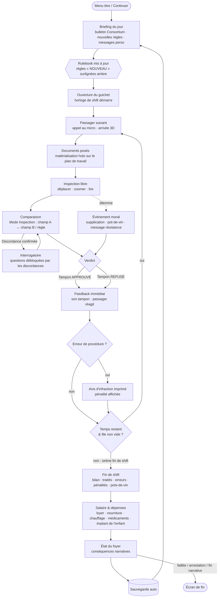

# CLEARANCE — UI Flow & UX

> Auteur : UI/UX Expert · Statut : proposition v0.1, à valider · Cible : Godot 4, 1920×1080 (16:9), mise à l'échelle par `canvas_items` + `expand`.
> Maquette de référence : [`docs/mockups/comparison.html`](mockups/comparison.html)

Ce document se conforme au **contrat Design System** (couleurs, polices, chanfreins, grille 4 px). Rappel des règles sémantiques utilisées partout :

| Token | Valeur | Sens UI — toujours doublé par… |
|---|---|---|
| `accent.cyan` | `#00E5FF` | hologramme, info, focus, sélection, **concordance** — trait fin + icône ✓ / losange de sélection |
| `accent.yellow` | `#FFE600` | marque Consortium, CTA principal, encre des tampons officiels — libellé en capitales |
| `accent.magenta` | `#FF2E88` | anomalie / **discordance** — icône ⚠ + hachures + libellé « DISCORDANCE » |
| `state.amber` | `#FFA31A` | avertissement, timer bas, **règle nouvelle** — étiquette « NOUVEAU » + liseré gauche |
| `state.red` | `#FF3B3B` | refus, critique — icône ✕ + libellé « REFUSÉ » |
| `state.green` | `#2EFF9A` | approbation — icône ✓ + libellé « APPROUVÉ » |

---

## 1. Boucle de jeu d'un shift



**Règles de rythme**
- Un passager = 45 à 120 s réelles. Un shift = 8 h in-game = ~10 min réelles (configurable en Options › Accessibilité › « Temps de shift »).
- L'horloge passe en `state.amber` à 30 min in-game de la fin, avec un tic sonore discret et le libellé « FIN DE SHIFT PROCHE » (jamais la couleur seule).
- Le verdict est **toujours** possible, même sans comparaison : le jeu ne force jamais l'outil, il le récompense (vitesse + sécurité).

---

## 2. Écran principal (1920×1080)

### 2.1 Wireframe

```
 0                                                                                              1920
 ┌──────────────────────────────────────────────────────────────────────────────────────────────┐ 0
 │ ◆ CONSORTIUM · CLEARANCE      HALCYON GATE · GUICHET 04 · JOUR 07       14:37 ▓▓▓▓▓▓░░ 18:00 │ [A] Barre d'état 56px
 ├──────────────────────────────────────────────────────────────────────────────────────────────┤ 56
 │ ┌ Dialogue ──────────┐                                                     ┌ File ─────────┐ │
 │ │ « J'ai un contrat… »│          ░░ vitre blindée ░░   ( passager 3D )     │ Passager 09/14│ │ [B] Vue guichet 3D
 │ │                    │                    ▄▀▀▀▄                           │ En attente 23 │ │     (~376px)
 │ │ [Question débloquée]│                   █ ◉ █   ← implant oculaire       │ Signalés  1   │ │
 │ └────────────────────┘               ▄▄▄██████▄▄▄                         └───────────────┘ │
 ├══════════════════════════════════════════════════════════════════════╦═══════════════════════┤ 432
 │ PLAN DE TRAVAIL HOLOGRAPHIQUE                       [MODE INSPECTION] ║ RULEBOOK · JOUR 07  ◂ │
 │ ┌ Bio-scan ──────┐ ┌ Carte d'identité ──────┐ ┌ Permis d'entrée ────┐ ║ DATE DU JOUR 19.03.2187│ [C] Plan de travail
 │ │ Statut  SAIN   │ │ [photo] NOM …          │ │ N° ID  HG-4471-K2Q9 │ ║ 1. Documents requis   │ [D] Rulebook rétractable
 │ │ Implants 2     │ │         N° ID HG-4471… │ │ Valide → 14.03.2187 ├─╫─⚠─► (date du jour)    │     (448px, Tab)
 │ │ Émis le …      │ │         Expire …       │ │ Motif  TRAVAIL      │ ║ ▌NOUVEAU 3. Bio-scan  │
 │ └────────────────┘ └────────────────────────┘ └─────────────────────┘ ║ 4. Implants militaires│
 │                                                                       ║ ...                   │
 ├───────────────────────────────────────────────────────────────────────╩───────────────────────┤ 984
 │ [◇ INSPECTION  Espace|LT] [? INTERROGER  Q|Y ①]      Tiroir à tampons ▸ [✓ APPROUVÉ] [✕ REFUSÉ]│ [E] Barre d'outils 96px
 └──────────────────────────────────────────────────────────────────────────────────────────────┘ 1080
```

### 2.2 Zones

| Zone | Position (px) | Contenu | Notes |
|---|---|---|---|
| **A · Barre d'état** | 0–56, pleine largeur | Logo Consortium (jaune), lieu/guichet/jour, **horloge de shift** (heure + barre de progression + heure de fin), crédits du jour | Toujours visible. L'horloge est la seule info temporelle : pas de timer par passager (anti-stress, cohérent avec Papers, Please). |
| **B · Vue guichet 3D** | 56–432 | Caméra fixe à travers la vitre ; passager animé (idle, émotions) ; bulle de dialogue à gauche ; panneau file/compteurs à droite | Pluie + néons **derrière** la vitre. Scanlines uniquement sur la vitre/le fond, jamais sur la bulle de dialogue. Les questions débloquées apparaissent sous la bulle. |
| **C · Plan de travail** | 432–984, 0–1456 | 2 à 5 documents holographiques manipulables (glisser, empiler, zoomer ×1.5 au survol long ou RS) | Documents « posés » : légère perspective à l'arrivée puis à plat pour la lecture. Pas de rotation > 0° en lecture (lisibilité). |
| **D · Rulebook** | 432–984, 1464–1904 | Date du jour (champ comparable), règles numérotées, nouveautés en ambre, onglets (Règles · Cartes · Implants · Sceaux) | Rétractable (Tab / ☰) : replié = languette 48 px avec compteur « 2 NOUVEAU ». Chaque règle et chaque entrée est un **champ comparable**. |
| **E · Barre d'outils** | 984–1080 | Mode Inspection (bascule), Interroger (+ badge du nombre de questions débloquées), tiroir à tampons APPROUVÉ / REFUSÉ | Rappels clavier + manette affichés en permanence (masquables en Options). |

### 2.3 Hiérarchie de l'information

1. **Discordances et verdict** — magenta / vert / rouge, saillance maximale, toujours accompagnés d'icône + texte.
2. **Valeurs des champs** — JetBrains Mono 16–18 px, `text.primary`, contraste ≥ 12:1 sur `bg.elevated`.
3. **Règles du jour** — `text.primary`, règles nouvelles avec liseré + étiquette ambre.
4. **Libellés des champs** — Inter 11 px capitales, `text.secondary`.
5. **Ambiance** (néons, pluie, flicker) — `text.muted` et couleurs désaturées, jamais au premier plan.

Principe : **une seule couleur saturée « active » à la fois dans le plan de travail** (le cyan de sélection OU le magenta de discordance), le reste reste neutre.

---

## 3. Flux de comparaison — proposition principale : « Mode Inspection »

### 3.1 Principe

1. Le joueur active le **Mode Inspection** (Espace / LT ou bouton). Le plan de travail et le Rulebook reçoivent un cadre cyan, les documents se figent (plus de glisser), chaque champ comparable affiche un soulignement pointillé cyan au survol.
2. Il clique un **champ A** (sur un document, ou une règle / la date du jour dans le Rulebook). Le champ prend un contour cyan + pastille « A » ; un **fil holographique** pointillé suit le curseur.
3. Il clique un **champ B**. Le fil se fixe entre A et B (courbe de Bézier, nœuds en losange).
4. Le système évalue en ~250 ms (animation de « calcul » : le fil se remplit de A vers B) :
   - **CONCORDANT** → fil cyan fin, étiquette « ✓ CONCORDANT » discrète, disparaît en 1,2 s. Aucune récompense, aucune pénalité.
   - **DISCORDANCE** → fil magenta épais 3 px + lueur, les deux champs passent en contour magenta **hachuré**, étiquette « ⚠ DISCORDANCE » + explication courte (« Permis expiré : 14.03 < 19.03 »). La discordance reste épinglée jusqu'au verdict.
5. Chaque discordance confirmée **débloque une question d'interrogatoire** (badge sur « Interroger », carte de question sous la bulle de dialogue).
6. Le joueur peut enchaîner d'autres comparaisons sans quitter le mode ; il quitte par Espace / LT / Échap.

> Le jeu ne dit jamais « ce passager est illégal » : il constate des faits (discordance entre deux champs). La décision reste au joueur, ce qui préserve les dilemmes (ex. : expiration de 5 jours + supplication).

### 3.2 Diagramme d'états


### 3.3 Cas limites

| Cas | Comportement | Retour |
|---|---|---|
| **Champs incomparables** (ex. « Nom » ↔ « Groupe sanguin ») | Pas d'évaluation. Le fil « claque » et se rétracte vers A. A reste sélectionné. | Libellé gris `text.secondary` « INCOMPARABLE — choisissez un champ de même type » + son sec court. Aucune pénalité. |
| **Même document, deux champs** | Autorisé uniquement s'il existe une relation logique (ex. date d'émission ↔ date d'expiration, âge ↔ date de naissance). Sinon : A est **remplacé** par le nouveau champ (le joueur a probablement changé d'avis). | Remplacement : le losange A glisse vers le nouveau champ. |
| **Même champ cliqué deux fois** | Désélection (retour InspectionActive). | Fil se rétracte. |
| **Annulation** | Échap / clic droit / Ⓑ / clic dans le vide : annule A. Échap une seconde fois : quitte le mode. | — |
| **Comparaison déjà faite** | Ne relance pas l'évaluation ; remet en surbrillance le lien existant. | Pulsation du lien. |
| **Champ vs règle du Rulebook** | Comparaison valide si la règle porte sur ce type de champ (date ↔ « Permis valide à la date du jour », implant ↔ « Implants militaires interdits »). | Le texte de la règle concernée se surligne. |
| **Plusieurs discordances** | Toutes restent épinglées (max. 4 visibles ; au-delà, compteur « +2 » sur la barre d'outils). | Chaque lien numéroté ①②③. |
| **Le temps s'écoule** | L'horloge **continue** pendant l'inspection (pas de pause) : c'est la tension du jeu. L'évaluation de 250 ms est dans le temps réel. | Horloge ambre en fin de shift. Option d'accessibilité : « Inspection ralentit le temps ×0.5 ». |
| **Fin de shift pendant une sélection** | La sirène retentit, le passager en cours peut être terminé (pas de coupure brutale), la sélection est conservée. | Bandeau ambre « DERNIER PASSAGER ». |
| **Document retiré/déplacé hors du plan** | Liens attachés à ce document masqués (pas supprimés), réapparaissent quand il revient. | — |
| **Passager tend un nouveau document** pendant l'inspection | Le document arrive en bas à gauche sans bousculer les autres ; sélection conservée. | Son de dépôt + liseré cyan 1 s. |
| **Faux positif impossible** | Le système n'affiche jamais une discordance fausse (fiabilité de l'outil). L'ambiguïté vient des règles et du récit, pas de l'UI. | — |

### 3.4 Retours visuels et audio

| Événement | Visuel | Audio | Haptique (manette) |
|---|---|---|---|
| Activer l'inspection | Cadres cyan en coin sur plan + Rulebook, voile `bg.void` 8 % sur la vue 3D | Montée d'un bourdonnement holo (‑18 dB) | — |
| Survol champ | Soulignement pointillé cyan + curseur réticule | Tic très léger | — |
| Sélection A | Contour cyan 2 px + pastille « A » (losange) | « Bip » aigu court | Pulse 20 ms |
| Fil en cours | Pointillé cyan animé (désactivable) | — | — |
| Concordant | Fil cyan 1 px, étiquette « ✓ CONCORDANT » | Double bip neutre descendant | — |
| Discordance | Fil magenta 3 px + lueur, champs hachurés magenta, ⚠, étiquette explicative | Accord dissonant bref + glitch | Pulse 60 ms ×2 |
| Incomparable | Fil gris qui se rétracte | Clic sec | — |
| Question débloquée | Badge numéroté sur Interroger, carte sous la bulle | Notification courte | — |
| Tampon APPROUVÉ / REFUSÉ | Animation 3D du tampon, encre `accent.yellow` sur le document + libellé vert/rouge | Impact lourd | Pulse 120 ms |

### 3.5 Raccourcis

| Action | Clavier / souris | Manette (Xbox · PlayStation) |
|---|---|---|
| Basculer Mode Inspection | **Espace** · bouton barre d'outils | **LT** · **L2** |
| Sélectionner un champ | Clic gauche · **Entrée** | **Ⓐ** · **✕** |
| Naviguer entre champs (inspection) | Flèches / Tab = champ suivant | **Stick G** (snap magnétique champ à champ) · croix directionnelle |
| Annuler la sélection | **Échap** · clic droit | **Ⓑ** · **○** |
| Interroger | **Q** | **Ⓨ** · **△** |
| Ouvrir/replier le Rulebook | **Tab** (hors inspection) · **R** | **View** · **Touchpad** |
| Tourner les pages du Rulebook | **[ / ]** | **LB / RB** (Rulebook focus) |
| Zoomer un document | Molette · maintien clic | **Stick D** (clic = zoom) |
| Sortir le tiroir à tampons | **T** | **RT** · **R2** |
| Tamponner APPROUVÉ | **V** (maintenir 0,4 s) | tiroir ouvert + **Ⓐ** maintenu |
| Tamponner REFUSÉ | **X** (maintenir 0,4 s) | tiroir ouvert + **Ⓧ** maintenu · **□** |
| Pause | **Échap** (hors sélection) · **F10** | **Menu** · **Options** |

Le maintien de 0,4 s sur les tampons évite les verdicts accidentels (désactivable). En manette, le curseur est remplacé par un **focus magnétique** qui saute de champ en champ : on n'a jamais à viser un champ au pixel près.

---

## 4. Alternatives

### 4.1 Alternative B — Superposition « Overlay »

Le joueur glisse un document **sur** un autre ; les champs de même type s'alignent et se colorent ligne à ligne (cyan = identique, magenta = différent).

| ➕ | ➖ |
|---|---|
| Très rapide, geste physique satisfaisant | Compare tout d'un coup : supprime la part de « trouver » l'erreur |
| Facile à comprendre sans tutoriel | Ne permet pas de comparer avec une **règle** ou la date du jour |
| Bien en manette (1 geste) | Documents de formats différents → alignement artificiel, lisibilité dégradée |

### 4.2 Alternative C — « Scanner » automatique partiel (upgrade)

Un scanner acheté avec le salaire (ou offert par la résistance) signale automatiquement une catégorie (ex. dates expirées) en début d'inspection.

| ➕ | ➖ |
|---|---|
| Progression et économie : rend le salaire utile | Retire de la jouabilité si trop large |
| Allège la charge en fin de jeu quand les règles s'empilent | Risque d'en faire un « pay to win » diégétique |
| Narratif : scanner qui tombe en panne, piraté, surveillé par le Consortium | Seul, ne suffit pas comme mécanique de base |

### 4.3 Recommandation

**Mode Inspection comme mécanique de base, Scanner partiel comme upgrade tardif (jour 10+), pas d'Overlay.**
- Le Mode Inspection préserve le cœur Papers, Please (le joueur *trouve* l'erreur), couvre documents **et** Rulebook, et produit le lien vers l'interrogatoire.
- Le Scanner s'y branche naturellement : il pré-trace des liens magenta « suggérés » (pointillés) que le joueur doit **confirmer** d'un clic → même grammaire visuelle, pas de nouvelle UI.
- L'Overlay peut survivre comme raccourci limité (comparer deux photos) si les tests montrent de la friction sur les portraits.

---

## 5. Accessibilité

| Domaine | Mesures |
|---|---|
| **Daltonisme** | Aucune info par la couleur seule : discordance = ⚠ + hachures + texte ; concordant = ✓ ; approuvé/refusé = icône + libellé + forme du tampon (cercle vs octogone). Préréglages Protanopie / Deutéranopie / Tritanopie qui remappent magenta→orange-blanc, vert→cyan clair, rouge→orange vif. Mode « Hachures renforcées ». |
| **Taille du texte** | Échelle UI 90 %–150 % (pas de 10). Documents : zoom de lecture permanent optionnel. Minimum absolu 12 px à 100 %. Valeurs de données jamais < 14 px. |
| **Réduction des effets** | Interrupteur unique « Effets holo réduits » : coupe scanlines, flicker, aberration chromatique, fils animés, pluie à l'écran. Respecte « reduce motion » du système quand disponible. Flicker toujours < 3 Hz. |
| **Remapping** | Toutes les actions remappables clavier & manette, profils séparés. Option « Bascule vs maintien » pour l'inspection et les tampons. |
| **Temps** | Vitesse du shift (×0.5 à ×1.5), option « Inspection ralentit le temps », option « Pas de fin de shift chronométrée » (mode Récit). |
| **Audio** | Tous les signaux sonores ont un équivalent visuel ; sous-titres des passagers avec nom du locuteur, taille et fond réglables. |
| **Lecture** | Lecteur d'écran du champ focalisé (TTS optionnel) : « Permis d'entrée, Valide jusqu'au, 14 mars 2187 ». |
| **Contraste** | Texte principal ≥ 7:1 ; libellés ≥ 4.5:1 (`text.secondary` sur `bg.panel` ≈ 6:1). `text.muted` réservé au décor et aux éléments désactivés. |

---

## 6. Onboarding — Jour 1 diégétique

Pas de pop-up tutoriel : le superviseur **Okonkwo** parle à l'intercom et le Rulebook du jour 1 n'a que 2 règles.

1. **Passager 1** (règle : « Carte d'identité valide ») — Okonkwo : « Pose ta main sur le pupitre… ça, c'est la touche Inspection. » La touche Espace / LT clignote **une fois** dans la barre d'outils.
2. **Passager 2** — carte expirée. Okonkwo guide : « Clique la date d'expiration… puis la date du jour, en haut du Rulebook. » Fil magenta → première question débloquée → première interrogation scénarisée.
3. **Passager 3** — documents corrects : le joueur découvre « CONCORDANT » et apprend que l'outil ne punit pas.
4. **Passager 4** — premier tampon REFUSÉ autonome. Puis Okonkwo se tait ; les passagers suivants sont libres.
5. Fin de journée : premier bilan + dépenses (le chauffage n'est pas payable → amorce dramatique).

Les jours 2–5 introduisent chacun **un** outil (Interroger approfondi, onglet Implants, tiroir à tampons, empreintes) via la règle « NOUVEAU » ambre + une ligne de briefing. Un « Carnet d'aide » dans le Rulebook rejoue chaque explication.

---

## 7. Écrans secondaires

| Écran | Contenu clé | Notes UX |
|---|---|---|
| **Menu titre** | Logo CLEARANCE (Chakra Petch, jaune), Continuer (CTA jaune), Nouvelle partie, Options, Crédits, Quitter ; fond : file d'attente sous la pluie | Continuer en focus par défaut. |
| **Briefing du jour** | Bulletin Consortium (date, contexte politique), nouvelles règles en ambre, message personnel (famille, résistance), bouton « Prendre son poste » | Lecture au rythme du joueur, pas de temps. Les nouvelles règles ici sont **les mêmes** que dans le Rulebook (un seul vocabulaire). |
| **Bilan de shift** | Passagers traités, erreurs (avec motif + règle citée), salaire, pénalités, pots-de-vin ; puis écran **Foyer** : dépenses cochables (loyer, nourriture, chauffage, médicaments), état de chaque proche (icône + texte) | Les erreurs sont **pédagogiques** : montrer les deux champs fautifs avec leur lien magenta. |
| **Pause / Options** | Reprendre, Options (Affichage, Audio, Commandes, **Accessibilité** en premier niveau), Rulebook (consultation), Quitter vers le menu | La pause gèle l'horloge et floute le plan de travail (anti-triche légère, désactivable). |

---

## 8. Questions ouvertes à valider

1. L'horloge continue-t-elle pendant le Mode Inspection (recommandé : oui, avec option d'accessibilité) ?
2. Une discordance confirmée doit-elle être **obligatoire** pour pouvoir interroger, ou seulement débloquer des questions supplémentaires ?
3. Pénaliser un REFUS sans discordance documentée (cohérence « procédurale » à la Papers, Please) ?
4. Le Scanner partiel : upgrade acheté (Consortium) ou objet de la résistance (risque narratif) ?
5. Nombre maximum de documents simultanés sur le plan (proposition : 5) pour garder la lisibilité à 1080p.
