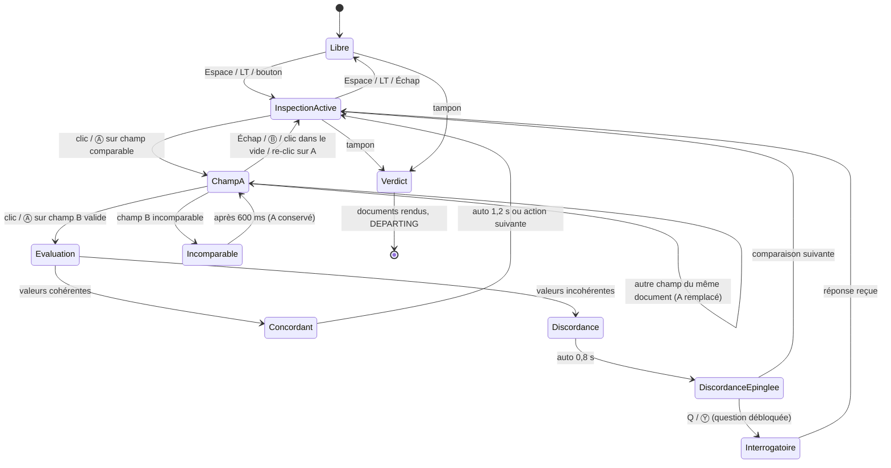
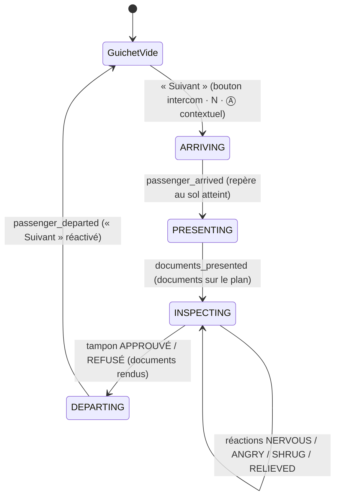

# CLEARANCE — UI Flow & UX

> Auteur : UI/UX Expert · Statut : proposition v0.2 (ajout : passager animé, vitre, champ « Visage »), à valider · Cible : Godot 4, 1920×1080 (16:9), mise à l'échelle par `canvas_items` + `expand`.
> Maquette de référence : [`docs/mockups/comparison.html`](mockups/comparison.html)

Ce document se conforme au **contrat Design System** (couleurs, polices, chanfreins, grille 4 px). Rappel des règles sémantiques utilisées partout :

| Token | Valeur | Sens UI — toujours doublé par… |
|---|---|---|
| `accent.cyan` | `#00E5FF` | hologramme, info, focus, sélection, **concordance** — trait fin + icône ✓ / losange de sélection |
| `accent.yellow` | `#FFE600` | marque Consortium, CTA principal, encre des tampons officiels — libellé en capitales |
| `accent.magenta` | `#FF2E88` | anomalie / **discordance** — icône ⚠ + hachures + libellé « DISCORDANCE » |
| `state.amber` | `#FFA31A` | avertissement, timer bas, **règle nouvelle** — étiquette « NOUVEAU » + liseré gauche |
| `state.red` | `#FF3B3B` | refus, critique — icône ✕ + libellé « REFUSÉ » |
| `state.green` | `#2EFF9A` | approbation — icône ✓ + libellé « APPROUVÉ » |

---

## 1. Boucle de jeu d'un shift


**Règles de rythme**
- Un passager = 45 à 120 s réelles, **dont ≤ 3–4 s de marche** (ARRIVING) et ~2 s de départ (DEPARTING). L'horloge de shift **continue pendant la marche** (proposition, à valider client) : la marche est courte et le joueur a de quoi faire (Rulebook, voir §4.2).
- « Suivant » n'est réactivé qu'à `passenger_departed` : il n'y a jamais deux passagers au guichet. Un shift = 8 h in-game = ~10 min réelles (configurable en Options › Accessibilité › « Temps de shift »).
- L'horloge passe en `state.amber` à 30 min in-game de la fin, avec un tic sonore discret et le libellé « FIN DE SHIFT PROCHE » (jamais la couleur seule).
- Le verdict est **toujours** possible, même sans comparaison : le jeu ne force jamais l'outil, il le récompense (vitesse + sécurité).

---

## 2. Écran principal (1920×1080)

### 2.1 Wireframe

```
 0                                                                                              1920
 ┌──────────────────────────────────────────────────────────────────────────────────────────────┐ 0
 │ ◆ CONSORTIUM · CLEARANCE      HALCYON GATE · GUICHET 04 · JOUR 07       14:37 ▓▓▓▓▓▓░░ 18:00 │ [A] Barre d'état 56px
 ├──────────────────────────────────────────────────────────────────────────────────────────────┤ 56
 │ ┌ Dialogue ──────────┐ ╔═ cadre métal ═══════════════════════════════╗ ┌ File ─────────┐ │
 │ │ « J'ai un contrat… »│ ║ ░ reflet ░    ┌ VISAGE ┐   · gouttes ·       ║ │ Passager 09/14│ │ [B] Vue guichet 3D
 │ │                    │ ║               │ ▄▀▀▀▄  │  ( passager 3D )     ║ │ En attente 23 │ │     (~376px, vitre)
 │ │ [Question débloquée]│ ║  ◎ hygiaphone │ █ ◉ █  │  ← implant oculaire  ║ │ Signalés  1   │ │
 │ └────────────────────┘ ║ ▒ condensation ▄▄██████▄▄   [ sous-titres ]  ║ └───────────────┘ │
 │                        ╚═════════════[▭ fente à documents ▭]══════════╝                   │
 ├══════════════════════════════════════════════════════════════════════╦═══════════════════════┤ 432
 │ PLAN DE TRAVAIL HOLOGRAPHIQUE                       [MODE INSPECTION] ║ RULEBOOK · JOUR 07  ◂ │
 │ ┌ Bio-scan ──────┐ ┌ Carte d'identité ──────┐ ┌ Permis d'entrée ────┐ ║ DATE DU JOUR 19.03.2187│ [C] Plan de travail
 │ │ Statut  SAIN   │ │ [photo] NOM …          │ │ N° ID  HG-4471-K2Q9 │ ║ 1. Documents requis   │ [D] Rulebook rétractable
 │ │ Implants 2     │ │         N° ID HG-4471… │ │ Valide → 14.03.2187 ├─╫─⚠─► (date du jour)    │     (448px, Tab)
 │ │ Émis le …      │ │         Expire …       │ │ Motif  TRAVAIL      │ ║ ▌NOUVEAU 3. Bio-scan  │
 │ └────────────────┘ └────────────────────────┘ └─────────────────────┘ ║ 4. Implants militaires│
 │                                                                       ║ ...                   │
 ├───────────────────────────────────────────────────────────────────────╩───────────────────────┤ 984
 │ [◇ INSPECTION  Espace|LT] [? INTERROGER  Q|Y ①]      Tiroir à tampons ▸ [✓ APPROUVÉ] [✕ REFUSÉ]│ [E] Barre d'outils 96px
 └──────────────────────────────────────────────────────────────────────────────────────────────┘ 1080
```

### 2.2 Zones

| Zone | Position (px) | Contenu | Notes |
|---|---|---|---|
| **A · Barre d'état** | 0–56, pleine largeur | Logo Consortium (jaune), lieu/guichet/jour, **horloge de shift** (heure + barre de progression + heure de fin), crédits du jour | Toujours visible. L'horloge est la seule info temporelle : pas de timer par passager (anti-stress, cohérent avec Papers, Please). |
| **B · Vue guichet 3D** | 56–432 | Caméra fixe à travers la **vitre** (cadre métal, reflet, gouttes, condensation, hygiaphone, fente à documents) ; passager animé **toujours visible** (marche, idle, réactions, regard) ; bulle de dialogue à gauche ; panneau file/compteurs à droite ; sous-titres des barks en bas de la vitre | Pluie + néons **derrière** la vitre. Scanlines uniquement sur la vitre/le fond, jamais sur la bulle ni les sous-titres. Les questions débloquées apparaissent sous la bulle. Aucun élément d'UI ne recouvre le visage (voir §4.4). |
| **C · Plan de travail** | 432–984, 0–1456 | 2 à 5 documents holographiques manipulables (glisser, empiler, zoomer ×1.5 au survol long ou RS) | Documents « posés » : légère perspective à l'arrivée puis à plat pour la lecture. Pas de rotation > 0° en lecture (lisibilité). |
| **D · Rulebook** | 432–984, 1464–1904 | Date du jour (champ comparable), règles numérotées, nouveautés en ambre, onglets (Règles · Cartes · Implants · Sceaux) | Rétractable (Tab / ☰) : replié = languette 48 px avec compteur « 2 NOUVEAU ». Chaque règle et chaque entrée est un **champ comparable**. |
| **E · Barre d'outils** | 984–1080 | Mode Inspection (bascule), Interroger (+ badge du nombre de questions débloquées), tiroir à tampons APPROUVÉ / REFUSÉ | Rappels clavier + manette affichés en permanence (masquables en Options). |

### 2.3 Hiérarchie de l'information

1. **Discordances et verdict** — magenta / vert / rouge, saillance maximale, toujours accompagnés d'icône + texte.
2. **Valeurs des champs** — JetBrains Mono 16–18 px, `text.primary`, contraste ≥ 12:1 sur `bg.elevated`.
3. **Règles du jour** — `text.primary`, règles nouvelles avec liseré + étiquette ambre.
4. **Libellés des champs** — Inter 11 px capitales, `text.secondary`.
5. **Ambiance** (néons, pluie, flicker) — `text.muted` et couleurs désaturées, jamais au premier plan.

Principe : **une seule couleur saturée « active » à la fois dans le plan de travail** (le cyan de sélection OU le magenta de discordance), le reste reste neutre.

---

## 3. Flux de comparaison — proposition principale : « Mode Inspection »

### 3.1 Principe

1. Le joueur active le **Mode Inspection** (Espace / LT ou bouton). Le plan de travail et le Rulebook reçoivent un cadre cyan, les documents se figent (plus de glisser), chaque champ comparable affiche un soulignement pointillé cyan au survol.
2. Il clique un **champ A** (sur un document, ou une règle / la date du jour dans le Rulebook). Le champ prend un contour cyan + pastille « A » ; un **fil holographique** pointillé suit le curseur.
3. Il clique un **champ B**. Le fil se fixe entre A et B (courbe de Bézier, nœuds en losange).
4. Le système évalue en ~250 ms (animation de « calcul » : le fil se remplit de A vers B) :
   - **CONCORDANT** → fil cyan fin, étiquette « ✓ CONCORDANT » discrète, disparaît en 1,2 s. Aucune récompense, aucune pénalité.
   - **DISCORDANCE** → fil magenta épais 3 px + lueur, les deux champs passent en contour magenta **hachuré**, étiquette « ⚠ DISCORDANCE » + explication courte (« Permis expiré : 14.03 < 19.03 »). La discordance reste épinglée jusqu'au verdict.
5. Chaque discordance confirmée **débloque une question d'interrogatoire** (badge sur « Interroger », carte de question sous la bulle de dialogue).
6. Le joueur peut enchaîner d'autres comparaisons sans quitter le mode ; il quitte par Espace / LT / Échap.

> Le jeu ne dit jamais « ce passager est illégal » : il constate des faits (discordance entre deux champs). La décision reste au joueur, ce qui préserve les dilemmes (ex. : expiration de 5 jours + supplication).

### 3.2 Diagramme d'états



### 3.3 Cas limites

| Cas | Comportement | Retour |
|---|---|---|
| **Champs incomparables** (ex. « Nom » ↔ « Groupe sanguin ») | Pas d'évaluation. Le fil « claque » et se rétracte vers A. A reste sélectionné. | Libellé gris `text.secondary` « INCOMPARABLE — choisissez un champ de même type » + son sec court. Aucune pénalité. |
| **Même document, deux champs** | Autorisé uniquement s'il existe une relation logique (ex. date d'émission ↔ date d'expiration, âge ↔ date de naissance). Sinon : A est **remplacé** par le nouveau champ (le joueur a probablement changé d'avis). | Remplacement : le losange A glisse vers le nouveau champ. |
| **Même champ cliqué deux fois** | Désélection (retour InspectionActive). | Fil se rétracte. |
| **Annulation** | Échap / clic droit / Ⓑ / clic dans le vide : annule A. Échap une seconde fois : quitte le mode. | — |
| **Comparaison déjà faite** | Ne relance pas l'évaluation ; remet en surbrillance le lien existant. | Pulsation du lien. |
| **Champ vs règle du Rulebook** | Comparaison valide si la règle porte sur ce type de champ (date ↔ « Permis valide à la date du jour », implant ↔ « Implants militaires interdits »). | Le texte de la règle concernée se surligne. |
| **Plusieurs discordances** | Toutes restent épinglées (max. 4 visibles ; au-delà, compteur « +2 » sur la barre d'outils). | Chaque lien numéroté ①②③. |
| **Le temps s'écoule** | L'horloge **continue** pendant l'inspection (pas de pause) : c'est la tension du jeu. L'évaluation de 250 ms est dans le temps réel. | Horloge ambre en fin de shift. Option d'accessibilité : « Inspection ralentit le temps ×0.5 ». |
| **Fin de shift pendant une sélection** | La sirène retentit, le passager en cours peut être terminé (pas de coupure brutale), la sélection est conservée. | Bandeau ambre « DERNIER PASSAGER ». |
| **Document retiré/déplacé hors du plan** | Liens attachés à ce document masqués (pas supprimés), réapparaissent quand il revient. | — |
| **Passager tend un nouveau document** pendant l'inspection | Le document arrive en bas à gauche sans bousculer les autres ; sélection conservée. | Son de dépôt + liseré cyan 1 s. |
| **Faux positif impossible** | Le système n'affiche jamais une discordance fausse (fiabilité de l'outil). L'ambiguïté vient des règles et du récit, pas de l'UI. | — |

### 3.4 Retours visuels et audio

| Événement | Visuel | Audio | Haptique (manette) |
|---|---|---|---|
| Activer l'inspection | Cadres cyan en coin sur plan + Rulebook, voile `bg.void` 8 % sur la vue 3D | Montée d'un bourdonnement holo (‑18 dB) | — |
| Survol champ | Soulignement pointillé cyan + curseur réticule | Tic très léger | — |
| Sélection A | Contour cyan 2 px + pastille « A » (losange) | « Bip » aigu court | Pulse 20 ms |
| Fil en cours | Pointillé cyan animé (désactivable) | — | — |
| Concordant | Fil cyan 1 px, étiquette « ✓ CONCORDANT » | Double bip neutre descendant | — |
| Discordance | Fil magenta 3 px + lueur, champs hachurés magenta, ⚠, étiquette explicative | Accord dissonant bref + glitch | Pulse 60 ms ×2 |
| Incomparable | Fil gris qui se rétracte | Clic sec | — |
| Question débloquée | Badge numéroté sur Interroger, carte sous la bulle | Notification courte | — |
| Tampon APPROUVÉ / REFUSÉ | Animation 3D du tampon, encre `accent.yellow` sur le document + libellé vert/rouge | Impact lourd | Pulse 120 ms |

### 3.5 Raccourcis

| Action | Clavier / souris | Manette (Xbox · PlayStation) |
|---|---|---|
| Basculer Mode Inspection | **Espace** · bouton barre d'outils | **LT** · **L2** |
| Sélectionner un champ | Clic gauche · **Entrée** | **Ⓐ** · **✕** |
| Naviguer entre champs (inspection) | Flèches / Tab = champ suivant | **Stick G** (snap magnétique champ à champ) · croix directionnelle |
| Annuler la sélection | **Échap** · clic droit | **Ⓑ** · **○** |
| Interroger | **Q** | **Ⓨ** · **△** |
| Ouvrir/replier le Rulebook | **Tab** (hors inspection) · **R** | **View** · **Touchpad** |
| Tourner les pages du Rulebook | **[ / ]** | **LB / RB** (Rulebook focus) |
| Zoomer un document | Molette · maintien clic | **Stick D** (clic = zoom) |
| Sortir le tiroir à tampons | **T** | **RT** · **R2** |
| Tamponner APPROUVÉ | **V** (maintenir 0,4 s) | tiroir ouvert + **Ⓐ** maintenu |
| Tamponner REFUSÉ | **X** (maintenir 0,4 s) | tiroir ouvert + **Ⓧ** maintenu · **□** |
| Pause | **Échap** (hors sélection) · **F10** | **Menu** · **Options** |

Le maintien de 0,4 s sur les tampons évite les verdicts accidentels (désactivable). En manette, le curseur est remplacé par un **focus magnétique** qui saute de champ en champ : on n'a jamais à viser un champ au pixel près.

---

## 4. Le passager et la vitre

Le passager n'est pas un décor : il **arrive**, **reste visible pendant toute l'inspection**, **réagit**, et son **visage est une pièce du dossier** (champ comparable « Visage »). La vitre matérialise la frontière entre l'agent et lui (référence : Papers, Please). Tout ce qui suit concerne la **vue 3D (zone B)** ; les documents restent une surcouche 2D (D-007).

### 4.1 Séquence d'un cas (contrat)



| Phase | Durée | Ce que voit / entend le joueur | Ce qu'il peut faire | Bloqué |
|---|---|---|---|---|
| **Guichet vide** | jusqu'à l'action | Repère au sol vide, file floue au fond, bouton « Suivant » pulsé (1 fois / 4 s, pas de clignotement) | Lire le Rulebook, appeler le suivant | Tampons, Inspection |
| **ARRIVING** | ≤ 3–4 s (≤ 1 s en « Réduire les animations ») | Anim **Walk** le long du chemin jusqu'au repère, pas sur sol mouillé spatialisés (gauche → centre), bark d'intercom sous-titré ; plan de travail **vide** avec texte d'attente discret ; nom affiché « PASSAGER 09 » (identité non vérifiée) | Lire / feuilleter le Rulebook (c'est le moment prévu pour ça) | Tampons (grisés + « aucun document »), Inspection (grisée), Interroger, « Suivant » (libellé « EN APPROCHE ») |
| **PRESENTING** | ~1,2 s | Anim **PresentDocuments**, voix « Voici mes papiers… » sous-titrée, la **fente** de la vitre s'éclaire cyan, son d'hologramme qui s'allume ; les documents glissent de la fente vers leurs positions par défaut (décalage 120 ms entre documents) | Rien (très court) ; Rulebook toujours lisible | Idem ARRIVING |
| **INSPECTING** | libre | **Idle / Talk**, regard qui suit le curseur, réactions déclenchées par la logique ; le nom réel s'affiche dans la bulle une fois les documents posés | Tout : inspection, comparaison (dont **Visage**), interrogatoire, verdict | — |
| **DEPARTING** | ~2 s | Documents rendus par la fente (ils glissent du plan vers la fente), anim **Leave** : sortie vers la station si approuvé, **demi-tour** vers la file si refusé ; réaction de sortie (RELIEVED / ANGRY) | Lire le Rulebook, consulter l'avis d'infraction éventuel | « Suivant », tampons |

### 4.2 Pendant la marche
- **Le temps de marche est un temps de lecture**, pas un temps mort : c'est le moment naturel pour feuilleter le Rulebook (nouveautés ambre). Le Rulebook reste 100 % interactif.
- Le passager **s'annonce par l'intercom** (bark court, 1 ligne : « Bonsoir… J'arrive. », toux, souffle) : sous-titré, LED de l'hygiaphone allumée tant qu'il parle (équivalent visuel du son).
- Plan de travail : **état vide** — texte `text.secondary` centré « En attente des documents » + sous-ligne « Ils glisseront par la fente de la vitre à l'arrivée du passager · Tab : Rulebook ». Pas d'animation de chargement (pas d'urgence artificielle).
- Barre d'outils : tampons grisés avec la mention « verrouillé · aucun document », statut « Passager en approche ».
- Identité : tant que les documents ne sont pas posés, le passager est désigné par son numéro (« PASSAGÈRE 09 ») — le jeu ne connaît pas encore son nom, l'agent non plus.

### 4.3 Arrivée des documents
1. `passenger_arrived` : le passager s'arrête sur le repère, se tourne vers la vitre (0,3 s).
2. `present_documents` : anim PresentDocuments (il glisse les papiers dans la fente), bark « Voici mes papiers… ».
3. Côté joueur : la fente (bas de la vitre, au centre) s'éclaire cyan, les documents **émergent de la bordure haute du plan de travail, au centre** (continuité spatiale fente → plan), avec une légère perspective qui s'aplatit, puis se rangent à leurs positions par défaut. Son : hologramme qui s'allume + dépôt.
4. `documents_presented` : INSPECTING commence, tampons et Inspection se déverrouillent (petit « clac » mécanique + liseré cyan 300 ms sur le tiroir).
- « Réduire les animations » : documents en fondu 150 ms à leurs positions, sans trajectoire.

### 4.4 Passager toujours visible — vérification du layout
- **Règle** : aucun élément d'UI ne recouvre le **visage** du passager pendant INSPECTING. Les documents ne peuvent pas être glissés au-dessus de y = 432 (butée élastique) ; la bulle de dialogue (gauche) et la file (droite) restent hors de la vitre ; les sous-titres s'affichent **sous le visage**, en bas de la vitre ; la pause est le seul écran qui masque la vue.
- **Proportions évaluées** :

| Option | Vue 3D | Plan de travail | Verdict |
|---|---|---|---|
| Actuelle | 376 px (35 %) | 552 px | **Retenue.** Cadrage buste : la tête fait ~136 px de haut à 1080p (plus grande que la photo d'identité, 150 px de cadre pour ~60 px de visage) : lisible pour la comparaison. |
| 45 % | 486 px | 442 px | Rejetée : la carte d'identité (~470 px de haut) ne tient plus, le Rulebook perd 2 règles visibles, et l'inspection (cœur du jeu) devient plus pénible. |
| 40 % | 432 px | 496 px | Possible en repli si les tests montrent un visage trop petit en 720p / Steam Deck ; impose des documents plus compacts. |

- Pour les moments où le visage compte (comparaison « Visage », interrogatoire), on **zoome la caméra** (travelling avant dans la même bande de 376 px) au lieu d'agrandir la zone : le layout ne bouge jamais.

### 4.5 La vitre
Ordre des calques (arrière → avant) : ville, pluie, néons → **passager** → **vitre** (reflet diagonal léger, gouttes, condensation en bas, scanlines très faibles) → **cadre métallique** (rivets, hygiaphone, fente à documents) → UI (bulle, file, sous-titres, cadre « Visage »).
- **Zone du visage dégagée** : gouttes et condensation sont exclues d'une ellipse autour de la tête au repère (le décor ne doit jamais devenir un handicap de lecture). La condensation reste dans le tiers bas.
- **Hygiaphone** (disque perforé, bas gauche de la vitre) : LED cyan quand le passager parle, ambre quand l'intercom de l'agent est ouvert (Suivant / question).
- **Fente à documents** (bas de la vitre, centre) : s'éclaire au passage des documents (aller et retour). C'est le lien diégétique entre la 3D et le plan 2D.
- Effets 3D uniquement ; l'option « Effets holo réduits » garde un reflet statique très faible et supprime gouttes animées et scanlines.

### 4.6 Regard qui suit le curseur
- Tête + yeux orientés vers le curseur (ou le focus manette) : lacet ±25°, tangage ±15°, lissage 200 ms, zone morte au centre ; yeux d'abord, tête ensuite (plus vivant, moins robotique).
- **Survol d'un champ de document** → le passager **baisse les yeux vers le comptoir** (là où se trouvent physiquement ses papiers). Évaluation : **recommandé, en version subtile** (yeux + 30 % de la tête). Ça crée de la présence (« il me regarde lire ») sans coût d'UI.
- **Survol du champ « Visage »** → il regarde **droit dans la caméra** (contact visuel) : moment de tension voulu.
- **Garde-fou** : le regard est purement réactif au curseur, **jamais conditionné à la vérité** des données (un fraudeur ne regarde pas « plus » le champ falsifié). Les indices comportementaux passent uniquement par les réactions (§4.7), toujours doublées par du texte.
- Option : « Regard du passager : suivre / fixe ».

### 4.7 Réactions = feedback de gameplay
Les réactions sont **lisibles mais jamais la seule source d'information** : chacune est doublée par une ligne de dialogue sous-titrée et une étiquette dans le journal de la bulle (`[nerveuse]`, `[en colère]`…).

| Réaction | Déclencheur logique (exemples) | Anim / visage | Son | Doublage texte |
|---|---|---|---|---|
| **NERVOUS** | Discordance confrontée en interrogatoire ; champ « Visage » comparé alors qu'il y a un piège | ReactNervous : regard fuyant, micro-expressions ditherées (2–3 images, < 3 Hz) | Souffle court | « [nerveuse] Je… c'est une vieille photo. » |
| **ANGRY** | Refus ; question répétée ; accusation sans discordance | ReactAngry : buste en avant, mains sur le comptoir | Voix forte, coup sur le comptoir | « [en colère] Vous n'avez pas le droit ! » |
| **SHRUG** | Question absurde / sans rapport ; discordance déjà expliquée | Shrug (haussement d'épaules) | Petit soupir | « [hausse les épaules] Je ne sais pas quoi vous dire. » |
| **RELIEVED** | Approbation ; question levant un doute | Épaules qui retombent, sourire bref | Expiration | « [soulagée] Merci… merci. » |

- **Ambiguïté préservée** : un innocent peut être nerveux, un fraudeur calme. La réaction informe sur l'état émotionnel, jamais sur la vérité ; seule une discordance documentée a valeur de preuve.
- Micro-expressions ditherées : remplacées par une expression fixe en « Réduire les animations ».

### 4.8 Sons et sous-titres
| Son | Moment | Équivalent visuel |
|---|---|---|
| Pas (sol mouillé, spatialisés) | ARRIVING / DEPARTING | Le passager marche (toujours visible) |
| Souffle, toux, soupir | Idle, réactions | Étiquette `[souffle]` si sous-titres descriptifs activés |
| Hologramme qui s'allume | `documents_presented` | Fente cyan + documents qui apparaissent |
| Voix courte (bark) | Annonce, « Voici mes papiers… », réactions | Sous-titre + LED hygiaphone |

- **Sous-titres activés par défaut**, en bas de la vitre, centrés, sous le visage : `NOM : « texte »` (nom en cyan, Chakra Petch 13 px ; texte Inter 18 px sur fond `bg.void` 85 %). Avant identification : « PASSAGÈRE 09 ». Durée = max(1,5 s ; 60 ms × caractères). Chaque bark est aussi archivé dans la bulle de dialogue.
- Option « Sous-titres descriptifs » : `[pas mouillés]`, `[souffle court]`. Taille et opacité du fond réglables (§6).

### 4.9 Interactions avec le passager et champ « Visage »
**Chaque passager est visuellement différent** à chaque cas (composition `appearance_seed`), avec des ressemblances occasionnelles — et des **ressemblances intentionnelles comme piège** : sosie qui usurpe une identité (photo proche, 1–2 traits différents : anomalie `PORTRAIT_MISMATCH`), papiers d'un parent (même « air de famille », âge apparent incohérent). La comparaison **Visage ↔ Photo** devient donc un geste central du Mode Inspection.

**Hors Mode Inspection**
- Survol du passager : contour fin + curseur « parler ». **Clic = Interroger** (même chose que Q / Ⓨ) : ouvre la liste des questions sous la bulle. Pas de clic « magique » qui révèle quoi que ce soit.

**En Mode Inspection : le champ « Visage »**
1. Le visage du passager est un **champ comparable** comme les autres : en Mode Inspection, un cadre en coins pointillés cyan apparaît autour de la tête avec l'étiquette « VISAGE » (même grammaire que le soulignement des champs).
2. **Sélection** (clic sur la tête, ou focus manette) → la caméra fait un **travelling avant** sur le visage (0,4 s, dans la bande 3D), le passager regarde l'agent ; le cadre devient contour cyan + pastille « A ».
3. Clic sur la **photo** d'un document (champ B) → **comparateur côte à côte** dans la vue 3D : visage zoomé à gauche, **photo agrandie ×2** (240 × 300) à droite, à la place du panneau File (masqué temporairement, jamais devant le visage). Les deux images sont mises à l'échelle pour **aligner la ligne des yeux** ; un **rideau glissant** optionnel (glisser horizontalement) permet de superposer les deux (seul survivant de l'alternative Overlay, §5.3).
4. Évaluation (~400 ms, balayage cyan vertical sur les deux images) sur des **traits biométriques stables** issus des données de génération : forme du visage, couleur des yeux, implants visibles, cicatrices / marques, oreilles / nez.
   - **CONCORDANT** → « ✓ VISAGE CONFORME À LA PHOTO ». Les différences non biométriques (coiffure, barbe, maquillage) sont signalées en note grise « coiffure différente — non biométrique » : bruit volontaire, sans valeur de preuve.
   - **DISCORDANCE** → les deux images reçoivent un repère magenta hachuré **sur la zone du trait** (cercle sur l'œil, trait sur la cicatrice) + étiquette « ⚠ DISCORDANCE · Implant oculaire absent sur la photo » (1 à 2 traits nommés). Débloque la question « Ce n'est pas vous sur cette photo. ». Le passager réagit (NERVOUS).
5. Autres paires valides avec « Visage » : **Né(e) le** (âge apparent incohérent : « Âge apparent 25–30 ans ≠ 62 ans » → piège des papiers d'un parent), **Implants déclarés** du bio-scan (« Implant oculaire visible non déclaré »), règle du Rulebook portant sur un trait visible (« Implants MIL- interdits »).
6. Sortie : Échap / Ⓑ → la caméra revient au cadrage normal (0,3 s), le comparateur se replie, la File réapparaît.
- Fiabilité : comme pour les autres champs, **jamais de faux positif** ; l'ambiguïté vient des ressemblances naturelles (qui restent CONCORDANT) et du récit, pas de l'outil.
- « Réduire les animations » : pas de travelling (coupe franche), pas de balayage.

### 4.10 Cas limites
| Cas | Comportement | Retour |
|---|---|---|
| **« Suivant » martelé** | Une seule prise en compte ; bouton désactivé de ARRIVING à `passenger_departed`, anti-rebond 500 ms. Les appuis suivants sont ignorés (pas de file d'appels). | Libellé « EN APPROCHE » / « DÉPART », clic mat discret. |
| **« Suivant » file vide** | Pas d'appel. | « Plus personne dans la file » dans la barre d'état. |
| **Tampon avant l'arrivée** | Impossible (tiroir verrouillé jusqu'à `documents_presented`). Raccourcis V / X ignorés. | Tiroir grisé « verrouillé · aucun document ». |
| **Verdict pendant le départ** | Impossible : les documents sont rendus au moment du tampon, le tiroir se referme. Un second appui est ignoré, jamais un double verdict. | — |
| **Fin du temps pendant la marche** | Un passager appelé est **en cours** : il est traité jusqu'au bout (cohérent avec §3.3). | Sirène + bandeau ambre « DERNIER PASSAGER ». |
| **Fin du temps pendant le départ** | Le bilan s'ouvre après `passenger_departed`. | — |
| **Pause pendant la marche** | Animation, son et horloge gelés ; reprise au même point. | — |
| **Réaction pendant DEPARTING** | Joue sur le trajet de sortie (ex. ANGRY en demi-tour), sous-titre maintenu jusqu'au bout. | — |
| **Document supplémentaire demandé** | Le passager le glisse par la fente pendant INSPECTING (§3.3). | Fente cyan + son de dépôt. |
| **Visage sélectionné pendant une réaction** | La réaction se termine, la caméra zoome ensuite (pas de coupure d'anim). | — |

### 4.11 Manette et clavier (ajouts)
| Action | Clavier / souris | Manette (Xbox · PlayStation) |
|---|---|---|
| Appeler le suivant | **N** · clic sur le bouton intercom | **Ⓐ** · **✕** contextuel (plan de travail vide) |
| Interroger le passager | Clic sur le passager · **Q** | **Ⓨ** · **△** |
| Focus sur « Visage » (inspection) | Clic sur la tête · **F** | Stick G vers le haut depuis la rangée supérieure des documents (snap) |
| Rideau du comparateur | Glisser · **← / →** | **Stick D** horizontal |
| Regard du passager | Suit la souris | Suit le focus magnétique |

---

## 5. Alternatives

### 5.1 Alternative B — Superposition « Overlay »

Le joueur glisse un document **sur** un autre ; les champs de même type s'alignent et se colorent ligne à ligne (cyan = identique, magenta = différent).

| ➕ | ➖ |
|---|---|
| Très rapide, geste physique satisfaisant | Compare tout d'un coup : supprime la part de « trouver » l'erreur |
| Facile à comprendre sans tutoriel | Ne permet pas de comparer avec une **règle** ou la date du jour |
| Bien en manette (1 geste) | Documents de formats différents → alignement artificiel, lisibilité dégradée |

### 5.2 Alternative C — « Scanner » automatique partiel (upgrade)

Un scanner acheté avec le salaire (ou offert par la résistance) signale automatiquement une catégorie (ex. dates expirées) en début d'inspection.

| ➕ | ➖ |
|---|---|
| Progression et économie : rend le salaire utile | Retire de la jouabilité si trop large |
| Allège la charge en fin de jeu quand les règles s'empilent | Risque d'en faire un « pay to win » diégétique |
| Narratif : scanner qui tombe en panne, piraté, surveillé par le Consortium | Seul, ne suffit pas comme mécanique de base |

### 5.3 Recommandation

**Mode Inspection comme mécanique de base, Scanner partiel comme upgrade tardif (jour 10+), pas d'Overlay.**
- Le Mode Inspection préserve le cœur Papers, Please (le joueur *trouve* l'erreur), couvre documents **et** Rulebook, et produit le lien vers l'interrogatoire.
- Le Scanner s'y branche naturellement : il pré-trace des liens magenta « suggérés » (pointillés) que le joueur doit **confirmer** d'un clic → même grammaire visuelle, pas de nouvelle UI.
- L'Overlay peut survivre comme raccourci limité (comparer deux photos) si les tests montrent de la friction sur les portraits.

---

## 6. Accessibilité

| Domaine | Mesures |
|---|---|
| **Daltonisme** | Aucune info par la couleur seule : discordance = ⚠ + hachures + texte ; concordant = ✓ ; approuvé/refusé = icône + libellé + forme du tampon (cercle vs octogone). Préréglages Protanopie / Deutéranopie / Tritanopie qui remappent magenta→orange-blanc, vert→cyan clair, rouge→orange vif. Mode « Hachures renforcées ». |
| **Taille du texte** | Échelle UI 90 %–150 % (pas de 10). Documents : zoom de lecture permanent optionnel. Minimum absolu 12 px à 100 %. Valeurs de données jamais < 14 px. |
| **Réduction des effets** | Interrupteur unique « Effets holo réduits » : coupe scanlines, flicker, aberration chromatique, fils animés, pluie à l'écran. Respecte « reduce motion » du système quand disponible. Flicker toujours < 3 Hz. |
| **Réduire les animations** | Interrupteur distinct (activé automatiquement avec « reduce motion » système) : marche du passager raccourcie à ≤ 1 s (ou apparition en fondu sur le repère), documents en fondu sans trajectoire, pas de travelling caméra sur le visage (coupe franche), micro-expressions ditherées remplacées par une expression fixe, aucun flicker. |
| **Remapping** | Toutes les actions remappables clavier & manette, profils séparés. Option « Bascule vs maintien » pour l'inspection et les tampons. |
| **Temps** | Vitesse du shift (×0.5 à ×1.5), option « Inspection ralentit le temps », option « Pas de fin de shift chronométrée » (mode Récit). |
| **Audio** | Tous les signaux sonores ont un équivalent visuel (LED hygiaphone pour la voix, fente cyan pour les documents) ; **sous-titres des barks activés par défaut** avec nom du locuteur, taille et fond réglables ; option « sous-titres descriptifs » (`[pas mouillés]`, `[souffle court]`). Les réactions du passager sont toujours doublées par une ligne de texte (§4.7). |
| **Lecture** | Lecteur d'écran du champ focalisé (TTS optionnel) : « Permis d'entrée, Valide jusqu'au, 14 mars 2187 ». |
| **Contraste** | Texte principal ≥ 7:1 ; libellés ≥ 4.5:1 (`text.secondary` sur `bg.panel` ≈ 6:1). `text.muted` réservé au décor et aux éléments désactivés. |

---

## 7. Onboarding — Jour 1 diégétique

Pas de pop-up tutoriel : le superviseur **Okonkwo** parle à l'intercom et le Rulebook du jour 1 n'a que 2 règles.

0. **Ouverture** — Okonkwo : « Appuie sur l'intercom pour faire avancer le premier. Pendant qu'il marche, jette un œil au Rulebook. » (le bouton « Suivant » pulse une fois).
1. **Passager 1** (règle : « Carte d'identité valide ») — Okonkwo : « Pose ta main sur le pupitre… ça, c'est la touche Inspection. » La touche Espace / LT clignote **une fois** dans la barre d'outils.
2. **Passager 2** — carte expirée. Okonkwo guide : « Clique la date d'expiration… puis la date du jour, en haut du Rulebook. » Fil magenta → première question débloquée → première interrogation scénarisée.
3. **Passager 3** — documents corrects : le joueur découvre « CONCORDANT » et apprend que l'outil ne punit pas.
4. **Passager 4** — premier tampon REFUSÉ autonome. Puis Okonkwo se tait ; les passagers suivants sont libres.
5. Fin de journée : premier bilan + dépenses (le chauffage n'est pas payable → amorce dramatique).

Les jours 2–5 introduisent chacun **un** outil (Interroger approfondi, onglet Implants, tiroir à tampons, empreintes) via la règle « NOUVEAU » ambre + une ligne de briefing. Un « Carnet d'aide » dans le Rulebook rejoue chaque explication.

---

## 8. Écrans secondaires

| Écran | Contenu clé | Notes UX |
|---|---|---|
| **Menu titre** | Logo CLEARANCE (Chakra Petch, jaune), Continuer (CTA jaune), Nouvelle partie, Options, Crédits, Quitter ; fond : file d'attente sous la pluie | Continuer en focus par défaut. |
| **Briefing du jour** | Bulletin Consortium (date, contexte politique), nouvelles règles en ambre, message personnel (famille, résistance), bouton « Prendre son poste » | Lecture au rythme du joueur, pas de temps. Les nouvelles règles ici sont **les mêmes** que dans le Rulebook (un seul vocabulaire). |
| **Bilan de shift** | Passagers traités, erreurs (avec motif + règle citée), salaire, pénalités, pots-de-vin ; puis écran **Foyer** : dépenses cochables (loyer, nourriture, chauffage, médicaments), état de chaque proche (icône + texte) | Les erreurs sont **pédagogiques** : montrer les deux champs fautifs avec leur lien magenta. |
| **Pause / Options** | Reprendre, Options (Affichage, Audio, Commandes, **Accessibilité** en premier niveau), Rulebook (consultation), Quitter vers le menu | La pause gèle l'horloge et floute le plan de travail (anti-triche légère, désactivable). |

---

## 9. Questions ouvertes à valider

1. L'horloge continue-t-elle pendant le Mode Inspection (recommandé : oui, avec option d'accessibilité) ?
2. Une discordance confirmée doit-elle être **obligatoire** pour pouvoir interroger, ou seulement débloquer des questions supplémentaires ?
3. Pénaliser un REFUS sans discordance documentée (cohérence « procédurale » à la Papers, Please) ?
4. Le Scanner partiel : upgrade acheté (Consortium) ou objet de la résistance (risque narratif) ?
5. Nombre maximum de documents simultanés sur le plan (proposition : 5) pour garder la lisibilité à 1080p.
6. L'horloge de shift continue-t-elle pendant la marche ARRIVING (recommandé : oui, marche ≤ 3–4 s) ? Faut-il permettre d'**accélérer** la marche (second appui sur « Suivant » = ×2, jamais de saut) ?
7. Proportions : on garde la vue 3D à 35 % (376 px) + travelling caméra sur le visage, plutôt que 45 % qui casse le plan de travail (§4.4) ?
8. Regard qui « lit » les documents au survol des champs (§4.6) : version subtile validée ou regard uniquement vers le curseur ?
9. Comparaison « Visage » : liste des traits biométriques évalués (proposition : forme du visage, yeux, implants visibles, cicatrices, oreilles / nez) et nombre maximal de traits discordants par piège (proposition : 2), à aligner avec `PORTRAIT_MISMATCH` (ARCHITECTURE).
10. Clic sur le passager hors inspection = Interroger : le valider, ou réserver le clic au seul champ « Visage » ?
