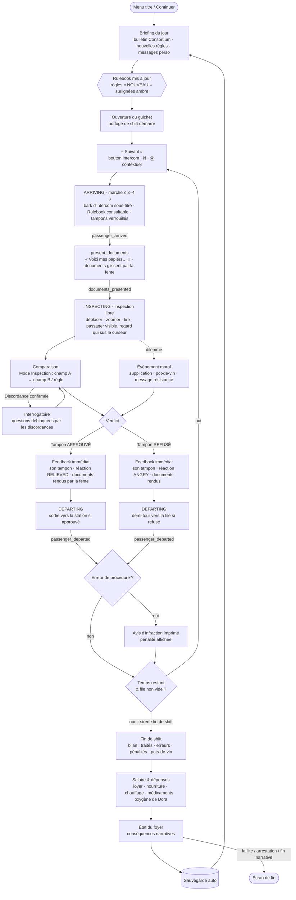
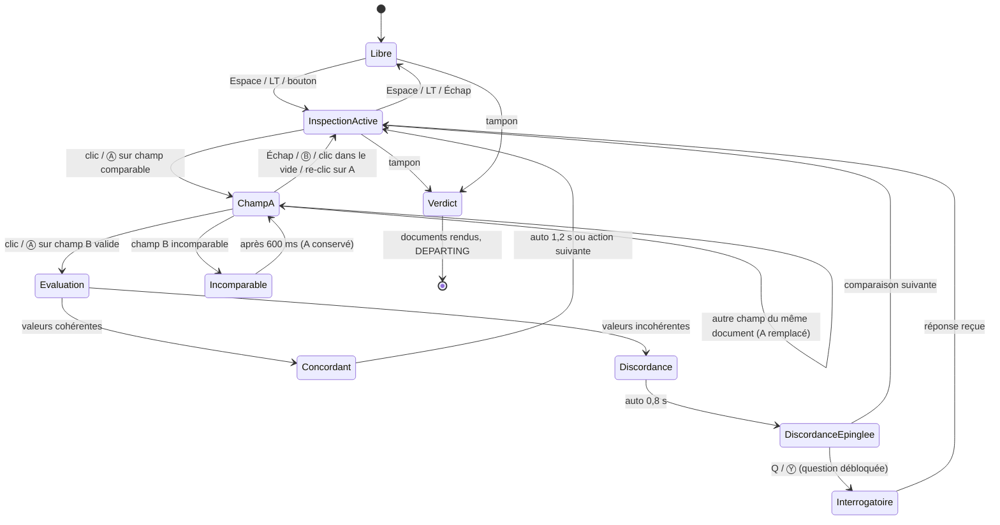
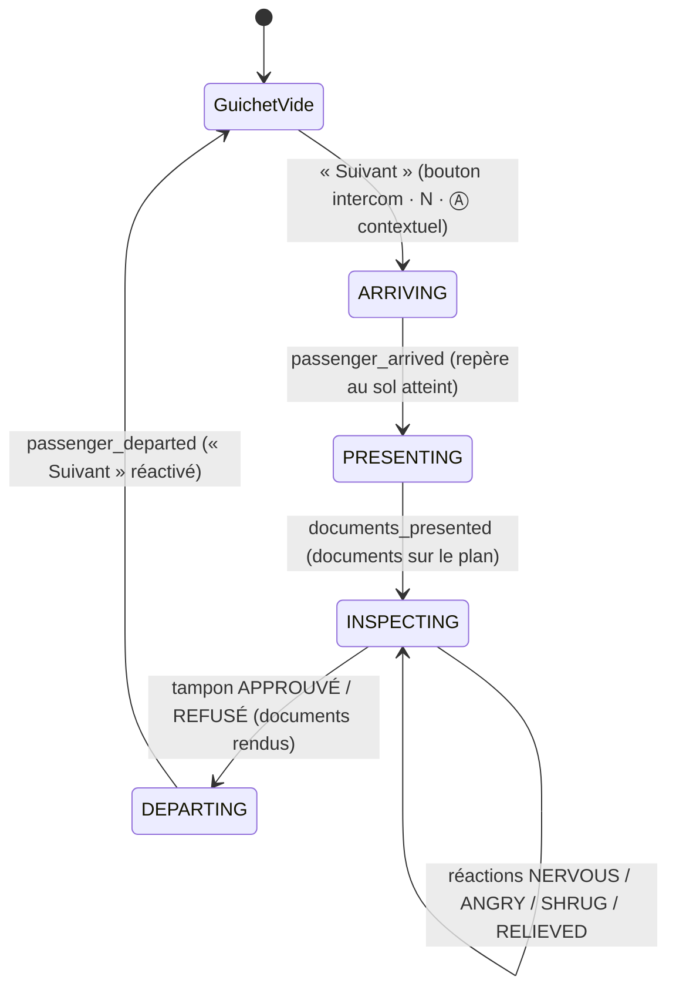

# CLEARANCE — UI Flow & UX

> Auteur : UI/UX Expert · Statut : proposition v0.2 (ajout : passager animé, vitre, champ « Visage »), à valider · Cible : Godot 4, 1920×1080 (16:9), mise à l'échelle par `canvas_items` + `expand`.
> Maquette de référence : [`docs/mockups/comparison.html`](mockups/comparison.html)

Ce document se conforme au **contrat Design System** (couleurs, polices, chanfreins, grille 4 px). Rappel des règles sémantiques utilisées partout :

| Token | Valeur | Sens UI — toujours doublé par… |
|---|---|---|
| `accent.cyan` | `#00E5FF` | hologramme, info, focus, sélection, **concordance** — trait fin + icône ✓ / losange de sélection |
| `accent.yellow` | `#FFE600` | marque Consortium, CTA principal, encre des tampons officiels — libellé en capitales |
| `accent.magenta` | `#FF2E88` | anomalie / **discordance** — icône ⚠ + hachures + libellé « DISCORDANCE » |
| `state.amber` | `#FFA31A` | avertissement, timer bas, **règle nouvelle** — étiquette « NOUVEAU » + liseré gauche |
| `state.red` | `#FF3B3B` | refus, critique — icône ✕ + libellé « REFUSÉ » |
| `state.green` | `#2EFF9A` | approbation — icône ✓ + libellé « APPROUVÉ » |

---

## 1. Boucle de jeu d'un shift



**Règles de rythme**
- Un passager = 45 à 120 s réelles, **dont ≤ 3–4 s de marche** (ARRIVING) et ~2 s de départ (DEPARTING). L'horloge de shift **continue pendant la marche** (proposition, à valider client) : la marche est courte et le joueur a de quoi faire (Rulebook, voir §4.2).
- « Suivant » n'est réactivé qu'à `passenger_departed` : il n'y a jamais deux passagers au guichet. Un shift = 8 h in-game = ~10 min réelles (configurable en Options › Accessibilité › « Temps de shift »).
- L'horloge passe en `state.amber` à 30 min in-game de la fin, avec un tic sonore discret et le libellé « FIN DE SHIFT PROCHE » (jamais la couleur seule).
- Le verdict est **toujours** possible, même sans comparaison : le jeu ne force jamais l'outil, il le récompense (vitesse + sécurité).

---

## 2. Écran principal (1920×1080)

### 2.1 Wireframe

```
 0                                                                                              1920
 ┌──────────────────────────────────────────────────────────────────────────────────────────────┐ 0
 │ ◆ CONSORTIUM · CLEARANCE      HALCYON GATE · GUICHET 04 · JOUR 07       14:37 ▓▓▓▓▓▓░░ 18:00 │ [A] Barre d'état 56px
 ├──────────────────────────────────────────────────────────────────────────────────────────────┤ 56
 │ ┌ Dialogue ──────────┐ ╔═ cadre métal ═══════════════════════════════╗ ┌ File ─────────┐ │
 │ │ « J'ai un contrat… »│ ║ ░ reflet ░    ┌ VISAGE ┐   · gouttes ·       ║ │ Passager 09/14│ │ [B] Vue guichet 3D
 │ │                    │ ║               │ ▄▀▀▀▄  │  ( passager 3D )     ║ │ En attente 23 │ │     (~376px, vitre)
 │ │ [Question débloquée]│ ║  ◎ hygiaphone │ █ ◉ █  │  ← implant oculaire  ║ │ Signalés  1   │ │
 │ └────────────────────┘ ║ ▒ condensation ▄▄██████▄▄   [ sous-titres ]  ║ └───────────────┘ │
 │                        ╚═════════════[▭ fente à documents ▭]══════════╝                   │
 ├══════════════════════════════════════════════════════════════════════╦═══════════════════════┤ 432
 │ PLAN DE TRAVAIL HOLOGRAPHIQUE                       [MODE INSPECTION] ║ RULEBOOK · JOUR 07  ◂ │
 │ ┌ Bio-scan ──────┐ ┌ Carte d'identité ──────┐ ┌ Permis d'entrée ────┐ ║ DATE DU JOUR 19.03.2187│ [C] Plan de travail
 │ │ Statut  SAIN   │ │ [photo] NOM …          │ │ N° ID  HG-4471-K2Q9 │ ║ 1. Documents requis   │ [D] Rulebook rétractable
 │ │ Implants 2     │ │         N° ID HG-4471… │ │ Valide → 14.03.2187 ├─╫─⚠─► (date du jour)    │     (448px, Tab)
 │ │ Émis le …      │ │         Expire …       │ │ Motif  TRAVAIL      │ ║ ▌NOUVEAU 3. Bio-scan  │
 │ └────────────────┘ └────────────────────────┘ └─────────────────────┘ ║ 4. Implants militaires│
 │                                                                       ║ ...                   │
 ├───────────────────────────────────────────────────────────────────────╩───────────────────────┤ 984
 │ [◇ INSPECTION  Espace|LT] [? INTERROGER  Q|Y ①]      Tiroir à tampons ▸ [✓ APPROUVÉ] [✕ REFUSÉ]│ [E] Barre d'outils 96px
 └──────────────────────────────────────────────────────────────────────────────────────────────┘ 1080
```

### 2.2 Zones

| Zone | Position (px) | Contenu | Notes |
|---|---|---|---|
| **A · Barre d'état** | 0–56, pleine largeur | Logo Consortium (jaune), lieu/guichet/jour, **horloge de shift** (heure + barre de progression + heure de fin), crédits du jour | Toujours visible. L'horloge est la seule info temporelle : pas de timer par passager (anti-stress, cohérent avec Papers, Please). |
| **B · Vue guichet 3D** | 56–432 | Caméra fixe à travers la **vitre** (cadre métal, reflet, gouttes, condensation, hygiaphone, fente à documents) ; passager animé **toujours visible** (marche, idle, réactions, regard) ; bulle de dialogue à gauche ; panneau file/compteurs à droite ; sous-titres des barks en bas de la vitre | Pluie + néons **derrière** la vitre. Scanlines uniquement sur la vitre/le fond, jamais sur la bulle ni les sous-titres. Les questions débloquées apparaissent sous la bulle. Aucun élément d'UI ne recouvre le visage (voir §4.4). |
| **C · Plan de travail** | 432–984, 0–1456 | 2 à 5 documents holographiques manipulables (glisser, empiler, zoomer ×1.5 au survol long ou RS) | Documents « posés » : légère perspective à l'arrivée puis à plat pour la lecture. Pas de rotation > 0° en lecture (lisibilité). |
| **D · Rulebook** | 432–984, 1464–1904 | Date du jour (champ comparable), règles numérotées, nouveautés en ambre, onglets (Règles · Cartes · Implants · Sceaux) | Rétractable (Tab / ☰) : replié = languette 48 px avec compteur « 2 NOUVEAU ». Chaque règle et chaque entrée est un **champ comparable**. |
| **E · Barre d'outils** | 984–1080 | Mode Inspection (bascule), Interroger (+ badge du nombre de questions débloquées), tiroir à tampons APPROUVÉ / REFUSÉ | Rappels clavier + manette affichés en permanence (masquables en Options). |

### 2.3 Hiérarchie de l'information

1. **Discordances et verdict** — magenta / vert / rouge, saillance maximale, toujours accompagnés d'icône + texte.
2. **Valeurs des champs** — JetBrains Mono 16–18 px, `text.primary`, contraste ≥ 12:1 sur `bg.elevated`.
3. **Règles du jour** — `text.primary`, règles nouvelles avec liseré + étiquette ambre.
4. **Libellés des champs** — Inter 11 px capitales, `text.secondary`.
5. **Ambiance** (néons, pluie, flicker) — `text.muted` et couleurs désaturées, jamais au premier plan.

Principe : **une seule couleur saturée « active » à la fois dans le plan de travail** (le cyan de sélection OU le magenta de discordance), le reste reste neutre.

---

## 3. Flux de comparaison — proposition principale : « Mode Inspection »

### 3.1 Principe

1. Le joueur active le **Mode Inspection** (Espace / LT ou bouton). Le plan de travail et le Rulebook reçoivent un cadre cyan, les documents se figent (plus de glisser), chaque champ comparable affiche un soulignement pointillé cyan au survol.
2. Il clique un **champ A** (sur un document, ou une règle / la date du jour dans le Rulebook). Le champ prend un contour cyan + pastille « A » ; un **fil holographique** pointillé suit le curseur.
3. Il clique un **champ B**. Le fil se fixe entre A et B (courbe de Bézier, nœuds en losange).
4. Le système évalue en ~250 ms (animation de « calcul » : le fil se remplit de A vers B) :
   - **CONCORDANT** → fil cyan fin, étiquette « ✓ CONCORDANT » discrète, disparaît en 1,2 s. Aucune récompense, aucune pénalité.
   - **DISCORDANCE** → fil magenta épais 3 px + lueur, les deux champs passent en contour magenta **hachuré**, étiquette « ⚠ DISCORDANCE » + explication courte (« Permis expiré : 14.03 < 19.03 »). La discordance reste épinglée jusqu'au verdict.
5. Chaque discordance confirmée **débloque une question d'interrogatoire** (badge sur « Interroger », carte de question sous la bulle de dialogue).
6. Le joueur peut enchaîner d'autres comparaisons sans quitter le mode ; il quitte par Espace / LT / Échap.

> Le jeu ne dit jamais « ce passager est illégal » : il constate des faits (discordance entre deux champs). La décision reste au joueur, ce qui préserve les dilemmes (ex. : expiration de 5 jours + supplication).

### 3.2 Diagramme d'états



### 3.3 Cas limites

| Cas | Comportement | Retour |
|---|---|---|
| **Champs incomparables** (ex. « Nom » ↔ « Groupe sanguin ») | Pas d'évaluation. Le fil « claque » et se rétracte vers A. A reste sélectionné. | Libellé gris `text.secondary` « INCOMPARABLE — choisissez un champ de même type » + son sec court. Aucune pénalité. |
| **Même document, deux champs** | Autorisé uniquement s'il existe une relation logique (ex. date d'émission ↔ date d'expiration, âge ↔ date de naissance). Sinon : A est **remplacé** par le nouveau champ (le joueur a probablement changé d'avis). | Remplacement : le losange A glisse vers le nouveau champ. |
| **Même champ cliqué deux fois** | Désélection (retour InspectionActive). | Fil se rétracte. |
| **Annulation** | Échap / clic droit / Ⓑ / clic dans le vide : annule A. Échap une seconde fois : quitte le mode. | — |
| **Comparaison déjà faite** | Ne relance pas l'évaluation ; remet en surbrillance le lien existant. | Pulsation du lien. |
| **Champ vs règle du Rulebook** | Comparaison valide si la règle porte sur ce type de champ (date ↔ « Permis valide à la date du jour », implant ↔ « Implants militaires interdits »). | Le texte de la règle concernée se surligne. |
| **Plusieurs discordances** | Toutes restent épinglées (max. 4 visibles ; au-delà, compteur « +2 » sur la barre d'outils). | Chaque lien numéroté ①②③. |
| **Le temps s'écoule** | L'horloge **continue** pendant l'inspection (pas de pause) : c'est la tension du jeu. L'évaluation de 250 ms est dans le temps réel. | Horloge ambre en fin de shift. Option d'accessibilité : « Inspection ralentit le temps ×0.5 ». |
| **Fin de shift pendant une sélection** | La sirène retentit, le passager en cours peut être terminé (pas de coupure brutale), la sélection est conservée. | Bandeau ambre « DERNIER PASSAGER ». |
| **Document retiré/déplacé hors du plan** | Liens attachés à ce document masqués (pas supprimés), réapparaissent quand il revient. | — |
| **Passager tend un nouveau document** pendant l'inspection | Le document arrive en bas à gauche sans bousculer les autres ; sélection conservée. | Son de dépôt + liseré cyan 1 s. |
| **Faux positif impossible** | Le système n'affiche jamais une discordance fausse (fiabilité de l'outil). L'ambiguïté vient des règles et du récit, pas de l'UI. | — |

### 3.4 Retours visuels et audio

| Événement | Visuel | Audio | Haptique (manette) |
|---|---|---|---|
| Activer l'inspection | Cadres cyan en coin sur plan + Rulebook, voile `bg.void` 8 % sur la vue 3D | Montée d'un bourdonnement holo (‑18 dB) | — |
| Survol champ | Soulignement pointillé cyan + curseur réticule | Tic très léger | — |
| Sélection A | Contour cyan 2 px + pastille « A » (losange) | « Bip » aigu court | Pulse 20 ms |
| Fil en cours | Pointillé cyan animé (désactivable) | — | — |
| Concordant | Fil cyan 1 px, étiquette « ✓ CONCORDANT » | Double bip neutre descendant | — |
| Discordance | Fil magenta 3 px + lueur, champs hachurés magenta, ⚠, étiquette explicative | Accord dissonant bref + glitch | Pulse 60 ms ×2 |
| Incomparable | Fil gris qui se rétracte | Clic sec | — |
| Question débloquée | Badge numéroté sur Interroger, carte sous la bulle | Notification courte | — |
| Tampon APPROUVÉ / REFUSÉ | Animation 3D du tampon, encre `accent.yellow` sur le document + libellé vert/rouge | Impact lourd | Pulse 120 ms |

### 3.5 Raccourcis

| Action | Clavier / souris | Manette (Xbox · PlayStation) |
|---|---|---|
| Basculer Mode Inspection | **Espace** · bouton barre d'outils | **LT** · **L2** |
| Sélectionner un champ | Clic gauche · **Entrée** | **Ⓐ** · **✕** |
| Naviguer entre champs (inspection) | Flèches / Tab = champ suivant | **Stick G** (snap magnétique champ à champ) · croix directionnelle |
| Annuler la sélection | **Échap** · clic droit | **Ⓑ** · **○** |
| Interroger | **Q** | **Ⓨ** · **△** |
| Ouvrir/replier le Rulebook | **Tab** (hors inspection) · **R** | **View** · **Touchpad** |
| Tourner les pages du Rulebook | **[ / ]** | **LB / RB** (Rulebook focus) |
| Zoomer un document | Molette · maintien clic | **Stick D** (clic = zoom) |
| Sortir le tiroir à tampons | **T** | **RT** · **R2** |
| Tamponner APPROUVÉ | **V** (maintenir 0,4 s) | tiroir ouvert + **Ⓐ** maintenu |
| Tamponner REFUSÉ | **X** (maintenir 0,4 s) | tiroir ouvert + **Ⓧ** maintenu · **□** |
| Pause | **Échap** (hors sélection) · **F10** | **Menu** · **Options** |

Le maintien de 0,4 s sur les tampons évite les verdicts accidentels (désactivable). En manette, le curseur est remplacé par un **focus magnétique** qui saute de champ en champ : on n'a jamais à viser un champ au pixel près.

> **M11** : ce tableau d'intention est remplacé par le schéma **implémenté** du §9 (croix réservée au focus, DÉTENTION sur L3, documents au stick droit).

### 3.6 Implémentation M4 — précisions de comportement

Capture de référence : [`docs/mockups/m4_comparison.png`](mockups/m4_comparison.png) (démo `scenes/ui/comparison_ui_demo.tscn`).

- **Sujets d'interrogatoire** (`interrogation_requested(topic)`) : questions de base `purpose`, `stay`, `origin` ; `remove_visor` tant que le visage présenté est masqué ; **une question par discordance confirmée** : `about_<raison>[:<document>]` (`about_expired:entry_permit`, `about_mismatch:id_card`, `about_face_mismatch`, `about_rule_violated:…`). Texte de la question : clé `q_<sujet sans suffixe>` (`{doc}` remplacé par le titre du document). La réponse est affichée telle que reçue (`interrogation_answered(topic, line_key)` → `tr(line_key)`). Réplique d'un sujet `about_…` : famille de la discordance (visage, N° ID, nom, naissance, validité, document manquant, émetteur, origine, santé, autre) → `line_about_<famille>_<n>` si elle a été constatée (gêne, excuse, mensonge ; NERVOUS), `line_about_<famille>_outrage_<n>` sinon (indignation ; ANGRY), variante tirée de la graine du cas ; la réaction qui suit une réponse n'en remplace pas le sous-titre (seule l'étiquette `[nerveux]`… s'ajoute). Visière : `<dialogue_id>_visor` pour un passager scénarisé. Départ : `bark_depart_ok|denied|detained` sous-titré 1,5 s après le tampon. Signaux publics de `ComparisonUI` pour l'audio : `hovered`, `toast_shown(kind)`, `departure_line_shown(key, text)`.
- **Déverrouillage** : tampons, Inspection et Interroger exigent `phase == INSPECTING` **et** `documents_presented` reçu pour le cas courant, et aucun verdict déjà posé ; « Suivant » n'est actif qu'en `WAITING_CASE` (anti-rebond 0,5 s), libellé « EN APPROCHE » / « DÉPART » sinon.
- **Tampon DÉTENTION** affiché seulement si le RuleSet du jour contient une règle de sévérité ≥ `RuleEngine.DETAIN_SEVERITY` (donnée, pas de numéro de jour en dur).
- **Concordant** : pas d'étiquette sur le fil (elle masquerait des valeurs) ; le bandeau du plan de travail et les coches des deux champs portent le « ✓ ».
- **Raccourcis manette retenus en M4** (en attendant le tiroir à tampons) : APPROUVÉ = RT maintenu, REFUSÉ = Ⓧ maintenu, DÉTENTION = croix ↓ maintenue ; Visage = clic stick droit ; onglets du Rulebook = LB / RB. Actions déclarées dans `project.godot` : `inspect_toggle`, `interrogate`, `stamp_approve`, `stamp_deny`, `stamp_detain`, `rulebook_toggle`, `next_case`, `cancel`, `inspect_face`, `rulebook_prev`, `rulebook_next`.

---

## 4. Le passager et la vitre

Le passager n'est pas un décor : il **arrive**, **reste visible pendant toute l'inspection**, **réagit**, et son **visage est une pièce du dossier** (champ comparable « Visage »). La vitre matérialise la frontière entre l'agent et lui (référence : Papers, Please). Tout ce qui suit concerne la **vue 3D (zone B)** ; les documents restent une surcouche 2D (D-007).

### 4.1 Séquence d'un cas (contrat)



| Phase | Durée | Ce que voit / entend le joueur | Ce qu'il peut faire | Bloqué |
|---|---|---|---|---|
| **Guichet vide** | jusqu'à l'action | Repère au sol vide, file floue au fond, bouton « Suivant » pulsé (1 fois / 4 s, pas de clignotement) | Lire le Rulebook, appeler le suivant | Tampons, Inspection |
| **ARRIVING** | ≤ 3–4 s (≤ 1 s en « Réduire les animations ») | Anim **Walk** le long du chemin jusqu'au repère, pas sur sol mouillé spatialisés (gauche → centre), bark d'intercom sous-titré ; plan de travail **vide** avec texte d'attente discret ; nom affiché « PASSAGER 09 » (identité non vérifiée) | Lire / feuilleter le Rulebook (c'est le moment prévu pour ça) | Tampons (grisés + « aucun document »), Inspection (grisée), Interroger, « Suivant » (libellé « EN APPROCHE ») |
| **PRESENTING** | ~1,2 s | Anim **PresentDocuments**, voix « Voici mes papiers… » sous-titrée, la **fente** de la vitre s'éclaire cyan, son d'hologramme qui s'allume ; les documents glissent de la fente vers leurs positions par défaut (décalage 120 ms entre documents) | Rien (très court) ; Rulebook toujours lisible | Idem ARRIVING |
| **INSPECTING** | libre | **Idle / Talk**, regard qui suit le curseur, réactions déclenchées par la logique ; le nom réel s'affiche dans la bulle une fois les documents posés | Tout : inspection, comparaison (dont **Visage**), interrogatoire, verdict | — |
| **DEPARTING** | ~2 s | Documents rendus par la fente (ils glissent du plan vers la fente), anim **Leave** : sortie vers la station si approuvé, **demi-tour** vers la file si refusé ; réaction de sortie (RELIEVED / ANGRY) | Lire le Rulebook, consulter l'avis d'infraction éventuel | « Suivant », tampons |

### 4.2 Pendant la marche
- **Le temps de marche est un temps de lecture**, pas un temps mort : c'est le moment naturel pour feuilleter le Rulebook (nouveautés ambre). Le Rulebook reste 100 % interactif.
- Le passager **s'annonce par l'intercom** (bark court, 1 ligne : « Bonsoir… J'arrive. », toux, souffle) : sous-titré, LED de l'hygiaphone allumée tant qu'il parle (équivalent visuel du son).
- Plan de travail : **état vide** — texte `text.secondary` centré « En attente des documents » + sous-ligne « Ils glisseront par la fente de la vitre à l'arrivée du passager · Tab : Rulebook ». Pas d'animation de chargement (pas d'urgence artificielle).
- Barre d'outils : tampons grisés avec la mention « verrouillé · aucun document », statut « Passager en approche ».
- Identité : tant que les documents ne sont pas posés, le passager est désigné par son numéro (« PASSAGÈRE 09 ») — le jeu ne connaît pas encore son nom, l'agent non plus.

### 4.3 Arrivée des documents
1. `passenger_arrived` : le passager s'arrête sur le repère, se tourne vers la vitre (0,3 s).
2. `present_documents` : anim PresentDocuments (il glisse les papiers dans la fente), bark « Voici mes papiers… ».
3. Côté joueur : la fente (bas de la vitre, au centre) s'éclaire cyan, les documents **émergent de la bordure haute du plan de travail, au centre** (continuité spatiale fente → plan), avec une légère perspective qui s'aplatit, puis se rangent à leurs positions par défaut. Son : hologramme qui s'allume + dépôt.
4. `documents_presented` : INSPECTING commence, tampons et Inspection se déverrouillent (petit « clac » mécanique + liseré cyan 300 ms sur le tiroir).
- « Réduire les animations » : documents en fondu 150 ms à leurs positions, sans trajectoire.

### 4.4 Passager toujours visible — vérification du layout
- **Règle** : aucun élément d'UI ne recouvre le **visage** du passager pendant INSPECTING. Les documents ne peuvent pas être glissés au-dessus de y = 432 (butée élastique) ; la bulle de dialogue (gauche) et la file (droite) restent hors de la vitre ; les sous-titres s'affichent **sous le visage**, en bas de la vitre ; la pause est le seul écran qui masque la vue.
- **Proportions évaluées** :

| Option | Vue 3D | Plan de travail | Verdict |
|---|---|---|---|
| Actuelle | 376 px (35 %) | 552 px | **Retenue.** Cadrage buste : la tête fait ~136 px de haut à 1080p (plus grande que la photo d'identité, 150 px de cadre pour ~60 px de visage) : lisible pour la comparaison. |
| 45 % | 486 px | 442 px | Rejetée : la carte d'identité (~470 px de haut) ne tient plus, le Rulebook perd 2 règles visibles, et l'inspection (cœur du jeu) devient plus pénible. |
| 40 % | 432 px | 496 px | Possible en repli si les tests montrent un visage trop petit en 720p / Steam Deck ; impose des documents plus compacts. |

- Pour les moments où le visage compte (comparaison « Visage », interrogatoire), on **zoome la caméra** (travelling avant dans la même bande de 376 px) au lieu d'agrandir la zone : le layout ne bouge jamais.

### 4.5 La vitre
Ordre des calques (arrière → avant) : ville, pluie, néons → **passager** → **vitre** (reflet diagonal léger, gouttes, condensation en bas, scanlines très faibles) → **cadre métallique** (rivets, hygiaphone, fente à documents) → UI (bulle, file, sous-titres, cadre « Visage »).
- **Zone du visage dégagée** : gouttes et condensation sont exclues d'une ellipse autour de la tête au repère (le décor ne doit jamais devenir un handicap de lecture). La condensation reste dans le tiers bas.
- **Hygiaphone** (disque perforé, bas gauche de la vitre) : LED cyan quand le passager parle, ambre quand l'intercom de l'agent est ouvert (Suivant / question).
- **Fente à documents** (bas de la vitre, centre) : s'éclaire au passage des documents (aller et retour). C'est le lien diégétique entre la 3D et le plan 2D.
- Effets 3D uniquement ; l'option « Effets holo réduits » garde un reflet statique très faible et supprime gouttes animées et scanlines.

### 4.6 Regard qui suit le curseur
- Tête + yeux orientés vers le curseur (ou le focus manette) : lacet ±25°, tangage ±15°, lissage 200 ms, zone morte au centre ; yeux d'abord, tête ensuite (plus vivant, moins robotique).
- **Survol d'un champ de document** → le passager **baisse les yeux vers le comptoir** (là où se trouvent physiquement ses papiers). Évaluation : **recommandé, en version subtile** (yeux + 30 % de la tête). Ça crée de la présence (« il me regarde lire ») sans coût d'UI.
- **Survol du champ « Visage »** → il regarde **droit dans la caméra** (contact visuel) : moment de tension voulu.
- **Garde-fou** : le regard est purement réactif au curseur, **jamais conditionné à la vérité** des données (un fraudeur ne regarde pas « plus » le champ falsifié). Les indices comportementaux passent uniquement par les réactions (§4.7), toujours doublées par du texte.
- Option : « Regard du passager : suivre / fixe ».

### 4.7 Réactions = feedback de gameplay
Les réactions sont **lisibles mais jamais la seule source d'information** : chacune est doublée par une ligne de dialogue sous-titrée et une étiquette dans le journal de la bulle (`[nerveuse]`, `[en colère]`…).

| Réaction | Déclencheur logique (exemples) | Anim / visage | Son | Doublage texte |
|---|---|---|---|---|
| **NERVOUS** | Discordance confrontée en interrogatoire ; champ « Visage » comparé alors qu'il y a un piège | ReactNervous : regard fuyant, micro-expressions ditherées (2–3 images, < 3 Hz) | Souffle court | « [nerveuse] Je… c'est une vieille photo. » |
| **ANGRY** | Refus ; question répétée ; accusation sans discordance | ReactAngry : buste en avant, mains sur le comptoir | Voix forte, coup sur le comptoir | « [en colère] Vous n'avez pas le droit ! » |
| **SHRUG** | Question absurde / sans rapport ; discordance déjà expliquée | Shrug (haussement d'épaules) | Petit soupir | « [hausse les épaules] Je ne sais pas quoi vous dire. » |
| **RELIEVED** | Approbation ; question levant un doute | Épaules qui retombent, sourire bref | Expiration | « [soulagée] Merci… merci. » |

- **Ambiguïté préservée** : un innocent peut être nerveux, un fraudeur calme. La réaction informe sur l'état émotionnel, jamais sur la vérité ; seule une discordance documentée a valeur de preuve.
- Micro-expressions ditherées : remplacées par une expression fixe en « Réduire les animations ».

### 4.8 Sons et sous-titres
| Son | Moment | Équivalent visuel |
|---|---|---|
| Pas (sol mouillé, spatialisés) | ARRIVING / DEPARTING | Le passager marche (toujours visible) |
| Souffle, toux, soupir | Idle, réactions | Étiquette `[souffle]` si sous-titres descriptifs activés |
| Hologramme qui s'allume | `documents_presented` | Fente cyan + documents qui apparaissent |
| Voix courte (bark) | Annonce, « Voici mes papiers… », réactions | Sous-titre + LED hygiaphone |

- **Sous-titres activés par défaut**, en bas de la vitre, centrés, sous le visage : `NOM : « texte »` (nom en cyan, Chakra Petch 13 px ; texte Inter 18 px sur fond `bg.void` 85 %). Avant identification : « PASSAGÈRE 09 ». Durée = max(1,5 s ; 60 ms × caractères). Chaque bark est aussi archivé dans la bulle de dialogue.
- Option « Sous-titres descriptifs » : `[pas mouillés]`, `[souffle court]`. Taille et opacité du fond réglables (§6).

### 4.9 Interactions avec le passager et champ « Visage »
**Chaque passager est visuellement différent** à chaque cas (composition `appearance_seed`), avec des ressemblances occasionnelles — et des **ressemblances intentionnelles comme piège** : sosie qui usurpe une identité (photo proche, 1–2 traits différents : anomalie `PORTRAIT_MISMATCH`), papiers d'un parent (même « air de famille », âge apparent incohérent). La comparaison **Visage ↔ Photo** devient donc un geste central du Mode Inspection.

**Hors Mode Inspection**
- Survol du passager : contour fin + curseur « parler ». **Clic = Interroger** (même chose que Q / Ⓨ) : ouvre la liste des questions sous la bulle. Pas de clic « magique » qui révèle quoi que ce soit.

**En Mode Inspection : le champ « Visage »**
1. Le visage du passager est un **champ comparable** comme les autres : en Mode Inspection, un cadre en coins pointillés cyan apparaît autour de la tête avec l'étiquette « VISAGE » (même grammaire que le soulignement des champs).
2. **Sélection** (clic sur la tête, ou focus manette) → la caméra fait un **travelling avant** sur le visage (0,4 s, dans la bande 3D), le passager regarde l'agent ; le cadre devient contour cyan + pastille « A ».
3. Clic sur la **photo** d'un document (champ B) → **comparateur côte à côte** dans la vue 3D : visage zoomé à gauche, **photo agrandie ×2** (240 × 300) à droite, à la place du panneau File (masqué temporairement, jamais devant le visage). Les deux images sont mises à l'échelle pour **aligner la ligne des yeux** ; un **rideau glissant** optionnel (glisser horizontalement) permet de superposer les deux (seul survivant de l'alternative Overlay, §5.3).
4. Évaluation (~400 ms, balayage cyan vertical sur les deux images) sur des **traits biométriques stables** issus des données de génération : forme du visage, couleur des yeux, implants visibles, cicatrices / marques, oreilles / nez.
   - **CONCORDANT** → « ✓ VISAGE CONFORME À LA PHOTO ». Les différences non biométriques (coiffure, barbe, maquillage) sont signalées en note grise « coiffure différente — non biométrique » : bruit volontaire, sans valeur de preuve.
   - **DISCORDANCE** → les deux images reçoivent un repère magenta hachuré **sur la zone du trait** (cercle sur l'œil, trait sur la cicatrice) + étiquette « ⚠ DISCORDANCE · Implant oculaire absent sur la photo » (1 à 2 traits nommés). Débloque la question « Ce n'est pas vous sur cette photo. ». Le passager réagit (NERVOUS).
5. Autres paires valides avec « Visage » : **Né(e) le** (âge apparent incohérent : « Âge apparent 25–30 ans ≠ 62 ans » → piège des papiers d'un parent), **Implants déclarés** du bio-scan (« Implant oculaire visible non déclaré »), règle du Rulebook portant sur un trait visible (« Implants MIL- interdits »).
6. Sortie : Échap / Ⓑ → la caméra revient au cadrage normal (0,3 s), le comparateur se replie, la File réapparaît.
- Fiabilité : comme pour les autres champs, **jamais de faux positif** ; l'ambiguïté vient des ressemblances naturelles (qui restent CONCORDANT) et du récit, pas de l'outil.
- « Réduire les animations » : pas de travelling (coupe franche), pas de balayage.

### 4.10 Cas limites
| Cas | Comportement | Retour |
|---|---|---|
| **« Suivant » martelé** | Une seule prise en compte ; bouton désactivé de ARRIVING à `passenger_departed`, anti-rebond 500 ms. Les appuis suivants sont ignorés (pas de file d'appels). | Libellé « EN APPROCHE » / « DÉPART », clic mat discret. |
| **« Suivant » file vide** | Pas d'appel. | « Plus personne dans la file » dans la barre d'état. |
| **Tampon avant l'arrivée** | Impossible (tiroir verrouillé jusqu'à `documents_presented`). Raccourcis V / X ignorés. | Tiroir grisé « verrouillé · aucun document ». |
| **Verdict pendant le départ** | Impossible : les documents sont rendus au moment du tampon, le tiroir se referme. Un second appui est ignoré, jamais un double verdict. | — |
| **Fin du temps pendant la marche** | Un passager appelé est **en cours** : il est traité jusqu'au bout (cohérent avec §3.3). | Sirène + bandeau ambre « DERNIER PASSAGER ». |
| **Fin du temps pendant le départ** | Le bilan s'ouvre après `passenger_departed`. | — |
| **Pause pendant la marche** | Animation, son et horloge gelés ; reprise au même point. | — |
| **Réaction pendant DEPARTING** | Joue sur le trajet de sortie (ex. ANGRY en demi-tour), sous-titre maintenu jusqu'au bout. | — |
| **Document supplémentaire demandé** | Le passager le glisse par la fente pendant INSPECTING (§3.3). | Fente cyan + son de dépôt. |
| **Visage sélectionné pendant une réaction** | La réaction se termine, la caméra zoome ensuite (pas de coupure d'anim). | — |

### 4.11 Manette et clavier (ajouts)
| Action | Clavier / souris | Manette (Xbox · PlayStation) |
|---|---|---|
| Appeler le suivant | **N** · clic sur le bouton intercom | **Ⓐ** · **✕** contextuel (plan de travail vide) |
| Interroger le passager | Clic sur le passager · **Q** | **Ⓨ** · **△** |
| Focus sur « Visage » (inspection) | Clic sur la tête · **F** | Stick G vers le haut depuis la rangée supérieure des documents (snap) |
| Rideau du comparateur | Glisser · **← / →** | **Stick D** horizontal |
| Regard du passager | Suit la souris | Suit le focus magnétique |

---

## 5. Alternatives

### 5.1 Alternative B — Superposition « Overlay »

Le joueur glisse un document **sur** un autre ; les champs de même type s'alignent et se colorent ligne à ligne (cyan = identique, magenta = différent).

| ➕ | ➖ |
|---|---|
| Très rapide, geste physique satisfaisant | Compare tout d'un coup : supprime la part de « trouver » l'erreur |
| Facile à comprendre sans tutoriel | Ne permet pas de comparer avec une **règle** ou la date du jour |
| Bien en manette (1 geste) | Documents de formats différents → alignement artificiel, lisibilité dégradée |

### 5.2 Alternative C — « Scanner » automatique partiel (upgrade)

Un scanner acheté avec le salaire (ou offert par la résistance) signale automatiquement une catégorie (ex. dates expirées) en début d'inspection.

| ➕ | ➖ |
|---|---|
| Progression et économie : rend le salaire utile | Retire de la jouabilité si trop large |
| Allège la charge en fin de jeu quand les règles s'empilent | Risque d'en faire un « pay to win » diégétique |
| Narratif : scanner qui tombe en panne, piraté, surveillé par le Consortium | Seul, ne suffit pas comme mécanique de base |

### 5.3 Recommandation

**Mode Inspection comme mécanique de base, Scanner partiel comme upgrade tardif (jour 10+), pas d'Overlay.**
- Le Mode Inspection préserve le cœur Papers, Please (le joueur *trouve* l'erreur), couvre documents **et** Rulebook, et produit le lien vers l'interrogatoire.
- Le Scanner s'y branche naturellement : il pré-trace des liens magenta « suggérés » (pointillés) que le joueur doit **confirmer** d'un clic → même grammaire visuelle, pas de nouvelle UI.
- L'Overlay peut survivre comme raccourci limité (comparer deux photos) si les tests montrent de la friction sur les portraits.

---

## 6. Accessibilité

| Domaine | Mesures |
|---|---|
| **Daltonisme** | Aucune info par la couleur seule : discordance = losange ≠ + hachures + pastille numérotée + texte ; concordant = ✓ ; approuvé/refusé = icône + libellé + forme du tampon (cercle vs octogone). **M11 — réglage « Vision des couleurs »** (Aucune · Protan·Deutan · Tritan · Contraste élevé, `Settings.color_vision`) : palettes de DESIGN_SYSTEM §2.5 (approuvé → bleu, discordance → rose pâle, avertissement → paille en Protan·Deutan ; discordance → violet en Tritan). |
| **Taille du texte** | Échelle UI 90 %–150 % (pas de 10). Documents : zoom de lecture permanent optionnel. Minimum absolu 12 px à 100 %. Valeurs de données jamais < 14 px. |
| **Réduction des effets** | Interrupteur unique « Effets holo réduits » : coupe scanlines, flicker, aberration chromatique, fils animés, pluie à l'écran. Respecte « reduce motion » du système quand disponible. Flicker toujours < 3 Hz. **M11** : « Scintillement holographique » (`holo_flicker`) coupe scintillement / défilement / glitch **sans** couper les lueurs (DS §5 règle 6). |
| **Réduire les animations** | Interrupteur distinct (activé automatiquement avec « reduce motion » système) : marche du passager raccourcie à ≤ 1 s (ou apparition en fondu sur le repère), documents en fondu sans trajectoire, pas de travelling caméra sur le visage (coupe franche), micro-expressions ditherées remplacées par une expression fixe, aucun flicker. |
| **Remapping** | Toutes les actions remappables clavier & manette, profils séparés. Option « Bascule vs maintien » pour l'inspection et les tampons. *(M11 : non livré ; schéma fixe du §9, glyphes Xbox / PlayStation au choix.)* |
| **Temps** | Vitesse du shift (×0.5 à ×1.5), option « Inspection ralentit le temps », option « Pas de fin de shift chronométrée » (mode Récit). |
| **Audio** | Tous les signaux sonores ont un équivalent visuel (LED hygiaphone pour la voix, fente cyan pour les documents) ; **sous-titres des barks activés par défaut** avec nom du locuteur, taille et fond réglables ; option « sous-titres descriptifs » (`[pas mouillés]`, `[souffle court]`). Les réactions du passager sont toujours doublées par une ligne de texte (§4.7). |
| **Lecture** | Lecteur d'écran du champ focalisé (TTS optionnel) : « Permis d'entrée, Valide jusqu'au, 14 mars 2187 ». |
| **Contraste** | Texte principal ≥ 7:1 ; libellés ≥ 4.5:1 (`text.secondary` sur `bg.panel` ≈ 6:1). `text.muted` réservé au décor et aux éléments désactivés. |

---

## 7. Onboarding — Jour 1 diégétique

Pas de pop-up tutoriel : le superviseur **Okonkwo** parle à l'intercom et le Rulebook du jour 1 n'a que 2 règles.

0. **Ouverture** — Okonkwo : « Appuie sur l'intercom pour faire avancer le premier. Pendant qu'il marche, jette un œil au Rulebook. » (le bouton « Suivant » pulse une fois).
1. **Passager 1** (règle : « Carte d'identité valide ») — Okonkwo : « Pose ta main sur le pupitre… ça, c'est la touche Inspection. » La touche Espace / LT clignote **une fois** dans la barre d'outils.
2. **Passager 2** — carte expirée. Okonkwo guide : « Clique la date d'expiration… puis la date du jour, en haut du Rulebook. » Fil magenta → première question débloquée → première interrogation scénarisée.
3. **Passager 3** — documents corrects : le joueur découvre « CONCORDANT » et apprend que l'outil ne punit pas.
4. **Passager 4** — premier tampon REFUSÉ autonome. Puis Okonkwo se tait ; les passagers suivants sont libres.
5. Fin de journée : premier bilan + dépenses (le chauffage n'est pas payable → amorce dramatique).

Les jours 2–5 introduisent chacun **un** outil (Interroger approfondi, onglet Implants, tiroir à tampons, empreintes) via la règle « NOUVEAU » ambre + une ligne de briefing. Un « Carnet d'aide » dans le Rulebook rejoue chaque explication.

### 7.1 Tutoriel interactif du J1 (M11 lot C)

En complément d'Okonkwo (qui continue de parler), une **surimpression guidée** non diégétique (`TutorialOverlay`, `scripts/ui/tutorial_overlay.gd`, panneau plat `SystemPanel`) posée **sur la file d'attente** (colonne droite de la bande B), jamais sur le visage, les documents ou les outils.

- **Quand** : au J1 d'une partie lancée depuis le titre (nouvelle partie, Continuer / Charger au J1), si le réglage **Options › Partie › « Tutoriel du jour 1 »** (`tutorial_j1`, actif par défaut) est actif. Terminé ou passé, le réglage repasse à « désactivé » (le joueur peut le réactiver pour le revoir). Fin du shift avant la fin : la carte disparaît, le réglage reste (reproposé au prochain J1). Jamais dans les scènes de debug / tests (sauf `--tutorial`).
- **Accueil** (après le briefing) : « PREMIER SHIFT », COMMENCER (**focus**) / PASSER LE TUTORIEL ; à la croix, le focus reste piégé entre ces deux boutons (QA-042). COMMENCER ne fait que commencer (QA-041) : le focus revient à SUIVANT, l'étape 1 demande d'appeler le passager. Appeler un passager sans répondre (N, ou Ⓐ / clic sur SUIVANT) lance le tutoriel.
- **Six étapes**, chacune attend l'**action réelle** (signal `EventBus`, lecture seule, la logique du jour n'est pas touchée) et montre l'invite du dernier périphérique (`PromptGlyph`) :

| # | Étape | Invite | Signal attendu |
|---|---|---|---|
| 1 | Regardez le passager (appeler, observer le visage) | `next_case` | `documents_presented` |
| 2 | Ouvrez l'inspection | `inspect_toggle` | `inspection_mode_changed(true)` |
| 3 | Consultez le Rulebook | `rulebook_prev` / `rulebook_next` | **`rulebook_consulted`** (nouveau, M11 lot C : onglet, panneau déplié, carte choisie) |
| 4 | Reliez deux champs (A → B) | `ui_accept` | `discrepancy_check_requested` |
| 5 | Interrogez | `interrogate` | `interrogation_requested` |
| 6 | Tamponnez | `stamp_approve` / `stamp_deny` | `verdict_stamped` |

- Pastilles d'avancement : coche (faite), losange cyan (en cours), losange contour (à venir) — forme, pas la couleur seule. Chaque étape : PASSER L'ÉTAPE / QUITTER, joignables à la manette (croix ↑ depuis SUIVANT ou depuis le haut du Rulebook, ou **VUE maintenue 1 s** = passer l'étape ; schéma §9.5). Une action déjà faite (papiers déjà posés, inspection déjà ouverte) fait avancer d'elle-même. Fin : « TUTORIEL TERMINÉ » quelques secondes.
- Captures : [`m11_tutorial_step.png`](mockups/m11_tutorial_step.png) / [`_deck`](mockups/m11_tutorial_step_deck.png) (étape 2, clavier), [`m11_tutorial_step_pad.png`](mockups/m11_tutorial_step_pad.png) / [`_deck`](mockups/m11_tutorial_step_pad_deck.png) (étape 3, glyphes Xbox). Debug : `--tutorial`, `--tutorial-step=N`.

---

## 8. Écrans secondaires

| Écran | Contenu clé | Notes UX |
|---|---|---|
| **Menu titre** | Logo CLEARANCE (Chakra Petch, jaune), Continuer (CTA jaune), Nouvelle partie, **Charger** (M11), Options, Crédits, Quitter ; fond : file d'attente sous la pluie | Continuer en focus par défaut (désactivé sans partie active). Nouvelle partie / Charger : §8.5. |
| **Briefing du jour** | Bulletin Consortium (date, contexte politique), nouvelles règles en ambre, message personnel (famille, résistance), bouton « Prendre son poste » | Lecture au rythme du joueur, pas de temps. Les nouvelles règles ici sont **les mêmes** que dans le Rulebook (un seul vocabulaire). |
| **Bilan de shift** | Passagers traités, erreurs (avec motif + règle citée), salaire, pénalités, pots-de-vin ; puis écran **Foyer** : dépenses cochables (loyer, nourriture, chauffage, médicaments), état de chaque proche (icône + texte) | Les erreurs sont **pédagogiques** : montrer les deux champs fautifs avec leur lien magenta. |
| **Pause / Options** | Reprendre, Options (Affichage, Audio, Commandes, **Accessibilité** en premier niveau), Rulebook (consultation), Quitter vers le menu | La pause gèle l'horloge et floute le plan de travail (anti-triche légère, désactivable). |

---

### 8.1 Implémentation M5 — précisions de comportement

Captures : [`m5_briefing.png`](mockups/m5_briefing.png), [`m5_briefing_j2.png`](mockups/m5_briefing_j2.png), [`m5_citation.png`](mockups/m5_citation.png), [`m5_summary.png`](mockups/m5_summary.png), [`m5_evening.png`](mockups/m5_evening.png), [`m5_options.png`](mockups/m5_options.png), [`m5_end.png`](mockups/m5_end.png).

- **Enchaînement** : titre (« CONTINUER — JOUR N » en CTA si une sauvegarde existe, sinon « NOUVELLE PARTIE ») → briefing → shift → sirène (+1,2 s) → bilan → soirée → nuit (conséquences) → jour suivant (scène rechargée) ou écran de fin (fin de démo après J3, F2 réaffectation, F3 famille perdue). Sauvegarde automatique à la validation de la soirée ; une fin efface la sauvegarde.
- **Briefing** : en-tête Bureau de Continuité (date, horaires), « JOUR NN » + titre de la directive de délégation, directive (liseré jaune), tuiles (passagers attendus, durée, rémunération), règles en vigueur (badge NOUVEAU = Rulebook), commandes du poste au J1 ; messages (Okonkwo cyan, brèves du hall jaunes, Ilan neutre — échos des choix de la veille), foyer (états icône + couleur + texte) et solde ; slogan. « PRENDRE SON POSTE » (focus par défaut) ferme l'INTRO.
- **Tutoriel J1** : Okonkwo parle à l'intercom aux 4 premiers passagers (ouverture, Inspection, expiration ↔ date du jour, discordance, concordant, premier refus seul, première citation, au revoir) en **sous-titres** (toast si sous-titres désactivés).
- **Ticket de citation** : imprimé dans la colonne des toasts (déroulé depuis la fente, fondu si « réduire les animations »), remplace le toast « Erreur de contrôle » ; avertissement ambre + triangle « AVERTISSEMENT n/2 », amende rouge + octogone « AMENDE −5 ₵ ». Tickets du bilan : archivés à 40 %, 100 % au survol / focus.
- **Bilan** : tuiles traités / conformes / citations / salaire / amendes / net ; registre (tampon, nom, statut, ₵) avec, pour chaque erreur, la règle non relevée ou non documentée (n° + titre du Rulebook) ; passagers non traités.
- **Soirée** : budget (solde du matin, net du shift, disponible), postes cochables (taxe d'air verrouillée « PRÉLEVÉE D'OFFICE »), « Fonds insuffisants » quand un poste ferait passer le solde sous 0, présélection loyer → nourriture → oxygène → médicaments → chauffage ; foyer ; mot des Lucioles (SIGNALER / BRÛLER, brûlé par défaut à la validation) ; « VALIDER ET DORMIR » puis panneau « La nuit au Bloc Pétrel ».
- **Pause** : Échap **seulement si l'UI n'a rien à annuler** (menu de questions, champ A, Mode Inspection sont annulés d'abord), F10, Menu/Start. Arbre en pause (horloge, booth), fond flouté. REPRENDRE · OPTIONS · QUITTER VERS LE TITRE (second appui de confirmation). Échap : retour / reprendre.
- **Options** (non diégétique, Accessibilité d'abord) : taille du texte 90–150 % (thème reconstruit à chaud), effets visuels Complets / Réduits / Désactivés, réduire les animations (marche ≤ 1 s dès le passager suivant), sous-titres, horloge ×0,5 ; volumes par bus. Aussi accessibles depuis le titre.

### 8.2 Implémentation M7 — interfaces J4–J10 (contrat ARCHITECTURE §7.1)

Captures : [`m7_envelope.png`](mockups/m7_envelope.png), [`m7_detain_escort.png`](mockups/m7_detain_escort.png), [`m7_rulebook_wanted.png`](mockups/m7_rulebook_wanted.png), [`m7_implants.png`](mockups/m7_implants.png), [`m7_evening_j9.png`](mockups/m7_evening_j9.png), [`m7_end_f5.png`](mockups/m7_end_f5.png). Signalement code 1 et dates des Dérivants : [`m8_symbol_report.png`](mockups/m8_symbol_report.png), [`m8_origins_drv.png`](mockups/m8_origins_drv.png).

- **Objets glissés** (`SlippedItemView`) : l'objet suit les documents par la fente et se range en bas à droite du plan, **papier** (fond `bg.elevated`, liseré sémantique : enveloppe ambre, mot Luciole magenta, carte de quai cyan), déplaçable. Bandeau « GLISSÉ AVEC LES PAPIERS », dessin, libellé (« ENVELOPPE · 20 ₵ », montant toujours visible), texte lisible (mot, carte), boutons exclusifs GARDER / RENDRE / REMETTRE À LA GARDE (seulement `allowed`), puce d'état (« Gardée dans le tiroir · +20 ₵ divers non déclaré », « Rendu par la fente », « Remis à la Garde · prime +10 ₵ », sinon « À trancher avant le tampon — sinon rendu d'office »). Le bouton n'émet qu'une **intention** (`item_decision_requested`) ; l'état affiché suit `item_decided`. Modifiable jusqu'au tampon, verrouillé ensuite ; au tampon, le défaut (D-054) s'affiche puis l'objet part au tiroir (gardé) ou par la fente. Répliques `_bribe` (à l'arrivée de l'enveloppe), `_bribe_kept` / `_bribe_returned`. Question « Qu'est-ce que c'est que ça ? » en tête du menu (magenta) tant qu'elle n'est pas posée.
- **DÉTENTION** : tampon visible et actif seulement si `DayDef.detain_enabled` (J7+, D-055) — avant, il n'existe pas (l'UI refuse aussi un verdict DÉTENTION). Même maintien 0,4 s (touche D). Booth : la **Garde de Continuité** (3ᵉ acteur, uniforme gris-bleu, visière, brassard jaune) entre par la porte de la station, se poste derrière le passager, qui sort escorté vers l'Anneau B ; lumière de porte jaune, portes (`station.door_*`). Réplique de sortie `_exit_detain` (ou générique).
- **Rulebook — bulletins** : seconde rangée « BULLETINS » (`DayDef.rulebook_tabs`, cumulatifs) : Codes d'origine (code, chiffre du bloc ID, secteurs), Implants (familles, signes visibles, légalité, MIL- en rouge), Symboles subversifs (glyphe luciole), Sceaux (sceau en vigueur par document), **Avis de recherche** (J10, rouge, compteur). L'onglet du jour porte « ·NOUV. » en ambre. Les rangées d'onglets passent à la ligne (pas de défilement horizontal).
- **Avis de recherche** (`WantedCardView`) : portrait officiel via `portrait_provider` (même rendu que les photos), nom, motif, puce « MISE EN ATTENTE ». **Sélectionnable en Mode Inspection** comme un champ (`FieldRef.wanted(id)`), à comparer au visage ou au nom / prénoms d'un document ; un lien vers un avis ouvre l'onglet. Résultat « Avis de recherche : NOM ». Question débloquée « Vous figurez sur l'avis de recherche. ».
- **Indices visuels** : marque luciole (code 1) dessinée en magenta au coin bas-droit des documents marqués, lisible à la loupe ; implants visibles posés sur le modèle 3D (OPT- iris cyan pâle, NX- port + LED derrière l'oreille, MIL- plaques + œil rouge mat, KIN- main prothétique, DER- lignes au cou, DER-19 carré sur la main) ; fil magenta au poignet (code 6) ; **trois tapes** (code 5) : trois ondes sur la vitre + `passenger.knock_glass`, didascalie « [trois tapes sur la vitre] » avant les papiers.
- **Signalement code 1** (NARRATIVE §4.9, D-062, J7+) : la marque luciole d'un document est une `DocMarkView` **sélectionnable en Mode Inspection** (`FieldRef.mark(doc, &"luciole")`) : aucun cadre au repos, même en inspection (le joueur doit la repérer, loupe conseillée), zone cliquable circulaire de 24 px centrée sur le glyphe ; survol / sélection = cercle cyan + losange « A », discordance = cercle magenta + numéro (pas d'icône d'alerte qui masquerait le glyphe). L'entrée du bulletin « Symboles subversifs » est une `SymbolCardView` sélectionnable (`FieldRef.symbol(&"luciole")`), cadre cyan en inspection comme une règle ; un lien vers elle ouvre l'onglet Symboles, et sa sélection / ses discordances survivent aux changements d'onglet. Paire marque ↔ bulletin = DISCORDANCE « Marque relevée au bulletin des symboles subversifs : signalement documenté. » (`disc_symbol_match`), sans question débloquée ; la barre d'état indique « marque luciole relevée : DÉTENTION = signalement documenté. ». Avant le J7 (bulletin fermé) la paire reste INCOMPARABLE.
- **Dates des Dérivants** (NARRATIVE §4.10, D-068) : onglet « Codes d'origine », ligne ambre sous l'intro « DRV · Dérivants : naissance « 00.00.AAAA » tolérée (année seule). » (`rb_origins_drv_birth`) ; les documents affichent `00.00.AAAA` tel quel (`GameDate.format`), champ comparable (R07 compare l'année).
- **Phrase de passe** : réplique `_password` sous-titrée après les papiers ; la réponse « La pluie ne tombe que vers le bas. » apparaît en tête du menu (magenta, ◆) seulement si le cas porte `luciole_password` et `lucioles_trust ≥ 2`, une fois.
- ***Lumika*** : tant que `lumika_learned` est faux, le mot est remplacé par « [mot inconnu] » dans tous les sous-titres de passagers (arrivée, réponses, sortie ; un porteur du code 7 le glisse dans sa phrase d'arrivée) ; ensuite il s'affiche tel quel.
- **Répliques d'arrivée / de sortie** : `_arrival` à l'appel, `_exit_<verdict>` (sinon `bark_depart_*`) 1,5 s après le tampon. **Annonces du Hall** (`hall_announced`) : bandeau discret en haut de la vitre, locuteur jaune « HAUT-PARLEUR · HALL », ≥ 6 s, voix PA existante ; toast si les sous-titres sont coupés.
- **Soirée** : colonne « CE SOIR » sous le foyer (cartes compactes) : un panneau par événement (lettre, décision, audit), pastilles d'étapes, PRÉCÉDENT / SUIVANT. J9 : audit → aveu d'Ilan (soutenir / interdire / dénoncer, D-053) → déposition → laissez-passer. Options exclusives avec montant (gain jaune) ; option non finançable **grisée** avec « Fonds insuffisants : 40 ₵ requis » (une option gratuite reste toujours possible) ; les choix modifient les postes (chauffage offert coché d'office) et la ligne « Événements du soir » du budget. « VALIDER ET DORMIR » attend que chaque décision soit prise (« 2 décisions à prendre ce soir ») ; un audit F1 clôt la soirée. Mot du J3 : « SIGNALER · +10 ₵ ».
- **Bilan** : tuiles « DIVERS NON DÉCLARÉ » (ambre) et « PRIME DE SIGNALEMENT » (jaune) quand non nulles, total versé ce soir ; puces « ENVELOPPE +20 ₵ » / « SIGNALÉ +10 ₵ » dans le registre.
- **Briefing** : Lucioles = liseré magenta sur fond magenta 12 % (icône ≠), Inspection des agents (Ravel) = **ambre** (icône triangle) pour se distinguer du bulletin jaune du Consortium.
- **Écran de fin** : titre et sur-titre dans la couleur de la fin (F1 rouge, F2 ambre, F3 gris, F4 jaune, F5 magenta — rouge pour la variante Brûlants —, F6 cyan, F7 blanc), puce « VARIANTE · VEILLEURS / BRÛLANTS » ; épilogue lu **lentement** (une ligne toutes les ~1,9 s, fondu, défilement automatique, « TOUT AFFICHER » / clic / Entrée) ; puis traces des choix (≤ 9, ordre de la campagne), récapitulatif, conformité, solde, foyer ; « RETOUR AU TITRE ». Aucune sauvegarde ne survit (D-041).
- **Captures / debug** (`day.tscn`, après `--`) : `--screen=shift|detain`, `--rulebook-tab=…`, `--inspect` (avec `--rulebook-tab=symbols` : paire marque ↔ bulletin comparée si le passager porte la marque, ex. `--day=7 --start-case=3 --zoom-doc=bioscan`), `--ask`, `--item=keep|return|report`, `--zoom-doc=…`, `--flags=a,b:2`, `--credits=N`, `--choose=event:option`, `--step=N` (soirée).

### 8.3 Implémentation M8 — interfaces de l'Acte II (contrat ARCHITECTURE §7.2)

Captures (réelles, OpenGL 3, 1920×1080 et 1280×800) : [`m11_booth_j12_quota_scanner.png`](mockups/m11_booth_j12_quota_scanner.png), [`m11_rulebook_revoked_j17.png`](mockups/m11_rulebook_revoked_j17.png), [`m11_evening_j10_board.png`](mockups/m11_evening_j10_board.png), [`m11_evening_j13_rations.png`](mockups/m11_evening_j13_rations.png), [`m11_chapter2.png`](mockups/m11_chapter2.png), [`m11_end_f8.png`](mockups/m11_end_f8.png), [`m11_end_f9.png`](mockups/m11_end_f9.png), [`m11_j20_lights_out.png`](mockups/m11_j20_lights_out.png) ; variantes Steam Deck `*_deck.png`.

- **Compteur QUOTA** (`QuotaCounterView`, barre d'état entre TRAITÉS et CRÉDITS) : icône souffle, « QUOTA · n / max » ; plein = fond ambre 12 %, filet ambre, « ATTEINT · n / max » (et l'annonce `hall_quota_full`). Masqué tant que `quota_changed` n'a pas publié de maximum (J1–J10). **Sélectionnable en Mode Inspection** comme une règle (cadre cyan) : la paire Compteur ↔ R23 épinglée documente un refus « quota atteint » (« Règle 23 — quota atteint (5 / 5) : refus justifié. ») et débloque « Le quota du jour est atteint. » (`about_quota`). Le texte de R23 affiche le quota du jour (jamais de `%d` brut, Rulebook et briefing).
- **Scanner partiel** (`scanner_suggested`) : liens **suggérés** en pointillés défilants dans la couleur de la source — boîtier des Lucioles **magenta**, ACV-2 du Consortium **ambre** —, losanges creux, visibles hors Mode Inspection ; au milieu de chaque lien, une **pastille ✓** (32 px) ; dans l'en-tête du plan, juste après le titre, la pastille de source « BOÎTIER MAGENTA · SCAN · 1 LIEN À CONFIRMER · CONFIRMER ». Rien n'est épinglé sans le joueur : la pastille (ou CONFIRMER, qui prend le lien suivant) évalue la paire comme une sélection A → B, le pointillé devient un fil d'évaluation puis une discordance numérotée. Aucune nouvelle touche. Suggestions oubliées au cas suivant.
- **Rulebook — Acte II** : onglets de bulletins « Codes employeurs » (J12, `CT-XX` → employeur, table de R25), « Registre des cargos » (J13, puces des cargos inscrits + « Retirés : SILLAGE » en ambre), « Révocations » (J17, bleu de registre, compteur) : une `RevokedCardView` par N° ID (mono, nom de l'ex-titulaire, « ⊗ NON CITOYEN·NE »), **sélectionnable** et comparable au N° ID d'un document (un lien vers une révocation rouvre l'onglet ; résultat « N° ID … révoqué — … n'est plus citoyen·ne. », question `about_revoked`). Onglet Implants : ligne ambre « NX- : firmware de moins de 90 jours. » quand R27 est en vigueur. Avis du J20 **visages seuls** : bandeau rouge « AVIS DU JOUR · VISAGES SEULS », cartes « IDENTITÉ INCONNUE » + puce « VISAGE SEUL ».
- **Documents** : ticket de file sans sceau, heure de présentation HH:MM ; document d'un tiers (contrat du chat, SC-27) marqué « DOCUMENT D'UN TIERS ».
- **Questions** : `about_quota`, `about_curfew`, `about_revoked`, `about_contract` (une par famille, sans document), débloquées par la discordance de leur règle.
- **Répliques** : toutes les clés passent par `Case.scripted_key` (variantes conditionnelles `line_overrides`, ex. `sc50_mira_arrival_detained`). Accessoires (`companion_child`, `prop_cat_crate`, `prop_drone`, `prop_shunt_led`) : didascalie d'arrivée dédiée (« [un enfant lui tient la main] »…) et pièce 3D (enfant, caisse du chat, drone de la Commissaire, LED de shunt ; ≤ 2 draw calls chacun, caisse et LED fusionnées au maillage de l'acteur).
- **Figure finale (J20, SC-50, D-079)** : la bulle du passager prend un liseré et un locuteur à la couleur de la voix — gris de la famille pour Ilan, magenta pour Mira.
- **Soirée** : textes à valeurs formatés (`text_args` : prélèvement, pages du registre) ; section **REVENUS DU FOYER** (vert, salaire d'Ilan) comptée dans « Disponible ce soir » ; **rations d'air** groupées dans un cadre ambre « RATIONS D'AIR · QUI RESPIRE CE SOIR ? » (votre ration prélevée, une case par proche présent ; proches absents ou en attente rappelés grisés « … — pas de ration ce soir ») ; liste des postes **défilante** (jusqu'à 12 postes), totaux fixes. Option qui termine la campagne : puce ambre « FIN DE LA CAMPAGNE » et **boîte de confirmation** « QUITTER HALCYON ? » (RESTER ENCORE UN PEU, focus par défaut / CONFIRMER LE DÉPART) ; annuler laisse le choix en suspens ; le défaut (`confirm()`, sans UI) n'embarque jamais. Soirée pivot du J10 : panneaux des vannes (magenta), d'Ilan (famille), du double jeu (ambre), de la promotion (jaune), du quai 6 (cyan).
- **Foyer** : ESSOUFFLÉ·E (ambre, icône souffle), DANS LA SOUTE / PARTIE À TYCHO (gris, icône porte), MIS·E EN ATTENTE (jaune Consortium, icône DÉTENTION) — distinct de PERDU·E (gris éteint, cadenas).
- **Bilan** : tuile « ENTRÉES IMPUTÉES » (ambre, si > 0) ; puces « IMPUTÉE » / « REFUS QUOTA » dans le registre.
- **Briefing** : voix **COMMISSION** = bleu de registre `#8E9CFF` (icône registre, fond bleu 12 %), **BRÛLANTS** = braise éteinte `#D9663F` (icône flamme, carte plus sombre « encre noire ») — DS §2.4.
- **« CHAPITRE II »** (`ChapterScreen`) : après la soirée pivot du J10 si la campagne continue (`Campaign.is_act2()`), avant le briefing du J11. Fond noir, « CHAPITRE II · HALCYON GATE · GUICHET 04 », chiffre romain Ⅱ dessiné (fûts et empattements : deux barres seules se liraient « pause »), « RÉÉQUILIBRAGE » en bleu de registre, dates de l'acte, rappel de la nuit (vannes ouvertes / avortées / échouées) et du quota ; apparition échelonnée (*skippable*), « PRENDRE SON POSTE · JOUR 11 », « Partie sauvegardée ».
- **Lumières coupées (J20)** : l'annonce qui termine le shift (`ends_shift`, grève) éteint les lampes du guichet (fondu 2,6 s, la ville reste visible par la baie), voile presque noir sur la vue 3D, panneaux à 38 % ; seuls le bandeau du haut-parleur et les sous-titres restent pleinement lisibles. Au départ du passager, pas de sirène : fondu au noir complet (1,6 s) puis le bilan.
- **Fins F8 / F9** : F8 « LE REGISTRE » en cyan (icône registre), F9 « LES VITRES ÉTEINTES » en gris (icône cadenas), surtitres dédiés, puce « ACTE II » ; traces des choix de l'Acte II ; tableau des 20 shifts défilant.
- **Captures / debug** : `--screen=chapter2`, `--lights-out` (avec `--screen=shift`, J20), `--confirm-scan`, `--rulebook-tab=employers|vessels|revoked` (+ `--inspect` : révocation du passager ↔ son N° ID), `--choose=d10_drift:board` (ouvre la confirmation).

### 8.4 Implémentation M9 — interfaces de l'Acte III (contrat ARCHITECTURE §7.3)

Captures (réelles, OpenGL 3, 1920×1080 et 1280×800) : [`m12_j20_act_card.png`](mockups/m12_j20_act_card.png), [`m12_chapter3.png`](mockups/m12_chapter3.png), [`m12_booth_j24_ledger.png`](mockups/m12_booth_j24_ledger.png), [`m12_booth_j26_summons.png`](mockups/m12_booth_j26_summons.png), [`m12_evening_j22_enquete.png`](mockups/m12_evening_j22_enquete.png), [`m12_evening_j29_deposition.png`](mockups/m12_evening_j29_deposition.png), [`m12_end_f10.png`](mockups/m12_end_f10.png), [`m12_booth_j30_final_figure.png`](mockups/m12_booth_j30_final_figure.png) ; variantes Steam Deck `*_deck.png`.

- **Main courante** (`ledger_changed`, onglet `ledger` dès le J24) : ouverte même vide (« Aucun répondant admis pour l'instant. »), compteur vert ; une `LedgerCardView` par répondant admis aujourd'hui (N° ID mono, nom, « ✓ ADMIS·E · C-2 », liseré vert), la dernière entrée surlignée ≈ 2,5 s (à l'ouverture de l'onglet si elle était cachée). **Sélectionnable** : paire Répondant (permis) ↔ entrée → CONCORDANT « Répondant HG-… (NOM) admis aujourd'hui : inscrit à la main courante. ». Choisir une carte fait défiler la liste jusqu'à elle.
- **Convocations** (`summons_published`, onglet `summons` dès le J26) : `SummonsCardView` (balance ambre de l'Enquête, N° ENQ mono, nom, motif) ; paire Convocation ↔ entrée (CONCORDANT, ou DISCORDANT « Convocation ENQ-… au nom de … : ce n'est pas le porteur. »).
- **Révocations** : colonne « RÉINTÉGRÉ·E LE jj.mm.aaaa » ; date atteinte = carte verte « ✓ RÉINTÉGRÉ (R33) » ; motif d'exclusion en ambre.
- **Retour aux quais** : règles retirées en fin de liste « Règles », numéro « — », texte atténué **barré**, puce du motif (« REPRIS PAR LES QUAIS (MERIDIAN) », « LEVÉ PAR L'ARBITRE »), jamais comparables ; R23 porte la puce « SUSPENDU PENDANT L'ENQUÊTE » (J21–J26, et climat Vanne J27+) et la barre d'état affiche **« QUOTA SUSPENDU »** gris, non comparable. Document retiré présenté (SC-58) : puce « RETIRÉ · NON CONTRÔLÉ ».
- **Permis** : Répondant et Convocation sur deux lignes seules en bas (mono), absentes si vides. Comparateur : « PROROGÉ (R32) — expiré le … : prorogé jusqu'au 10.04. » et puce cyan « PROROGÉ (R32) » posée sur le document ; « RÉINTÉGRÉ (R33) — N° … réintégré le … ».
- **Questions** : `about_sponsor`, `about_summons`, `about_lockout` (textes ACT3 §4.0), débloquées par la discordance de leur règle.
- **Soirée pivot du J20** : carte plein cadre noir **« FIN DE L'ACTE II »** à l'ouverture (titre de la fin de l'Acte II dans sa couleur d'écran de fin, deux lignes), passe seule après ≈ 3,2 s (`DS.DUR_DRAMATIC × 5`) ou au clic / Entrée / Échap / « LA NUIT DU 1ᵉʳ AVRIL ▶ » ; elle reste le panneau 0 de la soirée. « Embarquer » : même boîte modale « QUITTER HALCYON ? » qu'au J10, jamais par défaut.
- **« CHAPITRE III »** (`ChapterScreen.setup(flags, 3)`) : après la soirée pivot si l'Acte III commence, avant le J21 — « CHAPITRE III · HALCYON GATE · GUICHET 04 », chiffre Ⅲ dessiné, « TÉMOINS » en ambre de l'Enquête, dates, rappel du 1ᵉʳ avril et du climat d'entrée.
- **Enquête** (J22, J26, J28) : panneaux ambre, locuteur « ⚖ ENQUÊTE · C. RAVEL », options Dire / Se taire / Accuser (+10 ₵). **Déposition** (J29) : le panneau VERDICT reste « Le greffe délibère. Votre déposition d'abord. » tant que rien n'est choisi ; le choix fait, le verdict est recalculé (`audit_preview` → `Campaign.preview_evening`) et révélé en fondu : « MISE EN ATTENTE · FIN DE LA CAMPAGNE » (rouge, la suite de la soirée est sautée), « BLÂME · RETENUE SUR LE SOLDE » (ambre, −30 ₵), « RIEN À RETENIR » (cyan), avec le rappel de ce qui a été dit.
- **Aides du soir** : lettres à gain (rappel des salaires imputés, caisse des vitres) listées dans REVENUS DU FOYER et comptées dans le solde ; libellés `exp_contribution`, `exp_loan_repay`, `inc_*`, `ev_note_*`.
- **Bilan du J30** : tuile « FAMILLES DE TYCHO ADMISES » (vert). **Fins** : dix fins, F10 « LE PONT » en vert (icône approuvé, surtitre « HALL DES GUICHETS · QUAI 2 »), puce « ACTE III » (ambre, balance), puces de variante (charte, seconde vanne, Brûlants, dérive, Tycho), puce « DERNIÈRE NAVETTE · DORA / MIRA » ; traces J20–J30 (« 6 personnes de Tycho… »).
- **Figure finale du J30** (SC-82) : bulle au liseré gris de la famille pour Dora, magenta pour Mira. Accessoires : didascalies `tag_prop_*`, `tag_sc81b` et pièces 3D fusionnées (0 draw call).
- **Plan de travail** (D-085) : 2–3 documents de l'Acte III repassent côte à côte à 1080p (`test_workbench_goes_back_side_by_side_in_act_three`).
- **Captures / debug** : `--screen=chapter3`, `--hold-card`, `--rulebook-tab=ledger|summons` (+ `--inspect` ; Main courante préremplie des passagers en règle qui précèdent `--start-case`) ; `tools/qa_capture.gd --qa-after-check=s` (capture juste après une comparaison).

### 8.5 Implémentation M11 (lot C) — écrans de partie et mode Récit (D-101, D-102)

Captures (réelles, OpenGL 3, 1920×1080 et 1280×800 `*_deck.png`) : titre [`m11_title.png`](mockups/m11_title.png), nouvelle partie — écrasement [`m11_new_game_overwrite.png`](mockups/m11_new_game_overwrite.png) et difficulté [`m11_new_game_difficulty.png`](mockups/m11_new_game_difficulty.png), charger (3 emplacements dont un terminé) [`m11_load.png`](mockups/m11_load.png), reprise d'un jour [`m11_load_days.png`](mockups/m11_load_days.png), mode Récit + Fermer le guichet [`m11_story_close_booth.png`](mockups/m11_story_close_booth.png).

```
TITRE ── CONTINUER ───────────────────────────────▶ jour (partie active la plus récente)
     ├── NOUVELLE PARTIE ─▶ 1 EMPLACEMENT ─(occupé : « Écraser ? », focus ANNULER)─▶ 2 DIFFICULTÉ ─▶ J1 (+ tutoriel)
     ├── CHARGER ─▶ cartes ─┬─ REPRENDRE ─────────────────────────────────────────▶ jour
     │                      ├─ REPRENDRE UN JOUR PASSÉ… ─▶ matins ─(antérieur : confirmation)─▶ jour
     │                      └─ SUPPRIMER (deux temps)
     ├── OPTIONS (dont Partie › Tutoriel du jour 1)
     └── QUITTER                               Ⓑ / Échap : étape précédente, puis titre
```

- **Titre** (`scenes/main/main.gd`) : CONTINUER — JOUR n (· RÉCIT) = `SaveService.latest_slot()`, CTA jaune et **focus** ; désactivé (et jamais focalisable) sans partie active — NOUVELLE PARTIE devient alors le CTA et prend le focus. CHARGER désactivé sans aucune partie. Le panneau du titre est masqué sous les écrans (focus jamais derrière).
- **Nouvelle partie** (`NewGameScreen`) — **1. Emplacement** : trois `SaveSlotCard` ; libre → « CHOISIR CET EMPLACEMENT » ; occupé → « ÉCRASER CETTE PARTIE… » → `ConfirmDialog` (« Écraser la partie de l'emplacement n ? », jour, « les fins déjà vues restent au profil », focus **ANNULER**, Ⓑ annule). Focus initial : premier emplacement libre, sinon le premier. **2. Difficulté** : deux cartes — **DUR** (« Recommandé · l'expérience prévue », focus) et **RÉCIT** (« Pas de chrono », « Pas d'amendes », « Toutes les fins restent accessibles ») + « Vous pourrez passer de Récit à Dur plus tard (Pause › Options), pas l'inverse. » Lancement : `SaveService.delete_slot` → `Campaign.new_game(…, slot, difficulty)` → `GameState.save_to_slot()` (emplacement occupé tout de suite, matin du J1).
- **Charger** (`LoadScreen`) : carte = EMPLACEMENT n · puce difficulté (DUR ⚠ / RÉCIT 💬 : icône + texte), JOUR nn · ACTE x (partie terminée : puce « PARTIE TERMINÉE » + « Fin : <titre de l'épilogue> » + dernier jour), crédits, foyer (« 3 vivants · 1 malade · 1 absent·e »), date locale de sauvegarde, temps de jeu. Actions : REPRENDRE (parties actives ; focus sur celle de « Continuer »), REPRENDRE UN JOUR PASSÉ… (grille des matins `list_snapshots`, focus sur le dernier, bandeau ambre ⚠ « Les jours suivants de cet emplacement seront remplacés à la prochaine soirée » ; un jour antérieur au dernier demande confirmation, focus ANNULER ; une partie terminée se rouvre ainsi), SUPPRIMER en deux temps (« CONFIRMER LA SUPPRESSION » rouge ; quitter le bouton désarme). Ⓑ ferme la grille des jours, puis revient au titre.
- **Correctifs QA M11** : la grille ne propose que des matins **lisibles** (`LoadScreen.loadable_days` : instantané listé et relu ; un `.tmp` orphelin ou un fichier tronqué n'apparaît jamais, QA-045) ; si un chargement échoue malgré tout (fichier abîmé entre-temps), toast d'erreur « CHARGEMENT IMPOSSIBLE » (icône + texte) et grille relue, jamais un bouton qui ne fait rien (même chose pour REPRENDRE et, sur le titre, CONTINUER). **Emplacement endommagé** (méta `damaged` de `SaveService.list_slots()`, QA-043) : puce rouge ⚠ « SAUVEGARDE ENDOMMAGÉE » + « Le fichier de cette partie est illisible… » + dernier jour connu ; REPRENDRE visible mais désactivé (sauté par la croix), REPRENDRE UN JOUR PASSÉ… s'il reste un matin lisible, SUPPRIMER disponible ; CONTINUER du titre l'ignore (`SaveSlotCard.continue_slot` : partie active non endommagée la plus récente). Capture : [`m11_fix_damaged_slot.png`](mockups/m11_fix_damaged_slot.png) / [`_deck`](mockups/m11_fix_damaged_slot_deck.png).
- **Mode Récit au guichet** : puce « 💬 RÉCIT » après la date dans la barre d'état ; horloge sans état d'alerte — jamais « FIN DE SHIFT PROCHE / IMMINENTE », libellé de fin « SANS CHRONO » ; **« FERMER LE GUICHET »** dans la barre d'état (à côté de QUOTA ATTEINT) quand `DayController.can_close_booth()` (réévalué à chaque `quota_changed` / `day_phase_changed` / `difficulty_changed`) ; joignable à la manette par croix ↑ depuis SUIVANT ; toast « GUICHET FERMÉ — le bilan suit le passager en cours ». Tickets de citation : « AVERTISSEMENT · MODE RÉCIT », « sans amende en mode Récit » (jamais « AVERTISSEMENT 5/2 ») ; bilan : tuile AMENDES « Mode Récit : aucune amende ».
- **Pause › Options › Partie** : « PASSER EN MODE DUR » visible seulement en jeu et en Récit → `ConfirmDialog` (« Le chrono et les amendes s'appliquent dès maintenant… Impossible de revenir en mode Récit », focus ANNULER) → `GameState.set_difficulty(&"hard")` ; la ligne disparaît, la puce RÉCIT et le bouton Fermer le guichet aussi (`difficulty_changed`).
- **Composants** : `ConfirmDialog` (`scripts/ui/confirm_dialog.gd` : voile, focus ANNULER, focus piégé entre les deux boutons, Ⓑ = annuler, actif en pause), `SaveSlotCard` (`scripts/ui/save_slot_card.gd`).
- **Debug / captures** : titre `--demo-saves` (trois emplacements de démonstration dans `user://qa_demo_saves`, jamais `user://saves`), `--title=new|difficulty|overwrite|load|days` ; jour `--story`, `--close-booth` (bouton forcé). Tests : `tests/integration/test_m11_game_screens.gd`.

### 8.6 Implémentation M12 (lot C) — Garde de nuit, épilogue J31, Dossier, événements (I28 → I34)

Contrat : ARCHITECTURE §11 (services du lot A), M12 §1.9–§1.10, §2.2–§2.8, §3.1, §5 ; décisions D-122 → D-136. Captures réelles (OpenGL 3, 1920×1080 et `*_deck.png` 1280×800) dans `docs/mockups/m12_*.png` (liste en fin de section). Tests : `tests/integration/test_m12_ui.gd` (17).

```
TITRE ── CONTINUER / NOUVELLE PARTIE / CHARGER ───────────────────────────────────────── (M11)
     │        CHARGER ─▶ carte terminée (Acte III) : puce ÉPILOGUE · JOUER « UN AN PLUS TARD » ─┐
     ├── GARDE DE NUIT (grisée avant le J1) ─▶ ACCUEIL ─┬─ JOUER LA GRAINE DU JOUR ─┐            │
     │                                                 └─ GRAINE LIBRE (code validé) ┤            │
     │                                                                              ▼            │
     │                     GUICHET (session Garde) ─ 3ᵉ erreur / TERMINER LA GARDE ─▶ FIN DE GARDE
     │                          ▲  REJOUER CETTE GARDE ───────────────────────────────┤  NOUVELLE GRAINE ─▶ ACCUEIL
     │                          └─────────────────────────────────────────────────────┘  RETOUR / Ⓑ ─▶ TITRE
     ├── DOSSIER DE L'AGENT (grisé sans dossier) ─▶ FINS · PERSONNES · DERNIÈRE PARTIE · GARDE · ÉPILOGUES
     │                                                 GARDE › JOUER LA GRAINE DU JOUR ─▶ guichet (Garde)
     │                                                 ÉPILOGUES › JOUER / REJOUER ─────────────────────┤
     └── …                                                                                               ▼
ÉCRAN DE FIN (fin de l'Acte III) ─ 3 s ─▶ UN AN PLUS TARD ─▶ CARTE « UN AN PLUS TARD » ─▶ BRIEFING J31 ─▶ GUICHET
                                                  (fins des actes I–II : ligne epi_locked_hint)     │ (7 passagers)
                                                                     CONCLUSION ◀── file traitée ───┘
                                                                     RETOUR AU TITRE (GameState.end_session)
```

**Titre** (`scenes/main/main.gd`, I28) — deux entrées après CHARGER :
- **GARDE DE NUIT** : active si `GardeService.is_unlocked(profil)` (`max_day_reached ≥ 2`, D-128) ; sinon grisée, jamais focalisable, avec la mention « Terminez votre premier jour au Guichet 04. » sous le bouton.
- **DOSSIER DE L'AGENT** : active dès qu'une fin est vue ou un personnage croisé (`DossierData.has_dossier`) ; sinon grisée, « Aucun dossier. ».
- Le menu se relit à `profile_changed` et `save_slots_changed`. Revenir de la fin de garde par NOUVELLE GRAINE rouvre l'accueil de la Garde (`GardeScreen.open_on_title`).

**Accueil de la Garde** (`GardeScreen`, I31) — focus **JOUER LA GRAINE DU JOUR** ; graine du jour `NUIT-AAAA-MM-JJ` (date **UTC**, mention discrète « UTC · la même pour tout le monde »), record du jour / premier essai / essais de la version courante ; **graine libre** : champ mono (`LineEdit`, thème DS), validation en direct par `GardeService.normalize_code` (icône + texte : aide ⓘ, code reconnu ●, O/I/0/1 refusés ⬣ `garde_seed_invalid`, date `NUIT-…` impossible ⬣ `garde_seed_bad_date`, caractère hors alphabet ⬣ `garde_seed_bad_char`, longueur ▲ `garde_seed_length` — QA-055), « JOUER CE CODE » inactif tant que le code n'est pas valide, Entrée joue, « TIRER AU HASARD » remplit le champ et donne le focus à JOUER ; **records** : meilleur score, gardes et statistiques, 10 meilleures (rang, score, code, date, palier · directives ; puce « ancienne garde » si `garde_version` diffère). Ⓑ : titre. Lancement : `Campaign.start_garde(code)` → `DayScene.pending_garde_run` → `day.tscn`.

**Guichet en Garde** (`DayScene` session `garde`, `GardeHud`, I31) — pas de briefing (l'accueil en tient lieu), shift ouvert d'emblée.
- **Barre d'état** (`TopBar.set_garde_mode`) : « HALCYON GATE — GARDE DE NUIT », « GRAINE · K2Q-9TX » à la place de la date, horloge **cosmétique** modulo 24 h (`run.clock_minute()`, jamais celle du shift ; 22:00 + 6 min par passager), « PALIER n · NOM », TRAITÉS, **ERREURS** (octogones pleins pour les erreurs, losanges creux pour le reste + « 1/3 » : jamais la couleur seule), **PROCHAINE DIRECTIVE · n**, **SCORE** à la place des crédits ; file « ∞ » au panneau de file ; Rulebook « GARDE DE NUIT ».
- **TERMINER LA GARDE** : bouton de la barre (joignable par croix ↑ depuis SUIVANT, comme FERMER LE GUICHET) → `ConfirmDialog` (focus ANNULER ; « Le score de n est enregistré » ; thème du guichet ; **focus piégé** : la croix tourne entre ANNULER et TERMINER LA GARDE, Ⓐ, tampons et raccourcis du guichet sont muets tant que la boîte est ouverte, et un focus resté derrière le voile y revient au premier appui — QA-057, §9.4 règle 3) → `DayController.request_end_garde()` ; ou Pause › TERMINER LA GARDE en deux temps (« CONFIRMER : LE SCORE SERA ENREGISTRÉ »). Pause › QUITTER VERS LE TITRE devient « (GARDE PERDUE) » : rien n'est enregistré.
- **Directive** (`garde_directive`) : carte **DIRECTIVE DE GARDE N° n** posée sur le plan de travail (`GardeDirectiveCard`) : titre de l'unité, texte neutre de chaque règle, action (NOUVEAU ▲ · REPRIS PAR LES QUAIS ▬ barré · RÉTABLIE ✓), documents et onglets ajoutés, « Effet au prochain passager · Rulebook › Règles ». Focus sur **COMPRIS** (Ⓐ ferme la carte avant d'appeler le passager, D-114) ; passable (clic, Ⓑ/Échap) ; au plus `DS.DIRECTIVE_HOLD` (4 s) puis fondu ; retirée à l'arrivée du passager suivant. Au passager suivant (`rules_changed`), le Rulebook s'ouvre sur la règle (onglet Règles ; défilement **après** la mise en page, la carte étant recherchée à la frame suivante — la liste a pu être reconstruite, QA-061) et la **surligne** (cadre cyan, `RuleCardView.highlight`) : ajoutée = badge NOUVEAU ; retirée = ligne barrée et puce de motif ; rétablie = puce « RÉTABLIE » ✓.
- Annonces : palier (toast « PALIER n » + nom), aube au passager 80 (`garde_dawn`, haut-parleur).
- **FIN DE GARDE** (`GardeEndScreen`, après `garde_ended` puis `day_ended` + 1,2 s ; records écrits une fois par `Campaign.finish_garde`) : titre, raison (trois erreurs / à votre demande), score en grand, pastilles NOUVEAU RECORD ◆ / RECORD DU JOUR ● / PREMIER ESSAI DU JOUR · n, ligne « n directives · palier p · hh:mm · durée », **les erreurs** (passager n°, nom, verdict rendu → attendu, citation, règle en cause ; **erreur de procédure** — verdict juste, faute ailleurs : « APPROUVÉ · ERREUR DE PROCÉDURE », la citation « Visage non contrôlé » / « Interrogatoire omis » / « Refus non motivé » et sa description, puis « En cause : … » des violations manquées, jamais « APPROUVÉ → APPROUVÉ », QA-054), code à partager. Actions : **REJOUER CETTE GARDE** (focus ; nouvelle garde sur le même code, scène rechargée) · NOUVELLE GRAINE (accueil) · COPIER LE CODE (presse-papiers, toast) · RETOUR. Ⓑ = RETOUR (titre). REVOIR (documents de l'erreur en lecture seule, M12 §2.8) : reporté (proposition).

**Épilogue J31** (`DayScene` session `epilogue`, I29 / I30) — entrées : **écran de fin** d'une fin de l'Acte III (`EpilogueService.is_eligible`) : « UN AN PLUS TARD » devient le bouton principal 3 s (`DS.EPILOGUE_OFFER_DELAY`) après le récit, focus, à côté de RETOUR AU TITRE (graine de l'emplacement `day_31.json`, sinon de la partie) ; fins des actes I–II : ligne `epi_locked_hint` en pied, sans titre ni monde ; **Charger** : puce ÉPILOGUE ⇥ (« · JOUÉ » si `epilogue_done`) et action « JOUER « UN AN PLUS TARD » » en premier, sans confirmation ; **Dossier › Épilogues** : JOUER / REJOUER depuis la graine du profil (même si l'emplacement a été supprimé).
- **Carte d'ouverture** (`EpilogueScreen` intro) : surtitre du monde (icône + `epi_eyebrow_<monde>`), « UN AN PLUS TARD », « Vendredi 11.04.2188 », rappel, CONTINUER (focus) ; Ⓑ = titre (rien n'est écrit pendant le J31).
- **Briefing** (`BriefingScreen.epilogue_world`) : en-tête « UN AN PLUS TARD » et surtitre du monde, titre `day31_<monde>_directive_title`, directive du monde puis paragraphe de la fin (`EpilogueService.intro_key`), slogan du monde, tuiles « 7 passagers · SANS CHRONO · ÉCONOMIE : AUCUNE », foyer sans solde.
- **Guichet** : horloge « SANS CHRONO » sans alerte, crédits masqués, lieu du monde (« TYCHO · SAS CASTELLANOS » au monde D).
- **Conclusion** (`Campaign.close_epilogue` à `day_ended`, sans bilan ni soirée) : surtitre, titre, nom du monde, ligne de bilan (`epi_tally`), lignes (ouverture → SC-90 → monde → foyer → clôture, `%d` de F10) révélées une à une (TOUT AFFICHER / Entrée / clic / Ⓑ), réplique Tessar de la figure (magenta) si approuvée, RETOUR AU TITRE (focus après la révélation ; Ⓑ). Colonne de 980 px sur **toute la hauteur libre** (plus de `CenterContainer`, QA-058), `TitleLabel` ; si le texte déborde (texte 1,5 au Deck) : barre de défilement, repère **« SUITE · défiler »** (glyphe du stick droit + texte, opacité 0 quand le bas est atteint, sans saut de mise en page), défilement au stick droit / Pg↑ Pg↓ / molette (`FocusGuard.scroll_target`) et à la croix ↑ ↓ depuis les boutons du pied (demi-page).

**Dossier de l'agent** (`DossierScreen` + `DossierData`, I33, D-131) — en-tête `dos_title`, compteurs (« 3 fins vues · 7 gardes » ; totaux « 3 / 10 fins » seulement après `epilogue_unlocked`) ; onglets FINS · PERSONNES · DERNIÈRE PARTIE · GARDE DE NUIT · ÉPILOGUES (ce dernier seulement après `epilogue_unlocked`), boutons focalisables, LB / RB (`rulebook_prev` / `_next`) pour changer d'onglet, contenu défilant au stick droit / Pg↑ Pg↓ (`FocusGuard.scroll_target`), Ⓑ : titre.
- **FINS** : 10 cartes F1 → F10 ; vue : surtitre et icône de la fin, titre, « Première fois : 26.10.2026 · J30 · Vue 2 fois », pastilles des variantes **vues**, première ligne d'épilogue ; non vue : puce NON VUE 🔒, titre remplacé par trois barres pleines (silhouette), indice de niveau 1, indice de niveau 2 (ⓘ) seulement après `epilogue_unlocked`.
- **PERSONNES** : personnages croisés seulement (table `characters.tres`), triés par première apparition ; carte = **initiales** sur la couleur d'origine (`DS.FACTION_*`) **et** code d'origine en texte (« TYC · J03 · 1 rencontre »), nom appris (« Bastien Duval » entre guillemets tant que `known_names` ne contient pas le personnage), présentation de première rencontre ; filtre TOUS / ACTE I… (actes atteints seulement, `max_day_reached`). Pas de portrait (M14).
- **DERNIÈRE PARTIE** : `last_campaign` (partie terminée) : titre de la fin, dernier jour, date, climat, choix clés (`end_trace_*`), monde d'épilogue si débloqué.
- **GARDE DE NUIT** : graine du jour (record, premier essai, essais) + JOUER LA GRAINE DU JOUR, 10 meilleures, statistiques, graines libres.
- **ÉPILOGUES** : quatre mondes ; vu : icône et nom du monde, variantes (titre · variante, « Pas encore joué » / « Première fois : … · joué n fois », dernière ligne de conclusion), JOUER (jaune) / REJOUER ; non vu : silhouette « Un autre 11 avril ».

**Événements de station** (`StationEventBanner` dans `ComparisonUI`, I32) — bandeau **ÉVÉNEMENT** en haut de la vitre (centré sous la barre d'état ; le haut-parleur passe dessous) : icône propre à l'événement (réticule, « = », triangle, balance, cadenas, souffles, registre, coche) + « ÉVÉNEMENT » + titre (`sev_<id>_title`) + reste (« 3 PASSAGERS », « JUSQU'À 14:00 », « JUSQU'À LA FIN DU SHIFT », « EN COURS ») ; ligne ambre ▲ en tête du Rulebook (`sev_<id>_rb`, `%d` = passagers restants) ; tous deux retirés à `station_event_ended`. **En Garde** (D-138, QA-062) : toute fenêtre se compte en passagers (`StationEventPlan.window_kind/remaining`) — titre, annonce et ligne de Rulebook de Garde (`title_key()`, `garde_announce_key`, `rulebook_key()` : EV-08 « EXEMPTION TRANSIT · 5 PASSAGERS », « pour les cinq prochains passagers », « TRANSIT SANS BIO-SCAN (5 passagers) »), jamais « 13:00–14:00 ». EV-02 **comparateur en panne** (`ctx.modifier(MOD_COMPARATOR_DOWN)`, lu par `ComparisonUI.rule_context_provider`) : ni CONCORDANT ni DISCORDANCE, bandeau INFO « CONSTAT DE L'AGENT » et fil neutre. EV-07 : onglet **« Cartes volées »** (`rule_list_published(&"stolen")`, cartes sélectionnables comme les Révocations ; fermé quand la liste est vidée). Monde B : l'onglet Révocations s'intitule « Liste du Conseil » (`RevokedIdRule.list_title_key`). Non faits (proposés au lot D / suivant) : MRZ hachurée d'EV-01, éclairage de secours d'EV-05, silhouette d'Inspecteur d'EV-04.

**Carte de répondant** (`doc_sponsor_card`, monde B) : rendue par le `DocumentView` générique (champ Répondant seul sur sa ligne, `WIDE_FIELD_IDS`), aucun cas particulier.

**Captures M12** : accueil de la Garde [`m12_garde_home.png`](mockups/m12_garde_home.png) / [`_deck`](mockups/m12_garde_home_deck.png) (texte 1,5 : [`m12_garde_home_deck_text150.png`](mockups/m12_garde_home_deck_text150.png)) ; directive [`m12_garde_directive.png`](mockups/m12_garde_directive.png) / [`_deck`](mockups/m12_garde_directive_deck.png) ; Garde en cours, règle NOUVEAU surlignée [`m12_garde_shift.png`](mockups/m12_garde_shift.png) ; fin de garde [`m12_garde_end.png`](mockups/m12_garde_end.png) / [`_deck`](mockups/m12_garde_end_deck.png) ; Dossier › Fins [`m12_dossier_endings.png`](mockups/m12_dossier_endings.png) / [`_deck`](mockups/m12_dossier_endings_deck.png), › Personnes [`m12_dossier_people.png`](mockups/m12_dossier_people.png) / [`_deck`](mockups/m12_dossier_people_deck.png), › Épilogues (Deck, texte 1,5) [`m12_dossier_epilogues_deck_text150.png`](mockups/m12_dossier_epilogues_deck_text150.png) ; épilogue : carte d'ouverture (monde D) [`m12_epilogue_intro_d.png`](mockups/m12_epilogue_intro_d.png), conclusion (monde C, F10) [`m12_epilogue_conclusion_c.png`](mockups/m12_epilogue_conclusion_c.png) / [`_deck`](mockups/m12_epilogue_conclusion_c_deck.png) ; bandeau d'événement (EV-02, J14) [`m12_station_event.png`](mockups/m12_station_event.png) / [`_deck`](mockups/m12_station_event_deck.png) ; titre [`m12_title.png`](mockups/m12_title.png).
**Captures des correctifs QA M12** : boîte « Terminer la garde » au Deck, focus piégé sur TERMINER LA GARDE après croix → [`m12_fix_garde_end_dialog_deck.png`](mockups/m12_fix_garde_end_dialog_deck.png) (QA-057) ; fin de garde avec erreurs de procédure, Deck texte 1,5 [`m12_fix_garde_end_procedure_deck_text150.png`](mockups/m12_fix_garde_end_procedure_deck_text150.png) (QA-054) ; conclusion du J31 au Deck en texte 1,5 avec repère SUITE [`m12_fix_epilogue_conclusion_deck_text150.png`](mockups/m12_fix_epilogue_conclusion_deck_text150.png) (QA-058) ; bandeau EV-08 en Garde, en passagers [`m12_fix_garde_ev08_banner.png`](mockups/m12_fix_garde_ev08_banner.png) (QA-062).

**Correctifs QA M13** (QA-064, QA-069 → QA-071) — journal : la ponctuation qui suit une puce lui est collée (groupe insécable, jamais « , normalement. » en tête de ligne au Deck en texte 1,5, jamais « passer . ») ; une puce en discordance s'élargit pour son repère et sa pastille ① (le texte reste lisible) ; « FIGÉE · DISCORDANCE » passe au bout de la réplique (entier dans la vue). Une puce honnête épinglée contre un document faux (Code du contrat, R25) est une discordance **documentaire** : bandeau « Contrat de travail · Code … : … ≠ déclaré : … », pas de « Ce que vous dites… », non comptée au bilan. Rulebook au Deck : onglet raccourci (« Contreb… ·NOUV. »), jamais coupé sous « [ », titre complet en infobulle et au menu. Soirée : lettres d'offre AG-04 / AG-05 / AG-06 dans « CE SOIR » (locuteur signé, amélioration, message, « À L'ÉCONOMAT CE SOIR · n ₵ », **VOIR L'OFFRE** → focus sur la ligne de l'Économat, souris / clavier / manette) ; confiscation du tiroir : mot signé d'Okonkwo sous le constat d'audit et au rapport de la nuit. Captures : [`m13_fix_journal_deck_text150.png`](mockups/m13_fix_journal_deck_text150.png), [`m13_fix_contraband_deck_text150.png`](mockups/m13_fix_contraband_deck_text150.png), [`m13_fix_offer_okonkwo_j6.png`](mockups/m13_fix_offer_okonkwo_j6.png) (`--qa-evening-step=last --qa-focus=offer`).

**Arguments de capture** (debug, `DebugArgs.enabled`) : titre `--demo-profile[=early]` (profil de démonstration dans `user://qa_demo_saves`), `--title=garde|dossier|dossier-people|dossier-last|dossier-garde|dossier-epilogues` ; jour `--garde[=CODE]`, `--epilogue=<fin>` (+ `--flags`), `--skip-cases=N` (N passagers jugés juste et documentés), `--wrong-cases=K` (les K derniers jugés faux), `--undocumented-denials` (refus justes sans discordance épinglée : erreurs de procédure), `--hold-card` (la carte de directive reste), `--call-next` (appelle le passager suivant), `--station-event=<clé>` (bandeau seul, sans effet de règle). Une seule fois par processus (`DebugArgs.ONE_SHOT`). Outil : `tools/qa_capture.gd --qa-focus=end-garde` (boîte Terminer la garde, croix →).

### 8.7 Implémentation M13 (lot C) — journal à puces, portique, Économat (I35 → I41)

Contrat : ARCHITECTURE §12 (`Statement`, `FieldRef.statement/scan/contraband_entry`, `InspectionSession`, signaux `statement_given`, `search_*`, `inspection_busy`, `upgrade_purchased`), M13 §1.7, §2.2, §2.12, §3.3, §6.5 ; décisions D-139 → D-157. Composants : DESIGN_SYSTEM §7.13. Tests : `tests/integration/test_m13_ui.gd` (20). Captures réelles (OpenGL 3, 1920×1080 et `*_deck.png` 1280×800) : `docs/mockups/m13_*.png` (liste en fin de section).

```
INTERROGER (Q / Ⓨ) ── Motif ? · Durée ? · D'où ? · Quelque chose à déclarer ? (J8+) · Portique (R44) · confrontations
     │ réponse ─▶ JOURNAL (bulle) : « Le travail, » [» trois semaines] ─ puces sélectionnables (Mode Inspection)
     │                 └─ attente `inspection_busy` : « LE PASSAGER RÉPOND · 3 s » ▓▓░ (Interroger grisé)
     └ Portique ─▶ motif ? ── oui ─▶ bandeau MOTIF ─────────────────────┐
                        └─ non ─▶ boîte « AUCUN MOTIF ÉTABLI » (focus ANNULER)
                                   FOUILLER QUAND MÊME ─▶ bandeau ambre ┤      ANNULER ─▶ rien n'est compté
                                                                         ▼
                 SILHOUETTE (à la place de la File) ─ activation 2 s ─ zone (2 s) · TOUT SCANNER ─ objets
                 FERMER / Ⓑ ─▶ la File revient · objets à l'onglet FOUILLE du journal jusqu'au verdict
```

**Journal de dialogue** (`DialogueJournal` dans la bulle, I35) — les répliques du **cas** (arrivée, papiers, réponses, réactions, départ) au plus 8, la dernière en texte principal ; il défile au-delà de sa hauteur (stick droit / Pg↑ Pg↓, et la croix qui suit le focus des puces). Une réponse composée (`line_stmt_frame_*`) est découpée par `Statement.segments()` : chaque emplacement devient une **puce** (`StatementChipView` : glyphe « » » + pointillé, jamais la couleur seule) ; la valeur barrée d'une auto-correction reste barrée et n'est pas sélectionnable ; une réponse imprécise porte « ≈ » (le comparateur dit « réponse imprécise »). Une réplique **scénarisée en prose** garde son texte et reçoit, à `statement_given`, une rangée « DÉCLARÉ : » de puces à part (D-154). La question posée légende la réplique. Les **indices** visibles (IV-1 → IV-5) sont doublés d'une didascalie (« [une bosse sous la veste] »), lisible sous-titres coupés. Le sous-titre de la réponse est la phrase **composée** (`Statement.compose`), jamais un cadre brut.
- **Geste A → B étendu** : une puce est un champ du Mode Inspection, dans les deux sens (puce puis champ du permis, ou champ puis puce) ; souris (clic), clavier (Tab / flèches + Entrée), manette (croix ↑ depuis le haut du plan de travail jusqu'au journal, ↓ pour revenir, Ⓐ choisit ; la croix navigue par la géométrie, sans action nouvelle). DISCORDANCE → étiquette « DISCORDANCE n · Déclaré : TROIS SEMAINES ≠ Permis d'entrée : 30 JOURS », lien numéroté, puce hachurée et **réplique figée** (« FIGÉE · DISCORDANCE », gardée au journal jusqu'au verdict) ; question `about_statement:<doc>` débloquée. CONCORDANT : « Déclaré : … = … ».
- **Menu Interroger** : sujets de base, puis `cargo` (« Avez-vous quelque chose à déclarer ? », J8+ ou portique en vigueur) et `search` (« Placez-vous dans le portique… », tant que R44 est en vigueur : `rule_context_provider`, donc EV-05 le retire ; « Repassez dans le portique » pour rouvrir) ; confrontations M13 (`about_statement`, `about_contraband`, `about_weapon`, `about_concealed_implant`). Touches 1–9, menu défilant (le journal cède la place au menu). La demande de fouille **n'est pas une question** (elle n'entre pas dans `Verdict.questions_asked`, R08).
- **Attente** (`inspection_busy`, D-144) : l'indicateur de la bulle dit la raison et la durée (« LE PASSAGER RÉPOND · 3 s », « ACTIVATION DU PORTIQUE », « SCAN · TORSE ») ; pendant ce temps **Interroger et le portique** sont suspendus (bouton grisé, menu fermé, zones grisées) ; la lecture, le Mode Inspection et les tampons restent libres (le tampon est la décision : il clôt la fouille, ARCHITECTURE §12.5). « Réduire les animations » : la barre avance par quarts.

**Portique** (`SearchPanel`, I36) — à la place de la File (le visage reste dégagé). Motif présent : bandeau **MOTIF** (« MOTIF : INDICE : BOSSE SOUS LA VESTE », « DISCORDANCE 1 », « RÉPONSE ÉVASIVE », « DIRECTIVE DU JOUR », « FOUILLE OBLIGATOIRE (R47) »). Aucun motif : `ConfirmDialog` **« AUCUN MOTIF ÉTABLI »** (focus ANNULER, focus piégé, guichet muet derrière, §9.4 règle 3) ; FOUILLER QUAND MÊME → `search_requested(&"confirm")`, bandeau ambre ; ANNULER → `(&"cancel")`, rien n'est compté. Silhouette filaire, zones Z1 → Z5 étiquetées (clic sur la zone ou sur son bouton) ; chaque zone dit son état (— · EN FILE · SCAN… · RAS · n OBJETS) ; TOUT SCANNER met les zones libres en file (Z1 → Z5). Objets : icône neutre, nom, ligne « 6 · sans scellé » ; sélectionnables (objet ↔ R45 / R46, ↔ entrée de l'onglet Contrebande, implant ↔ « Implants déclarés », imprimé ↔ bulletin) ; l'onglet du Rulebook s'ouvre sur l'entrée choisie. **Manette** : à l'ouverture, focus sur la première zone libre ; croix entre zones, TOUT SCANNER et FERMER ; Ⓐ scanne ; Ⓑ annule d'abord le champ A, puis **referme le portique**, puis quitte l'inspection. À la fermeture, la File revient et le journal passe à l'onglet **FOUILLE · n** (objets et discordances gardés jusqu'au verdict).

**Rulebook** (I37) — onglet **Contrebande** (J8, `rb_tab_contraband`) : CB-01 → CB-07 sélectionnables (catégorie, exemple, verdict REFUS · R45 / MISE EN ATTENTE · R46), CB-08 renvoie au bulletin des symboles ; onglet Implants : « NX-12 NX-18 NX-25 · non visible — fouille » par famille quand R44 est en vigueur ; onglet Origines : « CER · séjour > 7 jours : fouille obligatoire (R47) » au J19+. Permis : ligne « Nom du répondant » (`sponsor_name`) à part, comme le Répondant.

**Économat** (`ShopView`, I38) — dans la soirée, sous les dépenses du foyer (même liste défilante, totaux toujours visibles), à partir du soir du J5 : offres du catalogue puis HORS CATALOGUE, NOUVEAU, effet en une ligne, **prix narratif** (« Prix : les relevés du PH-2 sont transmis… »), prix ; **jamais cochée par défaut** ; une case au plus (« Un achat par soir : décochez l'autre d'abord ») ; pas de crédit (« Fonds insuffisants ») ; « Solde après achat » ; améliorations ACQUISES rappelées. La nuit nomme l'achat (« ACQUIS · Lampe de Wood · effet dès demain »). Possédées : **pause** (« GUICHET 04 · AMÉLIORATIONS », nom et effet) et pastilles « AG-0n » du panneau File. Effets visibles : AG-02 « UV · MODÈLE 2187 » sous le sceau de chaque document ; AG-05 le Rulebook s'ouvre sur la première règle qui porte sur le champ A choisi, avec une marge d'Okonkwo (aucune indication de conformité) ; AG-06 « MANIFESTE · TYC · TRAVAIL · 3 DOC. » au panneau File pendant la marche (données présentées).

**Bilan** (I39) — « Fouilles · n (sans motif · m) » et « Déclarations contradictoires relevées · n » sous les tuiles (jours où R43 / R44 est en vigueur) ; puces FOUILLE / FOUILLE SANS MOTIF au registre ; FOUILLE SANS MOTIF et FOUILLE OMISE expliquées comme fautes de procédure (règle + description).

**Cartes d'aide** (`HelpCard`, §6.5) — au premier jour où R43 (déclarations) ou R44 (portique) est en vigueur (`Settings.m13_tutorials_due`), à la fermeture du briefing, en campagne : carte sur le plan de travail (texte + gestes avec les invites du périphérique), « 1 / 2 » si les deux sont dues ; focus sur SUIVANT / COMPRIS (Ⓐ ferme la carte avant d'appeler le passager, D-114), Ⓑ / clic passent ; le réglage passe à faux (Options › Partie : « Aide : déclarations », « Aide : portique »).

**Captures M13** : journal à puces avec un épinglage (puce employeur ↔ permis, réplique figée) [`m13_journal.png`](mockups/m13_journal.png) / [`_deck`](mockups/m13_journal_deck.png) ; fouille en cours (TOUT SCANNER, attente « SCAN · JAMBES ») [`m13_search.png`](mockups/m13_search.png) / [`_deck`](mockups/m13_search_deck.png) ; boîte « AUCUN MOTIF ÉTABLI » [`m13_unwarranted.png`](mockups/m13_unwarranted.png) / [`_deck`](mockups/m13_unwarranted_deck.png) ; onglet Contrebande, objet ↔ entrée discordant [`m13_contraband.png`](mockups/m13_contraband.png) / [`_deck`](mockups/m13_contraband_deck.png) ; Économat (Lampe de Wood cochée, un seul achat) [`m13_shop.png`](mockups/m13_shop.png) / [`_deck`](mockups/m13_shop_deck.png) ; carte d'aide (1 / 2, manette au Deck) [`m13_help.png`](mockups/m13_help.png) / [`_deck`](mockups/m13_help_deck.png).

**Arguments de capture** (debug, `DebugArgs.enabled`) : `--screen=shift --m13=journal|search|unwarranted|contraband` (premier passager du jour qui convient, geste joué par l'interface), `--m13-help` (carte d'aide due même déjà lue ; réglage changé pour la session seulement), `--screen=evening --shop=ag0N` (offre cochée, liste défilée jusqu'à l'Économat). Les captures d'autres écrans (`--screen=…`) ne posent pas de carte d'aide.

## 9. Commandes clavier et manette (M11)

Objectif : **une campagne complète à la manette seule** (Xbox, PlayStation, Steam Deck). Actions déclarées dans `project.godot` (section `[input]`), liste source `ControlsMap.GAME_ACTIONS` (`scripts/ui/controls_map.gd`) ; chaque action a une touche **et** un bouton (test `test_every_game_action_has_keyboard_and_gamepad_bindings`).

### 9.1 Schéma

| Action (`project.godot`) | Clavier / souris | Xbox | PlayStation | Steam Deck |
|---|---|---|---|---|
| Valider · choisir un champ (`ui_accept`) | Entrée · Espace · clic | A | ✕ | A |
| Annuler · retour (`ui_cancel`, `cancel`) | Échap · clic droit | B | ○ | B |
| Focus (`ui_up/down/left/right`) | Flèches · Tab | Croix · stick G | Croix · stick G | Croix · stick G |
| Passager suivant (`next_case`) | N (toujours) | A (guichet en attente, focus sur SUIVANT ou sur aucun contrôle actionnable) | ✕ | A |
| Mode Inspection (`inspect_toggle`) | Espace | LT | L2 | L2 |
| Interroger (`interrogate`) | Q | Y | △ | Y |
| APPROUVÉ, maintenir 0,4 s (`stamp_approve`) | V | RT | R2 | R2 |
| REFUSÉ, maintenir (`stamp_deny`) | X | X | □ | X |
| DÉTENTION, maintenir (`stamp_detain`) | D | **LS (clic)** | L3 | L3 |
| Visage — en inspection (`inspect_face`) | F · clic sur le passager | RS (clic) | R3 | R3 |
| Loupe — hors inspection (`doc_zoom`) | Z · molette · double-clic | RS (clic) | R3 | R3 |
| Document précédent / suivant (`doc_prev` / `doc_next`) | `,` / `.` · touches 1–n | stick D ← / → | stick D | stick D |
| Faire défiler (`scroll_up` / `scroll_down`) | Pg↑ / Pg↓ · molette | stick D ↑ / ↓ | stick D | stick D |
| Rulebook ouvrir / replier (`rulebook_toggle`) | Tab · R | Vue | Create | Vue |
| Onglet du Rulebook (`rulebook_prev` / `rulebook_next`) | [ / ] | LB / RB | L1 / R1 | L1 / R1 |
| Pause (`pause`, `cancel` sans rien à annuler) | Échap · F10 | Menu · B | Options · ○ | Menu · B |

Changements par rapport au §3.5 : la **croix est réservée au focus** (DÉTENTION quitte croix ↓, qui empêchait de descendre de champ en champ les jours de détention) ; `ui_accept` / `ui_cancel` reçoivent A / B (Godot 4 ne les lie plus à la manette : sans cela aucun bouton ne se validait) ; « Visage » et « Loupe » partagent le clic du stick droit par contexte (inspection / lecture).

### 9.2 Focus sur chaque écran

- **Focus initial** sur tous les écrans : titre (« CONTINUER », sinon « NOUVELLE PARTIE »), nouvelle partie (premier emplacement libre ; difficulté : « JOUER EN DUR »), charger (« REPRENDRE » de la partie de Continuer ; grille : dernier jour), boîtes de confirmation (« ANNULER »), tutoriel (« COMMENCER »), briefing (« PRENDRE SON POSTE »), guichet (aucun focus imposé : la souris reste libre), bilan (« CONTINUER »), soirée (carte de fin d'acte → rapport → « VALIDER »), fins (« PASSER » puis « TITRE »), chapitre (« CONTINUER » après la révélation), pause (« REPRENDRE »), options (premier réglage). Test `test_every_day_screen_has_an_initial_focus`. **M12** : accueil de la Garde (« JOUER LA GRAINE DU JOUR »), carte de directive (« COMPRIS »), fin de garde (« REJOUER CETTE GARDE »), carte « UN AN PLUS TARD » (« CONTINUER »), conclusion (« TOUT AFFICHER » puis « RETOUR AU TITRE »), fin de l'Acte III (« UN AN PLUS TARD » quand il paraît), Dossier (onglet courant), Charger (« JOUER « UN AN PLUS TARD » » d'un emplacement terminé si aucune partie active) ; Ⓑ : retour au titre partout (conclusion : tout afficher d'abord). Tests `tests/integration/test_m12_ui.gd`. **M13** : carte d'aide (« SUIVANT » / « COMPRIS »), boîte « AUCUN MOTIF ÉTABLI » (« ANNULER »), portique ouvert à la manette (première zone libre ; sinon FERMER pendant une attente) ; Ⓑ referme le portique après avoir annulé le champ A. Tests `tests/integration/test_m13_ui.gd`.
- **Focus d'appoint** (`FocusGuard`, enfant de chaque `ScreenBase`, du guichet et de la pause) : une direction reçue alors qu'aucun contrôle de l'écran n'a le focus (après un clic ailleurs, un panneau fermé) le rend au contrôle par défaut (`default_focus()`), sinon au premier contrôle focalisable. Le stick droit / Pg↑ Pg↓ font défiler la zone qui contient le focus, sinon la zone par défaut (Rulebook au guichet), sinon la première zone défilable.
- **Guichet** — contrôle par défaut selon la phase : question du menu ouvert → champ du document de devant (inspection) → « SUIVANT » (guichet en attente) → bouton de l'objet glissé à décider → « INSPECTION » → « INTERROGER ». Entrer en inspection **à la manette** pose le focus sur un champ (aucun curseur à viser) ; un champ qui prend le focus amène son document devant sa pile ; stick droit ← → change le document de devant et le focus suit. Comparaison A → B : Ⓐ sur le premier champ, croix jusqu'au second (document, règle du Rulebook, date du jour ; visage = R3), Ⓐ. Ⓑ annule A, puis ferme le menu, puis quitte l'inspection, puis ouvre la pause.
- **Interrogatoire** : Y ouvre le menu, le focus va à la première question, Ⓐ la pose, Ⓑ ferme. **Tampons** : RT / X / LS maintenus, ou focus sur le tampon + Ⓐ maintenu.
- **Pas de curseur virtuel** : aucun geste ne l'exige (le placement des documents est automatique, le glisser reste un confort souris ; la loupe, le visage et les objets glissés ont leur commande ou leur bouton). Donc pas de réglage de sensibilité.

- **Ⓐ appartient au focus** (QA-041) : entre deux passagers, Ⓐ (qui vaut `ui_accept` et `next_case`) n'appelle le passager que si SUIVANT a le focus ou si aucun contrôle actionnable ne l'a (`ComparisonUI.focus_takes_accept` : bouton actif, tampon déverrouillé, champ comparable en inspection) ; sinon il presse le contrôle focalisé — FERMER LE GUICHET, boutons du tutoriel, onglet du Rulebook… Clavier : Entrée / Espace suivent le focus comme Ⓐ ; **N** appelle toujours le passager. À la manette, quand Ⓐ presserait un autre contrôle, le glyphe Ⓐ de SUIVANT est **atténué** (`DS.PROMPT_INACTIVE_ALPHA`, mise en page inchangée, `ToolBar.set_next_prompt_dimmed`) ; il redevient plein dès que SUIVANT a le focus ou que plus rien d'actionnable ne l'a. L'invite clavier N n'est jamais atténuée. Captures : [`m11_fix_close_booth_focus.png`](mockups/m11_fix_close_booth_focus.png) / [`_deck`](mockups/m11_fix_close_booth_focus_deck.png).

### 9.3 Glyphes d'invite

`InputPrompts` (nœud ajouté à la racine au premier besoin, actif en pause) suit le **dernier périphérique** utilisé : touche / clic / souris déplacée de ≥ 6 px → clavier ; bouton ou axe ≥ 0,5 → manette (la dérive d'un stick ne compte pas). Famille de glyphes : réglage « Glyphes de manette » (`pad_glyphs` : Auto · Xbox / Deck · PlayStation ; Auto lit le nom de la manette, Steam Deck reconnu par `SteamDeck=1`, qui démarre d'emblée en glyphes manette). Les `PromptGlyph` (DS §7.11) se redessinent seuls ; les phrases (ligne d'état, aides du passager, « maintenir … » des tampons, en-tête du plan) sont réécrites au changement. Noms de touches selon la disposition réelle du clavier (AZERTY : la touche physique Q s'affiche « A »).

Captures : [`m11_gamepad_booth.png`](mockups/m11_gamepad_booth.png) / [`_deck`](mockups/m11_gamepad_booth_deck.png) (inspection à la manette, focus sur un champ, glyphes Xbox) ; options : [`m11_a11y_options.png`](mockups/m11_a11y_options.png) / [`_deck`](mockups/m11_a11y_options_deck.png) ; vision des couleurs sur une DISCORDANCE : [`m11_colorblind_discord.png`](mockups/m11_colorblind_discord.png) / [`_deck`](mockups/m11_colorblind_discord_deck.png), tritan [`m11_colorblind_tritan_discord.png`](mockups/m11_colorblind_tritan_discord.png), référence sans filtre [`m11_discord_reference.png`](mockups/m11_discord_reference.png) ; carte d'identité à 5 documents : [`m11_id_card_5docs.png`](mockups/m11_id_card_5docs.png) / [`_deck`](mockups/m11_id_card_5docs_deck.png).

Outils (`tools/qa_capture.gd`) : `--qa-set=color_vision:1` (réglage de session), `--qa-pad` (glyphes manette), `--qa-inspect`, `--qa-focus-booth`, `--qa-discord` (compare une vraie paire discordante), `--qa-measure` (taille physique des valeurs de chaque document).

### 9.4 Règles pour les nouveaux écrans (lot C et suivants)

1. Hériter de `ScreenBase` (ou attacher `FocusGuard.attach(self, …)`) et surcharger `default_focus()` ; donner le focus au contrôle principal à l'ouverture (`grab_focus.call_deferred()`), jamais à un bouton destructif.
2. Tout contrôle actionnable : `focus_mode = FOCUS_ALL`, cible ≥ 40 px, état focus visible (ring cyan) ; listes dans un `ScrollContainer` avec `follow_focus = true`.
3. Ⓑ / Échap (`ui_cancel`) = retour à l'écran précédent ; une confirmation destructive en deux temps (comme « QUITTER VERS LE TITRE ») ou boîte modale dont le focus part sur « Annuler ». Une boîte modale est une `ConfirmDialog` (groupe `FocusGuard.MODAL_GROUP`) : tant qu'elle est ouverte, le `FocusGuard` des écrans qu'elle recouvre se tait, le guichet ignore ses commandes (Ⓐ / SUIVANT, tampons, raccourcis), la pause ne s'ouvre pas par-dessus, et un appui alors que le focus est resté derrière le voile le rend à la boîte (QA-057). Posée hors d'un `ScreenBase`, elle reçoit le thème de l'écran qu'elle recouvre.
4. Invites : `PromptGlyph.make(&"action")`, jamais une touche écrite en dur ; phrases via `InputPrompts.text_for()`.
5. Couleurs d'état depuis `Palette`, jamais `DS` ; chaque état doublé d'une icône ou d'un libellé (DS §2.5).
6. Tester : focus initial, retour Ⓑ, navigation complète à la croix (GUT), capture 1080p + Deck.

### 9.5 Tutoriel du J1 à la manette (QA-042)

La carte du tutoriel est posée à côté du guichet (pas dans sa racine) ; elle gère donc sa navigation avant le `FocusGuard` du guichet.

| Où | Commande | Effet |
|---|---|---|
| Accueil (COMMENCER / PASSER LE TUTORIEL) | croix ← → ↑ ↓, Tab | focus **piégé** entre les deux boutons ; Ⓐ presse celui qui a le focus |
| Guichet → carte (pendant une étape) | croix ↑ depuis SUIVANT (si FERMER LE GUICHET n'est pas au-dessus) ou depuis le haut du Rulebook | focus sur **PASSER L'ÉTAPE** (à l'accueil : COMMENCER) |
| Carte (étape) | ← QUITTER · → PASSER L'ÉTAPE · ↓ retour au guichet (contrôle par défaut) · ↑ reste | Ⓐ sur PASSER L'ÉTAPE : étape suivante, focus gardé sur PASSER L'ÉTAPE |
| N'importe où (étape en cours) | **VUE maintenue `DS.SKIP_HOLD` (1 s)** | passe l'étape ; l'appui court garde son rôle (Rulebook replié / déplié), rétabli si le maintien aboutit |

L'invite « maintenir [VUE] : passer l'étape » (`PromptGlyph` de `rulebook_toggle`) s'affiche sous les boutons de l'étape **à la manette seulement** (au clavier, la souris et Tab suffisent). Tests : `tests/integration/test_m11_ui_fixes.gd`, `test_qa_m11.gd` (`test_pad_dpad_reaches_the_tutorial_buttons`). Captures : [`m11_fix_tutorial_pad.png`](mockups/m11_fix_tutorial_pad.png) / [`_deck`](mockups/m11_fix_tutorial_pad_deck.png) (focus manette sur PASSER L'ÉTAPE).

## 10. Questions ouvertes à valider

1. L'horloge continue-t-elle pendant le Mode Inspection (recommandé : oui, avec option d'accessibilité) ?
2. Une discordance confirmée doit-elle être **obligatoire** pour pouvoir interroger, ou seulement débloquer des questions supplémentaires ?
3. Pénaliser un REFUS sans discordance documentée (cohérence « procédurale » à la Papers, Please) ?
4. Le Scanner partiel : upgrade acheté (Consortium) ou objet de la résistance (risque narratif) ?
5. Nombre maximum de documents simultanés sur le plan (proposition : 5) pour garder la lisibilité à 1080p.
6. L'horloge de shift continue-t-elle pendant la marche ARRIVING (recommandé : oui, marche ≤ 3–4 s) ? Faut-il permettre d'**accélérer** la marche (second appui sur « Suivant » = ×2, jamais de saut) ?
7. Proportions : on garde la vue 3D à 35 % (376 px) + travelling caméra sur le visage, plutôt que 45 % qui casse le plan de travail (§4.4) ?
8. Regard qui « lit » les documents au survol des champs (§4.6) : version subtile validée ou regard uniquement vers le curseur ?
9. Comparaison « Visage » : liste des traits biométriques évalués (proposition : forme du visage, yeux, implants visibles, cicatrices, oreilles / nez) et nombre maximal de traits discordants par piège (proposition : 2), à aligner avec `PORTRAIT_MISMATCH` (ARCHITECTURE).
10. Clic sur le passager hors inspection = Interroger : le valider, ou réserver le clic au seul champ « Visage » ?
